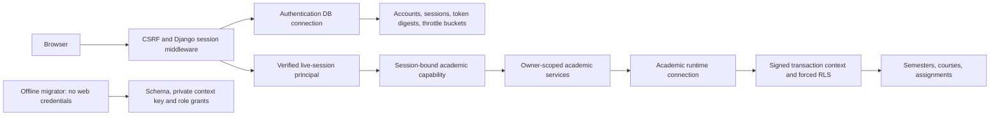

# Milestone 3 — student authentication and account security

This adds local Django registration, email verification, login/logout, password
recovery/change and a minimal authenticated academic demonstration. It preserves
Django 5.2 LTS, PostgreSQL 17, signed academic owner context, forced RLS and the
CLI/Streamlit JSON applications. It does not deploy a public service or build the
Milestone 4 dashboard. Production settings remain disabled.

## Authentication and database authorization are different boundaries



The web process uses TWO non-owner LOGIN roles against the same PostgreSQL
application database. It has no migration/DBA connection or credentials:

| Connection/role | Allowed | Not allowed |
| --- | --- | --- |
| `default`, academic runtime | Existing academic DML, column-limited updates and signed-context verifier | Account/session/token/throttle reads; private signing key; DDL, TRUNCATE, role membership/bypass |
| `auth`, authentication role | Account SELECT/INSERT; UPDATE only password, last_login, email_verified_at and updated_at. Token/throttle/session DML limited to needed columns | Academic records; private schemas/key/verifier; migration history; account deletion; changing account IDs, usernames, email or active status; DDL/TRUNCATE/bypass |
| Offline migrator | Schema ownership, migrations, role grant/key provisioning | Must NEVER serve web requests or be configured in the application process |

`AuthenticationRouter` sends account/session ORM reads and writes to `auth`.
Academic services keep their existing explicit runtime alias. Middleware verifies
both roles are restricted before serving a web request; an elevated/shared-role
configuration fails with a generic 503. Tests capture the migration connection
and verify that actual web operations issue zero queries through it.

The auth role necessarily handles sensitive account hashes and server sessions.
Compromise of that role can expose/hijack sessions or damage account data. It is
not a safe SQL console for students. All request input uses forms, ORM parameters
or bound SQL parameters. Restrict credentials and database access operationally.
Arbitrary trusted Python execution can read both application credentials and
signing secrets; this milestone does not defend against that compromise.

## Verified principals and capabilities

A constructed Student, a persisted Student, a UUID, or `is_authenticated=True`
is NOT sufficient input to `identity_for_verified_student` in application settings.
The previous 2B fixture-only adapter is explicitly enabled only in its non-web
`security_test` settings. Web profiles disable it, and middleware refuses to serve
requests if that fixture switch is enabled. All 46 historical tests remain intact.

`principal_for_request(request)` independently reloads the server-side Django
session, validates its signature/expiry and configured backend, loads the current
account through the auth connection, compares the session's password-derived
Django authentication hash, and checks active + verified email status. It also
matches the session owner to the middleware user. It returns an internal signed
`VerifiedSessionPrincipal`; it never reads an owner ID from forms/query strings.

`identity_for_verified_student` validates that principal and mints a five-minute
capability bound to its UUID, session key and current password auth hash. Every
service call revalidates that binding. Logout, expiry, password replacement,
deactivation or verification revocation invalidates previously minted web
capabilities. These objects stay inside the server and must never be serialized
into client responses. This is hardening of the existing internal authorization
capability, NOT a custom password hash or replacement cookie/session protocol.

The existing PostgreSQL HMAC remains bound to the transaction ID and backend PID.
Runtime cannot forge another student by setting a UUID GUC, read the signing key,
or reuse a signature on another transaction/backend. The 2B RLS policies and
composite owner foreign keys are unchanged. Authentication checks and the short
academic transaction use separate connections; there is no distributed transaction.
An already-authorized in-flight operation can finish while another request logs
out/changes credentials. Subsequent service calls/requests revalidate credentials.

## Account policy and schema

Account migration `0002_accounttoken_auththrottle_student_email_and_more` adds:

- Student.email: unique, normalized lowercase ASCII email for registration and
  recovery. It is nullable for existing internal accounts. PostgreSQL enforces
  normalized storage and case-insensitive uniqueness. Existing accounts are not
  assigned invented emails or silently verified.
- Student.email_verified_at: nullable; login requires a non-null value and active
  status. Student UUIDs, existing usernames and academic relationships are unchanged.
- AccountToken: UUID selector, SHA-256 digest of a random 32-byte secret, purpose,
  expiry/consumption timestamps, original email and password-derived credential
  stamp. The database never stores plaintext token secrets or passwords.
- AuthThrottle: shared HMAC-keyed fixed-window attempt counters and expiry, with
  no plaintext IP/identifier stored. Counters increment atomically in PostgreSQL.
- Django's standard `django_session` table, enabled by authentication profiles.

New usernames use 3–30 ASCII letters/digits/underscore/dot/hyphen, starting with
an alphanumeric character, and are case-sensitive. Existing internal username
storage remains compatible (150 characters). Email is not a login identifier;
registration lowercases it and requires it to be unique. Internationalized email
addresses, social login and email/username change features are not implemented.

Passwords use Django's supported default PBKDF2 hasher and password validators:
12–128 characters, common/numeric/similar passwords rejected, confirmation required.
No custom password hash is introduced. Fast MD5 hashing exists only in dedicated
test settings; an explicit test also executes the real PBKDF2 registration path.

## Flows and routes

All state-changing account/academic actions require POST and Django CSRF checks.

| Route | Behavior |
| --- | --- |
| `/accounts/register/` | Validates form/passwords and creates an unverified account. Duplicate username/email gets the same confirmation as successful submission. Client verification/owner flags are ignored. |
| `/accounts/verify/request/` | Generic resend response. Active unverified accounts receive a fresh link; the previous link is revoked. |
| `/accounts/verify/<selector>/<secret>/` | GET shows confirmation without consuming. CSRF-protected POST verifies the email once. Link expires after 24 hours. |
| `/accounts/verify/code/` | Public site only (`UCC_SIGNUP_CODE`; 404 elsewhere). One form, two buttons: **Confirm email** checks the newest 6-digit code (1 minute, 5 tries, HMAC-stored) and verifies the account once; **Send me a new code** retires the old code and emails another. Replies are the same for every email. Rate-limited (`verify-code`, `resend`). On the public site, register and resend open this page instead of sending a link. See docs/LAUNCH.md "Open sign-up". |
| `/accounts/login/` | Django AuthenticationForm/backend checks credentials and active/verified status; failures are generic. Django rotates the pre-login session key. Redirect always goes to academic demonstration, never a request-controlled URL. |
| `/accounts/logout/` | POST only; Django flushes the session. GET cannot log out. |
| `/accounts/reset/` | Generic request response. Only active VERIFIED accounts with usable passwords receive recovery links. Unverified accounts must use verification/resend first. |
| `/accounts/reset/<selector>/<secret>/` | One-hour, one-use reset link and Django SetPasswordForm. Replacement invalidates existing sessions and outstanding credential-bound links. |
| `/accounts/password/change/` | Authenticated Django PasswordChangeForm checks the current password, replaces it and logs out the current session. Other sessions are rejected on next use. |
| `/accounts/academic/` | Minimal owner-scoped list of semesters/courses/assignments, grade-edit and assignment-delete demonstration controls. Not a full dashboard. |
| `/accounts/academic/courses/<uuid>/` | GET returns one own course; POST edits only actual_grade with the expected record_version. Foreign/missing records both return the same 404. |
| `/accounts/academic/assignments/<uuid>/delete/` | POST deletes only an own assignment with its expected version. |

Academic form submissions redirect back to the demonstration when requesting HTML;
programmatic requests receive small JSON responses. Unknown/server-owned academic
fields are rejected. Stale writes are 409, invalid input 400, unknown/foreign rows
404 and database failures a generic 503. Signing material and raw SQL never appear
in those responses. Templates escape stored text. No academic creation/dashboard
workflow is built here; existing services support synthetic fixture creation.

Verification and reset issuance lock the account, revoke earlier tokens of the
same purpose and store a new digest. Redemption locks account THEN token in the
same order, checks expiry/purpose/email/password stamp, and consumes the token
atomically with the account/password update. Two concurrent reset attempts have
exactly one winner; failures roll back both password and consumption. Email is sent
only after commit. Delivery errors retain the generic response and log no account,
provider detail or link; users can retry through resend/reset.

Generic email responses do not promise constant timing; local synchronous delivery
can differ from unknown-account handling. Review queueing/timing before public use.

Email links use a fixed trusted `AUTH_LINK_ORIGIN`, not request Host/forwarding
headers. No email-change route exists, and the auth role cannot update email.
An offline administrative email change must clear verification, revoke tokens and
sessions, then arrange fresh verification; there is no public shortcut around that.

**Password-hash upgrades (F04b fix):** `StudentBackend` verifies passwords
without Django's auto-saving upgrade setter. Previously, a login that loaded the
account row before a concurrent reset or change could save an upgraded hash of
the OLD password over the new one. Upgrades are now a compare-and-swap on the
exact hash that was verified (`UPDATE ... WHERE id = %s AND password = <verified>`).
Before creating a session, `login` re-reads the account under the same Student
row lock that reset and change use. It proceeds only if the stored hash is the one
verified, or still accepts the submitted password (a concurrent same-password
upgrade). Otherwise it returns the generic invalid-login form. No new grants.
Regression tests: `auth_tests/test_password_upgrade_race.py`.

## Sessions, cookies and request boundaries

Django's DB session engine stores signed, NOT encrypted, session data through the
auth role. Browser session cookies are HttpOnly and SameSite=Lax. The server-side
session expires after 30 minutes; ordinary page reads do not refresh its lifetime.
Login sets a browser-session cookie (no persistent Max-Age); cookie lifetime ends
on browser close as implemented by the browser, and server expiry still applies.
There is no remember-me option. Old sessions fail their password-derived auth hash
after resets/changes. Expired rows can remain until cleanup but do not authenticate.

`auth_secure` defaults to Secure session/CSRF cookies. Local-only
`auth_development` turns Secure off solely for HTTP on 127.0.0.1. CSRF cookies are
HttpOnly/SameSite=Lax too; forms include hidden Django CSRF tokens. Pages are
no-store, frame protection is enabled, and Referrer-Policy is same-origin (cross-origin referrers are suppressed while Django form origin/referer checks keep working). No
third-party resources are included on token pages. Before production, redact token
URLs from access logs and use HTTPS throughout. Stolen valid sessions/mail links
remain bearer credentials; do not log, screenshot or commit them.

Session/auth updates finish on the auth connection. Academic operations create
their own transaction-scoped signed context and clear it at commit/rollback. Do not
use ATOMIC_REQUESTS or wrap services in a separate unknown atomic block. Existing
student_transaction, optimistic locking and RLS rules still apply. No external
pool is deployed or integration/load-tested; real connection reuse and concurrent
students are tested on PostgreSQL.

## Bounded brute-force protection

The database-backed fixed window is keyed by a normalized source address from
`accounts.throttling.client_address`:

- The socket `REMOTE_ADDR` is the trusted default. `X-Forwarded-For` is ignored.
- An IPv6 source is grouped by its /64 network, so rotating addresses inside one
  allocation shares one bucket. Side effect: devices that share one /64 (one home or
  campus network) share the limit, just as IPv4 users behind one NAT do. An
  IPv4-mapped IPv6 address uses its IPv4 bucket.
- A missing or malformed address uses one shared `unknown` bucket.
- `UCC_TRUSTED_PROXIES` (default `()`, empty in every profile) is opt-in. Only when
  the socket peer is inside a listed network is `X-Forwarded-For` read, from the
  right, skipping listed proxies. The first untrusted address is the client. Entries
  further left (client-supplied, forgeable) are ignored. A missing or malformed
  header keeps the proxy address. Configuring `0.0.0.0/0`, `::/0`, a single string
  or an invalid network fails closed with `ImproperlyConfigured`. Do not set this
  until a deployment topology has been reviewed.

Successful and failed attempts both count. New browser sessions do not bypass it.
Requests over the limit return generic 429 with Retry-After. The default limits
per source are:

- Login: 10 submissions / 15 minutes.
- Registration, reset and verification resend: 5 submissions / hour per action.
- Verification and reset confirmation: 20 requests / hour per action.
- Authenticated password change: 5 submissions / 15 minutes.

Counts saturate at limit+1; expiry starts a new window atomically. This is a clearly
bounded local mechanism, NOT complete distributed-abuse protection. Shared NAT
and shared-/64 users share limits. Attackers who rotate across distinct IPv4
addresses or /64 networks can evade IP limits: there is no per-account limit yet
(S0-02, proposal in `docs/security/S1_PROPOSALS.md`). Proxy settings need
production review. Do not blindly trust X-Forwarded-For. Run cleanup
regularly to bound expired bucket/token/session retention; active source count is
not globally capped. Future public hosting needs perimeter limits/monitoring and
possibly account-target controls without introducing easy account-lockout abuse.

## Local setup: offline migration, then a restricted web process

Use Python 3.12 and the existing hashed runtime locks:

```sh
python -m pip install --require-hashes -r requirements-lock.txt -r requirements-django-lock.txt
```

In a private PostgreSQL administrator console, create a NEW auth role in addition
to the separate migrator/runtime roles documented in DATABASE_SECURITY.md:

```sql
CREATE ROLE ucc_auth LOGIN NOINHERIT NOSUPERUSER NOBYPASSRLS NOCREATEDB NOCREATEROLE;
\password ucc_auth
```

Set passwords only through private prompts/secret environment settings. Never put
password literals or populated keys in Git/shell history. `.env.example` lists
names only and is not auto-loaded. With OFFLINE migrator PGUSER/PGPASSWORD and
UCC_RUNTIME_ROLE, UCC_AUTH_ROLE and UCC_CONTEXT_SIGNING_KEY configured privately:

```sh
python server/manage.py migrate --settings=config.settings.auth_migration --noinput
python server/manage.py configure_auth_role --settings=config.settings.auth_migration
python server/manage.py configure_runtime --settings=config.settings.auth_migration
python server/manage.py makemigrations --check --dry-run --settings=config.settings.auth_migration
```

These commands provision separate auth grants immediately after migration, then the
DB key/runtime grants. Complete and verify both before operating the web service.
No application role owns objects or has role membership. Do not add ad hoc grants.
Re-run the offline provisioning commands after adding reviewed tables/columns.

**S0-02A (dormant):** migration `accounts.0003_trusted_device_foundation` adds
all three support tables: `accounts_trusteddevice`, `accounts_loginlimit` and
`accounts_devicegeneration`. The auth role receives SELECT, INSERT and DELETE
plus column-limited UPDATE on the first two tables; on
`accounts_devicegeneration` it receives SELECT, INSERT and UPDATE only on
`generation`, without DELETE/TRUNCATE or identity-column UPDATE. Runtime must
have no access to any of the three. Login does not use these tables or issue
device cookies, and no new login restrictions are activated. The design is in
`docs/security/S1_PROPOSALS.md` section A.

**Operational sequence for a separately authorized deployment:**

1. Before touching a persistent database, inspect its applied migration history
   and the exact revision of any previously applied `accounts.0003`. An older
   applied revision is not upgraded just by fetching this file. Require a reviewed
   forward-migration/recovery plan if the history differs. Never fake migrations
   or reverse a persistent migration without an approved recovery plan.
2. Plan a maintenance window before deployment and keep the service out of normal
   operation during migration and provisioning. This documentation authorizes no
   deployment or database change.
3. Apply the reviewed migration 0003 using the authorized offline migration role
   and `auth_migration` process above. Never run it with runtime/auth credentials
   or give the web process migration credentials.
4. Run `configure_auth_role` **immediately afterward**, using that documented
   offline provisioning process, then complete `configure_runtime` as shown above.
   When support tables exist without the required grants, requests intentionally
   fail closed with generic **503** responses; do not return the service to normal
   operation during this gap.
5. Before returning the service to operation, verify both authentication and
   runtime grants using their actual restricted LOGINs and the documented role
   boundary checks. Confirm the exact auth support-table/column allowlist, no
   runtime support-table access, no unexpected memberships/ownership/MAINTAIN or
   grant options, and enabled/forced academic RLS. Stop and repair through the
   reviewed provisioning process if a check fails; do not bypass the guards.

Start a NEW process environment containing ONLY application credentials:

- PGDATABASE/PGHOST/PGPORT and PGUSER/PGPASSWORD for the restricted ACADEMIC runtime.
- UCC_AUTH_ROLE/UCC_AUTH_PASSWORD for the distinct authentication role.
- UCC_CONTEXT_SIGNING_KEY (same private database key) and DJANGO_SECRET_KEY.
- No DBA/migrator password, role-switch permission or privileged DB alias.

```sh
python tools/serve_local_website.py --settings config.settings.auth_development
```

`manage.py runserver` cannot be used with these application credentials: it reads the
`django_migrations` table, which the restricted roles are deliberately denied. The
starter serves the same application on 127.0.0.1 only (see STUDENT_WEBSITE.md).

Open http://127.0.0.1:8000/accounts/register/. Development uses the console mail
backend; the local private terminal shows verification/recovery email links. Do
not persist or share those terminal/email outputs. Automated tests use only an
in-memory email backend and example.invalid identities, and send no real email.
The fixed local link origin is http://127.0.0.1:8000; changing it needs a trusted
settings edit, not a request parameter. No paid SMTP service is configured.

Run maintenance with the restricted authentication application settings:

```sh
python server/manage.py clear_auth_artifacts --settings=config.settings.auth_development
```

It removes expired sessions/throttle buckets and tokens expired more than seven
days ago. Schedule regular cleanup before any long-lived environment. This is not
an audit/retention policy or account-deletion feature.

## Tests and future operational requirements

Run each historical suite separately as documented in DATABASE_SECURITY.md. The
original destructive migration tests restore older schemas, so never mix them
with live/application data or the new suites in one shared persistent database.

For the new auth suite, use a disposable cluster with a dedicated non-superuser
test migrator (CREATEDB only for tests), runtime and auth LOGIN roles. The test-only
role helper accepts UCC_AUTH_ROLE/UCC_AUTH_PASSWORD as well as its existing role
variables. A DBA runs that helper once on a NEW disposable cluster. Then set PG*
to the test migrator/scratch DB, PGTESTDATABASE to a different disposable name,
and all three roles' private test variables/key as needed:

```sh
python server/manage.py test auth_tests --settings=config.settings.auth_test -v 2
python tools/check_repository_safety.py
python -m pip check
python -m pip_audit --strict --require-hashes --disable-pip --progress-spinner off -r requirements-lock.txt -r requirements-django-lock.txt
```

The test runner migrates with the test-only default connection, grants both narrow
roles, and mirrors the test DB through distinct runtime/auth LOGIN credentials.
Tests verify web requests never query that default/migration connection. CI runs
all suites separately and masks generated ephemeral test secrets. No runtime
dependency change was required. SQLite does not verify these PostgreSQL guarantees.

Before public use: independent security review, production HTTPS/cookie/proxy
configuration, secret rotation and access policy, robust email delivery, monitoring,
anti-abuse controls, backup/restore, account retention/recovery policy and external
pool/load testing are still required. Transactional email needs a trusted sender,
SPF/DKIM/DMARC, TLS/authenticated delivery, retries/queues, bounce handling and redacted
logs; none is purchased or configured here. Do not use the console backend publicly.
Auth role/DB compromise, stolen sessions/email links, credential stuffing from many
IPs, endpoint compromise and arbitrary trusted Python/DBA access remain material
risks. No MFA/social login/payments/email-change/dashboard work is included.

## Milestone 4A website

For the full student pages, use the [student website profiles and guide](STUDENT_WEBSITE.md).
They inherit this authentication/role boundary and do not broaden runtime privileges.
`auth_development` remains the historical minimal demonstration profile;
`web_development` provides the new local student website and shared presentation.


## B1a: protected application connection timeouts

The protected `auth_development`, `auth_secure`, `auth_test`, `web_development`,
`web_secure` and `web_test` profiles apply connection options through
`accounts.dbsafety.apply_db_safety`. Only the `auth` and academic application
aliases are configured. The separate test migrator and the `auth_migration`,
foundation, security and offline runtime profiles do not opt in. App name and
label remain `accounts`. No migration or role/grant change is required.

| Environment variable | Default | Accepted range |
| --- | --- | --- |
| `UCC_DB_CONNECT_TIMEOUT_SECONDS` | 5 seconds | 2–30 |
| `UCC_DB_LOCK_TIMEOUT_MS` | 3000 ms | At least 1000, strictly below both statement limits |
| `UCC_AUTH_STATEMENT_TIMEOUT_MS` | 5000 ms | Above lock limit, at most 60000 |
| `UCC_RUNTIME_STATEMENT_TIMEOUT_MS` | 10000 ms | Above lock limit, at most 60000 |
| `UCC_DB_IDLE_TIMEOUT_MS` | 15000 ms | 5000–300000 |

Inputs must be exact integers or ASCII digits-only environment strings. Boolean,
decimal, unit-bearing, signed, whitespace-bearing, zero and out-of-range values
are rejected without rounding. These are owner-authorized synthetic tuning
candidates, not accepted production timeout policy.

The helper owns the fixed ordered `OPTIONS["options"]` string on these aliases.
Absent/empty or identical options are accepted; conflicting options and presence
of `PGOPTIONS` (even empty) are rejected. An existing conflicting connect timeout
is rejected too. TLS (`sslmode`, `sslrootcert`) and unrelated settings are retained.
Direct connections built from an alias's parameters inherit these options;
arbitrary external clients or later configuration changes are not covered.

Only the helper sets `UCC_DB_SAFETY_CONFIGURED`. Flag-gated `accounts.E101` checks
that configured options still match. Run `check --deploy` with
`config.settings.web_secure` before a future release; unrelated deployment
warnings may also appear. WSGI does not run system checks automatically.

Owner-approved cleanup option 1 keeps `clear_auth_artifacts` under the protected
auth timers. A failed statement rolls back; the command has separate delete calls,
so previously completed DELETEs are not promised to roll back. Command failures
must be reported and investigated, never treated as successful cleanup.

These timers bound specific connection/lock/statement/idle operations, not the
whole request, DNS/multiple-address connection attempts or COMMIT. Idle expiry
terminates a connection. Existing autocommit writes can survive a later failure;
an uncertain acknowledgement can follow a completed COMMIT. B1a adds no retry,
error classification, logging sink, session policy, device activation or status
conversion. Existing 400/500/503 paths remain as implemented. B1b–B1d and Stage C
remain separately authorized and reviewed work.

Options affect newly opened connections. A future approved release or rollback
must recycle affected connections/workers, verify fresh/reused `SHOW` values and
preserve TLS/roles. Reverting B1a does not undo committed writes, change operator
DB defaults or authorize reversing migrations. See
[B1a implementation evidence](security/B1A_IMPLEMENTATION_EVIDENCE.md) for tests
and remaining limitations.

## B1b: fixed-label diagnostics in protected profiles

The B1b implementation installs logging privacy through `auth_common.configure`
for auth/web development, secure and test profiles. Migration, foundation,
restricted-role historical and offline runtime profiles remain excluded. Start a
fresh process per profile: settings overrides do not undo process-global hooks.

The root sink emits only fixed labels (logger, level, method, route, typed event,
category, known SQLSTATE/exception label) and bounded numeric status. It does not
format messages, args, SQL, traceback text, credentials or request metadata. The
sink uses one write per line and a shared per-thread re-entry guard. Ordinary
preparation failures have a constant fallback; failed/short stream writes are not
retried. Normal-handler process controls propagate. All three uncaught hooks
contain **every BaseException from their own machinery**, preserving original
process/thread exit behavior and avoiding CPython's raw exception fallback.
`sys.unraisablehook` is included. No traceback/object reference is retained.

`logging.lastResort` and the process/thread/unraisable hooks are installed during
protected settings configuration, before app startup. `AccountsConfig.ready`
validates the final graph and hook identities. No runtime graph middleware, error
classifier, new status mapping or event emission is introduced. Typed FailureEvent
has only the minimal FAILURE/UNCLASSIFIED values; B1c is still separate work.

| Check | Activation / purpose |
| --- | --- |
| E101 | Existing B1a opt-in; unchanged database-option validation |
| E102 | Logging enforce mode; ADMINS must be empty |
| E103 | Logging enforce mode; safe root/lastResort, handler/filter/formatter graph and all three hook identities |
| E104 | Ordinary check when UCC_SECURE_PROFILE is True; both DEBUG flags must be False |
| E105 | Ordinary secure-profile check; configured email backend must be the exact identity of an approved class |

E104/E105 are **not deploy-only** and are registered independently of logging
enforcement. Both `check` and `check --deploy` under `web_secure` intentionally
still fail E105 (console email). **Launch step C (owner-approved, reviewed) approved
exactly one backend:** `accounts.email_backend.ReviewedSMTPBackend` (fixed providers,
port 587 STARTTLS with verified certificates and TLS 1.2+, 10 s timeout, one
recipient per message, configured sender only). Only the public profiles
(`web_production`, `web_vercel`) select it; see docs/LAUNCH.md step C.
Console/file, subclasses, wrappers, unknown/unimportable classes and selecting
SMTP/locmem do not bypass this. Do not populate the allow-list, skip the check or
configure another provider without its separate review/authorization. Development/test
email behavior is unchanged, including console output in development.

Checks execute only when the command/framework requests them; WSGI setup does not
automatically run system checks. Future secure preflight must enforce E101–E105
under its exact profile. Use auth_migration for authorized offline provisioning;
clear_auth_artifacts under auth_development still uses protected timers/logging.
No role or schema change is required by B1b.

The graph guard is a startup snapshot. Application source audits prohibit later
handler/filter/formatter/level/propagation/hook reconfiguration; arbitrary Python
or operator/dependency changes can still bypass it. Historical assertLogs fixtures
are a controlled test-only exception. Do not hot-reconfigure the serving graph.

Privacy boundaries remain: pre-settings/bootstrap, direct CommandError/command
prints, socketserver.handle_error, wsgiref log_exception, unittest failure output,
native/fatal errors, non-integer SystemExit text, raw stdout/stderr, development
email, Gunicorn/proxy logs and external retention/export. `--traceback` re-raises
that reach an installed hook are sanitized; directly printed errors are not.
`test --debug-sql` is disposable synthetic data only. No staging or real-data
readiness is implied; B1c/B1d and operational controls remain incomplete.

Rollback: stop serving, revert the B1b modules/wiring and restart processes to
restore their original logging/hooks. No migration reversal, grants, password or
session rewrites are needed. Rollback restores less-private diagnostics; it is not
permission to serve real data. Blocked/partial stream writes and diagnostic loss
remain accepted development limitations. See [B1b evidence](security/B1B_IMPLEMENTATION_EVIDENCE.md).
