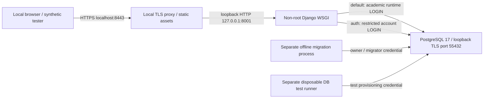

# Stage C — local staging architecture preparation

**Design only; not a runnable harness.** Prepared 12 November 2026 (Africa/Lagos), baseline master `8295fbd`. This is the Stage C preparation authorized by the [owner's execution plan](REMAINING_ENGINEERING_LAUNCH_PLAN.md), alongside [Stage A readiness](SECURITY_INTEGRATION_READINESS.md). No settings, dependencies, containers, infrastructure or authentication behavior are changed. The architecture below is proposed for a later explicitly scoped implementation.

Reference planning: [PR #28 roadmap](https://github.com/jordandavid1812-creator/university-command-center/pull/28) and [PR #34 backlog/provider/readiness plans](https://github.com/jordandavid1812-creator/university-command-center/pull/34). Those documentation PRs remain unmerged. This document specializes the local portion; it does not authorize Stages D–G or imply a provider has passed qualification.

## Recommended smallest first lab

Run an approved WSGI service and local TLS proxy as non-root processes on the development host, with PostgreSQL 17 in one disposable local container. Expose every listener only on loopback. This avoids app-container networking/proxy trust complexity in the first lab and buys no cloud service. A future app image can reuse the same release/settings contract after separate approval; no Kubernetes, microservices, cache or queue is needed for Stage C.

Proposed tools: Gunicorn for synchronous Django WSGI and Caddy for the local HTTPS/static proxy. These are **unapproved candidates**, not installed dependencies or final procurement choices. Any new Python package requires reviewed hashed-lock updates and owner approval. An existing suitable local proxy may be selected instead; preserve the tests and trust boundaries below. PostgreSQL stays on patched major 17; capture exact minor, image digest and client versions when implemented, rather than treating floating `postgres:17` as an immutable build.

Ports are proposals, subject to conflict checks. Use a dedicated lab project/container/database/volume name; never reuse an unknown existing database or the personal JSON directory. A localhost lab is not a VPN, provider-private environment or public-deployment design. Loopback does not isolate the service from other processes/users on the same host; use a trusted developer host and scoped file/process permissions.

| Component | Proposed endpoint / boundary | Acceptance property |
| --- | --- | --- |
| Browser entry/proxy | `https://localhost:8443`, bind `127.0.0.1` explicitly; IPv6 only via separately explicit `::1` listener | No wildcard/public listener, internet gateway, tunnel or shared preview URL |
| WSGI | `127.0.0.1:8001`; proxy is sole intended browser entry | No host/public exposure; no Django runserver for production-style proof; no migration at worker startup |
| PostgreSQL | Container 5432 published only as `127.0.0.1:55432`; SCRAM, local TLS | No `trust` authentication outside deliberately isolated CI; no public 5432; separate actual LOGINs |
| Static assets | Collected immutable directory served by proxy, read-only to proxy; explicit path, no directory index | App/DB secrets, source files, `.git`, local keys and student JSON are outside the served root |
| Lab certificates | Dedicated local CA; leaf SANs match actual localhost endpoints | Per-process/browser trust where possible; no automatic system CA installation or verification bypass |
| Mail | No external transport; future Stage D private sink is a dependency placeholder | Stage C must not send mail or log real recovery links. Use existing in-memory email only in tests; any interactive flow needing a sink waits for Stage D authorization |

DB bootstrap and app/test invocations must stay separate processes. No Docker socket is mounted into web services. No app process uses the DBA/migrator role. Existing CLI/Streamlit entry points and JSON paths remain independent and are neither mounted nor migrated into this lab.

## Proposed file/change inventory for later review

These paths are **not created by this task**; final names can follow the repository's conventions.

| Future artifact | Purpose and review boundary |
| --- | --- |
| `ops/local/README.md` | Prerequisites, generated-secret locations, immutable release/image manifest, explicit start/check/stop/teardown and troubleshooting with no secret-bearing command lines |
| `ops/local/compose.yaml` | PostgreSQL 17 service only initially; explicit loopback port, scoped named volume, health check and least necessary mounts; no committed secrets |
| `ops/local/Caddyfile` or approved equivalent | Local HTTPS, exact host, sanitized access/error logging, static root, bounded request forwarding/timeouts, stripped/rebuilt forwarding headers |
| `server/config/settings/local_staging.py` | Dedicated fail-closed local profile based on reviewed web/runtime components; never silently repurpose disabled production.py or development defaults |
| Reviewed Python dependency lock update | Approved WSGI package/version with hashes and vulnerability audit; no authentication/recovery dependency added through this ticket |
| Focused local harness/setup checks | Verify target is disposable, separate role environments, settings module, listener boundaries, readiness and cleanup. No script defaults to destroying a volume |

Secret/certificate files, database volumes, generated static files, logs and manifests with sensitive values live in a private ignored lab directory, never in committed YAML, GitHub issues, terminal output or screenshots. Do not copy an entire developer environment into a web service. Any reusable examples contain names/placeholders only.

## Credential and database boundaries

| Process | Necessary access | Explicitly absent |
| --- | --- | --- |
| WSGI | Runtime PGUSER/password for default; auth role/password for accounts/sessions; DJANGO_SECRET_KEY; UCC_CONTEXT_SIGNING_KEY; DB CA root | Migration/DBA/test-role/backup credentials, schema ownership, CREATEDB, role memberships, BYPASSRLS |
| Offline migrate/provision | Dedicated schema owner/migrator plus provisioning inputs needed by existing commands; Django/context secrets; scoped DB connection | No web serving/request handling; never inherit this environment into WSGI |
| Disposable test runner | Separate test provisioning role as existing runners require, actual runtime/auth credentials, generated test keys and distinct scratch/test DB names | No persistent/student database; no test fixture-principal switch in web profile |
| PostgreSQL service/bootstrap | Dedicated lab initialization credentials, server TLS leaf/private key and volume | No personal JSON, app source or operator cloud keys mounted |
| TLS/static proxy | Its own TLS leaf/private key and collected static root; expected upstream address | No DB credentials, Django/context keys, PostgreSQL key/volume or repo root |

Preserve existing migrations and exact provisioning through `config.settings.auth_migration`; run `migrate`, `configure_runtime` and `configure_auth_role` as the offline job. Then discard that process environment and construct a fresh web environment. Merely adding a second database alias does not remove a privileged default URL. Verify effective current_user/role flags and zero migrator queries during browser requests.

Keep accounts/sessions through `AuthenticationRouter` on auth, academic services through runtime and signed context, all three academic tables ENABLE + FORCE RLS, private pgcrypto in ucc_crypto and the private verifier/key in ucc_security. Signed context remains transaction/backend-bound; no unsigned owner-ID GUC, client owner ID or cached identity shortcut. Start with direct PostgreSQL connections and current CONN_MAX_AGE=0; no PgBouncer or persistent pooling until independently qualified. Bound connection usage for both aliases and test/provisioning jobs.

Inventory migration history before any future startup. A previously applied older accounts.0003 requires a reviewed forward plan; local throwaway rebuilds cannot be presented as a persistent-data migration strategy. Never auto-reset an unknown volume, fake migrations or weaken role checks.

## Settings and TLS contract

Observed repository gaps are concrete: base.py defaults PGSSLMODE to `prefer`; config.wsgi defaults to `config.settings.development`; auth_common defaults AUTH_LINK_ORIGIN to HTTP localhost and uses console mail; web_secure is a secure-cookie baseline, not a production profile; config.settings.production deliberately refuses startup. Stage C must not relabel these as deployment-ready.

The proposed local profile/startup must require:

- An explicit local-staging settings module and release manifest; startup fails if the expected module/required keys/roles are missing. No fallback to development or offline migration settings.
- DEBUG false, exact allowed hostnames, `CSRF_TRUSTED_ORIGINS` containing only the chosen local HTTPS origin, `AUTH_LINK_ORIGIN=https://localhost:8443`, Secure/HttpOnly/SameSite session protections and no fixture-only internal principal adapter.
- DB `sslmode=verify-full` and a trusted lab CA root on **both aliases**, certificate SAN matching the connection hostname. Verify the actual connection parameters and negotiated TLS, not only the environment label. No prefer/require-only downgrade, skipped hostname checking or `--insecure` in acceptance checks.
- A proxy configuration that removes client-supplied forwarding headers and constructs trusted scheme/source information. Any SECURE_PROXY_SSL_HEADER or trusted-proxy setting is enabled only for this separately reviewed loopback topology; the application must not trust arbitrary forwarded IPs. Test spoofing from both entry paths and document that trusted local processes are inside this lab boundary.
- Collection/static delivery with DEBUG false and no accidental serving of source, certificates or private directories. Explicit connection/read/request limits; do not invent automatic retries of security finalization or add long request-wide database transactions.
- Minimal sanitized logs: no body/form/password/cookie/header/query-string/reset-path-token/SQL-bind data, raw usernames or IPs. Stage D owns the full monitoring/email design; Stage C must not leak secrets while waiting for it. Console auth-email output is unsuitable for shared logs.

Use a local CA only for this lab. Trust it explicitly in test clients/a dedicated browser profile; retain secure file permissions and remove that profile/trust on teardown. Do not change host trust stores or open public ingress just to issue a certificate. Remote provider TLS/private networking remains an unverified later Stage F requirement.

## Future execution sequence and acceptance cases

No commands below have been executed as a new harness. First approve the implementation scope, dependencies and accepted combined security SHA; Stage A readiness alone does not approve running a vulnerable master as an accepted staging build.

| Stage C step | Future acceptance evidence | Failure / stop condition |
| --- | --- | --- |
| C16 install/harness | Clean isolated setup from locked Python 3.12 deps, exact PostgreSQL 17 image/minor, generated ephemeral secrets; inspect actual listeners and SCRAM/TLS; deterministic restart | Unknown existing volume, unpinned release, public listener, weak auth/TLS or committed secret |
| C17 role provisioning | Fresh migrations/grants as offline owner, then actual restricted runtime/auth LOGINs; role guards, PG17 MAINTAIN/missing-grant/identity-column drift negatives and no default owner URL | Missing/extra grants, app ownership/membership/bypass, online migration credential |
| C18 settings/startup | Explicit staging module, DEBUG false, narrow host/origin, fixture adapter off, missing-key/elevated-role/unsafe-profile startup failures | Development fallback, production disabled guard removed, auth-link origin/host poisoning accepted |
| C19 WSGI/static | Reviewed non-root WSGI startup/graceful stop, immutable source/static manifest, assets served with DEBUG false, no source/secret static access | runserver used as hosting evidence, world-readable keys or source traversal |
| C20 TLS/proxy | Browser valid HTTPS; wrong CA/hostname/expired certificate denied; Secure cookies, CSRF/host/scheme/source-spoof tests; direct WSGI confined to loopback | Public tunnel, insecure TLS bypass, spoofed forwarding headers trusted, redirect loop |
| C21 database/session boundary | All historical suites on real PG17 in separate DBs; two-student direct SQL, unsigned/stale-context denial, reuse/rollback, composite owner FKs, session invalidation and independent PR29/26 probes | Unexpected skip/test disappearance, foreign access, context leakage, stale auth accepted |
| C22 migration/release interruption | Fresh install, prior accepted schema upgrade where meaningful, missing-grant interval denies requests; failed/interrupted step and safe stop/retry/compatible rollback on disposable data | Tests require disabled RLS, fake migration, lost security state hidden by reset or web-credential escalation |
| C teardown | Graceful process stop, credentials/CA/lab artifacts removed under scoped ownership, no listeners; explicit opt-in deletion of only known synthetic volumes; clean second install | Unidentified resources deleted, shared/personal data touched, dangling secret or listener |

Run the legacy, foundation, restricted-role isolation, authentication and website suites separately as in repository CI. Foundation migration-reversal tests must not share the active app database. Report actual counts and versions; do not claim PostgreSQL behavior from SQLite. Carry forward tests for exact-case/UUID device binding, generation races, NULL rotation constraints, CAS/waiting-row credential changes and the post-transaction session persistence gap. Keep device primitives dormant; no trusted-cookie response headers or active account restrictions.

For interrupted releases define states: stopped → fresh schema → grants/key provisioned → role/security smoke passed → WSGI ready. A partial schema/grant failure remains stopped/unavailable; no elevated-runtime fallback. Roll back code only when compatible with installed schema; destructive migration reversal is limited to disposable synthetic tests. Full encrypted backup/restoration and operational recovery are Stage D work, not implemented or certified by C22; require their separate authorization before persistent/provider operation.

## Decisions and boundaries before implementation

Owner must approve a small concrete Stage C slice (recommended C16/C17 first), WSGI/proxy dependencies, exact accepted release, lab operator/host, loopback ports, local CA handling and secret locations. Architecture preparation can finish before security merges; accepted staging execution must use the subsequently approved security baseline. No purchase or provider selection is needed for local work.

A later slice can add C18–C22 after credential boundaries work. Do not use this sequence to begin S0-02B/C, build Stage D email/backup/monitoring infrastructure, invite reviewers, run Stage E performance studies or provision Stage F. Stage B design may proceed under its own assignment; implementation and feature activation still require explicit scope and independent recovery verification. This task delivers documents only and no prototype/harness/startup evidence.
