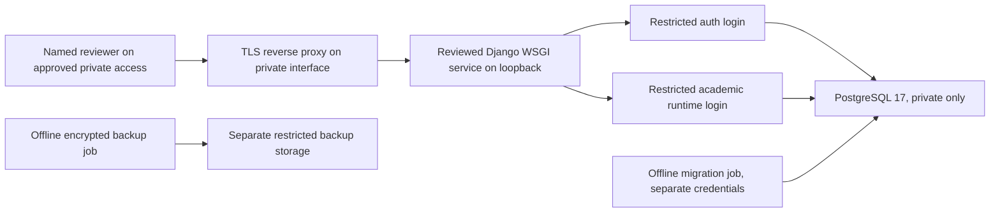

# Milestone 5A roadmap — affordable private staging and readiness evidence

**Planning only.** No service purchase, account creation, deployment, authentication
implementation, formula change or public/student pilot is authorized or performed.
This roadmap proposes later work for explicit owner approval. It does not approve
PR #26 or override Claude's responsibility for S0-02 implementation.

Prepared 11 November 2026 (Africa/Lagos), against master
`64fe8743fa1d3b1c2b1f9e833dca9e5e4fd982bb`. Draft security HEAD reviewed separately:
`61bf63232e4ca62296949c18040280cf5940c9af` (follow-up to initial review
`0e9e478fd4ed4249cbb81501a75ffda5e2744fd4`). Re-evaluate changed revisions before execution.

## Outcome and boundaries

Proposed 5A outcome: a **private, access-restricted, synthetic-data staging lab**,
repeatable operations and an evidence pack for later readiness decisions. Reviewers
may eventually include consenting students using invented records, but a public URL,
real academic import or open student onboarding is not a 5A acceptance shortcut.
Public production/pilot requires a separate decision after independent security work.

Existing Django templates and academic services remain the product; CLI/Streamlit
stay independent local JSON applications. No microservices, Kubernetes, frontend
rewrite, social login, billing, account-policy invention or private-record cache.

Today `config.settings.production` deliberately refuses startup; `web_secure` is a
future secure-cookie baseline, **not** a completed operational staging profile.
Gunicorn/another production WSGI server and any telemetry/mail dependencies need
explicit review and hashed-lock updates in future implementation PRs. Never expose
the local runserver or Streamlit shared-JSON app to testers on the internet.

## Recommended order and owners

All actions below are **future proposed work**, not commands to run now.

| Order | Work package | Lead / reviewer | Exit evidence / dependency |
| --- | --- | --- | --- |
| 0 | Approve scope, budget ceiling, data class, operators and acceptance targets | Project owner | Decision record; services still unpurchased |
| 1 | Resolve security foundation findings; agree deferred 02B/C policy contracts | Claude implements; independent reviewer verifies; owner approves | [Security documentation PR #27](https://github.com/jordandavid1812-creator/university-command-center/pull/27), PR #26 revision evidence and PG17 checks |
| 2 | Validate shortlisted provider/role/extension/private-access feasibility | Assigned platform engineer; security review | Disposable provider proof only after explicit account/spend approval; no weaker roles to fit a host |
| 3 | Prepare a reviewed private-staging settings/build/release plan | Product/platform engineer; independent review | Separate approved PRs for secure config, WSGI/static delivery, secret boundaries and gated CI; no implicit deployment |
| 4 | Provision the approved private lab and TLS/access boundary | Named operator, only on owner go-ahead | External unauthorized access denied before Django, no public origin bypass, PG not exposed |
| 5 | Install approved release through offline migrations/grants; rehearse rollback | Release operator; reviewer | Fresh PG17 install and upgrades, exact roles and artifact SHA recorded |
| 6 | Verify real test email, durable delivery/retry design and outage recovery | Claude for auth integration; platform operator for delivery | Controlled mailboxes, privacy approval, recovery under attack, bounce/outage evidence |
| 7 | Establish encrypted backups, successful restore and minimal monitoring | Operator + second reviewer | RPO/RTO drill, alerts delivered, retention/redaction checked |
| 8 | Run private usability, accessibility/mobile and bounded performance sessions | Product engineer + invited reviewers | Synthetic tasks, issue log, accessible recovery and measured baselines |
| 9 | Independent security testing and remediation/retest preparation | Independent tester; owner authorizes scope | Written rules of engagement, evidence pack, ranked unresolved findings |
| 10 | 5A acceptance review and separate production-readiness decision | Project owner + security/operator reviewers | GO/NO-GO checklist below; no automatic public pilot |

Infrastructure preparation can progress with S0-02 dormant and current protection
behavior documented. Enabling new trusted-IP bypass/account restrictions cannot
progress on the strength of hosting readiness alone. No merged code is assumed from
a draft PR; deploy only a separately approved pinned release after compatibility tests.

## 1. Affordable infrastructure recommendation

Compare the [official-source cost research and estimates](STAGING_COST_RESEARCH.md).
Provisional first choice is one small, private VM with self-managed PostgreSQL 17,
reviewed WSGI server/reverse proxy and encrypted off-site backups. It offers control
of this project's exact roles/pgcrypto setup at a modest bill, but needs a named
patch/backup operator. Prefer the managed alternative if that responsibility cannot
be staffed, **after** proving role/extension compatibility and private ingress.

The lean lab estimate is $17–22/month under free-plan eligibility and controlled
mail limits; paid-email/private-access choices can increase it substantially. These
are planning estimates, not a service quote or promise of production capacity.
Operator/tester labor, tax, FX and real penetration-test fees are excluded.

One VM is a single point of failure; 5A tests restoration instead of pretending it
has high availability. No autoscaling, extra caches, dedicated IPs or always-on
worker servers without demonstrated need and separate budget approval.

## 2. Django hosting and a genuinely private network boundary

Proposed traffic path:

- Choose a VPN/private network or independently reviewed identity-aware gateway.
  Allowlist reviewers; require MFA on operator/provider accounts and remove access
  when a session ends. A single shared Basic Auth password is not an equivalent
  reviewer-access/audit policy. Django sign-in remains required after the outer gate.
- Bind WSGI and PostgreSQL to loopback/private interfaces. Firewall internet access
  to app/debug/admin/database ports; SSH only through approved private access or
  provider break-glass with logging/MFA. No internet port 5432.
- For a managed PaaS public-origin service, prove the origin cannot bypass the outer
  gateway. A URL that is merely obscure or robots-disallowed is **not private**.
- Keep infrastructure access identities separate from synthetic student identities.
  Do not trust client headers to choose a student or bypass authentication.
- Future app process receives runtime + auth credentials and required signing keys
  only. Offline migrator/DBA/backup credentials stay out of WSGI/worker environment.
  No production secrets in PRs, CI output, build images, .env commits or screenshots.

## 3. PostgreSQL 17 and hosting compatibility

Pin major **17**, select a supported patched minor and record `SHOW server_version`
in the release evidence. Run all schema/RLS tests against actual PG17 with distinct
LOGINs, not SQLite or an admin SET ROLE simulation. Hosted providers may default to
a newer version; explicitly choose 17 rather than silently accepting that default.

Before selecting managed PG, prove NOINHERIT/no-membership/non-owner app roles,
private schemas/pgcrypto provisioning, exact column grants, FORCE RLS, signed context,
TLS verify-full, connection budgets and restore/export support. Provider default admin
URLs must not become Django runtime credentials. These are feasibility gates, not
reasons to relax the database-boundary checks.

Use direct connections initially. Review any external pool separately: transaction
pooling must preserve the transaction/backend-bound signed context and tests must
show no student leakage on reuse; statement pooling is unsuitable. Budget connections
for both app aliases, WSGI workers, migrations, backups and telemetry; do not raise
max_connections without memory/load evidence.

## 4. Real email delivery and recovery reliability

Only after provider and recipient-processing approval: configure a dedicated staging
sender/subdomain, SPF/DKIM/DMARC, authenticated TLS delivery, fixed trusted HTTPS link
origin and an allowlist of controlled recipients. Use a separate sender key with
minimal scope. Never test delivery by sending to arbitrary student addresses or use
`example.invalid` as a real delivery destination.

A free quota can be adequate for integration tests but cannot establish an available
recovery service. Review accepted-message versus actual mailbox arrival, spam/bounce
handling, pending sends, provider rate limits, delivery latency and overload/outage.

The delivery transport/queue/outbox is a security design decision: preserve one-use
proof semantics across retries, protect any queued secret URL, bound retention and
avoid invalidating a student's live link merely because SMTP timed out after accepting
it. No provider body/click/open tracking on auth emails by default; no token-bearing
URLs or recipients in logs/metrics. Provider message retention may exceed the chosen
application log retention; confirm controls/contract or reject the configuration.

Do not enable hard unfamiliar-account restrictions until an accessible recovery escape
hatch works under saturated login/NAT limits, repeated reset requests, expiry/replay,
concurrent redemption and unavailable-provider scenarios. Owner-paused per-account
policy is not unlocked by verifying DNS or sending one successful email. No automatic
provider-outage downgrade to weaker protection.

## 5. HTTPS, reverse proxy and security headers

A future review must specify exact hostnames, certificate issuance/renewal and proxy
trust. Private-network TLS can use an approved private trust chain or a real domain
with DNS-based certificate validation; avoid requiring public HTTP ingress just for
ACME. Public certificate transparency can reveal hostnames, so do not put student
identifiers/secrets in names. No certificates or DNS services are purchased here.

Require DEBUG false, narrow ALLOWED_HOSTS and CSRF_TRUSTED_ORIGINS, Secure/HttpOnly/
SameSite cookies, fixed auth-link origin, verified external DB TLS where applicable,
frame/referrer/content-type protections and a reviewed CSP/static-assets policy.
Strip client forwarding headers; set trusted proxy headers only at the controlled
boundary. S0-01 address normalization remains authoritative. A true campus NAT cannot
be split into individual people by inventing X-Forwarded-For values.

Set SECURE_PROXY_SSL_HEADER only when the upstream connection and header stripping
are proven. Test HTTPS redirect loops, Host poisoning, forged scheme/source headers,
CSRF on every state-changing route and static delivery with DEBUG false. Stage HSTS
carefully after HTTPS works; do not preload a staging domain or include unrelated
subdomains without owner approval. Rate/size/concurrency controls apply to all lanes,
including remembered devices, without assuming a small shared-IP ceiling is fair.

## 6. Backups and restoration testing

**Proposed synthetic-lab targets for owner approval:** daily DB backup, RPO <=24 h,
RTO <=4 h; these are unverified targets, not production guarantees. A real-student
system needs a separately approved loss/availability requirement.

Use encrypted, consistent PostgreSQL logical backups plus independently managed
configuration/release references; keep one off-host/off-account or tightly separated
storage copy, with restricted keys and lifecycle deletion. VM snapshots are useful
but not proof of a complete/restorable database backup. Back up required metadata/
configuration securely without publishing auth hashes, private context keys or role
credentials. Backups remain sensitive even when browser sessions have expired.

A runtime-role dump under forced RLS is not a whole-database backup. PostgreSQL's
[pg_dump documentation](https://www.postgresql.org/docs/17/app-pgdump.html) explains
row-security behavior. Use a separately reviewed offline backup principal/DBA job,
never add BYPASSRLS or backup privilege to the web process to make exports work.
Recreate roles/grants from the reviewed provisioning procedure and secret store;
avoid copying global role/password dumps into general logs or repositories.

Rehearsal: restore into a fresh isolated PG17 instance, verify record counts and
synthetic GPA/relationships, reapply exact grants, run signed-context/RLS and session
isolation checks, and time the whole recovery. Invalidate restored sessions, email
proofs and device trust/keys before accepting traffic so a snapshot does not revive
previously consumed/revoked credentials. Coordinate context-key provisioning and app
secrets. Prove the key recovery procedure; a backup whose encryption key is lost is
not usable. Retain the test report, not student rows or secret artifacts.

Schedule a restore drill before inviting reviewers, after material schema/key changes,
and at least monthly while the lab is used. Set a provisional seven-daily/four-weekly
encrypted backup policy for synthetic staging, review the storage bill/retention and
purge both backups and restored test instances on lab closure. Real-data retention
requires a separate policy. Failed/late backups must alert a named person.

## 7. Monitoring and error reporting

Begin with sanitized structured events, resource/DB health, backup/delivery/cleanup
status and private synthetic checks. No monitoring account/service is created here.
The access gate means an ordinary public uptime checker may be unable to reach the
app; use an approved private checker and distinguish network-gate health from Django/
DB readiness. Health responses must not disclose settings, account data or keys.

Track error/503/429 rate by static route/action, latency percentiles, CPU/RAM/disk,
DB connection/lock waits, job lag, backup freshness, delivery failures and protection-
store failures. Assign alert recipient, operating hours, acknowledgement/incident
procedure and a tested alternate channel; do not claim 24/7 support without staffing.

If adopting Sentry/another external service, first review library/dependency and
vendor access, scrubbing and retention. Disable session replay, request bodies,
locals/attachments and automatic PII; scrub Cookie/Authorization/Referer/Set-Cookie,
usernames/emails/IPs, query strings, reset path parameters, SQL bind values and student
model representations. `send_default_pii=False` alone is not a complete redaction
strategy. Test secret sentinels through real errors before allowing external export.
Rate/cap logs and detection state, reserve capacity for protection failures and alert
on dropped events. Do not expose a public dashboard or keep sensitive debug traces.

## 8. Migrations, release and rollback

- Record an immutable source/artifact SHA, Python/locked dependencies, PG17 version,
  settings revision and separately managed secret version; no credentials in the record.
- Run historical suites in their separate disposable DBs, plus PR-specific PG17 tests,
  schema-drift/system checks, dependency/repository safety audits and approved probes.
- Future schema release order: maintenance/compatibility decision → verified backup →
  offline migration → atomic role provisioning → privilege/constraint smoke checks →
  deploy compatible code → synthetic login/academic/isolation smoke → explicit acceptance.
  PR #26's new boundary checks can return 503 after migration but before grants;
  plan this interval rather than calling schema installation behavior-free.
- Prefer additive compatible schema changes. Offline migration job alone has owner
  credentials. Never run Django migrations automatically in every WSGI startup.
- Rollback code only if it supports the installed schema; otherwise use a reviewed
  forward fix or tested recovery/restore plan. Destructive reversal of device/counter
  tables resets protection state and is not a harmless routine rollback.
- Treat DB errors by stage; no session/cookie on failed security finalization, no
  unadmitted password checks and no blind retry of an already committed admission.
  Do not solve a rollback by disabling forced RLS or granting elevated app credentials.
- Rehearse a failed migration and missing-grant rollout on synthetic staging; record
  who can stop traffic, restore service and verify authentication after recovery.

## 9. Student usability testing — private and synthetic

After access/privacy approval, invite a small named group (proposed 3–5 consenting
reviewers), not a public pilot. Use fictional semesters/courses/grades/tasks and
controlled accounts, with a clear notice that the system is experimental and not an
institutional record. Do not import personal JSON or invite real grade uploads.

Tasks: verify/login, first semester/course/task, completion/grades, weighted GPA,
prediction without saving, target planning, edit/version conflict, protected deletion,
password change/logout, and recovering from expiry/errors. Have two students attempt
known foreign UUID access in a controlled script. Record task completion/time,
confusion and severity; do not screen-record passwords, recovery URLs or real mail.

Provisional acceptance: every core task has a working path without assistance, no
student can see another's records, no critical data loss or mathematical error, and
all high-severity usability issues are resolved/retested. Product wording, graduation
policies and grade rules are not changed through a usability session by implication.

## 10. Accessibility and mobile verification

Target applicable WCAG 2.2 AA, without claiming certification from axe. Test the six
existing widths (360/390/768/820/1024/1440), keyboard-only forms/nav/table scrolling,
focus and error/status announcements, 200% text enlargement/reflow, touch targets,
contrast/reduced motion and JavaScript-disabled core flows. Include long labels,
empty accounts, large lists, deletion conflicts and actual phone browsers.

Use a real screen reader/browser/OS combination (for example NVDA/Firefox on Windows
or VoiceOver/Safari on iOS/macOS), record exact versions, test email-to-browser recovery
and opt-out/typo/retry behavior. A missing test environment is reported as untested,
not passed. Provide a non-visual route through every protective recovery control.
The 4B review's lack of real screen-reader testing remains an explicit gap to close.

## 11. Bounded performance testing

Preserve the existing synthetic `web_tests.benchmark`; compare before/after on a fixed
build, data size and environment. Separate cold starts, app/SQL/auth timing and network
TLS costs. Report median/p95 and counts without asserting shared-container measurements
are production SLAs. Avoid timing assertions in ordinary CI.

Initial planned profiles: 1, 5 then 10 concurrent synthetic users, 25-row list pages,
61-course baseline, and separate near-limit cases (1000 courses/200 semesters/200
predictor controls). Only increase load with operator approval; do not load-test
providers, email delivery or shared infrastructure without explicit authorization.

Test source/account/device admission races separately from benign throughput. Include
campus NAT bursts past proposed 60/600 ceilings, query growth/N+1, connection reuse,
lock waits, hash-worker limits and cleanup behavior. No unbounded queries or partial
GPA presented as complete. Do not introduce a private-record cache without isolation/
invalidation review. Proposed benign-flow targets: p95 <1 s excluding deliberate rate
limits/delivery, zero unexpected 5xx, no cross-student context leakage and no continuous
memory/disk growth; these are goals to approve and measure, not achieved claims.

## 12. Privacy and student-data handling

Keep stage/prod databases, signing keys, SMTP destinations, backups and operator access
separate. Collect minimal account/test data, identify the data controller/processor
roles, document provider regions/subprocessors and university policies, and confirm
applicable jurisdiction/data-transfer requirements with qualified advice. Africa/Lagos
time display does not establish legal jurisdiction or compliance with NDPA/GDPR/FERPA.

Proposed stage policy: invented academics only, allowlisted controlled email recipients,
no real JSON import, no permanent screenshots of account identities, and deletion of
accounts/fixtures and associated snapshots/logs on lab closure under an approved
schedule. Reviewer contact addresses still require appropriate handling even when
academic records are synthetic. Document who can access secrets and stored hashes,
how access is revoked and how incidents/deletion requests are handled. Do not invent
an account-deletion product feature or change DB deletion policies in this plan.

## 13. Independent penetration-test preparation

Update the existing [draft handoff](security/PENTEST_HANDOFF.md) **in a future approved
work item** with the selected immutable release, private endpoints and named test
accounts, architecture/trust boundaries, findings/remediation matrix, role grants,
redaction rules and reproducible PG17 evidence. Do not treat a clean automated scan
or this engineering review as an independent penetration test/certification.

Obtain written scope/owner and provider permission where needed, explicit rate limits,
no real student data, test window/stop contact, safe reset procedure and reporting/
evidence-retention rules. Focus on account identity, device/recovery lifecycle,
CSRF/XSS/redirects, session invalidation, forced RLS/direct SQL/privileges, pooling,
concurrency, logging secrets and availability defenses. No uncontrolled DoS, attacks
on GitHub/email/provider infrastructure or tests against public users. Budget and
select an independent qualified tester; require retests for High/Critical findings.

## 14. Acceptance criteria and unresolved security dependencies

| Gate | Required evidence before proposed private-lab acceptance |
| --- | --- |
| Authorization | Owner approves exact next implementation/provisioning scope, spend cap, reviewer roster/data policy and operator |
| Private access / HTTPS | Unapproved external clients cannot reach Django or DB; no origin bypass; certificate renewal/proxy spoofing/CSRF/host checks pass |
| PG17 / privileges | Fresh install + upgrade + real-role RLS/context tests; no app owner/migrator credentials; approved foundation fixes independently retested |
| Existing product | All current tests for the pinned release pass; CLI/Streamlit/calculations preserved; no personal JSON changed |
| S0-02 gate | [PR #26 implementation review](https://github.com/jordandavid1812-creator/university-command-center/blob/docs/s0-02-independent-review/docs/security/PR_26_S0_02A_IMPLEMENTATION_REVIEW.md): case-sensitive/UUID correction independently confirmed at 61bf632; resolve PG17 privilege-drift detection, nullable rotation constraint and wrong-account old-cookie deletion; decide explicit-revocation freshness |
| Dormant vs active | Device evidence/account enforcement remains off unless separately authorized; 02B counters, finalization and 02C recovery need their own evidence, not schema-only approval |
| Recovery/email | Real controlled-mailbox delivery, bounded retry/outage handling, safe resends and accessible recovery under attack; no correct-password bypass of an enforced gate |
| Restore | Fresh isolated restore meets approved RPO/RTO, verifies academic integrity/roles and invalidates restored auth artifacts; alert tested |
| Observability/privacy | Sentinels absent from app/provider/proxy/error logs; health/backup/delivery/security alerts reach operator; retention/deletion and spend controls verified |
| UX/a11y/mobile | Named synthetic journeys and real assistive-technology testing recorded; no blocking accessibility/mobile defects hidden by automated pass counts |
| Performance | Approved bounded profile, no N+1/context leakage, recorded latency/capacity limits and actionable failure behavior |
| Independent security | Scope/handoff prepared; any testing separately authorized; no unresolved Critical/High issue is silently waived for later public use |

Dependencies from the independent twelve-finding review remain tracked in security
PR #27. In particular: exact account/UUID binding, quota accounting, campus fairness,
revocation/hasher-upgrade ordering, error/finalization semantics, recovery independence,
key/restore policy and bounded private logging. 02A's passing tests do not certify
unimplemented 02B/02C behavior. Plans may prepare a dormant synthetic lab; enabling
hard restrictions or a public pilot remains a separate owner decision.

## Decisions requiring project-owner approval

1. Is the next authorized work infrastructure preparation only, or a private synthetic
   lab build after the security foundation is revised? Define the endpoint of 5A.
2. Monthly cap/payer/currency, provider/region, sizing and VM operator vs managed DB;
   approve any separate restore test machine or external security-test quote.
3. Private-access method/plan, named reviewer roster, MFA/break-glass and access expiry.
4. Staging domain/DNS/certificate method and trusted reverse-proxy topology.
5. Email provider, sender domain, recipient allowlist, retention/tracking controls,
   durable transport/worker choice and outage/support path. No provider account now.
6. Backup RPO/RTO, retention/encryption/key custody and restore cadence.
7. Monitoring provider/retention, event volumes, external payload policy, alert owner
   and actual staffed response hours.
8. Recovery/campus/quota/rotation and forget-all policy decisions left open by the
   independent security review; approval of implementation belongs to Claude's work.
9. Privacy/data-classification/jurisdiction, university/participant permissions and
   whether any later phase may process real records. Default for 5A is **no**.
10. Independent tester, scope/budget/window, acceptance thresholds and who may sign
    off residual risk. Public-pilot/production approval is not bundled into 5A.

This planning PR records the proposed order and gates. It creates no purchasing,
deployment or authentication authorization and starts no public pilot.
