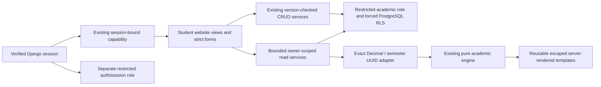

# Student website — Milestones 4A and 4B

The Django student website now provides the core academic capabilities of the local
Streamlit application, using PostgreSQL-owned records. It uses server-rendered
Django templates, local CSS and a small optional form-busy script. There is no
frontend framework, HTMX bundle, external font or third-party asset request.
CLI and Streamlit remain separate, unchanged local single-user JSON applications.
No personal JSON is read/imported and no public deployment is approved.

## Pages and functionality

| Page | Functionality |
| --- | --- |
| `/` | Personalized dashboard: actual CGPA, attempted credits, course/grade totals, completed/pending/overdue assignment totals, five upcoming deadlines, semester performance and action links |
| `/semesters/` | Paginated semesters, labels and explicit display order, course links and create/edit/confirmed protected delete |
| `/courses/` | Paginated/filterable course records, create/edit name/code/exact credits/semester/actual grade, genuinely ungraded state and protected deletion |
| `/assignments/` | Paginated due-date sorting, pending/completed/upcoming/overdue filters, create/edit/status/confirmed deletion |
| `/performance/` | Read-only credit-weighted semester GPA and overall CGPA, attempted credits, graded/ungraded counts and accessible native meters/table |
| `/predictor/` | Select courses with hypothetical grades, compute a selected-course prediction, filter by semester and reset selections without saving |
| `/planner/` | Decimal target/remaining-credit form, required future average and the engine's achievable/guaranteed/impossible result states |
| `/settings/` | Verified username/email/status, password-change link and secure POST logout; no email change or account deletion |
| `/materials/` | Own study materials: upload checked PDF/TXT files, owner-only attachment downloads, confirmed deletion; 50 files / 200 MiB per student. See [STUDY_MATERIALS.md](STUDY_MATERIALS.md) |
| `/accounts/...` | Existing registration, verification, login/logout and recovery, presented in the shared website layout |

New/edit/delete pages use the corresponding plural prefix. Delete GET requests
show confirmation only; all changes use POST and CSRF. A semester containing
courses cannot be deleted; a course with assignments cannot be deleted, even if
those assignments are complete. Move/remove dependent records explicitly first.
Overdue assignments are NEVER automatically deleted or marked complete.

Dashboard current-semester GPA requires an explicit selector choice. No existing
model field marks a semester as current, so the website does not infer chronology
from its label or display order. The selection is a read-only URL query and is not
a saved account preference. An empty/ungraded selected semester shows Not graded.
Overall CGPA always covers all owned actual grades, not just that selection.

## Architecture and preserved security boundary



- `server/student_web/`: page views, forms, presentation adapter, navigation
  context and reusable page/components/static assets. The 4A/4B pages add no
  models; study materials add two tables (see [STUDY_MATERIALS.md](STUDY_MATERIALS.md)).
- `server/academics/queries.py`: bounded, owner-scoped read services for evaluated
  pages, dropdowns, analysis snapshots and SQL workload aggregates. Every operation
  uses the existing signed student transaction and explicit owner filter. It never
  returns a lazy queryset to a template or uses the migration connection.
- `academics.services`: unchanged write boundary for create/update/delete and
  existing model/shared validation, optimistic locking and protected deletion.
- `academic_logic.py`: the same calculation formulas. The course-record numeric
  type check now also accepts Decimal, already supported by checked_credits.
- `config.settings.web_*` and `config.web_urls`: explicit website profiles/routes.
  Historical foundation/auth profiles remain available for compatibility/testing.

All student views reuse `student_required`: ownership comes from a verified live
session, not request owner IDs or constructed Student instances. The web profiles
inherit distinct runtime/auth roles, password/session binding, role safety checks,
forced RLS and signed transaction/backend context. No migration credentials are
configured in a web profile. The 4A/4B pages need no new database grants; study
materials need the grants in [STUDY_MATERIALS.md](STUDY_MATERIALS.md), applied by
re-running `configure_runtime` after `migrate`.

New read services filter by owner in addition to RLS. Related course/semester
metadata is fetched with bounded joins to avoid template N+1 queries. Dashboard
workload counts are SQL aggregates, not an unbounded assignment download. Queries
finish inside short signed transactions; calculations and HTML rendering happen
afterward. No request-global ATOMIC_REQUESTS or long rendering transaction is added.

Forms accept only named fields; parent choices are owned records and services
validate those relations again. Owner/ID/version/timestamp fields cannot be passed
as arbitrary mutations. Expected versions are separate hidden concurrency tokens.
All edits, status changes and deletes require those tokens. A stale form returns
409, retains submitted values and provides an explicit reload link instead of
silently replacing another tab's work. Success uses fixed redirects and short,
generic signed-cookie messages without copying records into a session/cookie.

Unknown/foreign records share a safe 404. Invalid forms are 400, conflicts 409,
analysis limits 413 and database failures a generic 503. CSRF failures explain how
to reload without exposing rejection internals. Templates escape stored content;
no owner information, signing key or raw SQL is exposed in errors. All student
responses remain no-store. Existing auth recovery/session controls are preserved.

## Academic semantics and data adaptation

PostgreSQL credits remain Decimal throughout the adapter and engine. They are not
converted through float. The only engine change is accepting Decimal course-credit
records alongside JSON int/float inputs; formulas, scale, warnings and bounds remain
unchanged. Credits support 0.0001–1000000 with at most four decimal places, and targets
support 0–5 with four places. Unlike the old Streamlit course form's integer 1–6
selector, Django exposes the existing full database/shared-validator contract.
Streamlit behavior is not changed.

Semester UUID strings are calculation grouping keys; labels are attached afterward.
Two owned semesters with the same label therefore remain separate GPA groups.
Display order (with existing stable tie-breaks) controls presentation only. UUID
course relations also let a code change preserve assignment links, unlike JSON's
string-code links. Per-owner normalized codes remain unique across all semesters.

A=5, B=4, C=3, D=2, E=1 and F=0. An actual F contributes credits and zero points;
ungraded contributes neither attempted credits nor points. Overall CGPA uses all
attempted credits, not the unweighted mean of semester GPAs. Predictions use only
selected courses and hypothetical grades via predicted_summary; they do not mix in
unselected actual grades or write any actual grade/version/timestamp. Reset is a
fresh GET. Target planning delegates to target_plan with Decimal inputs; outcomes
use unrounded values even though display is rounded. Remaining credits are supplied
by the student; no graduation, repeat-course or excluded-credit policy is invented.

Due dates are calendar dates, not invented times. The website uses timezone.localdate
in Africa/Lagos. Pending dates before today are Overdue, today is Due today, and
upcoming includes today/future pending work only. The same date is captured once
per page for consistent status comparisons at midnight. Completed work stays complete
regardless of date; pending and completed counts reflect saved Boolean status.

## Responsive and accessible presentation

The layout includes a desktop sidebar, tablet layout and native keyboard-operable
mobile details navigation. It provides a skip link, semantic main/navigation,
current-page markers, labelled controls, field help/error associations, visible
focus, error summaries, empty states, confirmation forms and status messages.
Statuses use text as well as color. Tables include captions/header scopes and a
focusable, labelled horizontal-scroll region with a mobile hint. A sensible minimum
column width prevents tall single-character headers at phone widths. Native meter
values also have adjacent numeric text; no chart script is required.

The small local JavaScript disables repeated POST submission, shows Working/busy
feedback and restores controls after back/forward cache navigation. It does not
fetch data, authorize owners, store grades/credentials or replace server validation.
Every core flow works without JavaScript. Keyboard navigation and no-JS semester
CRUD were exercised in Chromium; this is not a formal WCAG certification or a
complete real-device/screen-reader audit.

## Technical bounds and known limitations

- Lists show 25 records per page, with page inputs limited to 1–10000.
- Analysis snapshots support 1000 courses and 200 semesters. Over-limit analyses
  are rejected explicitly; a truncated GPA is never shown and records are not deleted.
- Parent selectors support 200 semesters / 1000 courses. Over-limit selectors show
  a clear limit message. Semester lists and ordinary bounded record management
  remain available; large pre-existing accounts need a reviewed selector expansion.
- Predictor forms show at most 200 courses. Filter by semester when necessary;
  no hidden truncation or extra hypothetical records are submitted.
- Website POST bodies are limited to 64 KiB and 600 fields. Model/form text bounds
  remain enforced. There are no file upload or bulk-import endpoints.
- Session/current-semester preferences, advanced search, saved scenarios, bulk edits,
  notifications/calendar integrations and exports are not implemented here.
- Read statements use normal PostgreSQL transaction semantics, not a global locked
  snapshot across every dashboard section. Concurrent changes may appear on refresh.

Keep synthetic test data separate from personal records. Do not attempt to fix a
limit by deleting personal data automatically. Before supporting unusually large
accounts, review selectors, query plans, pagination and calculation limits together.

## Local startup

Use the Python 3.12 hashed dependency setup and TWO application roles described in
[AUTHENTICATION.md](AUTHENTICATION.md). No runtime dependencies, new schema migration
or wider privileges are required for Milestone 4A.

In the separate OFFLINE migrator environment, initialize or update the existing schema:

```sh
python server/manage.py migrate --settings=config.settings.auth_migration --noinput
python server/manage.py configure_runtime --settings=config.settings.auth_migration
python server/manage.py configure_auth_role --settings=config.settings.auth_migration
python server/manage.py makemigrations --check --dry-run --settings=config.settings.auth_migration
```

Then use a NEW process environment with PGUSER/PGPASSWORD for the restricted academic
runtime, UCC_AUTH_ROLE/UCC_AUTH_PASSWORD for the separate auth login, database/loopback
settings and the private Django/context keys. Do not include migration/DBA credentials.

```sh
python server/manage.py runserver 127.0.0.1:8000 --settings=config.settings.web_development
```

Open http://127.0.0.1:8000/. Register/verify using PRIVATE local console email output,
then create a semester, a course and an assignment. The website profile redirects
successful login and the old academic demonstration link to the dashboard. Existing
old JSON applications continue with their existing commands and independent data.
No personal JSON migration is part of startup.

The local profile explicitly serves bundled static files with DEBUG still off;
that helper is disabled in web_secure. Future production static delivery, HTTPS,
headers and secret configuration require review. Production settings still refuse
startup. Never bind this local development server or shared JSON apps publicly.

## Tests, CI and future review

Use a disposable PostgreSQL cluster and the existing three-role test setup. Run all
historical suites separately as documented in DATABASE_SECURITY.md/AUTHENTICATION.md;
their destructive migration tests must not share a live/application database.
Set private PG* to the non-superuser test migrator/scratch DB, a separate disposable
PGTESTDATABASE, runtime/auth role passwords and signing keys, then:

```sh
python server/manage.py test web_tests --settings=config.settings.web_test -v 2
python tools/check_repository_safety.py
python -m pip check
python -m pip_audit --strict --require-hashes --disable-pip --progress-spinner off -r requirements-lock.txt -r requirements-django-lock.txt
```

CI runs the 69 website tests (52 from 4A and 17 polish regressions) against PostgreSQL in addition to all 268 pre-website
tests (including the 13 S1 source-address regressions) and both runtime-lock audits. Tests use synthetic accounts/records and actual
separate LOGIN connections, not SQLite or SET ROLE from a privileged session.
The test-only default migration connection never serves website queries.

Before public use, retain all Milestone 3 production caveats: independent security
review, operational HTTPS/email/secrets/proxy policy, distributed abuse limits,
backups/restore, monitoring, load/pool testing and account/data lifecycle design.
Milestone 4B can review broader device/screen-reader accessibility, larger-account
selectors/performance, preferences and additional product polish. No payments,
subscriptions, social login, mobile app, deployment or automatic merge is included.


## Milestone 4B refinement

The dashboard now puts actual results below a compact heading and offers first-time
semester/course/assignment steps. Overdue workload counts link directly to tasks.
Course lists search by code/name; assignment lists search by title/course code/name.
Search is literal, case-insensitive and capped at 80 characters. Combine it with
semester/status/sort filters; pagination and refresh preserve it. Clear filters
returns to the complete list. It does not change CGPA scope or any safety limit.

Website/account forms share focusable error summaries. Optional controls are marked,
parent help explains scoped choices, and hidden-version errors explain reloading.
JavaScript only focuses feedback and provides existing busy-state support; forms
and searches submit normally without it. Login includes session-expiry guidance.

Read helpers reuse the verified capability ID inside student_transaction, retaining
live-session checks, signed context, explicit owner filters and forced RLS. They do
not cache identities/records or access a migration connection. All role/schema and
academic calculation contracts remain unchanged.

See [MILESTONE_4B_REVIEW.md](MILESTONE_4B_REVIEW.md) for the file inventory, measured
query/timing changes, six-width browser checks, axe/manual audit coverage and limits.
The opt-in benchmark uses the same disposable three-role web_test environment:

```sh
python server/manage.py test web_tests.benchmark --settings=config.settings.web_test -v 1
```

It creates/drops a synthetic test database and prints aggregate timing/query/index
measurements. Never run tests against personal or live application data. Timing is
local diagnostic evidence, not a production guarantee. Screen-reader and real-device
validation, deeper search/selector scaling and production operations remain deferred.
