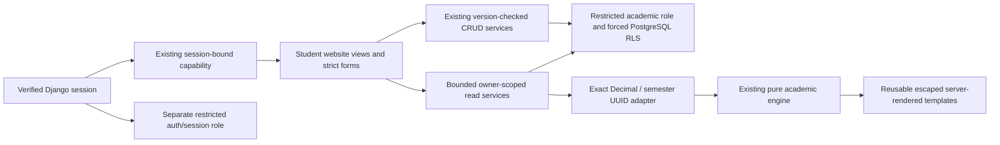

# Student website — Milestones 4A and 4B

The Django student website now provides the core academic capabilities of the local
Streamlit application, using PostgreSQL-owned records. It uses server-rendered
Django templates, local CSS and a small optional form-busy script. There is no
frontend framework, HTMX bundle, external font or third-party asset request.
CLI and Streamlit remain separate, unchanged local single-user JSON applications.
No personal JSON is read/imported and no public deployment is approved.

## Pages and functionality

| Page | Functionality |
| --- | --- |
| `/` | Personalized dashboard: actual CGPA, attempted credits, course/grade totals, completed/pending/overdue assignment totals, five upcoming deadlines, semester performance and action links |
| `/semesters/` | Paginated semesters, labels and explicit display order, course links and create/edit/confirmed protected delete |
| `/courses/` | Paginated/filterable course records, create/edit name/code/exact credits/semester/actual grade, genuinely ungraded state and protected deletion |
| `/assignments/` | Paginated due-date sorting, pending/completed/upcoming/overdue filters, create/edit/status/confirmed deletion |
| `/performance/` | Read-only credit-weighted semester GPA and overall CGPA, attempted credits, graded/ungraded counts and accessible native meters/table |
| `/predictor/` | Select courses with hypothetical grades, compute a selected-course prediction, filter by semester and reset selections without saving |
| `/planner/` | Decimal target/remaining-credit form, required future average and the engine's achievable/guaranteed/impossible result states |
| `/materials/<id>/tools/` and AI result pages | AI study assistant: summary, quiz, flashcards, ask a question; confirm before sending; see [AI_STUDY_ASSISTANT.md](AI_STUDY_ASSISTANT.md) |
| `/settings/` | Verified username/email/status, password-change link and secure POST logout, profile, display mode, storage used and **Download my data**; no email change or account deletion |
| `/materials/` | Own study materials: upload checked PDF/TXT files, owner-only attachment downloads, confirmed deletion; 50 files / 200 MiB per student. See [STUDY_MATERIALS.md](STUDY_MATERIALS.md) |
| `/accounts/...` | Existing registration, verification, login/logout and recovery, presented in the shared website layout |

New/edit/delete pages use the corresponding plural prefix. Delete GET requests
show confirmation only; all changes use POST and CSRF. A semester containing
courses cannot be deleted; a course with assignments cannot be deleted, even if
those assignments are complete. Move/remove dependent records explicitly first.
Overdue assignments are NEVER automatically deleted or marked complete.

Dashboard current-semester GPA requires an explicit selector choice. No existing
model field marks a semester as current, so the website does not infer chronology
from its label or display order. The selection is a read-only URL query and is not
a saved account preference. An empty/ungraded selected semester shows Not graded.
Overall CGPA always covers all owned actual grades, not just that selection.

## Architecture and preserved security boundary



- `server/student_web/`: page views, forms, presentation adapter, navigation
  context and reusable page/components/static assets. The 4A/4B pages add no
  models; study materials add two tables (see [STUDY_MATERIALS.md](STUDY_MATERIALS.md)).
- `server/academics/queries.py`: bounded, owner-scoped read services for evaluated
  pages, dropdowns, analysis snapshots and SQL workload aggregates. Every operation
  uses the existing signed student transaction and explicit owner filter. It never
  returns a lazy queryset to a template or uses the migration connection.
- `academics.services`: unchanged write boundary for create/update/delete and
  existing model/shared validation, optimistic locking and protected deletion.
- `academic_logic.py`: the same calculation formulas. The course-record numeric
  type check now also accepts Decimal, already supported by checked_credits.
- `config.settings.web_*` and `config.web_urls`: explicit website profiles/routes.
  Historical foundation/auth profiles remain available for compatibility/testing.

All student views reuse `student_required`: ownership comes from a verified live
session, not request owner IDs or constructed Student instances. The web profiles
inherit distinct runtime/auth roles, password/session binding, role safety checks,
forced RLS and signed transaction/backend context. No migration credentials are
configured in a web profile. The 4A/4B pages need no new database grants; study
materials need the grants in [STUDY_MATERIALS.md](STUDY_MATERIALS.md), applied by
re-running `configure_runtime` after `migrate`.

New read services filter by owner in addition to RLS. Related course/semester
metadata is fetched with bounded joins to avoid template N+1 queries. Dashboard
workload counts are SQL aggregates, not an unbounded assignment download. Queries
finish inside short signed transactions; calculations and HTML rendering happen
afterward. No request-global ATOMIC_REQUESTS or long rendering transaction is added.

Forms accept only named fields; parent choices are owned records and services
validate those relations again. Owner/ID/version/timestamp fields cannot be passed
as arbitrary mutations. Expected versions are separate hidden concurrency tokens.
All edits, status changes and deletes require those tokens. A stale form returns
409, retains submitted values and provides an explicit reload link instead of
silently replacing another tab's work. Success uses fixed redirects and short,
generic signed-cookie messages without copying records into a session/cookie.

Unknown/foreign records share a safe 404. Invalid forms are 400, conflicts 409,
analysis limits 413 and database failures a generic 503. CSRF failures explain how
to reload without exposing rejection internals. Templates escape stored content;
no owner information, signing key or raw SQL is exposed in errors. All student
responses remain no-store. Existing auth recovery/session controls are preserved.

## Academic semantics and data adaptation

PostgreSQL credits remain Decimal throughout the adapter and engine. They are not
converted through float. The only engine change is accepting Decimal course-credit
records alongside JSON int/float inputs; formulas, scale, warnings and bounds remain
unchanged. Credits support 0.0001–1000000 with at most four decimal places, and targets
support 0–5 with four places. Unlike the old Streamlit course form's integer 1–6
selector, Django exposes the existing full database/shared-validator contract.
Streamlit behavior is not changed.

Semester UUID strings are calculation grouping keys; labels are attached afterward.
Two owned semesters with the same label therefore remain separate GPA groups.
Display order (with existing stable tie-breaks) controls presentation only. UUID
course relations also let a code change preserve assignment links, unlike JSON's
string-code links. Per-owner normalized codes remain unique across all semesters.

A=5, B=4, C=3, D=2, E=1 and F=0. An actual F contributes credits and zero points;
ungraded contributes neither attempted credits nor points. Overall CGPA uses all
attempted credits, not the unweighted mean of semester GPAs. Predictions use only
selected courses and hypothetical grades via predicted_summary; they do not mix in
unselected actual grades or write any actual grade/version/timestamp. Reset is a
fresh GET. Target planning delegates to target_plan with Decimal inputs; outcomes
use unrounded values even though display is rounded. Remaining credits are supplied
by the student; no graduation, repeat-course or excluded-credit policy is invented.

Due dates are calendar dates, not invented times. The website uses timezone.localdate
in Africa/Lagos. Pending dates before today are Overdue, today is Due today, and
upcoming includes today/future pending work only. The same date is captured once
per page for consistent status comparisons at midnight. Completed work stays complete
regardless of date; pending and completed counts reflect saved Boolean status.

## Responsive and accessible presentation

The layout includes a desktop sidebar, tablet layout and native keyboard-operable
mobile details navigation. It provides a skip link, semantic main/navigation,
current-page markers, labelled controls, field help/error associations, visible
focus, error summaries, empty states, confirmation forms and status messages.
Statuses use text as well as color. Tables include captions/header scopes and a
focusable, labelled horizontal-scroll region with a mobile hint. A sensible minimum
column width prevents tall single-character headers at phone widths. Native meter
values also have adjacent numeric text; no chart script is required.

The small local JavaScript disables repeated POST submission, shows Working/busy
feedback and restores controls after back/forward cache navigation. It does not
fetch data, authorize owners, store grades/credentials or replace server validation.
Every core flow works without JavaScript. Keyboard navigation and no-JS semester
CRUD were exercised in Chromium; this is not a formal WCAG certification or a
complete real-device/screen-reader audit.

## Technical bounds and known limitations

- Lists show 25 records per page, with page inputs limited to 1–10000.
- Analysis snapshots support 1000 courses and 200 semesters. Over-limit analyses
  are rejected explicitly; a truncated GPA is never shown and records are not deleted.
- Parent selectors support 200 semesters / 1000 courses. Over-limit selectors show
  a clear limit message. Semester lists and ordinary bounded record management
  remain available; large pre-existing accounts need a reviewed selector expansion.
- Predictor forms show at most 200 courses. Filter by semester when necessary;
  no hidden truncation or extra hypothetical records are submitted.
- Website POST bodies are limited to 64 KiB and 600 fields. Model/form text bounds
  remain enforced. There are no file upload or bulk-import endpoints.
- Session/current-semester preferences, advanced search, saved scenarios, bulk edits,
  notifications/calendar integrations and exports are not implemented here.
- Read statements use normal PostgreSQL transaction semantics, not a global locked
  snapshot across every dashboard section. Concurrent changes may appear on refresh.

Keep synthetic test data separate from personal records. Do not attempt to fix a
limit by deleting personal data automatically. Before supporting unusually large
accounts, review selectors, query plans, pagination and calculation limits together.

## Student profile (historical; see privacy update below)

Account settings shows an optional profile: display name, university or institution,
programme, current level (100-700 or Postgraduate) and matric / student ID. Students
edit it at `/settings/profile/`; every field may be left blank. The dashboard greets
the student by display name, or by username when none is set.

- Stored in `academics_studentprofile` (migrations 0009 and 0010): one row per student
  (unique owner), forced row-level security with the same signed `current_student()`
  policy as other student tables, CHECK constraints for level, matric format and
  trimmed text, and optimistic versions.
- Runtime grants: SELECT, INSERT and column-limited UPDATE of the five profile fields,
  version and update time. No DELETE, TRUNCATE or owner/ID update. The authentication
  role must not read profiles. Startup checks require forced RLS on six tables (eight
  since the AI study assistant records; see AI_STUDY_ASSISTANT.md).
- The matric number is personal data: owner-only, never logged, and hidden on Account
  settings (the last four characters show only for values of 8+ characters); the edit
  form shows it to its owner only. Startup checks also refuse a runtime DELETE grant.
- Account settings reads the profile, so it shows the safe 503 page if the academic
  database is unavailable; logout stays available from the navigation.
- Two tabs creating a first profile at the same moment: one is saved and the other gets
  the generic "could not be saved" message. No data is lost.
- Username and email are not editable here. Email change needs its own reviewed
  security process (AGENTS.md).
- The dashboard reads its records, assignment totals and greeting name in one verified
  transaction (`academics.queries.dashboard_reads`), which lowered its query count.

## Display modes

Account settings offers **System** (the default), **Light** and **Dark**. The choice is
saved only in this browser, in the `ucc_display` cookie (HttpOnly, SameSite=Lax, one
year); nothing is stored in the database. Unknown cookie values fall back to System.

- Dark values live in `student_web/static/student_web/theme-dark.css`, which defines
  the same colour names as `site.css`. It loads after the page styles: always for Dark,
  only when the device prefers dark for System, never for Light. It applies to screens
  only, so printouts stay light. No JavaScript is involved.
- `tools/test_frontend_foundation_browser.py` checks every visible text element on the
  dashboard, courses, form-error and login pages for at least 4.5:1 contrast (3:1 for
  large text) in dark mode, plus controls in default and hover states. A new colour or
  component must keep these tests passing in both modes.
- Historical test change: the earlier light-only check now expects System to follow
  the device; Light staying light and print staying light are tested separately.

## Your data, storage and sessions

Account settings has three more items:

- **Storage used** shows how many study files are stored and their real size against
  the per-student quota (50 files, 200 MiB). The same line appears on Study materials.
  Both come from `services.materials.storage`, which reads the stored-file IDs and the
  byte total in one verified transaction.
- **Download my data** (`/settings/export/`, GET only) gives the signed-in student a
  JSON file of their own account name and email, profile, semesters, courses (credit
  units as exact decimal strings), assignments and study material details with a
  `file_stored` flag. File contents are not included. `academics.queries.export_records`
  reads everything in one signed `student_transaction` under the RLS owner policy; the
  pure `student_web/export.py` builds the document. The response is an attachment with
  `nosniff`, a sandbox CSP and never-cache headers. Workspaces above the export limits
  (the dashboard limits, plus 20,000 assignments and 5,000 materials) get the shared
  413 page and no partial file.
- **Signed in somewhere else?** explains that changing the password signs out every
  other session and that sessions end after 30 minutes or when the browser closes.
  There is no separate "sign out everywhere" button (owner decision).

Tests: `web_tests.test_settings_data` (owner-only content, no file contents or fingerprints, headers, exact credits, local-date file name,
sign-in and GET only, forged identities refused, too-large workspace, storage text).

## Know where you stand (part A)

Ideas from popular CGPA calculators, built on the app's existing rules. No calculation
formula changed: two new pure helpers in `academic_logic.py` reuse `validate_courses`,
`GRADE_POINTS`, `checked_target` and `checked_credits`, so duplicates, ungraded courses and
input limits behave exactly as before.

- **GPA & CGPA page** (`/performance/`):
  - **Semester GPA chart**, drawn as SVG on the server (no JavaScript or chart library):
    one bar per graded semester, in the order of the Semesters page (the caption says
    so, since order does not imply chronology), with the overall CGPA as a dashed,
    directly labelled reference line. Each bar has a hover title; the semester table
    below is the table view. Colours are a validated pair (blue `#2a78d6` bars, orange
    `#eb6834` line; dark mode `#3987e5`/`#d95926` in `theme-dark.css`), checked with the
    dataviz palette validator against the site's light and dark surfaces.
  - **How your CGPA is calculated**: `course_breakdown` shows every course's grade
    points and quality points (units × points), each semester's GPA as points ÷ units,
    and the overall CGPA as all points ÷ all graded units. Ungraded courses are listed
    as "not counted". Its totals equal `academic_summary` exactly.
  - **Grade scale**: the A–F points the app uses, with a note that score ranges and
    degree-class boundaries come from the student's handbook.
- **Graduation predictor** on the Target CGPA Planner (`POST /planner/projection/`):
  `projected_cgpa` gives the final CGPA if the student averages a GPA they enter over
  remaining credits they enter. It is read-only: actual grades stay fixed and nothing
  is saved. It has its own field IDs beside the target form.
- **Printable summary** (`/performance/print/`): metrics, chart, semester table and the
  full working, with a "Print or save as PDF" button (shown by `site.js`; without
  JavaScript the page explains Ctrl+P). Print styles hide navigation and buttons. It
  says it is not an official transcript.
- Styles live in `static/student_web/standing.css`, loaded only on these pages, so the
  `site.css` budgets are unchanged.
- Tests: `tests.test_standing` (calculations; totals match `academic_summary`) and
  `web_tests.test_standing` (chart, working, scale, predictor, print page, owner-only,
  signed-out).

Part B (degree-class guide with editable bands, class targets and a "where you stand"
bar) needs a small database change and comes in its own PR.

## Local startup

Use the Python 3.12 hashed dependency setup and TWO application roles described in
[AUTHENTICATION.md](AUTHENTICATION.md). No runtime dependencies, new schema migration
or wider privileges are required for Milestone 4A.

In the separate OFFLINE migrator environment, initialize or update the existing schema:

```sh
python server/manage.py migrate --settings=config.settings.auth_migration --noinput
python server/manage.py configure_runtime --settings=config.settings.auth_migration
python server/manage.py configure_auth_role --settings=config.settings.auth_migration
python server/manage.py makemigrations --check --dry-run --settings=config.settings.auth_migration
```

Then use a NEW process environment with PGUSER/PGPASSWORD for the restricted academic
runtime, UCC_AUTH_ROLE/UCC_AUTH_PASSWORD for the separate auth login, database/loopback
settings and the private Django/context keys. Do not include migration/DBA credentials.

```sh
python tools/serve_local_website.py
```

Do not use `manage.py runserver` here: it always reads the `django_migrations` table on
startup, which the restricted academic runtime login is deliberately denied, so it fails
with a permission error. `tools/serve_local_website.py` serves the same application with
Django's development server, only on 127.0.0.1 and only with the `web_development` or
`auth_development` profile (`--port` changes the port). If startup fails with a
connection timeout, PostgreSQL is not running.

Open http://127.0.0.1:8000/. Register/verify using PRIVATE local console email output,
then create a semester, a course and an assignment. The website profile redirects
successful login and the old academic demonstration link to the dashboard. Existing
old JSON applications continue with their existing commands and independent data.
No personal JSON migration is part of startup.

The local profile explicitly serves bundled static files with DEBUG still off;
that helper is disabled in web_secure. Future production static delivery, HTTPS,
headers and secret configuration require review. Production settings still refuse
startup. Never bind this local development server or shared JSON apps publicly.

## Tests, CI and future review

Use a disposable PostgreSQL cluster and the existing three-role test setup. Run all
historical suites separately as documented in DATABASE_SECURITY.md/AUTHENTICATION.md;
their destructive migration tests must not share a live/application database.
Set private PG* to the non-superuser test migrator/scratch DB, a separate disposable
PGTESTDATABASE, runtime/auth role passwords and signing keys, then:

```sh
python server/manage.py test web_tests --settings=config.settings.web_test -v 2
python tools/check_repository_safety.py
python -m pip check
python -m pip_audit --strict --require-hashes --disable-pip --progress-spinner off -r requirements-lock.txt -r requirements-django-lock.txt
```

CI runs the 69 website tests (52 from 4A and 17 polish regressions) against PostgreSQL in addition to all 268 pre-website
tests (including the 13 S1 source-address regressions) and both runtime-lock audits. Tests use synthetic accounts/records and actual
separate LOGIN connections, not SQLite or SET ROLE from a privileged session.
The test-only default migration connection never serves website queries.

Before public use, retain all Milestone 3 production caveats: independent security
review, operational HTTPS/email/secrets/proxy policy, distributed abuse limits,
backups/restore, monitoring, load/pool testing and account/data lifecycle design.
Milestone 4B can review broader device/screen-reader accessibility, larger-account
selectors/performance, preferences and additional product polish. No payments,
subscriptions, social login, mobile app, deployment or automatic merge is included.


## Milestone 4B refinement

The dashboard now puts actual results below a compact heading and offers first-time
semester/course/assignment steps. Overdue workload counts link directly to tasks.
Course lists search by code/name; assignment lists search by title/course code/name.
Search is literal, case-insensitive and capped at 80 characters. Combine it with
semester/status/sort filters; pagination and refresh preserve it. Clear filters
returns to the complete list. It does not change CGPA scope or any safety limit.

Website/account forms share focusable error summaries. Optional controls are marked,
parent help explains scoped choices, and hidden-version errors explain reloading.
JavaScript only focuses feedback and provides existing busy-state support; forms
and searches submit normally without it. Login includes session-expiry guidance.

Read helpers reuse the verified capability ID inside student_transaction, retaining
live-session checks, signed context, explicit owner filters and forced RLS. They do
not cache identities/records or access a migration connection. All role/schema and
academic calculation contracts remain unchanged.

See [MILESTONE_4B_REVIEW.md](MILESTONE_4B_REVIEW.md) for the file inventory, measured
query/timing changes, six-width browser checks, axe/manual audit coverage and limits.
The opt-in benchmark uses the same disposable three-role web_test environment:

```sh
python server/manage.py test web_tests.benchmark --settings=config.settings.web_test -v 1
```

It creates/drops a synthetic test database and prints aggregate timing/query/index
measurements. Never run tests against personal or live application data. Timing is
local diagnostic evidence, not a production guarantee. Screen-reader and real-device
validation, deeper search/selector scaling and production operations remain deferred.

## Site-wide look and motion

- **Links look like buttons.** Links in the page content are rounded buttons with no underline.
  They are still normal links underneath, so they work without JavaScript.
- **Coloured cards.** Panels, metric tiles and AI tool cards have soft tinted backgrounds that
  rotate between teal, blue, violet and amber. Flashcards have a coloured question side and a
  different coloured answer side, and the colours change for each card. Light and dark colours
  are contrast-checked (at least 4.5:1) in `tools/test_redesign_browser.py`.
- **The menu has no numbers.** A soft highlight glides to the item under the pointer or keyboard.
- **Motion** (`frontend/src/app.ts`, compiled to `static/student_web/app.js`): sections slide in
  as you scroll, numbers count up, chart bars grow, a progress bar shows how far down the page
  you are, and buttons ripple when pressed.
  - Nothing is hidden by the HTML or CSS. Only the script hides a section, just before it
    animates it in, and never one that already has keyboard focus. Keyboard focus and links
    to a section show it at once; printing finishes every animation first; a find-in-page
    jump scrolls the section into view, which starts its entrance. Sections of any height
    appear as soon as any part of them is on screen.
  - Pages that reload themselves (the AI "still working" page), a reload, and Back/Forward
    do not replay the entrance animations.
  - Parts of the AI pages that `ai.js` already animates are left to `ai.js`.
  - Account settings: the Display choices are pill-shaped options (still ordinary radio
    buttons, so saving works without JavaScript), and each section is separated by a line.
    Styles: `static/student_web/settings.css`, loaded on that page only.
  - "Before you send" on the AI confirm page is a clear warning card with an icon and
    full-contrast text.
  - The coloured card borders keep the status stripes: red for an impossible target or a
    failed AI request, green for an achievable target.
  - The count-up is drawn on top of the real number. The page text always holds the true value.
  - "Reduce motion" in the device settings turns all motion off.
  - The script stores nothing and sends nothing.
- **Building the script.** TypeScript 6.0.3 is locked in `frontend/package-lock.json`. To rebuild
  after changing `app.ts`, run `npm ci --ignore-scripts` and `npm run build` in `frontend/`, and
  commit the new `app.js`. CI rebuilds it and fails if the committed file is different.
  `site.js` loads `app.js` from the same folder.

## Know where you stand (part B): class of degree

- **Class bands** are the lowest CGPA for each class: First Class, Second Class Upper,
  Second Class Lower, Third Class and Pass. Until a student saves their own, the common
  Nigerian 5-point guide is used (4.50, 3.50, 2.40, 1.50, 1.00:
  `academic_logic.DEFAULT_CLASS_BANDS`). Every page says the bands are a guide and the
  student's university handbook decides their actual class. Nothing here decides graduation,
  repeat-course or excluded-credit rules.
- **Storage.** Five optional columns on `academics_studentprofile` (migration 0015), exact
  decimals with up to four places. The runtime role gets column-level UPDATE on them
  (`configure_runtime`). The database CHECK `profile_class_bands_valid` allows only all five
  empty, or all five set, within 0–5 and strictly falling from First to Pass. Its explicit
  `IS NOT NULL` parts stop a partly filled set from slipping through as "unknown".
- **Settings → Class of degree** shows the bands. **Edit class bands** (`/settings/class-bands/`)
  checks them with `academic_logic.checked_bands`, which uses the shared `checked_target`
  (never silently rounded), and saves them through `services.profiles` with the usual version
  check. **Reset to the common guide** clears them.
- **GPA & CGPA → Where you stand** (also on the printable summary): a 0–5 bar coloured by band
  with a marker at the actual CGPA, the current band, and the distance to the next band
  (rounded up, so it never understates). It uses the unrounded CGPA and is hidden until a
  course is graded. The page reads the profile in the same verified database visit as the
  grades (`queries.standing_snapshot`), keeping the existing query budget.
- **Target CGPA Planner → Aim for a class**: buttons link to `?aim=0..4`. These only fill in
  the target with that band's lowest CGPA; nothing is saved, and other query values are
  refused with 400.
- The data export includes the student's own bands (exact strings) or `null`.
- Tests: `tests/test_class_bands.py`, `security_tests/test_class_bands.py`,
  `web_tests/test_class_bands.py`, `tools/test_class_bands_browser.py`.

## Welcome page (the main link)

- `/` shows the public welcome page (`student_web/landing.html`, `landing.css`) to visitors
  without a signed-in session: what the site does, how to join, and links to Log in, Register,
  the privacy notice and terms. With a signed-in session it is the dashboard as before, and the
  dashboard still checks the live session (a stale one is signed out and sent to login).
- GET/HEAD only, never cached (the same address shows a private dashboard), no student data,
  no JavaScript and no forms. It never names the AI provider; the privacy notice does.
- Owner-approved historical test changes: `web_tests/test_security.py` no longer expects `/` to
  redirect signed-out visitors (it checks the welcome page instead), and
  `web_tests/test_account_delete.py` checks sign-out on Settings instead of `/`.
- Tests: `web_tests/test_landing.py`.

## Grade scale: 4-point or 5-point

- **Settings → Grade scale** (`/settings/grade-scale/`, POST only) lets each student choose the
  5-point scale (A=5, B=4, C=3, D=2, E=1, F=0; the default) or the 4-point scale (A=4, B=3,
  C=2, D=1, F=0; no E). Both are `grading_policy` policies (`LEGACY_POLICY`,
  `FOUR_POINT_POLICY`, listed in `grading_policy.SCALES`); no formula changed.
- **Storage.** `academics_studentprofile.grading_scale` (migration 0025, Supabase 0012/0013),
  `five` or `four` (CHECK `profile_grading_scale_valid`). The runtime role gets column UPDATE
  on it. It changes only through `services.profiles.set_scale`, with the usual version check.
- **No silent conversion.** Saved letters never change; every GPA is recalculated from them.
  Choosing 4-point is refused (409) while any course is graded E and the page names those
  courses. A change of scale clears the student's own class bands, which belonged to the old
  scale. If an E reaches a 4-point record anyway (a tab racing the change), the calculation
  skips it with the usual "invalid saved grade" warning; it is never counted as 0.
- **Pages.** Dashboard, GPA & CGPA, printable summary, predictor, planner, class bands and the
  course form use the student's scale (maximum, letters, chart axis, class bar). 5-point pages
  are unchanged. The 4-point scale has no built-in class guide: "Where you stand" and the planner
  shortcuts appear once the student enters their university's bands (each 0–4).
- The dashboard reads the scale in its existing profile query; the predictor now reads the
  profile with the grades (`data.standing`). The data export includes `grading_scale`.
- The CLI and Streamlit app stay on the 5-point scale.
- Tests: `tests/test_grading_scale_core.py`, `web_tests/test_grading_scale.py`.

## Deadline reminders

- **Dashboard → Due this week.** Seven day cards from today (Africa/Lagos dates). Each shows how
  many pending assignments are due and which courses, or "Nothing due". Titles stay in
  "Upcoming deadlines", which still shows at most five.
  - Completed, overdue and later work is not counted.
  - It is read in the same verified dashboard visit (`queries._due_this_week`, at most 50, with
    a "more" note).
  - On phones only today and days with work are shown.
- **Deadline pop-ups (optional, Settings).** `frontend/src/reminders.ts` (compiled to
  `reminders.js`, loaded by `site.js`) is off until the student presses **Turn on pop-ups** and
  the browser allows notifications.
  - At most once a day, when the dashboard opens, if something is due today or tomorrow, it
    shows a pop-up with counts only, for example "1 assignment due today · 2 assignments due
    tomorrow". It never shows titles, so nothing private appears on a lock screen.
  - Browser storage holds only `ucc-reminders` = on and `ucc-reminded-on` = the date of the
    last pop-up.
  - It works only while a tab with the site is open; there is no server push.
  - Without JavaScript, Settings explains this and the dashboard section still works.
- Tests: `web_tests/test_reminders.py` and `tools/test_reminders_browser.py`.

## Results PDF

- **GPA & CGPA → Download PDF** opens the printable summary with `?save=pdf`. `site.js` then
  opens the browser's print window once, after the page loads; the student chooses **Save as
  PDF**. Without JavaScript the page explains Ctrl+P. No PDF library is used (owner decision);
  the browser's own PDF writer makes the file.
- The page title, which browsers use as the PDF file name, is
  "Academic summary YYYY-MM-DD - University Command Center".
- The summary shows the student's own display name, programme, level and institution when
  set, never the matric number.
- Print styles (`standing.css`):
  - A4 pages with a "University Command Center · Academic summary" header and
    "Page N of M" footer (CSS page margin boxes).
  - Colours are kept, and pages are always light.
  - Long sections continue over pages, but a table row, the chart or the class bar is never cut.
  - No menu, buttons or links.
- Tests: `web_tests/test_results_pdf.py` and `tools/test_results_pdf_browser.py`. The browser
  test makes a real PDF with Chromium and reads it back with pypdf.

## Search all study files

- **Study materials → Search all your study files**, or `/materials/search/?q=…`. This finds
  words in every stored file of the signed-in student. The words are taken literally (`%`, `_`
  and `.` are plain characters) and matched in any letter case.
- Each file shows its title, course, match count, up to 3 highlighted snippets, and Study tools
  and Download buttons. At most 50 files are shown. Snippets are escaped text with only `<mark>`
  added by the template.
- **Text is saved once** in `academics_materialtext` (migrations 0016–0017):
  - at upload, or on the first search for files stored earlier (3 per visit, with a "still being
    prepared" note);
  - it is the same text the study tools read (up to 60,000 characters);
  - a file with no readable text gets one row with the reason (`problem`), so it is not read
    again, and it is counted on the page.
- Security, as for stored files:
  - forced RLS `student_owner` and a same-owner foreign key to the material;
  - the runtime role has SELECT, INSERT and DELETE, but no UPDATE;
  - `require_runtime_role` now requires forced RLS on 9 tables and refuses UPDATE, TRUNCATE,
    REFERENCES or TRIGGER on this table;
  - the auth role may not read it;
  - deleting a material deletes its text.
  - Nothing is sent to an AI service.
- Tests: `security_tests/test_material_text_rls.py`, `web_tests/test_material_search.py` and
  `tools/test_search_browser.py`.

## Timetable

- **Timetable** (menu, `/timetable/`): the student's weekly classes, Monday to Sunday, in time
  order, using Africa/Lagos times.
  - Each class has a course, day, start and end time, type (lecture, tutorial, practical or
    lab, other) and an optional venue.
  - Today is outlined. A class that starts before the previous one on the same day has ended
    is marked as a clash, with a warning at the top (a warning only; nothing is blocked).
  - On phones only today and days with classes are shown.
- Classes are added, edited and deleted through the shared record pages (kind `session`,
  shown as "class"): version checks, owner-only course choices, and "not found" for anyone
  else's class.
- **Dashboard → Today's classes**: today's classes in time order. Finished ones are marked
  "Done", and the next one (or the one in progress) is highlighted "Next" or "Now". They are
  read in the same verified dashboard visit.
- Storage: `academics_classsession` (migrations 0018–0019).
  - Forced RLS `student_owner` and a same-owner foreign key to the course.
  - Database checks: day 0–6, end after start, a known type, trimmed venue.
  - The runtime role has SELECT, INSERT and DELETE, plus UPDATE on the editable columns only.
  - `require_runtime_role` now requires forced RLS on 10 tables; the auth role may not read it.
  - Deleting a course deletes its classes.
- The data export includes a `timetable` list. At most 300 classes.
- Tests: `security_tests/test_class_session_rls.py`, `web_tests/test_timetable.py` and
  `tools/test_timetable_browser.py`.

## Study planner

- **Study planner** (menu, `/study-planner/`): one plan per exam. Each plan has one of the
  student's courses, an exam date (after today, within a year), 0–3 revision days and 1–60
  topics (one per line).
- **Spreading** (`student_web/study_plan.py`, pure functions):
  - Topics are shared out evenly, in order, from today to the day before the exam, keeping the
    last revision days free. If the exam is too close for them, every day is used.
  - Example: 10 topics over 5 study days gives 2 a day.
- **Plan page**: every day from the earliest topic (or today) to the exam, then the revision
  days and the exam day, each shown once.
  - Topics are ticked or unticked with small POST forms, which work without JavaScript and are
    version-checked.
  - Unfinished topics on past days are "Overdue".
  - **Re-plan from today** shares only unfinished topics out again; it is version-checked on the
    plan, so a second tab is refused.
  - "Add a topic" puts a topic on the last study day. Topics can be removed, and the whole plan
    can be deleted.
- **Dashboard → Today's study**: unfinished topics planned for today or earlier, for exams still
  ahead, with overdue ones marked (at most 20). They are read in the same verified dashboard visit.
- Storage: `academics_studyplan` and `academics_studytopic` (migrations 0020–0021).
  - Forced RLS on both, with same-owner foreign keys (plan to course, topic to plan).
  - Database checks: at most 3 revision days, trimmed non-empty topic titles.
  - The runtime role has SELECT, INSERT and DELETE, plus UPDATE on the editable columns only
    (never course, plan or owner).
  - `require_runtime_role` now requires forced RLS on 12 tables; the auth role may not read them.
  - Deleting a course deletes its plans and topics.
  - The data export includes `study_plans` with their topics.
- Tests: `tests/test_study_plan.py`, `security_tests/test_study_plan_rls.py`,
  `web_tests/test_study_planner.py` and `tools/test_study_planner_browser.py`.

## Content Security Policy

Every response carries a `Content-Security-Policy` header from
`accounts.middleware.ContentSecurityPolicyMiddleware` (placed right after Django's
`SecurityMiddleware`, so sign-in, error and outage pages get it too):

```
default-src 'self'; script-src 'self'; style-src 'self' 'unsafe-inline'; style-src-elem 'self';
img-src 'self'; font-src 'self'; connect-src 'self'; object-src 'none'; base-uri 'none';
form-action 'self'; frame-ancestors 'none'
```

- Scripts run only from this site's own files: no inline scripts, event handlers, `eval` or
  outside scripts. Page data from `json_script` is a data block and is never run.
- Style sheets and `<style>` blocks must come from this site. Style *attributes* stay allowed
  because the class-band bar positions its parts with them and every page must work without
  JavaScript. Scripts change styles through the DOM, which the policy does not restrict.
- Pages can never be shown inside another website (`frame-ancestors 'none'`, plus the
  existing `X-Frame-Options`), and forms may only post back to this site.
- Responses that set their own policy keep it: study-file downloads, AI result downloads
  and the data export still send the stricter `default-src 'none'; sandbox`.
- No calculation, data or form behaviour changed.
- Tests: `web_tests/test_content_security.py` (the header on every page, and the sandbox kept)
  and `tools/test_content_security_browser.py` (17 real pages, with motion on and off, show
  zero blocked items; the flashcards, quiz and class bar still work; and a control confirms an
  injected inline script, `<style>` block and outside script are all refused).

## Privacy update: account full name and no matric-number field

[EDITABLE_FULL_NAME.md](EDITABLE_FULL_NAME.md) describes the reviewed rollout requirements.
Registration optionally collects a separate, self-reported full name on accounts_student.
Existing users may edit or clear it in Settings; username and credential/session behaviour
stay unchanged. The existing optional profile display name remains a separate greeting preference.
The additive privacy migration retains the legacy StudentProfile.matric_number column and CHECK
with a persistent blank default while removing current input/display/export collection, and
academics.0027 erases every saved value. Dropping the empty column is deferred to a later reviewed
contract release after old code is retired. Account full_name
has its own persistent blank database default. Historical masked-ID descriptions are not current UI.
No live migration has occurred. See [Editable full name](EDITABLE_FULL_NAME.md) for rollout,
backup-schema compatibility, explicit test-change approval and the remaining erasure gate.

## Get started checklist (dashboard)

New students see a **Get started with UniCommand** panel at the top of the dashboard: six first
steps (semester, a graded course, an assignment, a timetable class, lecture notes, a quiz or
flashcards), a progress bar and "N of 6 done".

- Each step is ticked from the student's **own** records in the dashboard's one verified
  transaction (`academics.queries.dashboard_reads`). Only one small read was added
  (`_started`: does any study file / timetable class exist, as one UNION query), so the dashboard
  stays within its query budget; everything else was already read.
- A button appears only when it can work (a course needs a semester; assignments, classes and
  notes need a course; study tools need an uploaded file); otherwise the step says what comes first.
- It is a `<details>` element: it works without JavaScript and can be folded away. It disappears
  once every step is done. Nothing new is stored. Styles: `getting_started.css` (dashboard only).

## Study streak (dashboard)

A **study streak** card shows how many days in a row the student has studied, their best run in
the last 60 days, and dots for the last seven days. A study day (Lagos calendar date) is any day
with an AI request, a saved quiz mistake, a study topic ticked done, an assignment completed or a
file uploaded. The streak counts back from today, or from yesterday while today is still open.

- Nothing new is stored: the days come from timestamps the site already keeps, so the privacy
  notice is unchanged.
- No extra database reads: the AI usage count became one grouped count (today's number plus the
  days AI was used), and the "Get started" UNION query also returns the other activity days
  (`academics.queries._started(with_activity=True)`). Both stay in the one verified transaction.
- Practising in the browser (answering a quiz, the Mistake bank practice) is not recorded, so it
  does not count on its own.

## Grade suggestions (Target CGPA Planner)

The planner has a **Grade suggestions for your courses** section. The student enters a target (it
starts at their First Class band, or 4.00 without bands) and gets one letter grade for each course
they have added but not graded yet, from `academic_logic.grade_suggestions`:

- The lowest single grade that would work for every open course is found; every course starts one
  grade below it, and courses with the most credit units are raised first until the target is met,
  so at most two neighbouring grades are used.
- "Already safe" when even the lowest grades keep the target; "Out of reach" shows the CGPA with
  an A in every open course. Exact Decimal credits; the projected CGPA uses the same rounding as
  `academic_summary`.
- Read-only: nothing is saved and saved grades never change. Only courses the student has added
  count (no graduation, repeat or excluded-credit policy is inferred); the main planner above
  still takes the remaining credits the student supplies.

## Share cards (dashboard and quiz results)

Owner's choice, to help UniCommand spread by word of mouth. A student can share a picture of:

- their **study streak** (the "Share my streak" button on the streak card, when the streak is at least one day);
- their **CGPA** (the "Share my CGPA" button under Actual CGPA, once a course is graded), out of 5.00 or 4.00 to match their scale;
- their **quiz score** (the "Share my score" button that appears when an interactive quiz ends).

How it works (`frontend/src/share.ts`, compiled to `share.js` and loaded by `site.js`):

- The 1080 × 1920 picture (story size, for WhatsApp status) is drawn in the student's own browser on a canvas.
  It shows only the number, the UniCommand name and the site address. No name, username, course or school.
- On phones it opens the phone's own share sheet (Web Share). Where there is none, the picture is saved as a download.
- Nothing is stored and nothing is sent to UniCommand: the script makes no network requests and uses no browser storage.
  The buttons carry only numbers already shown on the page.
- Without JavaScript the buttons stay hidden. `ai.js` announces a finished quiz with a `ucc:quiz-finished` event.

Tests: `web_tests/test_share_cards.py` and `tools/test_share_cards_browser.py` (share sheet, download fallback, PNG size, quiz).
