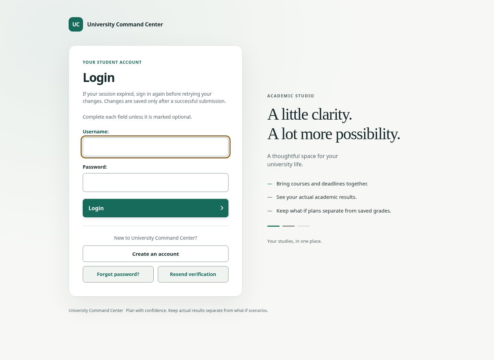

# Academic Studio — premium authentication presentation

Prepared 12 November 2026 (Africa/Lagos). Branch `frontend/premium-auth-presentation`, based on master `13c8cc10aa8c4a7b2a2e08c16778f5a9697364ef` after merged UI1 PR #41. Presentation only; draft for independent review. No deployment or security implementation is authorized by this document.

## Visual direction and screens

The website's existing login, registration, password-reset request, new-password form and confirmation messages share a warm Academic Studio frame. A near-opaque frosted card, restrained green glow, editorial system-serif side panel, generous spacing and carefully grouped actions replace the plain row of account links. The main form stays first in reading/focus order; the noninteractive editorial panel follows it and disappears on narrow screens. There are no fake grades, charts, notifications or security promises in the artwork.

The primary action stays filled green. Account creation/back navigation uses an outlined action; login recovery choices use soft bordered controls with readable labels. Native fields, inline help/errors, the existing summary and disabled/hover/focus states remain visible. The form's original title and submit text are retained; decorative arrows are hidden from assistive technology. Reset screens add static instructions describing the existing email/two-password fields, without introducing password rules or an email-delivery claim.

The desktop layout balances the card and secondary editorial content; phones use a single card. The page grows naturally with validation text, helper lists and text enlargement, rather than clipping inside a fixed-height centered box.

## Files and architecture

- `server/accounts/templates/accounts/base.html`: adds body-class, extra-style and public-navigation extension blocks. Academic routes continue using their original shell/navigation.
- `server/accounts/templates/accounts/auth_base.html`: new shared presentation frame, loaded only by the existing form/message templates. Authenticated password-change forms retain the academic shell and hide the editorial panel.
- `server/accounts/templates/accounts/form.html`, `message.html`: visual composition and secondary actions selected by stable, server-resolved route names. The same form instance, csrf_token, field.as_field_group, summary include and message values render server-side.
- `server/accounts/static/accounts/auth.css`: locally served scoped stylesheet; no external fonts/images/libraries. Its 6,882 bytes plus the unchanged 21,923-byte site.css total **28,805 bytes**, below the combined 30 KB CSS budget. Application JavaScript stays unchanged at 1,774 bytes.
- `server/web_tests/test_auth_presentation.py`: seven PostgreSQL-backed presentation/workflow/navigation checks.
- `tools/test_premium_auth_browser.py`: static real-template screen/state, native POST, accessibility and glass-fallback checks. The existing browser harness also inlines the new asset and correctly ignores gradients hidden by an opaque descendant; unsupported visible compositing still fails explicitly.
- `.github/workflows/quality.yml`: adds the auth browser command to the existing restricted browser job. Hashed dependencies and the [browser dependency policy](BROWSER_TEST_DEPENDENCIES.md) are unchanged.

The premium visual treatment applies to the website-enabled profiles (`web_development`, `web_secure`, `web_test`) that already serve local assets. The legacy auth-only profiles keep their minimal unstyled rendering, with signed-in password-change navigation returning to the existing academic workspace; no settings, route or asset-serving policy was changed to expand those profiles.

## Backend and security invariants

No views, form classes/validators, URLs, middleware, models, migrations, role grants, RLS, token handling, rate limits, session logic or academic code changed. No password visibility toggle, remembered-device control, frontend auth API, browser storage or new JavaScript was added.

Forms still POST to their existing URL, with the same named fields and hidden CSRF input. Credential field types, autocomplete/maxlength/validation attributes come from the existing Django widgets. Verification's existing no-field confirmation still submits its CSRF token. All message values and validation errors remain server-derived and escaped. Generic eligibility wording, credential errors, confirmation text and existing login/session copy are preserved; this is not an opportunity to change Claude's B1 failure wording. Invalid/expired-token and rate-limit HttpResponses are untouched and are not wrapped in the rich shell.

The shared-message icon is a neutral next-step arrow, not a green success tick or a claim that email was sent. Styling never infers account existence, token validity or recovery success from client state. The same generic known/unknown recovery response is checked in PostgreSQL integration tests. No private data is sent to an external service.

## Glass, accessibility and fallback

The base card is opaque white. `@supports(backdrop-filter)` optionally uses **96% white**, with 12px blur. Even over pure black its channels remain at least 244.8/255, so readability does not depend on the exact glow or blurred background. Browser tests check important text against both endpoints (244.8 and 255) at ≥4.5:1 and the focus token at ≥3:1. Opaque input surfaces retain their contrast checks. This bound is supporting evidence, not certification of every rendered pixel.

Browsers without blur support retain the opaque card. Forced colors removes the glow/shadow/blur and uses native canvas/borders. Print is opaque and shadow-free. Transitions are limited to 140ms color/border/shadow changes; reduced-motion preferences remove them. No essential information or interaction depends on translucency or animation.

Keyboard focus keeps the existing 3px ring. Forms remain usable without JavaScript. The summary moves focus only using the unchanged progressive script, remains readable without it, and links to visible native fields. Secondary actions are at least 44px high. There are no overlays, custom menus, cognitive tests, paste blockers or focus traps. One H1, meaningful page titles, a skip link and the existing role=status confirmation remain. Labels/helper associations are rendered by Django, not recreated in JavaScript.

## Executed verification

Local Python 3.12.14 / Django 5.2.19 / psycopg 3.3.8, **PostgreSQL 17.11** with separate migration/auth/runtime LOGINs and forced RLS. Synthetic fixtures only; email uses the existing locmem test backend. No SQLite substitution.

| Suite | Result |
| --- | --- |
| Legacy CLI/Streamlit/calculations | 113 passed |
| Foundation database constraints | 33 passed |
| Restricted-role isolation | 46 passed |
| Historical authentication | 76 passed |
| Website including new presentation tests | 79 passed (72 historical + 7 presentation tests) |
| Focused presentation/asset rerun | 7 passed |
| Existing foundation browser methods | 10 passed |
| New auth browser methods | 5 passed |
| Strict audit of all three hashed locks | No known vulnerabilities |
| Django checks / migration drift | No issues / no changes detected |

The auth browser suite covers seven states (login, register, reset request, new password, generic confirmation, invalid login and signed-in password change) at 320, 390, 768, 1440 and 1280/200%-text: **35 layout observations**, no document overflow. It checks keyboard reachability/focus, intercepted native POST with JavaScript disabled and intact field names/CSRF, error-summary links, busy/pageshow label restoration, hover/disabled/reduced-motion states, conservative glass contrast and opaque/forced-color fallbacks. Signed-in password change additionally checks desktop/phone keyboard traversal, Account Settings navigation and native POST with all three credential field names and CSRF present. These intercepted POSTs are browser HTML contract checks, **not actual authentication**. The real reset/confirmation path is tested separately against PostgreSQL.

An initial concurrent browser run hit the old harness's 3s content-load timeout while retaining many pages. The harness now closes layout pages after each case; the serial foundation/auth run passed. No selector assertions or security regressions were removed or bypassed. Hosted CI is recorded with its exact head/run in the PR after completion; documentation cannot predeclare it passed.

## Screenshots

All images below are **synthetic static template renders**, not live account sessions. Empty inputs, fake validation submissions and a transient unsaved test user supply presentation context only. No actual passwords, reset URLs, student academic data or personal accounts are included. [Actual local browser metadata](evidence/premium-auth/browser-metadata.json): system Chromium **156.0.8078.79**, Playwright **1.65.0**, Django **5.2.19**. CI prints its own managed browser version; do not conflate the two.

| Screen | Desktop | Phone |
| --- | --- | --- |
| Login | [1440px](evidence/premium-auth/login-1440.png) | [390px](evidence/premium-auth/login-390.png) |
| Register | [1440px](evidence/premium-auth/register-1440.png) | [390px](evidence/premium-auth/register-390.png) |
| Reset request | [1440px](evidence/premium-auth/forgot-1440.png) | [390px](evidence/premium-auth/forgot-390.png) |
| New password | [1440px](evidence/premium-auth/reset-1440.png) | [390px](evidence/premium-auth/reset-390.png) |
| Generic next step | [1440px](evidence/premium-auth/confirmation-1440.png) | [390px](evidence/premium-auth/confirmation-390.png) |
| Signed-in password change | [1440px](evidence/premium-auth/change-1440.png) | [390px](evidence/premium-auth/change-390.png) |
| Invalid login fields | [1440px](evidence/premium-auth/login-errors-1440.png) | [390px](evidence/premium-auth/login-errors-390.png) |

[1280px / 200% root text](evidence/premium-auth/login-1280-text-200.png)



## Independent-review conditions at 141d385

**P1 — resolved:** the signed-in website Change Password screen now offers only **Back to Account Settings** in its form navigation. Its existing signed-in sidebar/mobile navigation remains intact. Neither public login nor recovery links are rendered anywhere on that page. The legacy auth-only profile has no Settings route, so both its brand/home link and navigation return to `accounts:academic`. Login/register/reset/resend/reset-confirm public links retain their existing destinations. No view, validation, session/logout behavior, URL or security message changed.

**P2 — resolved:** presentation branching uses `request.resolver_match.view_name` (for example `accounts:password-change`), assigned to a template-local `auth_page`. These are stable URLconf names supplied by Django's resolver, not visible headings, raw URL strings, POST/query values or a client-selectable template name. Changing/translating the heading no longer changes links or instructions. The template performs no authorization; the unchanged view still enforces signed-in access. Tests vary headings and query parameters and verify the same route-appropriate links. Static browser fixtures now resolve their fixed synthetic paths through the actual URLconf.

**P3 — retained intentional exceptions:** the **20px auth-card radius** softens the larger standalone entry surface; the **Georgia/serif story heading** supplies a restrained editorial accent. Both remain confined to the existing accounts auth stylesheet and auth components. Inputs, labels, validation text and functional headings retain the readable system UI type; academic cards keep their 12px radius and academic headings keep the UI font. Neither exception changes colors or contrast. The story is supplemental, has no fixed text height, can wrap and is hidden on narrower screens; the card grows with content. The unchanged glass/focus/forced-color tests and 35 viewport/text observations support readability and responsive behavior without claiming a full accessibility certification. **No CSS change was needed for these corrections.**

**P4 — explicitly deferred:** forms still lack complete pre-submission password-policy guidance. The existing “enter it twice” instruction describes confirmation, not all password requirements. A future usability change should surface accurate guidance from the configured Django validators, coordinated with security review and localization, rather than hard-code policy text. This PR changes no validator, form rule or password requirement and does not claim P4 is implemented.

New evidence: [desktop signed-in change](evidence/premium-auth/change-1440.png) and [phone signed-in change](evidence/premium-auth/change-390.png) are synthetic template fixtures, not actual authenticated sessions. The approved public screenshots and styling are preserved. Remaining physical-device, screen-reader, cross-browser and actual-zoom limitations below still apply.

## Reproduction and limits

Use the existing hashed Django/browser-test environments and restricted-role PostgreSQL test instructions in [AUTHENTICATION.md](../AUTHENTICATION.md) and [STUDENT_WEBSITE.md](../STUDENT_WEBSITE.md). Run the historical suites separately with their existing offline test runner credentials, never application requests through the migrator.

```sh
python server/manage.py test web_tests --settings=config.settings.web_test
python server/manage.py test auth_tests --settings=config.settings.auth_test
python tools/test_frontend_foundation_browser.py -v
python tools/test_premium_auth_browser.py --screenshots-dir work/premium-auth-evidence -v
```

For the screenshot browser used here set `UCC_CHROMIUM_EXECUTABLE=/usr/bin/chromium`; otherwise Playwright uses its managed browser. Screenshots require no server or database because the static harness uses a dummy backend that rejects queries.

Real screen readers, physical phones, Safari/Firefox, actual browser zoom, OS high-contrast variations and a full WCAG 2.2 audit remain unverified. Root-text scaling/forced-color emulation are specific evidence only. Existing B1/security work remains separate and requires integration regression checks once its approved branches merge. No launch-readiness, recovery-delivery or rollback guarantee is added by this visual change.
