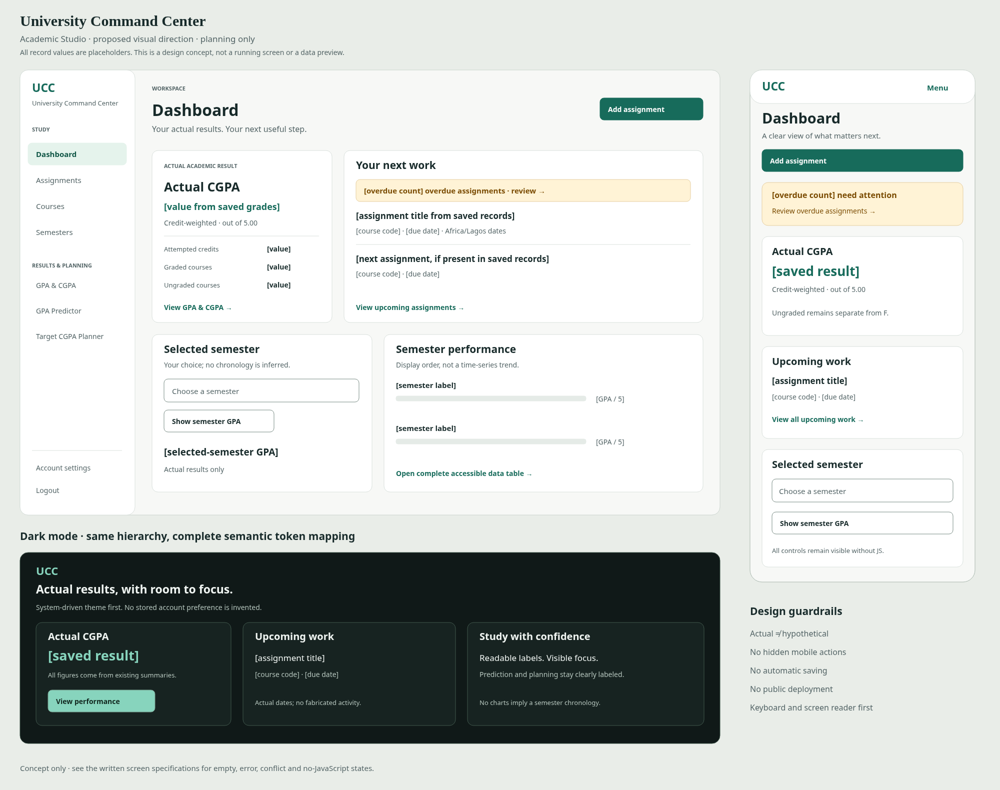

# University Command Center — premium UI/UX redesign blueprint

**Design and planning only.** Prepared 12 November 2026 (Africa/Lagos) against master `c19c1a335c6817e9eb2b359e5944a63eea3f3189`. No application, template, CSS, JS, dependency, schema, authentication or calculation implementation is changed. This branch contains documents, contrast evidence and static concept artwork only. Review the direction before authorizing any implementation PR.

## Recommended direction

**Academic Studio:** a calm, precise student workspace with warm paper surfaces, deep green accents, strong typography and clear numeric labels. The product should help a student answer two questions quickly: **What needs my attention? How am I doing in my actual results?** Preserve University Command Center's name and truthful academic model. Use a restrained visual identity rather than a generic KPI wall, institutional imitation, decorative charts or gamification.

[Open the visual direction sheet](PREMIUM_DESIGN_DIRECTION.png) · [Editable vector concept](PREMIUM_DESIGN_DIRECTION.svg)

The concept is a static design artifact, not a working application, final responsive implementation or completed accessibility test. Square-bracket values explicitly represent future bindings to existing saved summaries/records. Bar tracks have no invented grade values. Optional overdue modules appear only when the real count is positive; selected-semester results appear only after a valid selection. Conditional states in the written specifications take precedence over the composite concept sheet.

## Review pack

| Document | Contents |
| --- | --- |
| [Current frontend audit](FRONTEND_AUDIT.md) | Actual templates/CSS/JS and data inventory, strengths, prioritized defects, browser observations, scope and evidence limits |
| [Design system specification](DESIGN_SYSTEM.md) | Light/dark semantic colors, type/spacing/layout, components, interaction/state contracts and token/file architecture |
| [Screen and journey specifications](SCREEN_BLUEPRINTS.md) | Page-by-page purpose, hierarchy, data bindings, empty/error/conflict states, wireframes, mobile behavior and accessibility |
| [Delivery and acceptance plan](DELIVERY_AND_ACCEPTANCE.md) | Small proposed PRs, regression matrix, WCAG/mobile/performance gates, security dependencies and owner decisions |
| [Contrast evidence](COLOR_CONTRAST_EVIDENCE.csv) | Computed sRGB contrast for 24 proposed text/control/focus pairings; not a certification of rendered screens |

## First screen to redesign

**Dashboard, after a small token/shell/focus foundation PR.** It is the recurring entry point, exposes reusable summary/attention/list patterns and can improve immediately using existing server context. Its present mobile fixture puts the deadline list around 1,621 px down the page. A new composition can promote real upcoming work/overdue counts while keeping actual CGPA visible, improve first-use onboarding and demonstrate the visual language without touching authentication flows or academic formulas.

The first screen PR should reuse `summary`, `totals`, the existing five upcoming records and the semester selector; it should add **zero database reads**. Keep the full actual overview intact. Assignment-list adaptation comes next because primary actions currently require horizontal scrolling on a phone. Auth screens come later, coordinated with Claude's failure-rendering and recovery work.

## What remains intact

Django templates, native HTML/CSS and small progressive JavaScript remain the frontend. No React/Vue/Tailwind/SPA rewrite is justified by this audit. Retain owner-scoped services, live-session principals, forced RLS, UUID relationships, CSRF, hidden record versions, server validation, GET filters and bounded pagination. Keep CLI/Streamlit functional and separate. Do not import JSON, store grades in the browser, replace the grading scale or infer semester chronology/graduation policy.

## Approval choices

Approve or revise: the Academic Studio palette/typography; light sidebar and grouped navigation; dashboard attention-first mobile order; responsive management lists while retaining native performance tables; system-driven light/dark as the first release; the proposed PR order and evidence gates. Manual persistent theme controls, custom font packages, modal conversions, new analytics, autosave, authentication copy/policy changes and new backend features require separate scope decisions. This document's approval does not authorize implementation, purchase, merge or deployment.
