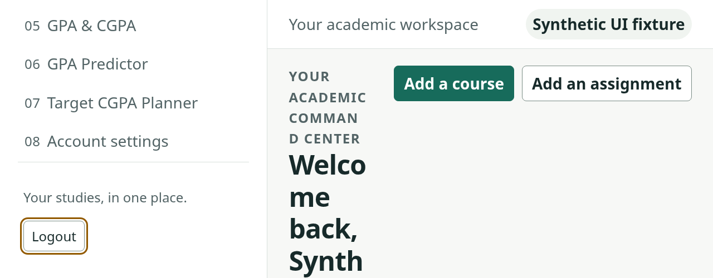

# UI1 — Academic Studio frontend foundation

Baseline: master `0983f6f144cfd39a744b915e89d648740d1187d2` (merged blueprint PR #39). Branch: `frontend/academic-studio-foundation`. This is the first UI1 slice from [the delivery plan](DELIVERY_AND_ACCEPTANCE.md), submitted for independent review, not deployment or full accessibility certification.

## Implementation and boundaries

- One consolidated light semantic token map at the top of site.css: approved warm canvas, green primary/active colors, text/control/focus/status colors; existing page aliases retained with documented roles. Shared buttons, fields and notices consume those tokens. Dark mode stays deferred to UI9; no partial OS-driven dark palette.
- Local system typography, rem text sizes, approved spacing scale, 12px surface/8px control radii, 15rem sidebar and 76rem content maximum. No remote font, icon, framework or application dependency. CSS is 21,568 bytes before compression; unchanged JavaScript is 1,774 bytes (budgets 30,000 / 5,000).
- Light desktop navigation retains every existing route and its order. Sidebar is bounded to 100dvh with 100vh fallback, internally scrollable, non-shrinking children and room for focus rings. Footer/Logout scroll into view using native keyboard behavior.
- Below 1024px, retain native inline details/summary navigation with visible Menu and UCC wordmark. No dialog, focus trap, sticky mobile overlay or JS requirement. Hidden desktop/mobile variants do not become extra keyboard stops. Current route continues using server-derived aria-current.
- The shared accounts/base.html change is **presentation only**: add the mobile wordmark and change the disclosure label. No authentication form, message, request/session behavior or error renderer was changed. All credential and academic forms, POST/CSRF/version fields, services, ownership, roles, RLS, schemas, migrations, formulas, CLI and Streamlit remain intact. Existing dashboard copy and composition are intentionally retained; UI2/onboarding reordering is separate.

The first implementation had no historical presentation assertions to rewrite: “Welcome back”, “Current semester”, Actual CGPA ordering and no-browser-storage tests all remain. New tests check shared-shell contracts rather than changing expected academic/security outcomes.

## Visual evidence

All four images are reproducibly generated by the browser script from real templates with an **empty synthetic workspace**, not an authenticated student's data or a live application capture. “Synthetic UI fixture” is an explicit fixture identity; zero counts and Not graded are the empty fixture state, not invented grades. The static renderer uses Django's dummy database backend to fail on accidental queries; it exercises no authentication or isolation behavior. PostgreSQL workflow regressions are separate below.

[Desktop shell](evidence/ui1/desktop.png) · [Phone shell](evidence/ui1/mobile.png) · [Shared login styles](evidence/ui1/login-mobile.png) · [Short desktop, 200% text, focused Logout](evidence/ui1/focus-200.png)



## Executed verification

Local environment: Python 3.12.14, Django 5.2.19, PostgreSQL **17.11**, psycopg 3.3.8, Playwright 1.65.0, Chromium **156.0.8078.79**, headless Linux. Disposable PostgreSQL bound to localhost; migration provisioning uses its dedicated role and requests use restricted auth/runtime identities through the existing test harness. No SQLite substitution.

| Check | Result |
| --- | --- |
| Legacy CLI/Streamlit/shared calculations | 113 passed |
| Foundation/database constraints | 33 passed |
| Restricted-role ownership/isolation | 46 passed |
| Existing authentication/session integration | 76 passed |
| Website integration, query budgets and academic behavior | 72 passed (69 existing + 3 new shared-shell/asset tests) |
| Browser regression methods | 6 passed |
| Django system checks / migration drift | No issues / no changes detected |
| Hashed runtime dependency audit | No known vulnerabilities |
| Repository safety / diff whitespace | Passed |

Browser coverage: empty academic shell and login at 320, 360, 390, 768, 820, 1024, 1280 and 1440 CSS widths (16 layout cases); no document overflow, one H1, intended navigation breakpoint. At 1280×500, Tab reaches every sidebar link and Logout with the entire 3px outline and offset inside the viewport/sidebar at **100% and 200% root text size**. All existing text sizes now scale in rem. Long identity reflow, native skip link and every mobile route/Logout with application JavaScript disabled, close-disclosure exclusion, active/default/hover text contrast, field boundary/focus contrast, reduced motion and forced-colors focus were checked.

Negative control: the same short-height regression method applied to **master's unchanged stylesheet** fails at both text sizes (focused target's bottom plus ring measured 533.125px in a 500px viewport). It passes with UI1. This verifies the test detects the original problem rather than merely checking CSS declarations. Different fixtures need not reproduce the earlier audit's exact Logout coordinates.

The browser fixture requires no server, database credentials or student records. Test-only Playwright is pinned in the new `frontend-browser` CI job; no runtime requirements or lockfiles change. The three existing CI jobs remain in place, and the website suite discovers the new integration tests. Hosted CI's exact run/head/conclusions are reported with the draft PR rather than guessed in this document.

## Reproduction

Use the repository's hashed Python 3.12 runtime/Django setup. Follow the existing three-role PostgreSQL test instructions in [STUDENT_WEBSITE.md](../STUDENT_WEBSITE.md) and [DATABASE_SECURITY.md](../DATABASE_SECURITY.md), with private environment values, to run:

```sh
python -m unittest discover -v
python server/manage.py test accounts academics --settings=config.settings.test
python server/manage.py test security_tests --settings=config.settings.security_test
python server/manage.py test auth_tests --settings=config.settings.auth_test
python server/manage.py test web_tests --settings=config.settings.web_test
```

Run foundation with its disposable foundation credentials and each restricted-role suite with the existing offline test/provisioning profile; do not run website requests with DBA credentials. Each suite needs its own PGTESTDATABASE distinct from the scratch database.

Browser-only checks (test environment only):

```sh
python -m pip install playwright==1.65.0
python -m playwright install --with-deps chromium
python tools/test_frontend_foundation_browser.py --screenshots-dir work/ui1-evidence -v
```

An already-installed local Chromium can be selected with `UCC_CHROMIUM_EXECUTABLE=/usr/bin/chromium`. The script uses in-memory template rendering and inline copies of the repository assets; it does not host or deploy an app. Retained screenshots default to no output unless the flag is supplied.

## Independent review and remaining work

Review the shared CSS across pages, focus evidence and the small shared-base diff before acceptance. Real VoiceOver/NVDA, physical mobile devices, Safari/Firefox, actual browser zoom and a full axe/WCAG 2.2 audit were **not tested** here; root-text resizing and 320px reflow are specific automated evidence, not a substitute for all zoom/assistive-tech checks. Do not infer WCAG certification or launch readiness.

PR #26/#29 security integration and B1 remain security-owned. This branch neither merges those changes nor resolves the B1 review findings. UI1 must be regression-tested again against their eventual accepted integrated head, and any template conflict independently reviewed. Account task composition, richer errors, navigation regrouping, icons, dark mode and dashboard/list redesigns remain later slices. No service purchase or deployment is included.
