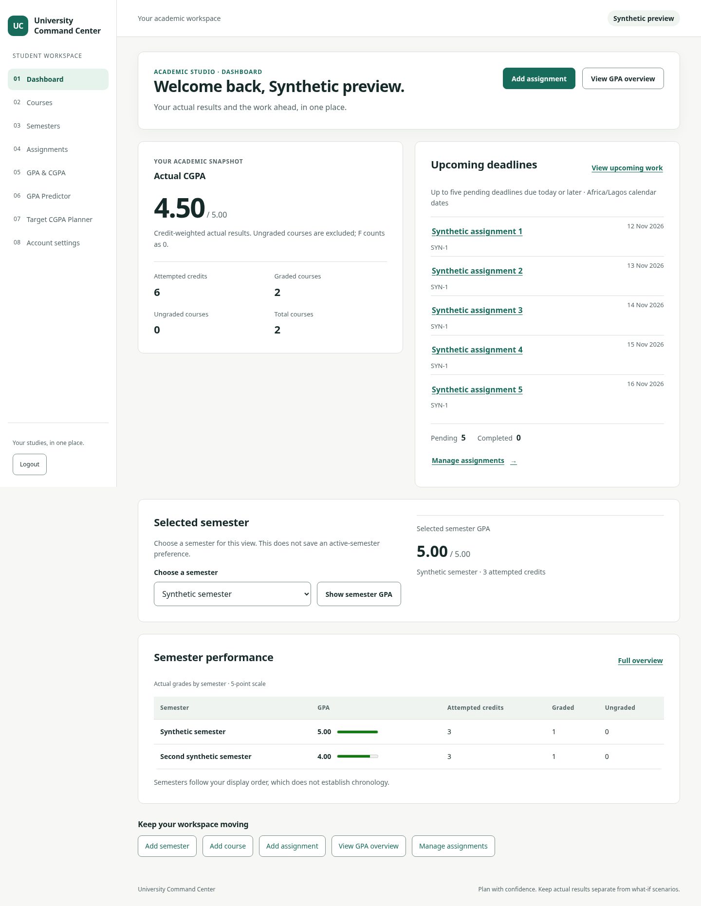

# UI2 — Academic Studio student dashboard

Branch: `frontend/ui2-academic-dashboard`. Verified base/master at start: **`ed8890982d99b7be5262d997e2e76266a4b65b0c`**, as requested. UI1 and premium auth were already merged. Dashboard presentation only; UI3 and security branches are untouched. Exact submitted head and hosted CI run are recorded in the draft PR.

## Before → after

Before: four equally weighted metric cards, always-promoted child creation links, a large selector/workload block before deadlines, and “Current semester” implying a persistent choice.

After: one prerequisite-aware primary action; conditional overdue attention; one dominant actual CGPA with compact supporting facts; upcoming work next; an accurately labelled **Selected semester** GET view; the full native semester comparison and supported quick actions. This brings real next work forward without adding requests for data or inventing metrics. One DOM/reading order works across desktop and mobile; no CSS order reversal.

[Before desktop](evidence/ui2/before-graded-1440.png) · [After desktop](evidence/ui2/graded-1440.png) · [Before phone](evidence/ui2/before-graded-390.png) · [After phone](evidence/ui2/graded-390.png)

## Design and scope

Warm ivory, deep green, system UI typography and the existing semantic tokens connect the dashboard to Academic Studio. The welcome surface alone optionally uses 96%-white frost with an opaque fallback. Academic values, deadlines, native controls and tables stay opaque. Dashboard cards retain the standard **12px** radius; auth's 20px radius/serif-story exception is not copied into academic UI.

The header keeps “Welcome back” and wraps long usernames. Its action is Create your first semester → Add course → Add assignment as actual prerequisites become available. View GPA overview is a supported secondary action. Footer quick actions have the same prerequisite checks. The empty comparison no longer promotes a course-create route without a semester.

Actual CGPA is supplied by `summary.gpa`, with a None check (not a truthiness check): **0.00 is real**, Not graded means missing actual grades. Attempted credits, graded/ungraded counts and real course count use the loaded context. No percentages, standing, predicted progress, reminders or chronology are invented. Warnings remain visible.

A positive real overdue count links to the existing filter. No attention block is rendered at zero. Upcoming rows keep the existing five-record maximum, exact dates, normalized course codes and owned-record edit links. No-upcoming wording still invites review of overdue work; it does not claim all work is complete. No completion/write control or assignment-management redesign is introduced.

The existing selector still submits GET with the same semester UUID values and Show semester GPA action. Its scope is explicitly this view, not a saved active semester. The complete existing comparison include, text values and meters remain, including separate rows for identical labels. Its keyboard-scrollable table retains its native semantics and scrollbar/hint.

Changed implementation files: only `student_web/dashboard.html`, new `student_web/dashboard.css`, dashboard/presentation tests, one existing browser asset-inlining helper and one CI browser command. There are **no changes to views, queries, services, calculations, models/migrations, ownership, RLS, authentication/session/recovery, minimal error handlers, application JS or dependencies**.

## Engineering evidence — zero additional database queries

[Recorded counts](evidence/ui2/query-counts.json) and [reproducible observation source](UI2_QUERY_PROBE.md), on real PostgreSQL **17.11**, compare the old template at the pinned base against UI2 using the same view, verified synthetic sessions and records. The old template was supplied through a test-only locmem loader; no application code or old template snapshot was added to the application.

| State | Baseline auth/runtime/migrator | UI2 auth/runtime/migrator |
| --- | --- | --- |
| Empty | 20 / 20 / 0 | **20 / 20 / 0** |
| Populated | 20 / 20 / 0 | **20 / 20 / 0** |

The committed regression additionally renders the already-loaded real view context under query capture: **0 auth, 0 runtime, 0 migrator reads** during rendering. Existing request query-budget/no-N+1 tests still pass. These are local observed counts, not a production latency guarantee.

No additional queryset access is hidden in an include. Course counts use the loaded list; deadline course codes use the existing select_related result. All authorization and snapshot/query bounds remain in their existing services/views.

The dashboard asset is **7,096 bytes**, plus unchanged site.css **21,923 bytes** = **29,019 CSS bytes per dashboard**, within the 30 KB page budget. Auth and dashboard styles are mutually exclusive. Aggregate repository CSS is larger; this budget is explicitly page payload. Application JS remains 1,774 bytes; no remote asset/framework/library is added.

## Regression evidence

Local: Python 3.12.14, Django 5.2.19, psycopg 3.3.8; PostgreSQL **17.11** with the established separate migration/auth/runtime LOGINs and forced RLS. Synthetic fixtures and local test email only; no SQLite and no real JSON imports.

| Suite | Result |
| --- | --- |
| Website | 91 passed (79 baseline + 12 UI2), with the three U2 presentation assertion changes now owner-approved |
| Authentication | 76 passed |
| Restricted-role isolation | 46 passed |
| Foundation/academic database | 33 passed |
| Legacy CLI/Streamlit/calculations | 113 passed |
| Historical presentation assertions | Three U2 presentation changes explicitly owner-approved in [comment #6822116700](https://github.com/jordandavid1812-creator/university-command-center/pull/44#issuecomment-6822116700); no further assertion edits |
| Baseline/new query observation | 1 method passed, empty and populated cases |
| UI1 browser | 10 passed |
| Premium-auth browser | 5 passed |
| UI2 browser | 12 passed |
| All three hashed dependency locks audited | No known vulnerabilities |
| Django check / migration drift | No issues / no changes detected |

UI2 covers no semesters, semesters without courses, all ungraded, actual zero, mixed grades, overdue without upcoming work, five-record previews, same-label UUID rows, full comparison, foreign account data/forged semester rejection, native GET and page asset budgets. Existing academic/security tests are preserved.

**U2 is explicitly owner-approved.** [PR #44 comment #6822116700](https://github.com/jordandavid1812-creator/university-command-center/pull/44#issuecomment-6822116700), recorded on 12 November 2026, authorizes exactly: Current → Selected semester; absence of the zero-overdue attention link while retaining the actual zero-count assertion; singular grammar for one overdue assignment. Exact before/after text and rationale remain in [the U2 approval register](UI2_ASSERTION_APPROVAL.md). This documentation update does not edit the historical test file. Mathematical, security and query-budget assertions remain unchanged; independent review is still required before merge.

The browser investigation caught two issues before submission: a duplicate outer/inner “Semester performance” region name (outer redundant label removed, inner native scroll region retained), and UI1's row flex-basis becoming a tall blank column above mobile actions. A dashboard-only override and a header-spacing regression prevent that blank gap. No auth/shared stylesheet change was needed.

## Accessibility and responsive checks actually performed

The UI2 browser methods cover **eight states × eight required widths = 64 layout cases**, plus 18 compact-header cases. Widths: 320, 360, 390, 768, 820, 1024, 1280, 1440 CSS px. Empty/graded/long states also use 1280×500 and 1440px at 200% root text size, and **320×200 equivalent reflow for a 1280×800 viewport at 400%**. This is equivalent-layout evidence, not a claim of actual browser-zoom testing.

Checks: no document overflow; meaningful H1/source order; actual mobile section order; readable action grouping; long username/title wrapping; keyboard-reachable primary action in short viewports; unchanged sidebar focus; no-JS GET submits the selected UUID; comparison keyboard scrolling and complete two-row text. Overdue attention precedes actual results only when positive. Native controls and full-page navigation remain.

Rendered important text pairs pass ≥4.5:1; control borders/focus pass ≥3:1 on adjacent opaque/attention/welcome surfaces using alpha-aware composition. Frost is optional and has an opaque fallback. Forced colors remove blur/shadow, preserve boundaries/focus, and keep text/links native. UI2 adds no motion; reduced-motion behavior and the existing meaningful motion-probe regression remain. No fixed mobile overlay, tooltip-only control, chart-only value or focus trap is added.

**Not tested:** real screen readers, physical phones, Safari/Firefox, actual browser zoom or a complete axe/WCAG 2.2 AA audit. Automated/Chromium evidence is not certification. Existing two-dimensional comparison-table local scrolling remains an intentional supported pattern; assignment-list adaptation is UI3, not this PR.

## Independent-review corrections against 0296607

| Finding | Disposition / evidence |
| --- | --- |
| **U1 required** | Corrected: auto-fitting tracks reserve **26rem per card** against actual content width, so 1280/1440 desktop views stack at 150% and 200% root text. Dates wrap beneath title/course metadata when an 18rem title column plus date cannot fit. Scalable padding is kept compact without reducing the 44px task-link target. Stats use adaptive 10rem tracks and normal word breaking. The selected-semester panel also auto-fits 22rem tracks so its controls/result reflow at enlarged text. No title truncation, hidden data, line clamp or content max-height is used. |
| **U2 required** | **Owner-approved.** [Three exact historical assertion changes](UI2_ASSERTION_APPROVAL.md) are authorized by [comment #6822116700](https://github.com/jordandavid1812-creator/university-command-center/pull/44#issuecomment-6822116700). Scope and justification are preserved; no further assertion changes. U1–U4 are ready for independent review, which remains a pre-merge gate. |
| **U3 recommended** | Corrected: `align-items:start` keeps the actual-CGPA card at natural height. A regression compares identical summary data beside one short task, five short tasks and five long tasks; the summary height must stay within 1px across those cases. |
| **U4 recommended** | Corrected: caption explicitly says **up to five pending deadlines due today or later**. Empty workspaces say “Add an assignment when you have a deadline.” Overdue review guidance appears only if the existing overdue count is positive; completed-only workspaces get neutral “view your work” guidance. No count/query semantics change. |

**Intentional secondary action:** View GPA overview is read-only and available with or without parent records. It exposes complete actual results/rules without competing with the prerequisite-aware primary creation action. This is a deliberate dashboard design choice, not a new backend feature.

New content-area tests inspect 1280/1440px × 150%/200% × normal/long assignment fixtures (eight configurations): full-width stacked cards, title columns at least 16rem, stat labels no more than two lines with no mid-word splits, actual row heights, dates below metadata where space is insufficient, and the entire focus ring on every deadline link reached by Tab. Normal rows are bounded by 6rem and the 186-character long-fixture rows by 16rem **in the tests**, relative to actual root text size; production CSS does not clamp height or hide text. Single-column statistics are also checked at 320px.

The **same readability assertions reject a test-only restoration of the original desktop grid/nowrap rules**. The negative fixture is intentionally broken and labelled as such; it is not the delivered design. [Captured corrected geometry](evidence/ui2/enlarged-content-metrics.json) is separate from full-page screenshots. Root-text scaling is not asserted to be identical to real browser zoom/OS text settings.

Updated full-page enlarged-text evidence:

| Width / text | Normal assignments | Long assignments |
| --- | --- | --- |
| 1280 / 150% | [Full page](evidence/ui2/graded-1280-text-150-full.png) | [Full page](evidence/ui2/long-1280-text-150-full.png) |
| 1280 / 200% | [Full page](evidence/ui2/graded-1280-text-200-full.png) | [Full page](evidence/ui2/long-1280-text-200-full.png) |
| 1440 / 150% | [Full page](evidence/ui2/graded-1440-text-150-full.png) | [Full page](evidence/ui2/long-1440-text-150-full.png) |
| 1440 / 200% | [Full page](evidence/ui2/graded-1440-text-200-full.png) | [Full page](evidence/ui2/long-1440-text-200-full.png) |

[Negative control: restored original broken layout](evidence/ui2/negative-original-layout-1280-text-200.png). The 1280×500 text-200 image below is now a full-page capture from that short viewport, rather than only the welcome region. Before-baseline images are retained; current-state screenshots are regenerated.

## Synthetic screenshot pack

All records, names, grades and dates below are **explicit synthetic test fixtures**, not real students or fabricated production data. Values are calculated by the existing `academic_summary`/presentation helpers. [Actual browser metadata](evidence/ui2/browser-metadata.json): system Chromium **156.0.8078.79**, Playwright **1.65.0**, Django **5.2.19**. Hosted CI prints its own managed Chromium version.

| State | Desktop | Phone |
| --- | --- | --- |
| Empty | [1440](evidence/ui2/empty-1440.png) | [390](evidence/ui2/empty-390.png) |
| Graded | [1440](evidence/ui2/graded-1440.png) | [390](evidence/ui2/graded-390.png) |
| Ungraded | [1440](evidence/ui2/ungraded-1440.png) | [390](evidence/ui2/ungraded-390.png) |
| Actual zero | [1440](evidence/ui2/zero-1440.png) | [390](evidence/ui2/zero-390.png) |
| Overdue only | [1440](evidence/ui2/overdue-1440.png) | [390](evidence/ui2/overdue-390.png) |
| Long content | [1440](evidence/ui2/long-1440.png) | [390](evidence/ui2/long-390.png) |

[1280×500 / 200% text](evidence/ui2/long-1280x500-text-200.png). Before images use the pinned baseline template with the **same graded fixture**, not another student's records.



## Reproduction / independent review gate

Use existing hashed Python/browser dependencies and the PostgreSQL instructions in [STUDENT_WEBSITE.md](../STUDENT_WEBSITE.md) / [DATABASE_SECURITY.md](../DATABASE_SECURITY.md). Each database suite uses its existing offline runner and private environment, never a migrator for web requests.

```sh
python server/manage.py test web_tests --settings=config.settings.web_test
python server/manage.py test auth_tests --settings=config.settings.auth_test
python server/manage.py test security_tests --settings=config.settings.security_test
python server/manage.py test accounts academics --settings=config.settings.test
python -m unittest discover -v
python tools/test_frontend_foundation_browser.py -v
python tools/test_premium_auth_browser.py -v
python tools/test_dashboard_browser.py --screenshots-dir work/ui2-evidence -v
```

Set `UCC_CHROMIUM_EXECUTABLE=/usr/bin/chromium` to reproduce the local screenshot browser; otherwise use the installed Playwright-managed Chromium. Static browser fixtures use the dummy DB backend and no running app; they are presentation checks, not authentication or RLS verification. The database suites provide separate runtime evidence.

Hosted CI is reported with the exact head/run after completion, not predeclared by this document. Owner/Claude review must assess visual hierarchy, evidence and test changes. No UI3, security integration, infrastructure provision, deployment, service purchase or merge is included. Existing security/B1 work and real AT/device validation remain separate dependencies before launch readiness.

## Native table-keyboard test follow-up

[Actual browser diagnostics and reproducible polling probe](UI2_TABLE_KEYBOARD_DIAGNOSTICS.md) explain the no-JavaScript wait correction. Native focus, genuine overflow and keyboard movement remain required; a blocked-key mutation proves the assertion rejects failed scrolling. UI2 now has 12 browser methods; UI1 and premium-auth assertions are unchanged. U1–U4 remain intact and owner approval remains recorded.
