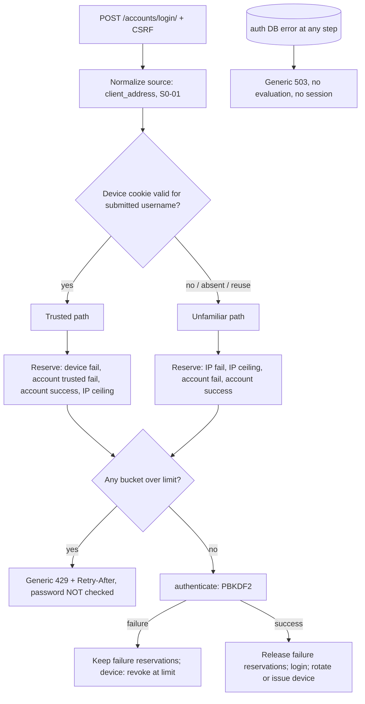

# Stage S1 design proposals — NOT implemented

| Item | Status |
| --- | --- |
| **S0-02** | Final technical design below (section A). Architecture accepted as the working design. **S0-02A (dormant foundation) is implemented** on `security/s0-02a-trusted-device-foundation`. S0-02B and S0-02C are **not authorized**; corrections A–D for S0-02B are in A.19. |
| **S0-03** | Design only (section B). Implementation not authorized. |

| Baseline for this design | Value |
| --- | --- |
| `master` | `64fe8743fa1d3b1c2b1f9e833dca9e5e4fd982bb` (Milestone 4B, PR #25) |
| Hosted CI on that commit | **Not verified.** Runs #22–#25 have been queued with zero jobs since 2026-11-11 20:20 UTC. A local PostgreSQL 16 run passed (337 tests) but does **not** substitute for the PostgreSQL 17 hosted run. |

---

## A. S0-02 — Authentication abuse protection (final design for approval)

### A.0 Owner decisions this design implements

| # | Decision | Where |
| --- | --- | --- |
| 1 | Server-side trusted devices: random cookie IDs, hashed DB values, **30-day** lifetime | A.4, A.5 |
| 2 | Device cookies never authenticate without the password | A.4.3 |
| 3 | Revocation on password reset, change, compromise and deactivation; student can revoke all | A.5.4 |
| 4 | Trusted browsers skip the ordinary shared-IP limit only while separate device and broader controls are in force | A.6, A.10 |
| 5 | IP login limit counts failures only, plus independent limits on successful logins and session creation | A.6.2 |
| 6 | 100-per-day account limit **deferred** (rationale in A.13) | A.13 |
| 7 | Site-wide adaptive mode and its 50-per-5-minutes threshold **deferred**; not part of S0-02A/B/C | A.13 |
| 8 | Email step-up and hard account restriction are inactive until real email, recovery and monitoring are verified | A.10 |
| 9 | Every PostgreSQL ownership, role-separation and RLS guarantee stays intact | A.8 |
| 10 | Minimal security-event logging, with no raw usernames, IPs, passwords, tokens or session secrets | A.9 |

### A.1 Threat model (authentication surface only)

| Threat | Attacker capability | Primary control | Residual |
| --- | --- | --- | --- |
| Distributed password guessing against one account | Many IPs, IPv4 rotation, IPv6 /64 rotation | Account failure limit reserved before the password is checked (A.6.3) | At most 10 guesses per 15 min per account, about 960 per day (A.13) |
| Credential stuffing (many accounts, few guesses each) | Breached username/password lists, botnet | IP failure limits; password policy | **Not stopped** by per-account limits. Needs MFA, breached-password checks or the deferred adaptive mode (R-06) |
| Username enumeration | Compares responses and timing | Identical bodies and statuses; account bucket keyed by HMAC with no account lookup; generic recovery responses | Registration still reveals taken usernames (S0-04). Timing until email is queued (S0-05) |
| Malicious lockout | Knows a username | Trusted devices are exempt; enforcement off until recovery works; recovery escape hatch (02C) | Unfamiliar browsers can be held restricted while an attack continues (R-01) |
| Shared campus NAT / Wi-Fi | One public IP for many students | Failure-only IP counting; trusted devices skip the IP limit | New browsers still share the IP failure limit (R-03) |
| Stolen device cookie | Malware, XSS, copied browser profile | Password still required; 5-failure device limit then revocation; rotation and reuse detection; per-account trusted-failure cap | Up to 5 guesses before revocation, and replay from another browser can't be prevented cryptographically (R-02) |
| Accumulating device cookies | Many logins to the attacker's own account | Devices bound to one account; max 10 per student; per-account trusted cap | None for other accounts |
| Email bombing | Repeated recovery requests | Per-IP, per-account and per-day limits; one outstanding token | Limited inbox noise (R-08) |
| Throttle or DB failure | Outage or induced errors | Fail closed: 503, password not checked, no session | Login unavailable during an outage (R-05) |

The assets, attackers and trust boundaries are those in `THREAT_MODEL.md`.
Only the auth role and the `auth` connection are touched. The academic runtime
role, RLS, signed owner context and academic tables are not changed (A.8).

### A.2 Architecture overview



### A.3 Modes and feature switches (settings, no code rollback needed)

| Setting | Values (default first) | Effect |
| --- | --- | --- |
| `UCC_TRUSTED_DEVICES` | `off`, `on` | `on`: issue and validate device cookies and records. `off`: cookies ignored and none issued. |
| `UCC_DEVICE_IP_BYPASS` | `False`, `True` | Trusted path skips the IP failure bucket. Its own limits and the IP ceiling still apply. |
| `UCC_ACCOUNT_LIMIT_MODE` | `off`, `observe`, `enforce` | `observe`: count and log "would restrict" but still check the password. `enforce`: 429 without checking the password. |
| `UCC_RECOVERY_TRUST` (02C) | `False`, `True` | A completed verified reset trusts that browser |
| `UCC_EMAIL_STEP_UP` (02C) | `False`, `True` | "Trust this browser" email link offered on restriction |
| `UCC_EMAIL_RECOVERY_VERIFIED` | `False`, `True` | Operator attestation (A.10). Settings refuse to load if `enforce` or any 02C switch is on while this is `False` or the email backend is console or locmem. Test settings may override. |

Startup checks fail closed with `ImproperlyConfigured` on an invalid
combination. Examples: `UCC_DEVICE_IP_BYPASS=True` with devices `off`, or
`enforce` without the attestation.

### A.4 Trusted-device cookie

#### A.4.1 Format

```
cookie value = django.core.signing.dumps(raw_id_b64, salt="ucc.trusted-device.v1", compress=False)
raw_id       = secrets.token_bytes(32)                          # 256-bit random identifier
db digest    = sha256(b"ucc.trusted-device.v1|" + raw_id).hexdigest()
```

* **Authentication of the cookie.** Security rests on the 256-bit random ID, whose digest must match a live DB row. The Django signature (purpose-specific salt, so a separate signing domain) is defence in depth: it rejects junk before any DB lookup, and it can't be swapped with any other signed value in the app. A leaked `DJANGO_SECRET_KEY` alone can't forge a device, because the attacker would still need a raw ID whose digest is in the DB.
* **Contents.** No username, student ID, session key, password material or email.
* **Attributes:**
  * Secure profiles: name `__Host-ucc_device`, `Secure`, `Path=/`, no `Domain`.
  * Local HTTP profiles: name `ucc_device`, not Secure (localhost only, matching the existing session cookie policy).
  * Always: `HttpOnly`, `SameSite=Strict` (only our own same-site login form needs it), `Max-Age` = 30 days.
* **Size.** About 110 bytes. One cookie per browser (see A.4.4).
* **Where it is read.** Only in the login POST handler (and the 02C recovery handlers). It is never consulted by any other view or middleware, and never stored in the session.

#### A.4.2 Issuance

A device is issued **only after a successful password authentication**, or in 02C
after a verified recovery (A.7). This happens in one `auth` transaction:

1. `SELECT ... FOR UPDATE` on the student row. This keeps the existing lock order (Student first) and serializes device issuance per student. **Under that lock** (implemented in S0-02A):
   * the supplied username must equal the student's **stored** username exactly, and the binding key is derived from the record;
   * the caller's `credential_stamp` (the password-derived `get_session_auth_hash()` captured when the password was verified) must still match.
   
   So a login verified before a password change or reset can never create trust after it.
2. If the browser presented a cookie for a record of *this* student, rotate that record instead of creating a new one (A.4.3).
3. Otherwise, if the student has 10 or more live records, delete the least-recently-used ones down to 9 (`ORDER BY last_used_at, id`).
4. Insert a record with `username_key = HMAC(normalized username)`, `expires_at = now + 30 days`, and `current_digest`.
5. After commit, set the cookie. If the browser held a cookie for a **different** student, that student's record is deleted in the same transaction (single-account browser, A.4.4).

Abuse resistance:

* Creation needs a successful login, so an attacker can only create devices for accounts whose password they already know.
* Successful logins are themselves limited (A.6.2).
* The per-student cap bounds storage.
* Records are bound to one account, so they give no advantage against other accounts.

#### A.4.3 Validation, rotation and reuse detection

On a login POST with a cookie:

1. Verify the signature with the purpose salt (`SECRET_KEY` plus `SECRET_KEY_FALLBACKS`). Invalid → unfamiliar path (no DB access).
2. Look up the digest (`current_digest = d OR previous_digest = d`), joined to `accounts_student.is_active` and `expires_at > now()`.
3. **Superseded identifier.** A match on `previous_digest` within `ROTATION_GRACE` (60 s) of `rotated_at` is a concurrent tab (`grace`; see A.19 C). After the grace window it is a replayed copy: delete the record, log `device_reuse_detected`, and use the unfamiliar path. Replay detection happens before the username check, so a replay is revoked whatever username accompanies it.
4. A `current_digest` match whose `username_key` differs from the submitted username's key → unfamiliar path. The record is untouched, because it may be another legitimate account on that browser.
5. Otherwise → trusted path. This is used **only** to choose throttle buckets. The password is always checked by the unchanged `StudentBackend`.

On every **successful** trusted login, the ID rotates: a new random ID is generated, `previous_digest` is set to the old one, `current_digest` to the new one, `last_used_at` and `expires_at` (now + 30 days) are updated, and a new cookie is set. A thief replaying the old cookie after the victim's next login triggers step 3, which revokes the device for both parties. The student simply re-earns trust at their next successful login.

#### A.4.4 One account per browser (chosen) vs. several

| Aspect | Single account (chosen) | Multiple accounts (up to 5) |
| --- | --- | --- |
| Cookie size | ~110 B | ~600 B (5 signed IDs), within the 4 KB limit |
| Logic | One lookup | List parsing, per-entry rotation, eviction order, partial reuse handling |
| Privacy | Reveals nothing beyond "this browser has a device" | Shows anyone with access to the browser profile how many accounts used it. The server can link those students to one browser. |
| Effect | A second student logging in on the same browser replaces the first student's trust | Shared family laptops keep trust for each |

Single-account is simpler and leaks less. Shared lab computers make the
multi-account linkage undesirable. It can be revisited after rollout with real
usage data.

#### A.4.5 Lifecycle summary

| Event | Effect on device records | Effect on cookie |
| --- | --- | --- |
| Successful login, no or unknown cookie | Issue new record (A.4.2) | Set |
| Successful trusted login | Rotate ID, expiry = now + 30 d | Replaced |
| 30 days without a successful login | Expires; cleanup deletes it | Expires in the browser too |
| 5 failures in 15 min on this device | Record deleted (`device_limit_revoked`) | Ignored afterwards |
| Old (rotated) ID replayed | Record deleted (`device_reuse_detected`) | Ignored afterwards |
| Password change | **All** of the student's records deleted in the password transaction | Re-issued at next login |
| Password reset completed | **All** deleted in the reset transaction. 02C with `UCC_RECOVERY_TRUST`: one new record for the resetting browser. | Re-issued per 02C |
| "Forget all trusted browsers" (settings page, POST + CSRF + authenticated session) | All deleted | Cleared on this browser |
| Account compromise | Owner resets the password → all deleted. Sessions are already invalidated by the existing auth-hash check. | — |
| Deactivation (`is_active=false`, offline) | Lookup join ignores them; runbook deletes them; cleanup removes them | Ignored |
| `DJANGO_SECRET_KEY` rotation | Unchanged (`username_key` is checked against the current key and every fallback) | With the old key in `SECRET_KEY_FALLBACKS`: still valid; a rotation re-signs the cookie, but the record's `username_key` stays bound to the old key, so trust ends when the fallback is removed. Without: signature fails, so the browser is treated as unfamiliar (graceful) and the record expires. |
| Logout | Unchanged (device trust is not a session) | Kept |

### A.5 Database schema proposal (S0-02A, new migration `accounts.0003`)

```sql
CREATE TABLE accounts_trusteddevice (
    id               uuid PRIMARY KEY,
    student_id       uuid NOT NULL REFERENCES accounts_student(id) DEFERRABLE INITIALLY DEFERRED,
    username_key     char(64) NOT NULL,
    current_digest   char(64) NOT NULL UNIQUE,
    previous_digest  char(64) UNIQUE,
    rotated_at       timestamptz,          -- NULL iff previous_digest IS NULL (CHECK)
    created_at       timestamptz NOT NULL,
    last_used_at     timestamptz NOT NULL,
    expires_at       timestamptz NOT NULL,
    CONSTRAINT trusteddevice_hex CHECK (current_digest ~ '^[0-9a-f]{64}$'
        AND (previous_digest IS NULL OR previous_digest ~ '^[0-9a-f]{64}$')
        AND username_key ~ '^[0-9a-f]{64}$'),
    CONSTRAINT trusteddevice_rotation CHECK (previous_digest IS DISTINCT FROM current_digest),
    CONSTRAINT trusteddevice_expiry CHECK (expires_at > created_at
        AND expires_at <= last_used_at + interval '31 days')
);
CREATE INDEX trusteddevice_student_lru ON accounts_trusteddevice (student_id, last_used_at);
CREATE INDEX trusteddevice_expiry_idx  ON accounts_trusteddevice (expires_at);

CREATE TABLE accounts_loginlimit (
    bucket      char(64) PRIMARY KEY,           -- HMAC(kind|subject); no plaintext
    kind        varchar(24) NOT NULL CHECK (kind IN ('account_fail','account_trusted_fail',
                    'account_success','device_fail','ip_ceiling')),
    attempts    integer NOT NULL CHECK (attempts >= 0),
    expires_at  timestamptz NOT NULL
);
CREATE INDEX loginlimit_expiry_idx ON accounts_loginlimit (expires_at);
```

Notes:

* The existing `accounts_auththrottle` keeps the **IP failure** bucket under its existing key (`login|<source>`). Historical tests assert one `AuthThrottle` row per login source, so new buckets go in the new table.
* The ORM uses `on_delete=CASCADE` for devices. Account deletion isn't a feature, but devices must never block an offline admin deletion.
* The migration is reversible (drops both tables). Historical migration tests that migrate `accounts` back to `0002` must keep passing.
* No change to `accounts_student`, `accounts_accounttoken`, the academic tables or `ucc_security`.
* **02C only:** `accounts_accounttoken.purpose` CHECK gains `'device'`, plus a nullable `browser_binding char(64)` column (digest of a pending-request nonce, A.7.2).

### A.6 Throttling algorithms (S0-02B)

#### A.6.1 Keys

| Kind | Subject | Limit (initial) | Counts |
| --- | --- | --- | --- |
| IP failure (`AuthThrottle`, existing key) | `client_address()` (IPv4 or IPv6 /64) | 10 / 15 min (`AUTH_RATE_LIMITS['login']`) | **Failures** (reserve, release on success) |
| `ip_ceiling` | same source | 60 / 15 min | **All** attempts, successes included (bounds hashing CPU and session creation per source) |
| `account_fail` | `NFKC(username).casefold()` | 10 / 15 min | Failures on the unfamiliar path |
| `account_trusted_fail` | same | 20 / 15 min | Failures on the trusted path, across **all** of the account's devices |
| `account_success` | same | 20 / hour | Successful logins on either path (bounds session creation per account) |
| `device_fail` | device record id | 5 / 15 min | Failures on that device; reaching the limit deletes the device |

Bucket = `salted_hmac("ucc-login-limit", f"{kind}|{subject}", algorithm="sha256")`.
Unknown and known usernames compute identically, with no account lookup. The
username is normalized exactly as `UsernameField` does (NFKC), then casefolded.
That over-groups case variants, which is conservative.

| Path | Buckets reserved before checking the password |
| --- | --- |
| Unfamiliar | IP failure, `ip_ceiling`, `account_fail`, `account_success` |
| Trusted, `UCC_DEVICE_IP_BYPASS=False` | IP failure, `ip_ceiling`, `device_fail`, `account_trusted_fail`, `account_success` |
| Trusted, `UCC_DEVICE_IP_BYPASS=True` | `ip_ceiling`, `device_fail`, `account_trusted_fail`, `account_success` (no IP failure bucket) |

A trusted device therefore never escapes **all** limits:

* `device_fail` revokes a stolen cookie after 5 guesses.
* `account_trusted_fail` caps guessing across every stolen cookie for one account at 20 per 15 minutes.
* `ip_ceiling` and infrastructure limits (A.10) still bound volume per source.

Accumulating cookies can't raise these limits, because devices are per account and capped at 10.

#### A.6.2 Successful authentications and session creation

Failure-only IP counting stops a NAT from being blocked by its own successful
logins. Volume is then bounded independently:

* `ip_ceiling`: 60 attempts per 15 minutes per source.
* `account_success`: 20 per hour per account.
* Each session already expires 30 minutes after creation, so live sessions per account stay at about 20 or fewer.

Historical tests stay valid. Each test either uses the `login` key alone, or a
failure followed by a block, and both behave the same under failure-only
counting (checked by reading `test_limits_and_tokens.py` lines 18–55; to be confirmed by running them in 02B).

#### A.6.3 Atomic reservation

The reservation is a hook in `BoundedAuthenticationForm.clean()`, placed
immediately before Django's `authenticate()` call. That call only happens when
both fields are present and within length bounds, so malformed posts reserve nothing.

```
BEGIN (auth connection, READ COMMITTED)
  -- one statement per table, rows in sorted bucket order (deterministic lock order, no deadlock)
  INSERT INTO accounts_auththrottle ... ON CONFLICT DO UPDATE SET attempts = CASE expired THEN 1 ELSE LEAST(attempts+1, limit+1) END ... RETURNING attempts, expires_at
  INSERT INTO accounts_loginlimit (bucket, kind, attempts, expires_at) VALUES (...),(...),(...)
      ON CONFLICT (bucket) DO UPDATE SET ... RETURNING bucket, attempts, expires_at
  IF any attempts > limit:  ROLLBACK → generic 429, Retry-After = max remaining window; log once per window
  ELSE:                     COMMIT  (reservations are now visible to concurrent requests)
authenticate()   -- PBKDF2 runs OUTSIDE any transaction; no row locks held while hashing
on failure: keep reservations; if device_fail reached limit → DELETE device (own short transaction)
on success: one transaction:
  UPDATE ... SET attempts = GREATEST(attempts-1,0) WHERE bucket IN (failure buckets) AND expires_at = <reserved expiry>
  (success and ceiling counts stay); then login(), device issue or rotation (A.4)
```

Properties:

* At most `limit` passwords are checked per window per failure bucket, however many requests run in parallel. Each over-limit request rolls back its own increments, so the counters saturate at `limit+1` without drifting.
* A release never decrements a newer window, because it's conditioned on the same `expires_at`.
* `observe` mode reserves and releases identically but never returns 429 for `account_fail`. It logs `account_limit_would_restrict` instead.
* **Failure semantics:** any `DatabaseError` (including a missing grant or an unavailable DB) during reservation, device lookup or finalization produces a generic **503**, and `auth_protection_failure` is logged. **Superseded by A.19 D:** a failed finalization *after* a correct password also returns 503 with no session and no cookie. It does **not** complete the login.

#### A.6.4 Shared campus Wi-Fi / NAT

| Student | Experience |
| --- | --- |
| Returning browser (device on), bypass on | Unaffected by others' failures at the same IP. Limited only by their own device, account and success limits plus the 60 / 15 min ceiling. |
| New browser | Shares the IP failure bucket (10 failures / 15 min) with everyone on that IP. Successful logins don't consume it. An attacker on the same NAT can still exhaust it (R-03). |
| Large campus behind few IPs | **See A.19 B:** trusted and unfamiliar traffic use separate ceilings, so unfamiliar floods can't block trusted devices. The 60 / 15 min unfamiliar ceiling may still be too low; it's configurable per deployment. The real fix is a reviewed trusted-proxy topology (S0-01) or campus egress data. |

### A.7 Recovery mechanism (S0-02C)

#### A.7.1 Verified recovery → trusted browser (no session)

* Uses the existing `/accounts/reset/<selector>/<secret>/` flow, unchanged: one-hour, single-use token, digest storage, row locks, credential stamp.
* Only a **successful POST** (valid token, new password accepted) changes device state, in the same `auth` transaction as the password update and token consumption:
  1. Delete all of the student's device records.
  2. If `UCC_RECOVERY_TRUST` is on, insert one record for this browser.
* The response still logs out and asks the student to sign in. **No session is created.**
* *Requesting* a reset, or a GET on the link, never changes device state. An attacker who can't read the inbox gains nothing.
* Concurrent consumption is already serialized (Student, then token locks). The second request finds the token consumed and creates nothing.

#### A.7.2 "Trust this browser" link (email step-up, `UCC_EMAIL_STEP_UP`)

1. On a restriction (429 in `enforce` mode), the generic page also offers "Email me a link to trust this browser". This text is identical for every 429 kind and every username.
2. A POST with an email address and CSRF sets a short-lived HttpOnly `ucc_device_pending` nonce cookie (15 min). An `AccountToken(purpose='device')` is created only if an active verified account matches. It stores `browser_binding = sha256(nonce)`, a 15-minute expiry, the credential stamp and the email at issue. The response is identical either way.
3. GET on the link shows a confirmation page and consumes nothing (safe against email link scanners).
4. A POST on the link must present the same nonce cookie (binding check) and a valid unconsumed token. Then it locks Student, then token, consumes the token, creates the device record, sets the device cookie, and clears the nonce. **No session is created.** The student then logs in with their password on the trusted path.
5. Replay → token already consumed. Expiry → 400. Wrong browser → 400 and the token is untouched. A password change before use invalidates the token (credential stamp). A new request revokes the earlier token.

#### A.7.3 Email bombing and enumeration

Limits:

* Per source: 5 per hour, reusing the `AuthThrottle` pattern.
* Per email HMAC: 3 per hour and 10 per day (new `loginlimit` kinds, added in 02C).
* One outstanding token per account and purpose.

All responses are byte-identical whether or not the account exists.

**Activation requires asynchronous email delivery** (S0-05), so that response
time doesn't reveal whether an account exists.

#### A.7.4 Email provider unavailable

* There is no automatic fallback. An automatic downgrade to `observe` would let an attacker disable protection by breaking email.
* Alerts fire on delivery-failure rates. The runbook is: switch `UCC_ACCOUNT_LIMIT_MODE` to `observe` (a settings change), and switch back when delivery is healthy.
* During an outage, trusted browsers are unaffected, and restrictions on unfamiliar browsers last at most one 15-minute window after the attack stops.

### A.8 Role-grant changes (`configure_auth_role`, migrator-run)

| Table | Auth role | Runtime role |
| --- | --- | --- |
| `accounts_trusteddevice` | SELECT, INSERT, DELETE. UPDATE (`current_digest`, `previous_digest`, `last_used_at`, `expires_at`) only. | **None.** `configure_runtime` already revokes all public-table privileges and grants an allow-list. |
| `accounts_loginlimit` | SELECT, INSERT, DELETE. UPDATE (`attempts`, `expires_at`) only. | **None** |
| `accounts_accounttoken` (02C) | Unchanged grants, plus SELECT and INSERT on the new `browser_binding` column through the existing table-level grants | None |

* `require_auth_role()` also fails closed if the auth role **lacks** SELECT on the two new tables (so a missing provisioning step gives a site-wide generic 503 instead of mid-login errors).
* `require_runtime_role()` also fails closed if runtime has **any** privilege on them.
* No new roles, no `SECURITY DEFINER` functions, no RLS change, no grant to PUBLIC, and nothing touches `ucc_security` or `ucc_crypto`.
* RLS is not applied to these auth tables, consistent with the existing account, token and session tables. The auth role is a single trusted server principal, not a per-student identity.

### A.9 Security-event logging (minimal S0-12 subset)

* Logger `ucc.security`, writing one JSON line per event to stderr. The host's log pipeline enforces retention: **30 days**, documented as a deployment requirement. No DB log table.

| Event | Fields |
| --- | --- |
| `login_limited` | `kind`, `bucket_ref`, `path` (trusted or unfamiliar), `retry_after` |
| `account_limit_would_restrict` (observe) | `bucket_ref` |
| `distributed_guessing_suspected` | `bucket_ref`. Emitted when `account_fail` reaches its limit while the current source's IP failure bucket is below **half** its limit: failures are spread across sources. |
| `device_issued`, `device_rotated`, `device_revoked` (`reason`: password_change, reset, forget_all, reuse, device_limit, lru, deactivation) | `device_ref` |
| `auth_protection_failure` | `stage` (reserve, lookup, release, issue), `error_class` |
| 02C: `recovery_trust_granted`, `step_up_link_requested`, `step_up_link_rejected` (`reason`) | `bucket_ref` / `device_ref` |

Field rules:

* `bucket_ref` and `device_ref` are the first 12 hex characters of an HMAC under a **separate** logging salt. They support correlation across events but can't be reversed or joined to DB buckets without the secret.
* **Never logged:** passwords, token selectors or secrets, cookie values, session keys, raw usernames, emails, raw IPs, request paths of token URLs (the route *name* is logged instead) and query strings.
* Each limit kind is logged once per window (on the transition to `limit+1`), so attacks can't flood the logs.

### A.10 Activation conditions

| Mechanism | PR | Can be enabled when |
| --- | --- | --- |
| Schema, grants, primitives (dormant) | 02A | Hosted PostgreSQL 17 CI is green; migration is reversible; all historical tests pass unchanged; grant tests pass |
| `UCC_TRUSTED_DEVICES=on` (issue, rotate, revoke, forget-all) | 02B | 02A merged; concurrency tests green on PG17 CI |
| `UCC_ACCOUNT_LIMIT_MODE=observe` | 02B | Same, plus logging verified |
| Failure-only IP counting plus `ip_ceiling` and `account_success` | 02B | Same (always on once merged) |
| `UCC_DEVICE_IP_BYPASS=True` | 02B | `device_fail`, `account_trusted_fail`, `ip_ceiling` and `account_success` verified. **Production only:** infrastructure request-rate limiting at the reverse proxy and reviewed `UCC_TRUSTED_PROXIES` |
| `UCC_ACCOUNT_LIMIT_MODE=enforce` | 02C | **All of:** real transactional email (SPF/DKIM/DMARC, TLS); async queue (S0-05); reset and trust-link tested end to end in staging with real delivery; alerts on limit and delivery-failure rates; support runbook; rollback rehearsed; `UCC_EMAIL_RECOVERY_VERIFIED=True` |
| `UCC_RECOVERY_TRUST`, `UCC_EMAIL_STEP_UP` | 02C | Same as `enforce`, plus the bombing limits verified |

Until `enforce` is active, a correct password from an unfamiliar browser is
still checked (`observe`), as required by the owner's decision 5.

### A.11 State transitions

**Device record:** `(none)` →[successful login, or verified recovery in 02C]→ `ACTIVE`
→[successful trusted login]→ `ACTIVE` (rotated; old ID kept as `previous`) →
any of {30-day expiry, password change, reset, forget-all, reuse detected, 5 device failures,
LRU eviction, deactivation} → `DELETED`.

**Account restriction (`account_fail`):** `OPEN (0..9 failures)` →[10th failure
within the window]→ `AT_LIMIT` →[next unfamiliar attempt]→ `RESTRICTED` (enforce:
429 without checking the password; observe: logged and checked) →[window expires]→ `OPEN`.
A successful login in `OPEN` or `AT_LIMIT` releases its reservation. Trusted
devices never read this bucket.

**Login request:** `RECEIVED` → `CLASSIFIED` (trusted or unfamiliar) →
`RESERVED` | `LIMITED (429)` | `UNAVAILABLE (503)` → `EVALUATED` → `FAILED`
(reservations kept; device possibly revoked) | `SUCCEEDED` (failure reservations
released; session rotated; device issued or rotated).

**Step-up token (02C):** `REQUESTED` → `PENDING` →[POST, same browser, valid]→
`CONSUMED` + device `ACTIVE` | →[expiry, newer request or password change]→ `INVALID`.

### A.12 Answers to the owner's critical questions

| # | Question | Answer |
| --- | --- | --- |
| 1 | Can an attacker exhaust an unfamiliar student's allowance indefinitely? | **Yes, in `enforce` mode, for unfamiliar browsers only**, at about 10 requests per 15 min per victim. Trusted browsers are unaffected, and 02C's trust link is the escape hatch. That is why `enforce` is gated on verified email (A.10). |
| 2 | Can a cookie be replayed from another browser? | It can't be prevented cryptographically (no device-bound keys). It's detected when IDs rotate (A.4.3), limited to 5 failures before revocation, and the password is still required. |
| 3 | Can a student revoke all trusted devices? | Yes: "Forget all trusted browsers" on the settings page, and any password change or reset. |
| 4 | Do stolen cookies survive a password reset? | No. Every record is deleted in the reset transaction. |
| 5 | Can an attacker accumulate cookies for more guessing capacity? | Devices need a successful login to that account and are capped at 10 per student. `account_trusted_fail` caps guessing across all of an account's devices at 20 per 15 min. |
| 6 | What if the throttle DB is unavailable? | Generic 503. The password isn't checked and no session is created (fail closed). |
| 7 | Can shared-NAT users still suffer denial of service? | Unfamiliar browsers can, through the shared IP failure bucket and `ip_ceiling` (R-03). Returning browsers can't once IP bypass is on. |
| 8 | What if the email provider is down? | No automatic fallback. Alert, then operator switches to `observe` (A.7.4). |
| 9 | Can cookies exceed browser size limits? | No. One ~110-byte cookie per browser (A.4.4). |
| 10 | How are races tested on PostgreSQL 17? | The CI `database-tests` job (postgres:17 service) runs `TransactionTestCase` threads behind a `threading.Barrier`, each closing its own connections, as in the existing `test_concurrent_attempts_cannot_race_the_limit`. Also a raw two-connection psycopg interleaving test. Local PG16 runs are supporting evidence only. |

### A.13 Deferred items

| Item | Expected benefit | Denial-of-service consequence | Status |
| --- | --- | --- | --- |
| 100-per-24-hour `account_fail` limit | Cuts online guesses per account from ~960/day (~350k/year) to 100/day (~36.5k/year), about a 9.6× reduction | An attacker could hold an unfamiliar-browser restriction for up to 24 h instead of 15 min | **Deferred** (owner decision 7) |
| Site-wide adaptive mode (50 failures / 5 min → email step-up for every unfamiliar login) | The main defence against credential stuffing | An attacker can deliberately push every new-browser login into email confirmation | **Deferred**; not in 02A/B/C |
| IPv4 /24 and IPv6 /48 prefix limits | Slows rotation across prefixes | False positives on large campuses and ISPs | Deferred |
| Multi-account device cookies | Shared family laptops | Privacy linkage (A.4.4) | Deferred |
| MFA, breached-password checks | Strongest defence against stuffing | New dependency or product decision | Needs separate approval |

### A.14 Risk register

| ID | Risk | Likelihood | Impact | Treatment | Owner action |
| --- | --- | --- | --- | --- | --- |
| R-01 | Targeted unfamiliar-browser restriction in `enforce` | Medium | Medium (that student, new browsers) | Trusted devices, 02C trust link, alerts, 15-min windows | Gate `enforce` on A.10 |
| R-02 | Stolen device cookie replay | Low | Low–Medium (5 guesses, then revoked) | Rotation and reuse detection, device limit, revocation, CSP (S0-07) | Prioritize S0-07 |
| R-03 | Shared NAT: new browsers blocked by attacker failures | Medium | Low–Medium | Failure-only counting, IP bypass for devices | Trusted-proxy topology at deployment |
| R-04 | Throttle state wiped (DB restore or table truncation) | Low | Low (one window of extra guesses) | Short windows; no persistence required | — |
| R-05 | Auth DB outage → login unavailable | Low | High (availability) | Fail closed, by design | Monitoring |
| R-06 | Credential stuffing under per-account thresholds | High (generic internet risk) | High (account takeover) | **Not addressed by 02A–C** | Decide on adaptive mode, MFA or breached-password checks |
| R-07 | Enumeration through timing before async email | Medium | Low | Gate 02C on S0-05 | — |
| R-08 | Email bombing within limits | Low | Low | Per-IP, per-account and per-day caps | — |
| R-09 | Hot rows under attack (one account bucket) | Low | Low (latency) | Short transactions; hashing outside transactions | Load test (S3) |
| R-10 | Misconfiguration (bypass without devices; enforce without email) | Low | Medium | `ImproperlyConfigured` startup checks | — |
| R-11 | Release failure leaves over-counting | Low | Low (more conservative) | Logged; window expiry | — |
| R-12 | Hosted CI unavailable, so PG17 unverified | **Current** | Medium (unverified merges) | Don't merge 02A until PG17 CI is green | Resolve the Actions queue; branch protection (S0-15) |

### A.15 Rollout and rollback

**Rollout:**

1. Merge 02A (dormant), then re-run `configure_auth_role` in each environment. Middleware fails closed until that's done.
2. Merge 02B with every switch at its default.
3. Locally: `UCC_TRUSTED_DEVICES=on`, then `observe`, then optionally IP bypass.
4. Review the logs.
5. 02C, then staging with real email, then `enforce` only once A.10 is met.

**Rollback** (in order of preference):

1. Settings: `enforce` → `observe` → `off`; `UCC_DEVICE_IP_BYPASS=False`; `UCC_TRUSTED_DEVICES=off`. Immediate, with no data change.
2. Code revert of 02B or 02C. Device cookies are then ignored harmlessly.
3. Reverse migration of 02A, in disposable or reviewed maintenance only, after the code is reverted. It drops only throttle and device state; no academic or account data is affected.

### A.16 Test matrix

All tests are new files. Every historical test stays unchanged (currently 337
on `64fe874`). All must pass in **hosted PostgreSQL 17 CI** before merge.

**S0-02A: schema, grants, primitives (no login behaviour change), IMPLEMENTED**

File: `server/auth_tests/test_trusted_devices.py` (35 tests, real migrator, runtime and auth LOGIN roles; the 7 added after review are in `DeviceBindingAndRevocationTests`).

| Group | Tests |
| --- | --- |
| Creation and storage | `test_issue_stores_only_digest_and_cookie_reveals_no_identity`, `test_identifiers_are_256_bit_and_unique` |
| Validation | `test_check_accepts_only_the_bound_account`, `test_invalid_tampered_foreign_and_junk_cookies_are_absent`, `test_expired_signature_and_expired_record_are_absent`, `test_deactivated_student_devices_are_absent_and_cannot_be_issued`, `test_secret_key_rotation_requires_fallback` |
| Rotation and replay | `test_rotation_replaces_identifier_and_renews_expiry`, `test_superseded_identifier_within_grace_gets_no_new_cookie`, `test_superseded_identifier_after_grace_is_replay_and_revokes`, `test_replay_is_detected_even_with_another_username`, `test_two_generation_old_identifier_is_absent`, `test_concurrent_two_tab_rotation_gives_one_cookie_and_one_grace`, `test_lost_conditional_update_never_returns_an_unstored_cookie` |
| Caps and revocation | `test_cap_evicts_least_recently_used`, `test_concurrent_issue_never_exceeds_cap` (20 threads), `test_revoke_one_and_all_leave_other_students` |
| Expiry and cleanup | `test_cleanup_removes_only_expired_records_in_batches` (includes `clear_auth_artifacts`) |
| Constraints | `test_database_constraints_reject_invalid_records` |
| Compatibility | `test_login_behaviour_unchanged_no_device_cookie_or_rows`, `test_password_change_and_reset_flows_work_with_devices_present`, `test_revoke_all_is_atomic_with_a_locked_password_update` |
| Roles | `test_auth_role_grants_are_minimal`, `test_runtime_role_has_no_access_to_device_tables`, `test_missing_auth_grant_fails_closed`, `test_over_privileged_roles_fail_closed` |
| Migration | `test_migration_reverses_and_reapplies_with_fail_closed_grants` |
| Isolation | `test_live_code_does_not_import_device_primitives` |

**S0-02B: throttling integration**

| Test | Asserts |
| --- | --- |
| `test_distributed_guessing_limited_without_password_check_enforce` | mocked backend never called after the 10th failure |
| `test_observe_mode_logs_but_checks_password` | — |
| `test_unknown_and_known_usernames_identical` | status, body, row counts |
| `test_case_and_nfkc_variants_share_account_bucket` | — |
| `test_concurrent_failures_never_exceed_limit_evaluations` | barrier, 20 threads, PG17 |
| `test_release_only_same_window` | — |
| `test_window_expiry_restores_access` | — |
| `test_trusted_device_logs_in_during_account_restriction` | — |
| `test_trusted_device_bypasses_shared_ip_failures_only_when_enabled` | — |
| `test_device_fail_limit_revokes_device` | — |
| `test_account_trusted_fail_caps_multiple_stolen_cookies` | — |
| `test_ip_failures_only_campus_nat_many_successes` | 30 students, one IP |
| `test_ip_ceiling_and_account_success_limits` | — |
| `test_password_change_and_reset_revoke_all_devices` | — |
| `test_forget_all_requires_post_csrf_and_session` | — |
| `test_deactivated_student_device_ignored` | — |
| `test_single_account_browser_replacement` | — |
| `test_cookie_flags_per_profile` | `__Host-`, HttpOnly, Strict, Secure, Max-Age |
| `test_db_error_fails_closed_503_without_evaluation` | patched cursor and missing grant |
| `test_all_limit_responses_identical_with_retry_after` | — |
| `test_security_log_fields_redacted` | no username, IP, token or cookie in captured logs; once per window |
| `test_settings_validation_rejects_unsafe_combinations` | — |
| `test_existing_auth_flows_unchanged` | — |
| S0 probe P03 | now shows 429 in `enforce` |

**S0-02C: recovery and step-up**

| Test | Asserts |
| --- | --- |
| `test_reset_request_alone_grants_nothing` | — |
| `test_verified_reset_trusts_browser_without_session` | — |
| `test_reset_replay_expiry_concurrent_consumption` | — |
| `test_step_up_link_same_browser_binding_single_use_expiry` | — |
| `test_step_up_get_does_not_consume` | — |
| `test_step_up_token_invalid_after_password_change` | — |
| `test_step_up_requests_generic_and_bombing_limited` | — |
| `test_enforce_requires_attestation_and_real_email_backend` | — |
| `test_async_email_constant_response_time` | delivery mocked with a delay |
| `test_email_failure_does_not_create_trust_or_leak` | — |

### A.17 Deployment dependencies

* Hosted PostgreSQL 17 CI restored and required on `master` (S0-15).
* Re-run `configure_auth_role` after the 02A migration.
* Scheduled `clear_auth_artifacts`, extended to the new tables (batched deletes).
* For production IP bypass: a reverse proxy with request-rate limiting and a reviewed `UCC_TRUSTED_PROXIES` list.
* For 02C activation: a real transactional email provider, an async queue, monitoring and alerts, a support runbook, and a log pipeline with 30-day retention.
* HTTPS everywhere (secure cookies, `__Host-` prefix).

### A.18 Unresolved risks needing owner decisions

1. Credential stuffing (R-06) remains largely unaddressed until adaptive mode, MFA or breached-password checks are approved.
2. Large-campus `ip_ceiling` sizing needs real egress data.
3. Whether "forget all trusted browsers" should also end other sessions. That needs a session index; it's tracked under S0-16.
4. The retention period (30 days proposed) and log destination at deployment.

### A.19 Corrections required before S0-02B (owner review)

#### A. Failed attempts must not consume the success allowance (and vice versa)

Every login attempt reserves **all** of its path's buckets atomically before the
password is checked (A.6.3). Finalization then settles each bucket by outcome:

| Bucket class | Reserved before check | On **failure** | On **success** |
| --- | --- | --- | --- |
| Failure buckets (`login` IP failure, `account_fail`, `account_trusted_fail`, `device_fail`) | +1 | **Keep** | **Release** (−1, same window only) |
| Success bucket (`account_success`) | +1 | **Release** (−1, same window only) | **Keep** |
| Volume ceilings (`ip_ceiling_*`) | +1 | Keep | Keep |

So each completed attempt permanently consumes exactly one ceiling unit, plus
one failure unit if it failed or one success unit if it succeeded. Release is
`UPDATE ... SET attempts = GREATEST(attempts - 1, 0) WHERE bucket = %s AND
expires_at = %s`, so a release can never drain a newer window.

Two things to note:

* An in-flight attempt briefly holds a unit in both its failure and success buckets. Near both limits, a concurrent attempt can therefore get a transient 429. That is bounded by one account's own concurrency and errs conservative.
* A request rejected with 429 rolls back all of its own increments, so it consumes nothing.

Regression tests for S0-02B:

* `test_failures_do_not_consume_success_allowance`: with `account_success` limited to 2, five failures followed by two successes are all allowed.
* `test_successes_do_not_consume_failure_allowance`: twenty successes don't restrict a later failure.
* `test_rejected_attempt_consumes_nothing`
* `test_inflight_reservation_released_after_outcome`: barrier threads; final counts are exact.
* `test_release_never_touches_newer_window`

#### B. The shared-IP ceiling can block trusted devices on a campus network

With a single `ip_ceiling` for all traffic, unfamiliar-browser attempts from one
campus egress address (including an attacker's) can use up the ceiling and
block returning students on trusted devices. The correction keeps volume
protection but separates the pools:

* `ip_ceiling_unfamiliar`: 60 attempts per 15 min per source. Counts only unfamiliar-path attempts.
* `ip_ceiling_trusted`: a separate, larger pool per source, initially 600 per 15 min and set per deployment. Counts only trusted-path attempts. Unfamiliar floods can't drain it, and each device stays bound by `device_fail`, `account_trusted_fail` and `account_success`.
* `UCC_HIGH_VOLUME_SOURCES` is an optional, operator-reviewed list of networks (for example the campus egress, from real data). It **multiplies** both ceilings (for example ×10) but never removes them. Like `UCC_TRUSTED_PROXIES`, it is empty by default and validated at startup: no `/0`, no prefix wider than IPv4 /16 or IPv6 /32.
* In production, reverse-proxy request-rate limiting remains the outer control (A.17).

Residual risk: a determined flood of *trusted-path* attempts from one egress
needs valid device cookies, which means compromised accounts. Monitoring covers it.

Regression tests:

* `test_unfamiliar_flood_does_not_exhaust_trusted_ceiling`
* `test_trusted_ceiling_still_bounds_volume_per_source`
* `test_high_volume_source_raises_but_never_removes_ceilings`
* `test_settings_reject_zero_missing_or_overbroad_ceiling_config`
* `test_campus_nat_trusted_students_log_in_during_unfamiliar_flood`

#### C. Cookie rotation under concurrent login attempts (implemented in S0-02A)

* `rotate()` locks the device row (`SELECT ... FOR UPDATE OF self`). Two tabs presenting the same identifier are serialized.
* The first tab rotates the identifier and gets the new cookie.
* The second tab re-reads the rotated row, finds its identifier in `previous_digest` within `ROTATION_GRACE` (60 s) of `rotated_at`, and gets **`grace`** with **no new cookie**. S0-02B must not send a `Set-Cookie` in that case, so the browser keeps the first tab's cookie. The trusted path still applies to that request.
* A conditional UPDATE (`WHERE current_digest = presented`) that matches no row also returns `grace` with no cookie. A cookie whose digest wasn't stored is never handed out.

| Situation | Classification | Effect |
| --- | --- | --- |
| Legitimate two-tab or double-submit | Previous digest, within 60 s of rotation | `grace`: trusted for this request, no rotation, no cookie |
| Copied cookie used after the owner's next login | Previous digest, more than 60 s after rotation | `replayed`: record deleted for both parties; unfamiliar path |
| Copied cookie used within 60 s of the owner's rotation | Previous digest, within grace | `grace`: **treated as an unfamiliar browser for all limits** (see below) |
| Identifier two or more rotations old | No match | `absent` (unfamiliar path); not detected as replay (accepted) |

**How S0-02B treats `grace` (review issue 3):**

* `Check.selects_trusted_limits` is `True` **only** for `trusted` (a current identifier).
* A `grace` request uses the **unfamiliar** path for throttling: the IP failure bucket, `ip_ceiling_unfamiliar`, `account_fail` and `account_success`.
* It gets no IP bypass and no trusted ceiling. It never rotates, renews or sets a cookie.

The only effect of `grace` is to avoid falsely revoking a legitimate device when
two tabs race. A copied cookie replayed inside the window therefore adds no
guessing capacity beyond what an unfamiliar browser already has, and can't
bypass account limits. A legitimate second tab is at worst subject to the
ordinary unfamiliar-browser limits for that one request; the first tab has
already succeeded.

S0-02B regression tests:

* `test_grace_request_uses_unfamiliar_limits_not_device_bypass`
* `test_grace_replay_within_window_cannot_exceed_account_fail`
* `test_grace_request_never_sets_cookie_or_renews`

Implemented tests:

* `test_grace_never_selects_trusted_limits_or_renews`
* `test_concurrent_two_tab_rotation_gives_one_cookie_and_one_grace`
* `test_superseded_identifier_within_grace_gets_no_new_cookie`
* `test_superseded_identifier_after_grace_is_replay_and_revokes`
* `test_lost_conditional_update_never_returns_an_unstored_cookie`
* `test_two_generation_old_identifier_is_absent`

Mutation evidence: with the grace window set to 0, the grace test fails. With
the lost-update guard removed, the lost-update test fails. The concurrency test
verifies lock serialization: the waiting tab's timestamp predates the
rotation, so it falls inside the window.

#### E. Record binding, revocation races and lock order (review issues 1–2, implemented in S0-02A)

**Lock order:** (1) `accounts_student` row → (2) `accounts_trusteddevice` rows → (3) `accounts_loginlimit` rows.

| Operation | Lock behaviour |
| --- | --- |
| `issue()` | Student `FOR UPDATE`, then devices (expiry and eviction deletes, insert) |
| `revoke_all()` | **Always** Student `FOR UPDATE` first (re-entrant inside a password change or reset transaction that already holds it), then DELETE all devices |
| `rotate()` | Only its own device row (`FOR UPDATE OF self`). It never takes the Student lock, so it can't form a cycle with `issue` or `revoke_all`. |
| S0-02B password change, reset, "forget all" | Student `FOR UPDATE`, update the password where applicable, `revoke_all()`, in **one** auth transaction |

Guarantees:

* **Issue racing a reset or change:** the issuance blocks on the Student lock. After the reset commits, the credential stamp no longer matches, so `DeviceError` is raised and no record is created.
* **`revoke_all` racing an in-flight issue:** the DELETE waits for the Student lock, so its statement snapshot includes the committed device, which is then deleted.
* **`revoke_all` racing a rotation:** the DELETE waits for the device-row lock and then deletes the rotated row. Neither the old nor the new cookie remains valid, and a later `rotate()` of either returns `absent`.
* **Explicit revocation without a password change** removes every existing device. Someone who still knows the password can log in and earn trust again later, so compromise response must be a **password reset**, which changes the stamp and revokes everything atomically.

Tests:

* `test_issue_binds_to_the_student_record_not_the_supplied_username`
* `test_issue_with_stamp_from_before_a_password_change_is_refused`
* `test_issue_waiting_on_a_password_reset_cannot_recreate_trust`
* `test_revoke_all_waits_for_inflight_issuance_and_removes_it`
* `test_revoke_all_removes_a_device_rotated_concurrently`
* `test_mixed_concurrent_issue_rotate_revoke_never_deadlock`

The race tests block on real PostgreSQL row locks, observed through `pg_locks`,
not sleeps. Mutation evidence:

* Removing the username check fails the binding test.
* Removing the stamp check fails 3 tests.
* Removing the Student lock in `revoke_all` fails the in-flight-issuance test.

#### D. Fail-closed vs. a release failure after a correct password

Resolution: **no session without a successful finalization.**

1. Reservation commits, or the request gets 503 and the password is never checked.
2. The password is verified outside any transaction.
3. **Finalization** runs as **one** `auth` transaction. It releases the failure buckets (or the success reservation on failure), rotates or issues the device, and creates the session (`django_session` is on the same `auth` connection).
4. If finalization raises `DatabaseError`, the whole transaction rolls back. The response is a generic **503**, with no session and no device cookie, and the old device identifier stays valid because its rotation rolled back. The committed reservations stay counted, which is conservative: one transient error costs one unit of the failure allowance. `auth_protection_failure stage=finalize` is logged.

This replaces the earlier "log and still complete the login" text in A.6.3.

Regression tests:

* `test_finalize_failure_after_correct_password_returns_503_without_session_or_cookie`
* `test_finalize_failure_leaves_old_device_identifier_valid`
* `test_finalize_failure_counts_conservatively_and_recovers_after_window`
* `test_reservation_failure_returns_503_without_password_check`

#### Corrections summary

| ID | Status |
| --- | --- |
| A | Design corrected; tests specified for S0-02B |
| B | Design corrected; tests specified for S0-02B |
| C | **Implemented and tested in S0-02A.** `grace` uses the unfamiliar limits in S0-02B. |
| E | **Implemented and tested in S0-02A** (record binding, credential stamp, revocation lock order) |
| D | Design corrected; tests specified for S0-02B |

---

## B. S0-03 — Per-student record quotas (design only)

Initial caps: **200 semesters, 1,000 courses, 5,000 assignments** per student.

### B.1 Where to enforce

Enforce in `academics.services.StudentRecords.create`, inside the existing
`student_transaction(identity)`:

* The owner comes from the signed capability, never from the client.
* The count runs as the restricted runtime role through the existing owner filter **and** forced RLS: `Model.objects.filter(owner_id=owner).count()`. It only ever sees that student's rows.
* No access to `accounts_student` is needed. Runtime keeps zero account privileges, and the RLS policies, verifier and grants are unchanged.
* Updates and deletes are not capped. A student who is over a cap (none exist today) can still edit and remove records.

### B.2 Concurrency

Count-then-insert is racy: two simultaneous creates at 199 would both see 199
and both insert, ending at 201. To serialize creates per owner without touching
the Student table:

* Call `pg_advisory_xact_lock(<64-bit key derived from owner UUID and record kind>)` at the start of the create, inside the student transaction.
* PostgreSQL releases the lock automatically at commit or rollback, so it cannot leak across requests or pooled connections.
* Runtime can already call it (default PUBLIC EXECUTE). No new grant is needed.
* The key comes from the trusted owner UUID. A hash collision with another student only adds a brief wait; it never affects correctness or visibility.

Locking a parent row was rejected: semesters have no accessible parent row, and
a course cap applies across all semesters.

`SERIALIZABLE` isolation was rejected because it would need retry logic in every
caller.

A later defence-in-depth step could add a DB-side BEFORE INSERT trigger that
enforces the same caps against direct SQL by runtime. That needs a migration and
a security review of a `SECURITY DEFINER` count function. Not proposed for the
first change.

### B.3 Legitimate needs

| Kind | Cap | Typical need | Notes |
| --- | --- | --- | --- |
| Semesters | 200 | 8–16 over a degree | Matches the existing analysis limit (`MAX_SEMESTERS`) |
| Courses | 1,000 | 40–80 over a degree | Matches the existing analysis limit (`MAX_COURSES`). Above it, GPA pages already refuse to show a partial GPA, so a create cap stops students making data their own pages cannot analyse. |
| Assignments | 5,000 | Hundreds | About 5 per course at the course cap. Lists are paginated, so there is no read-side cap today. |

The caps leave GPA formulas, grading, credit validation and semester ordering
unchanged.

### B.4 Behaviour and response

* A new `QuotaExceeded(InvalidRecord)` exception.
* The website shows a friendly HTTP 409 page: "You have reached the limit of N <kind>s. No records were changed."
* The legacy JSON surface has no create route.

### B.5 Limits of quotas alone

* Quotas bound storage per account, not write *rate*. Repeated updates are still unlimited, so a separate per-session or per-account write throttle is the second half of S0-03.
* Total storage still grows with the number of accounts. Registration is limited to 5 per hour per IP and needs email verification, so this is bounded but not fixed. Monitoring is needed.

### B.6 Tests that would accompany it

* At the cap, the next create fails and stores nothing. Delete one, and a create succeeds again.
* Twenty concurrent creates at cap−1 (threads, barrier, separate connections) give exactly one success.
* Another student's quota is independent.
* `require_runtime_role` still passes, the runtime role still has no account privileges, and forced RLS is still present.
* All calculation tests are unchanged.
