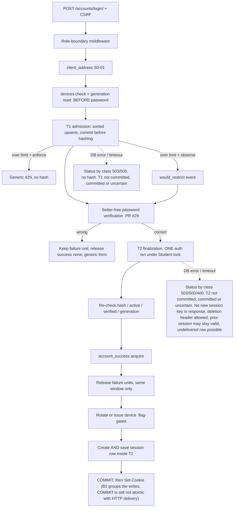

# Stage B: S0-02B/C authentication security implementation plan

**Status: planning only. Revision 4:** B1 is corrected after Codex's second independent review. That review gave the verdict REQUEST CHANGES on revision 3 (`e308a9a`) and raised findings R3-01 to R3-06. It is in `docs/security/B1_REVISION_3_INDEPENDENT_REVIEW.md` and `B1_REVISION_3_REVIEW_PROBES.md`, on PR #38 (`a908e12`). The first review (PR #37) is also addressed. See the correction matrices in §6.0. Nothing in this document is implemented or authorized.

| Item | Value |
| --- | --- |
| Prepared | 12 November 2026 (Africa/Lagos) |
| Baseline | `master` `c19c1a3` (includes PR #30 and PR #37). The revision-3 review documents are read from PR #38 `a908e12`, which is unmerged; this branch does not include them. |
| Analysed tree | A local, never-pushed scratch merge of `master` + PR #29 (`42910ed`) + PR #26 (`44c515f`). Both merged with no conflicts (`docs/AUTHENTICATION.md` auto-merged). That is static evidence only; no tests were run on it. |
| PR #26 and PR #29 | Read, not modified |
| Owner decisions so far | B1 accepted as the first candidate, subject to this refinement; timeout values remain **configurable candidates**, not production limits; D-B1-1 to D-B1-6 pending (§6.14) |

Companion documents:

* `docs/security/S1_PROPOSALS.md` sections A.19–A.21 (accepted design baseline). **These sections exist only on the unmerged PR #26 branch** (`security/s0-02a-trusted-device-foundation`, `44c515f`); on `master` the file predates them.
* `docs/security/S0_02_RECONCILIATION.md` §§4–5 (quota taxonomy and commit order). **This file exists only on the PR #26 branch**; it arrives on `master` when PR #26 merges.
* Codex PR #35 (Stage A readiness, Stage C local staging)
* Codex PRs #32 and #33 (independent approvals)

This plan does not repeat that design. It turns it into small, reviewable PRs against the code as it will exist after Stage A.

---

## 1. Authentication architecture review

### 1.1 Implemented and verified (on `master`, or in an approved unmerged PR)

| Control | Where | Evidence |
| --- | --- | --- |
| Separate restricted `auth` and academic `runtime` LOGIN roles; the migrator never serves requests; fail-closed role middleware | `accounts/middleware.py`, `accounts/boundary.py`, `academics/ownership.py` | Historical suites, PG17 CI |
| Forced RLS plus a signed transaction/backend-bound owner context | `academics/ownership.py`, migration `academics.0004` | 46 security tests |
| Live-session principal, password-hash-bound capability, session invalidation on password change | `accounts/principals.py` | Auth suite |
| Per-IP throttle (`REMOTE_ADDR`, IPv6 /64, opt-in trusted proxies), atomic upsert | `accounts/throttling.py` (S0-01, PR #24) | `test_client_address.py` |
| Generic login, registration and recovery responses; dummy hashing for unknown users | `accounts/backends.py`, `accounts/tokens.py` | Auth suite |
| One-use, expiring, digest-only email tokens with a credential stamp; Student-then-token locking | `accounts/tokens.py` | Auth suite |
| **F04b:** setter-free verification, compare-and-swap hash upgrade, locked re-validation before `auth_login` | PR #29 (`42910ed`), **unmerged** | 9 tests plus 9 Codex probes; PG17 CI |
| **S0-02A** dormant device primitives: UUID binding, generation barrier, rotation with grace, exact role allowlist including PG17 MAINTAIN | PR #26 (`44c515f`), **unmerged** | 64 tests plus 8 Codex probes; PG17 CI |

### 1.2 Confirmed gaps (code-level)

| ID | Gap | Location | Severity before activation |
| --- | --- | --- | --- |
| G1 | No `lock_timeout`, `statement_timeout` or `idle_in_transaction_session_timeout` on application aliases. A held Student lock stalls login, reset and change without limit. | `config/settings/base.py:36-37` | High (availability) |
| G2 | Database errors raised **after** the middleware's role checks become a generic **500** in account views. Session-save database errors become **400** via `SessionInterrupted` (Codex B1-01). The shared error template is unavailable in auth profiles (B1-05), and Django error logs carry token paths and exception text (B1-07). | `accounts/middleware.py`; `config/web_urls.py`; Django session middleware | Medium |
| G3 | The authenticated session payload is persisted by `SessionMiddleware` **after** the login transaction commits (Codex PR #32, Low). It is safe today, but device issuance cannot be made atomic with the session. | `accounts/views.py` login; Django `SessionMiddleware` | Blocks atomic device finalization |
| G4 | No account-aware failure tracking. Distributed guessing is limited only per source. | `accounts/views.py` login | High (S0-02, P2) |
| G5 | The IP login bucket counts **successes**, so many students behind one NAT block each other. | `accounts/throttling.py`, `AUTH_RATE_LIMITS['login']` | Medium (availability) |
| G6 | No security-event logging, no pseudonymous references, no deduplication. | n/a | Medium (S0-12) |
| G7 | `reset_confirm` and `verify` apply the per-IP limit **before** token validation, so shared-IP saturation also blocks recovery. | `accounts/views.py:110-113, 95-98` | High for any future enforcement (F07) |
| G8 | A new reset or verify request **revokes** earlier live links, so an unauthenticated requester can invalidate a victim's working link. | `accounts/tokens.py:29` | High for enforcement (F07) |
| G9 | Email is sent synchronously after commit through the console backend. There is no queue, retry or outage contract, and timing can reveal account existence. | `accounts/tokens.py:41`, `auth_common.py:46` | High for enforcement (S0-05) |
| G10 | The single `ip_ceiling` kind can't express the split trusted and unfamiliar ceilings in A.19 B. | `accounts/models.py` (PR #26) | Needs a migration in B6 |
| G11 | Device generation monotonicity is enforced by application code, not SQL (Codex PR #33, Low). | PR #26 | Low; documentation and test naming |

### 1.3 Outstanding risks carried forward

* Credential stuffing below per-account thresholds (R-06), which needs MFA or breached-password checks: owner decisions.
* An old `accounts.0003` already applied anywhere persistent needs a forward migration plan.
* `sslmode=prefer` (S0-08) is owned by Stage C (`verify-full` in the local staging profile).

---

## 2. Stage B implementation blueprint

### 2.1 Login data flow (end state; every enforcement switch default off)

Failure edges show **per-unit** outcomes (§6.1). A failure response carries no new session key (§6.2 CK1). A deletion header is allowed, and a prior session may remain valid (§6.3). Statuses come from the classifier (§6.4): 503 for proven outage, connection or configuration states; 500 for defects; 400 kept for a genuine concurrent deletion. **No edge promises that a database failure rolled back, deleted sessions or produced a 503.**



### 2.2 Components

| Component | New or changed | Responsibility | Security boundary |
| --- | --- | --- | --- |
| `accounts/dbsafety.py`, `logging.py`, `failure_classification.py`, `failure_response.py` (new) | B1 (B1a–B1d) | Application-alias timers plus `connect_timeout`. Sink-level log sanitisation. A deterministic classifier over named wrapper classes. **Three** catch points: `process_exception`, `handler500`, and `handler400` for the session-save `SessionInterrupted` path. A template-free renderer. | No retry. Proven outage, connection or configuration states get 503. Driver defects and unproven database errors get 500, at `handler400` too. A genuine concurrent deletion stays 400. **No claim** that a failure rolled back writes, revoked prior sessions, or produced a 503 (§6.2–§6.5). |
| `accounts/login_flow.py` (new) | B2, then extended | `finalize_login(request, verified, raw_password)`: one auth transaction holding the Student lock, re-validation, `auth_login`, explicit session save | Replaces only the body of PR #29's finalizer; same lock order |
| `accounts/security_events.py` (new) | B3 | Allowlisted event names and fields, an independent pseudonym key, dedup by bucket window | No usernames, IPs, tokens, cookies or paths |
| `accounts/admission.py` (new) | B4 | T1 reservation; T2 settlement helpers over `AuthThrottle` and `LoginLimit` | Auth connection only; sorted lock order; observe/enforce mode |
| Device wiring in `login_flow` and `views` | B5 | Classify before the password; rotate or issue in T2; `revoke_all` in reset, change and forget-all | `UCC_TRUSTED_DEVICES=off` by default |
| `accounts/recovery.py` (new) + outbox model | B7/B8 | Coalesced non-invalidating issuance; outbox delivery; independent redemption lane | No enforcement dependency; console or locmem until Stage D |

### 2.3 Invariants (each PR must keep all of these)

* **I1:** A failure response produced before headers are emitted never *issues or renews* a session or device key (§6.2 CK1). Deletion or expiry headers are allowed. A committed T2 whose response is lost can leave an undelivered valid row (RB-1), and prior sessions may remain valid (RB-6). After the headers are handed off (P5), nothing is guaranteed (RB-2).
* **I2:** No password hash is evaluated without a committed admission (once B4 lands).
* **I3:** A wrong password never consumes `account_success`. A success never consumes failure units. Releases never touch a newer window.
* **I4:** Device trust can only lower friction for the **exact** account that owns the device: the stored username before authentication, the UUID after.
* **I5:** Generation is read before password verification and re-checked in T2. A forget-all, reset or change serialized before T2 refuses issuance.
* **I6:** No request path uses the migrator. Runtime and auth privileges are unchanged unless a migration plus allowlist update is reviewed. RLS is never weakened.
* **I7:** Every enforcement switch defaults to off or observe. Hard account restriction requires all of A.21.
* **I8:** Lock order: Student → TrustedDevice → AccountToken → AuthThrottle/LoginLimit (sorted). `rotate()` takes only its own device row.
* **I9:** Within each response variant (status, category family, route group), the body is byte-identical for unknown and known accounts and, where the plan says so, across limit kinds. Variants differ on purpose (status, `Retry-After`, uncertain-outcome wording). Constant bodies are **not** by themselves proof of enumeration resistance: status, timing and side effects are tested separately, and timing as distributions.

---

## 3. PR-by-PR roadmap

Each PR is separately reviewed, gets its own PG17 CI, and is independently verified by Codex. None activates a hard restriction.

| PR | Scope | Depends on | Migration | Live behaviour change | Owner decision |
| --- | --- | --- | --- | --- | --- |
| **B0** | Stage A: merge #29, then #26 (Codex sequence) | Owner | `accounts.0003` | **Yes:** #29 changes live login finalization (F04b fix: setter-free verification, CAS upgrade, locked revalidation). #26 is dormant. | Merge authorizations |
| **B1** (B1a–B1d, §6.11) | **Bounded database waits, log sanitisation and safe authentication failure handling** (§6, revision 4) | #29 merged | No | Proven outage, connection or configuration failures on account routes and the session-save path give a template-free 503. Driver defects and unproven database errors give a minimal 500. A genuine concurrent deletion stays 400. Existing handled contracts preserved. Sink-level sanitisation of Django and application logs. Uncertain-outcome wording. Intermediates are trusted synthetic development only. | D-B1-1 to D-B1-6 (§6.14) |
| B2 | Transactional login finalization: explicit session save inside T2 (closes G3, Codex PR #32 Low) | B1 | No | None visible; session row created atomically | — |
| B3 | Security-event logging foundation (G6) | B1 | No | Log lines only | Logging key and retention; Stage D sink |
| B4 | Account-aware admission in **observe** mode: T1/T2 accounting, `account_fail`, `account_success` acquired in T2 | B2, B3, #26 | No (uses `LoginLimit`) | None; logs `would_restrict` only | Thresholds (initial 10/15 min) |
| B5 | Trusted-device wiring behind `UCC_TRUSTED_DEVICES=off`; `revoke_all` wired into reset, change and a new forget-all view | B4 | No | Forget-all button and revocation hooks; cookies only with the flag on | Forget-all UX; flag stays off |
| B6 | Split ceilings plus device IP bypass (flag-gated); failure-only IP counting | B5 | **`accounts.0004`** (`LoginLimit` kind CHECK) plus allowlist update | Failure-only IP counting changes when NAT users are limited | Failure-only switch; ceiling values from Stage E data |
| B7 | **02C-1:** recovery hardening: coalesced non-invalidating links, outbox and worker, recovery lane independent of login and IP saturation | B3 | **`accounts.0005`** (outbox, token columns) | Multiple live links (contract change; historical test conflict) | Link semantics; outbox vs Stage D transport |
| B8 | **02C-2:** verified-recovery trust and the "trust this browser" step-up link (flag-gated) | B5, B7 | Token purpose CHECK in 0005 | None until flagged | Step-up UX |
| B9 | Enforcement enablement (switch only) | All, plus A.21 evidence, plus independent review | No | Hard restriction | **Separate explicit approval** |

**Why this order:**

* B1 bounds lock and statement waits, classifies failures and sanitizes logs. B2 then groups the login writes into one transaction. Neither makes COMMIT atomic with HTTP delivery, so outcome-uncertain states remain (RB-1, RB-3). Without them, the B4 counters and B5 devices would inherit the unbounded-wait, 500 and post-commit-session gaps.
* Logging (B3) comes before observe-mode counters, so B4 produces evidence.
* Recovery hardening (B7) can run in parallel with B5 and B6 once B3 is done.

---

## 4. Security testing matrix

All tests use PostgreSQL 17 with real distinct migrator, runtime and auth LOGINs, synthetic data, and `TransactionTestCase` with barriers and bounded waits observed through `pg_locks` or `pg_blocking_pids`. They go in new test files; historical tests stay unchanged unless the owner approves a contract change.

| PR | Negative | Concurrency | Replay | Failure injection | PG17-specific |
| --- | --- | --- | --- | --- | --- |
| B1 | No B1 options on the migrator; duplicate or zero overrides rejected; a genuine concurrent deletion stays 400; driver defects give 500 at every catch point, including `handler400`; existing handled contracts preserved | Real 55P03 on the Student and session rows; logins in the N/AN/SA/DA states | — | **Flow × phase × initial-cookie** matrix (§6.10 A): O1–O4 recorded; CK1–CK4; DA A-valid on rollback; allowed deletion headers; no new key. Classification (B): 42703/42P01, 55P03, real and no-SQLSTATE connection loss. Sink-level logging sentinels (D). | 55P03 / 57014 / 25P03 (`InternalError`); a deferred-trigger COMMIT exceeds `statement_timeout`; `connect_timeout` with a stalled handshake |
| B2 | No session row if T2 rolls back | Reset racing finalization in **both** orders (Codex probe 3 becomes a regression) | — | Fault after `auth_login`, at session save, at commit | Real row locks |
| B3 | Sentinel username, IP, token, cookie and password never appear in captured logs; reset paths never logged | Dedup under N threads | — | Logging failure never blocks auth | — |
| B4 | 20 failures across windows don't consume `account_success`; unknown and known accounts are identical | N+1 admissions, exactly N password checks (backend call counter); finalizations never exceed the success limit | — | T1 rollback consumes nothing; crash between T1 and T2 counts as a failure only | Campus simulation (11/61/601 students) **in observe mode** |
| B5 | Wrong-account and grace cookies get the unfamiliar lane; cookie flags per profile; flag off means no cookie | Forget-all or reset between verification and T2 refuses the device | Previous-cookie replay after grace revokes only the owner's device | Lost response or out-of-order responses; fault in T2 leaves the old identifier valid | MAINTAIN and allowlist regressions retained |
| B6 | Bypass only with a valid **current** device; ceilings never removed | Unfamiliar flood does not drain the trusted ceiling | Stolen-cookie guessing capped by `device_fail` and `account_trusted_fail` | — | Migration 0004 forward and reverse, grants re-provisioned |
| B7 | A recovery request never invalidates a live link; bombing limits; generic responses | Concurrent consumption of sibling tokens gives exactly one password change | Consumed or expired or wrong-purpose tokens rejected | Outbox send failure, retry, permanent failure; provider timeout | Redemption works while login and IP buckets are saturated |
| B8 | A request alone grants nothing; GET never consumes | Two-browser nonce mismatch | Step-up token single-use | Delivery outage | — |
| B9 | Enforcement refuses to start without the A.21 attestation | Full B4–B8 suite with enforce on | — | Email outage runbook rehearsal | Staging evidence (Stage C/F) |

---

## 5. Risk and dependency register

| ID | Risk or dependency | Severity | Mitigation | Owner |
| --- | --- | --- | --- | --- |
| RD-1 | PR #29 not merged, so stale-hash reset reversal persists on `master` | High | Stage A merges #29 first (B0) | Owner, then Codex |
| RD-2 | Unbounded lock waits (G1) | High (availability) | B1 | Claude |
| RD-3 | Post-commit session save (G3) | Medium | B2 | Claude |
| RD-4 | Recovery coupled to IP saturation and link invalidation (G7/G8) | High (blocks enforcement) | B7 | Claude; owner decides link semantics |
| RD-5 | No real email, outbox or outage behaviour (G9) | High (blocks enforcement) | B7 outbox; Stage D transport, sink and runbooks | Claude (code) / Codex (Stage D) |
| RD-6 | Campus ceiling sizing unknown | Medium | Observe-mode data (B4); Stage E simulations | Codex (Stage E) / owner |
| RD-7 | Credential stuffing below thresholds | High (general) | Out of Stage B: MFA or breached-password check decision | Owner |
| RD-8 | Settings collision with the Stage C `local_staging.py` profile | Low | B1 puts timeouts in a shared helper that every profile inherits; Stage C must not override them | Claude + Codex |
| RD-9 | Historical-test contract changes (B7 link semantics) | Medium (process) | Feature-flagged profile, or explicit owner approval to amend | Owner |
| RD-10 | `accounts.0003` history drift on persistent databases | Medium | Inventory before any persistent use; forward migrations only | Codex (Stage C/D) |
| RD-11 | Generation is not monotonic in SQL (G11) | Low | Document in B5; optional trigger only if the threat model requires it | Owner decision |
| RD-12 | Timeout values too tight cause false 503s under load | Medium | Configurable; Stage E measurement before staging | Codex (Stage E) / owner |

---

## 6. First implementation proposal: B1 (revision 4: corrected after the second independent review)

**Status.** Specification only, **not implemented**, not authorized.

Revision 4 corrects revision 3 (`e308a9a`). Codex reviewed revision 3 with the verdict **REQUEST CHANGES**. The review is on PR #38 (`a908e12`): `docs/security/B1_REVISION_3_INDEPENDENT_REVIEW.md` and `B1_REVISION_3_REVIEW_PROBES.md`. It accepted the B1-03 timeout correction and most of revision 3. It raised six new findings, **R3-01 to R3-06** (five Medium, one Low). Revision 4 fixes those six and makes the rest of the document agree with them (§2, §3, §4, §7).

**Evidence base for revision 4.** Every claim below is labelled as one of:

* **Probe (PG17.11, Codex):** Codex's seven revision-3 probes. They ran on Django 5.2.19, psycopg 3.3.8 and PostgreSQL 17.11 against the post-PR #29 code, with real separate LOGINs and synthetic data. I read the probe source in full. **I did not rerun them for this revision.**
* **Probe (PG16.15, mine):** my R1–R3 probes and my reruns of Codex's earlier probes (§6.13). They are unchanged since revision 3.
* **Source:** a reading of Django 5.2.19 or CPython 3.12 code, cited by file and line. **These still need the tests in §6.10 to prove them.**
* **Design:** a requirement for the future implementation, not an observation.

### 6.0 Correction matrices

#### 6.0.1 Revision-3 findings (Codex PR #38)

| Finding (severity) | Revision 3 error | Evidence | Correction in revision 4 | Section | Status |
| --- | --- | --- | --- | --- | --- |
| **R3-01** (Medium): `handler400` sends database defects back as 400; the classification order was ambiguous | Any SQLSTATE outside the 503 sets fell through to the original 400 in `handler400`. "First decisive node" conflicted with whole-chain fallbacks. Bare `OperationalError` was handled three different ways. | Probe (PG17.11, Codex): `SessionInterrupted → UpdateError → ProgrammingError → UndefinedColumn(42703)` returns **400** at `handler400` | **One** deterministic algorithm, with three passes in a fixed order over a bounded walk through **named wrapper classes only**. It returns a category plus database-or-not origin. One status table covers all three catch points. **A driver defect gives 500 at every catch point, `handler400` included.** A genuine concurrent deletion, or a non-database `BadRequest`, keeps the original 400. Edge cases are listed explicitly: no-driver `InterfaceError`, a bare Django `OperationalError`, a truncated or cyclic chain, an unrelated non-database outer exception, and several driver nodes. | 6.4, 6.5 | **Corrected (design)**; tests in 6.10 |
| **R3-02** (Medium): a login as B from a browser holding A's session assumed the flush always committed | Showed A as invalidated for every P3/P4 failure, which generalised from one committed-case probe | Probe (PG17.11, Codex): a lock timeout before the flush leaves **A valid** (follow-up 200). A fault before COMMIT after the flush rolls back the DELETE, so **A stays valid and no B row survives**. Probe (PG16.15, mine), R3: after the session commit plus a lost acknowledgement, A is invalid and B is an orphan. | The account-switch outcome is now set **per login phase L0–L6** (§6.3.2). Before the flush, or with the flush rolled back, A **may remain valid**. A committed flush whose key is never delivered leaves A invalid and B possibly orphaned. An uncertain COMMIT allows either set. The universal oracle is **no B authority delivered** in every pre-header handled failure, not "A becomes anonymous". Keeping A's prior authority is an owner decision (D-B1-1, now explicitly covering account switch). It is **not** changed to make a test pass. | 6.3 | **Corrected (design)**; decision D-B1-1 |
| **R3-03** (Medium): SG1 forbade legitimate cookie-deletion headers | "No `Set-Cookie` for a session" on any ≥500 response | Probe (PG17.11, Codex): the password change completes its flush, then fails before COMMIT. The response is 500 with `sessionid=""; Max-Age=0`, and the old server session is valid again after the rollback. | Four separate observables: **O1** the cookie headers on the response, **O2** the browser cookie jar after receipt, **O3** committed valid session rows, **O4** keys the client already held. **CK1** forbids only *issuing or renewing* a non-empty session key on a pre-header failure response. **Deletion or expiry headers are allowed, and B1 must not strip them.** A client that receives no response gets no deletion header (CK5). | 6.2 | **Corrected (design)** |
| **R3-04** (Medium): the logging design missed real Django namespaces and the raw record metadata | Filters attached only to `django.request` and `django.server`. Records were rewritten in place. Assertions covered the message, args and traceback only. | Probe (PG17.11, Codex): a reset secret appears in **`django.security.csrf`**. `LogRecord.request` is the **live** request, with Cookie, Authorization, query and IP reachable. A logger filter **does not run** for records propagated from child loggers. Source: `logging.Handler.handleError` writes `record.msg` and `record.args` to stderr (CPython 3.12). | Logger filters are replaced by **sanitisation at the final sink**. A single `SanitizingHandler` is the only handler in the application process, attached at the root, so all propagation reaches it. Python's `lastResort` handler is replaced. A startup check fails closed if any raw handler is present in the covered logger tree. The handler builds a **fresh allowlisted record**: no message text, args, request reference, extras, `exc_text` or `stack_info` is copied, and it never mutates the request. `exc_info` is set to `None`, and a bounded summary of class names and SQLSTATEs goes in its own field. Its failure path is a constant line and `handleError` is overridden, so raw data is never a fallback. Tests check the bytes written to the sink. The Django namespaces are inventoried, including `django.security.*`. | 6.8 | **Corrected (design)**; RB-4 narrowed to non-Django sinks only |
| **R3-05** (Medium): the global blueprint and the correction matrix disagreed; increment gates were too loose | §2.1 promised "Rollback: 503, no session, no cookie". I1 and I9 were global. RB-1 implied B2 removes orphans. B1a–B1c had no full regression gates. | Review comparison of §2 against §6 | §2.1, §2.2, §2.3 (I1, I9), §3, §4 and §6.14 are rewritten to use per-unit known-rollback, committed or uncertain states. Statuses come from the classifier, and defects are 500. **B2 groups writes but cannot make COMMIT atomic with HTTP delivery.** Body-constancy claims are limited to their scope and are not presented as enumeration resistance. §6.11 gives **mandatory evidence gates per increment**. Privacy moves to **B1b, before** the new error handling (B1c). Every intermediate is **trusted synthetic development only**, never "B1 complete" or an accepted staging release. | 2.1–2.3, 3, 4, 6.11, 6.14 | **Corrected (design)** |
| **R3-06** (Low): wording around the renderer's fatal exceptions and DEBUG | "`try/except BaseException`-safe logic"; implied DEBUG causes a plain 500 through `handler500` | Source: `core/handlers/exception.py:96-107` and `173-186` | The renderer catches **`Exception` only**. `SystemExit`, `KeyboardInterrupt` and `GeneratorExit` propagate. There is no promise to survive `MemoryError` or resource exhaustion. DEBUG and `DEBUG_PROPAGATE_EXCEPTIONS` behaviour is documented exactly; neither calls `handler500`. A call with no active exception is a separate, tested case. | 6.7 | **Corrected (design)** |

#### 6.0.2 Original findings B1-01 to B1-08 after revision 4

| Finding | Codex disposition of revision 3 | Revision 4 change | Current status |
| --- | --- | --- | --- |
| B1-01 (High) session-save errors bypass `handler500` | Core routing corrected; partially addressed | R3-01: a defect at `handler400` gives 500; the chain rule is deterministic | Corrected (design); needs B1c evidence |
| B1-02 (High) 5xx does not revoke sessions or prevent valid rows | False guarantee withdrawn; partially addressed | R3-02 / R3-03 / R3-05: per-phase account-switch states, cookie observables, diagram and invariants | Corrected (design) with residual risks RB-1, RB-6 |
| B1-03 (High) COMMIT and request bound false | **Addressed** as a design correction | None (§6.6 unchanged in substance) | Accepted design; RB-3 |
| B1-04 (Medium) failed change need not flush | Substantively addressed | R3-03: the deletion header is allowed and asserted per phase | Corrected (design); D-B1-2 |
| B1-05 (Medium) unsafe renderer | Substantively addressed | R3-06 wording | Corrected (design) |
| B1-06 (Medium) universal invariants | Substantially corrected | R3-02 / R3-05: per-phase oracle and per-increment scope | Corrected (design) |
| B1-07 (Medium) framework logs leak | Partially addressed | R3-04: sink-level sanitisation, namespace inventory, safe records | Corrected (design); RB-4 limited to non-Django sinks |
| B1-08 (Medium) classification conflicts | Substantially addressed | R3-01 / R3-05: one precedence table, no global shorthand | Corrected (design) |

"Corrected (design)" means the specification is technically supportable. It does **not** mean implemented, tested in CI or authorized.

### 6.1 Failure phases (per write unit, not per request)

These phases apply **to each write unit separately**. A login request contains several units:

* the autocommit throttle upsert;
* the PR #29 compare-and-swap hash upgrade;
* the finalization transaction;
* the response-phase session UPDATE. Django runs it in its own `transaction.atomic` (`contrib/sessions/backends/db.py:114-136`).

An earlier unit can commit while a later one fails. **B1 never claims that a failed request rolled anything back.**

| Phase | Meaning | Server-side outcome of **that** unit | Known or uncertain |
| --- | --- | --- | --- |
| P0 | Before any write (role check, connect) | Nothing written | Known |
| P1 | A wait or failure before the unit's first write (`lock_timeout`, connect failure) | Nothing written by this unit | Known |
| P2 | Failure after writes, before COMMIT was sent | **Not committed**: a transaction never commits without COMMIT. If the connection is lost, the server may hold the transaction and its locks until it notices. | Known (not committed) |
| P3 | COMMIT sent, acknowledgement not received | Committed **or** not | **Uncertain** |
| P4 | Unit committed, later failure (another unit, middleware, rendering) | Committed | Known (committed) |
| P5 | After response headers were handed to the WSGI server | Committed, and **Set-Cookie may already have been delivered** | Outside Django; RB-2 |

Post-failure state is never read back through a broken connection.

### 6.2 Cookie and session observables, and the invariants B1 guarantees

Each test records four observables separately:

| Observable | Definition | How it is read |
| --- | --- | --- |
| **O1 Response cookie** | Each `Set-Cookie` for `SESSION_COOKIE_NAME` on the response. Each is classified as **issue/renew** (non-empty value), **delete/expire** (empty value with `Max-Age=0` or a past `expires`), or none. | `response.cookies` |
| **O2 Browser jar** | The cookie the client holds **after** processing the response. If no response arrives, the jar is unchanged. | The test client's jar after the request |
| **O3 Committed sessions** | Every valid row: not expired, decodes, and `session_student(key)` is not None. Records the user and whether the row is authenticated. | Clean connection after all controlled transactions end |
| **O4 Prior keys** | The keys the client held before the request (`K_prev`), plus any key delivered in this test | Captured before the request |

**"Authority held by the client"** means a key in O2 that is valid in O3, and the user it maps to.

**Invariants for a B1-handled failure produced before headers are emitted** (any response produced inside Django's exception lifecycle, including B1's handlers):

* **CK1 (no new key issued).** O1 contains **no issue/renew** header for the session cookie. **Delete/expire headers are allowed. B1 must not remove them, and tests never require them to be absent.** Source: `contrib/sessions/middleware.py:36-42` (deletion when the session is empty, whatever the status) and `58-77` (save and set only below 500). After `handler400`, the new response is built after the session middleware has raised, so the session middleware adds no issue header to it.
* **CK2 (no new authority).** After receipt, O2 holds no key outside `K_prev`. Any authority the client still has is **prior** authority: a `K_prev` key that is still valid.
* **CK3 (prior state asserted, not assumed).** Each `K_prev` key's validity is asserted against the per-flow phase tables (§6.3). Tests never assume a rollback invalidated it, and never assume it survived a committed flush.
* **CK4 (orphans recorded).** Valid rows whose key is in neither O2 nor `K_prev` are enumerated. They are permitted only in the phases the §6.3 tables list. They expire within `SESSION_COOKIE_AGE` (1800 s server side) and are removed by cleanup.
* **CK5 (no response, no promise).** If the client receives no response (transport loss, worker killed) or the failure is in P5, O1 is undefined. The client may get neither a deletion header nor, in P5, may already have an issue header. This is outside B1's guarantees (RB-2).
* **SG2.** B1 never converts a database failure into a 2xx or 3xx response, and never retries a security write.
* **SG3.** Flows with uncertain outcomes (reset, verify, change) say the outcome is uncertain. They do not claim success or rollback.
* **SG4.** B1 does not touch privileges, RLS, the signed context, the session engine, or the authentication semantics of successful paths.

### 6.3 Flow-specific authentication, session and cookie invariants

#### 6.3.1 Login internals (source, PR #29 `42910ed` plus Django 5.2.19)

1. Role check, then the throttle upsert (autocommit), then form authentication, including the PR #29 CAS hash upgrade (autocommit).
2. Finalization transaction on the `auth` alias. It locks the Student row and revalidates. Then `auth_login` runs:
   * If the session already holds a **different** user (or a hash mismatch), it calls `flush()`: clear, **DELETE A's row**, key set to None (`contrib/auth/__init__.py:175-185`, `sessions/backends/base.py:412-419`).
   * `cycle_key()` follows. It **INSERTs** a new row carrying the in-memory data at that moment, then DELETEs the old key if there is one (`base.py:426-435`, `db.py:68-78`). For a different-account (DA) session the inserted data is empty after the flush. For a same-account (SA) session it is the **existing authenticated data**. For no cookie (N) or an anonymous cookie (AN) it is anonymous.
   * The authentication keys are set **in memory only**.
   * `user_logged_in` updates `last_login`, then `set_expiry(0)`.
3. COMMIT, then the 302 redirect.
4. The response-phase session UPDATE: autocommit, its own atomic block, carrying the authentication data. Then `Set-Cookie` with the new key.

Login phases used in the tables below:

| Label | Meaning |
| --- | --- |
| L0 | Before finalization (role check, throttle, form, CAS) |
| L1 | Inside finalization, before the flush or `cycle_key` (Student lock wait, revalidation) |
| L2 | Inside finalization, after flush and/or `cycle_key` writes, before COMMIT is sent (known not committed) |
| L3 | Finalization COMMIT uncertain |
| L4 | Finalization committed; the response-phase session UPDATE known not applied (55P03, connection lost before sending, genuine deletion) |
| L5 | Session UPDATE committed, acknowledgement lost (or uncertain) |
| L6 | After headers (P5) |

#### 6.3.2 Account switch: browser authenticated as A logs in as B

| Phase | A's row (O3) | B rows (O3) | O1 | O2 after | Authority after | Evidence |
| --- | --- | --- | --- | --- | --- | --- |
| L0, L1 | **Valid**, unchanged | None | None | A's key | **Prior A retained** | Probe (PG17.11, Codex): Student lock 55P03, 500 today, A valid, protected follow-up 200 |
| L2 | **Valid** (the DELETE rolled back) | None (the INSERT rolled back) | None if the session is non-empty at response time. **Deletion allowed** if it is empty (for example a failure after `flush()` but before `create()` assigned a key). | A's key, or none if deleted | Prior A retained, **or** the browser is anonymous while A's server row is still valid | Probe (PG17.11, Codex): fault at `_commit`, A valid, 1 row, follow-up 200. Deletion sub-case: source (`is_empty`, `base.py:185-190`), test required. |
| L3 | L2 set **or** L4 set | L2 set or L4 set | As L2 or L4 | — | Either | Union of both; asserted as an allowed set |
| L4 | **Invalid** (DELETE committed) | One B row with **anonymous** data (the INSERT ran after the flush; authentication keys never persisted) | None (response built by `handler400` or `process_exception`) | A's key (dead) | Anonymous; no authenticated orphan | Source; test required |
| L5 | Invalid | One **valid authenticated** B row, key never delivered (**orphan**) | None | A's key (dead) | Anonymous; orphan recorded | Probe (PG16.15, mine) R3 |
| L6 | Invalid | B valid | Issue header **may** have been delivered | **May** be B | Equivalent to a successful login | Outside B1 (RB-2) |

**Universal oracle for every pre-header row:**

* **no authority for B in O2** (CK2);
* A's validity is **asserted per row**;
* B orphans only in L5 (or the committed side of L3 combined with L5).

Status codes come from §6.5. **A B1 status conversion cannot change these states**: the rows above are the same whether the status is 500 or 503.

#### 6.3.3 Other initial states for login

| Initial state | L0–L2 (known not committed) | L3 | L4 | L5 |
| --- | --- | --- | --- | --- |
| **N** (no cookie) | Nothing persisted by finalization | Either | Anonymous new row committed; not delivered | Valid authenticated orphan |
| **AN** (known anonymous key) | Old anonymous key valid | Either | Old anonymous key deleted; new anonymous row; jar holds the dead anonymous key | Authenticated orphan; jar holds the dead anonymous key |
| **SA** (same-account key K) | **K valid**, expiry unchanged | Either | **K deleted**; the new row holds **A's authenticated data** (copied by `cycle_key`), so it is a **valid authenticated orphan for A**; jar holds dead K | Valid authenticated orphan for A; jar holds dead K |

The SA L4 and L5 cells are source-derived and need tests. Codex's earlier probe (PR #37, `test_session_update_ack_lost_can_extend_known_existing_session`) shows a different effect: **a known key can stay valid with its expiry extended** when that key's own UPDATE commits and the acknowledgement is lost. That applies to any request that saves an existing session **without cycling it**, not only to login. RB-6 covers it.

No pre-header row ever delivers a key outside `K_prev` (CK1, CK2).

#### 6.3.4 Password change (F-CHG; initial state SA)

| Phase | Server session K | Other sessions of A | O1 | O2 after | Evidence |
| --- | --- | --- | --- | --- | --- |
| C0 before flush (Student lock, validation) | Valid | Valid (hash unchanged) | None | K | Probe (PG16.15 and PG17, PR #37) |
| C1 flush DELETE fails | Valid (rolled back) | Valid | None (`_session_key` still set, so not empty) | K | Probe (PR #37) |
| C2 after flush, before COMMIT | **Valid again** (rolled back) | Valid | **Deletion header present** (session empty) | **None** | Probe (PG17.11, Codex): 500, `sessionid=""; Max-Age=0`, K valid |
| C3 COMMIT uncertain | {committed: K deleted, new hash, others invalid by hash} or the C2 state | Either | As C2 | None | Allowed set |
| C4 committed, later failure | Deleted | Invalid by hash | Deletion header | None | Source; test required |

The **C2** row shows the R3-03 distinction. The browser copy is deleted, but **the server-side session K stays valid**, and so does any other copy of K. That is a prior-authority residual (RB-6, D-B1-2), not new authority.

#### 6.3.5 Reset, verify, issue and register

* **F-RESET (redemption; initial states N or SA).**
  * Unit: one transaction, writing the password and consuming the **nominated** token together.
  * Allowed outcomes: {not committed: password and nominated token unchanged} or {committed: password = submitted secret, nominated token consumed}.
  * Other tokens are not part of this unit.
  * "Old password invalid" is asserted **only** when the submitted secret differs from the old one.
  * Session observables: no issue header (CK1). For SA, a prior key's validity follows the hash rule (an unchanged hash keeps it valid; a committed change invalidates it).
* **F-VERIFY.** Unit: `email_verified_at` written together with consumption of the nominated token. Allowed outcomes: {unverified, token usable} or {verified, token consumed}. CK1 applies.
* **F-ISSUE.** Unit: older same-purpose tokens are revoked and a new one inserted, together. On P3 with an acknowledgement fault, the token may be committed **without email**, and the older links are still revoked (RB-5).
* **F-REGISTER.** The existing handled `IntegrityError` gives the generic success page; **preserved**.

### 6.4 Failure classification: one deterministic algorithm

`classify_database_failure(exc) -> Classification(category, origin, sqlstate, truncated)` is a pure function. It performs no I/O, reads no request data, and never calls `str()` on any exception.

**Transparent wrapper allowlist** (exact classes and their subclasses). The walk passes **only** through these:

* `django.contrib.sessions.exceptions.SessionInterrupted`;
* `django.contrib.sessions.backends.base.UpdateError` and `CreateError`;
* `django.db.utils.Error` and its subclasses (`InterfaceError`, `DatabaseError`, `OperationalError`, `ProgrammingError`, `IntegrityError`, `DataError`, `InternalError`, `NotSupportedError`; `TransactionManagementError` is a `ProgrammingError`);
* `psycopg.Error` and its subclasses (the **driver nodes**).

**Bounded walk:**

* Start at `exc`.
* At each node, the next node is `__cause__` if set. Otherwise it is `__context__`, unless `__suppress_context__` is true, in which case the walk stops.
* The walk also stops at a node **outside the allowlist**: that node is not examined further.
* It stops at **16 nodes** or on a revisited object, with `truncated=True`.
* Result: the ordered list of allowlisted nodes.

**Decision, in strict pass order.** The first pass that matches wins.

0. **Outer gate.** If `exc` itself is not on the allowlist, the result is `NOT_DATABASE`. This covers an unrelated outer exception raised while handling a database error, such as a template error with a database `__context__`: it is **not** read as an outage. It also covers a non-database `BadRequest`.
1. **SQLSTATE pass.** The first driver node in walk order with a well-formed `sqlstate` (five characters `[0-9A-Z]`) decides:
   * **`OUTAGE`**: class `08`, class `53`, `57P01`, `57P02`, `57P03`, `57014`, `55P03`, `40001`, `40P01`, `25P03`;
   * **`CONFIGURATION`**: `42501`, class `28`, `3D000`, `57P04`;
   * **`DEFECT`**: any other SQLSTATE (for example `42703`, `42P01`, `22xxx`, `23xxx` that was not handled).
2. **No-SQLSTATE driver pass.** Only if pass 1 found nothing. The first driver node decides:
   * `psycopg.OperationalError` or `psycopg.InterfaceError` (including `ConnectionTimeout`, a closed connection or lost input) is **`CONNECTION_UNAVAILABLE`**;
   * any other `psycopg.Error` is **`DEFECT`**.
3. **Django-only pass.** No driver node was reached: a bare Django `DatabaseError` family member with no driver cause, a chain truncated before a driver node, or a chain that ended at a non-allowlisted node. The result is **`DATABASE_UNPROVEN`**. This covers a no-driver Django `InterfaceError`, a bare Django `OperationalError`, Django's "Forced update did not affect any rows" (the genuine concurrent deletion; probe R2), and `TransactionManagementError`.

`origin` is `database` for every category except `NOT_DATABASE`. Passes 1 and 2 are taken in that order across the **whole** bounded walk. So a SQLSTATE deeper in the chain beats an outer node with no SQLSTATE. With several driver nodes, the outermost one with a SQLSTATE decides. The result is the same for any given chain.

**Status by category and catch point** (B1 end state; "minimal" means the template-free renderer, §6.7):

| Category | View `process_exception` (`AuthFailureMiddleware`) | `handler500` (`sys.exc_info()`) | `handler400(request, exception)` |
| --- | --- | --- | --- |
| `OUTAGE` | 503 minimal + `Retry-After` | 503 minimal + `Retry-After` | 503 minimal + `Retry-After` |
| `CONNECTION_UNAVAILABLE` | 503 minimal, no `Retry-After` | Same | Same |
| `CONFIGURATION` | 503 minimal ("not configured safely"), no `Retry-After` | Same | Same |
| `DEFECT` | Not consumed; Django's 500 path runs and `handler500` renders it | **500 minimal** | **500 minimal** |
| `DATABASE_UNPROVEN` | Not consumed, so `handler500` handles it | **500 minimal** (database origin, so never the database-dependent web renderer) | **Original 400** (genuine concurrent deletion, or another Django-only session failure) |
| `NOT_DATABASE` | Not consumed | Existing handler (web profile: `student_web` 500; auth profile: Django default) | Existing 400 handling |

**Precedence over existing handled contracts.** These are unchanged and run **before** B1 sees anything:

| Site | Existing behaviour (kept) |
| --- | --- |
| P0 `DatabaseRoleBoundaryMiddleware` (`accounts/middleware.py:13-25`) | Catches **all** `DatabaseError` and `ImproperlyConfigured`, returning 503 "not configured safely". Programming errors at the role check stay 503. This is the documented exception to "defects are 500". |
| Registration `IntegrityError` (`accounts/tokens.py`) | Generic success page |
| Academic wrappers (`student_web.views.protected`, `accounts.views.academic_errors`) | `DatabaseError` → 503; service errors → 400/404/409 |
| `SuspiciousOperation`, CSRF 403, 404 | Existing Django handling (logging covered by §6.8) |

**Logging of consumed exceptions.** When `process_exception` returns a response, Django does **not** call `log_response` for the exception (`core/handlers/base.py:356-366`). B1 therefore emits one sanitized event on logger `accounts.failures` with the category, SQLSTATE and route label, through the §6.8 sink.

**Retry-After and caching.** Every B1 response carries `Cache-Control: no-store`. Only `OUTAGE` carries `Retry-After` (a configurable candidate value).

**Synthetic chain cases (unit tests; the expected result is part of the test):**

| Chain (outer → inner) | Expected |
| --- | --- |
| `SessionInterrupted → UpdateError → OperationalError → LockNotAvailable(55P03)` | `OUTAGE` / 55P03 |
| `SessionInterrupted → UpdateError → ProgrammingError → UndefinedColumn(42703)` | `DEFECT` / 42703 |
| `SessionInterrupted → UpdateError → DatabaseError` (no driver) | `DATABASE_UNPROVEN`, so 400 at `handler400` |
| `OperationalError → psycopg.OperationalError` (no SQLSTATE) | `CONNECTION_UNAVAILABLE` |
| Django `InterfaceError` with no cause or context | `DATABASE_UNPROVEN`, so 500 minimal |
| Django `OperationalError` with no driver | `DATABASE_UNPROVEN`, so 500 minimal |
| `OperationalError → psycopg.OperationalError` (no SQLSTATE) whose context is `AdminShutdown(57P01)` | `OUTAGE` / 57P01 (pass 1 beats pass 2) |
| `TemplateDoesNotExist` with context `OperationalError(55P03)` | `NOT_DATABASE` (outer gate) |
| `UpdateError` whose context is a `KeyError` | `DATABASE_UNPROVEN` (walk stops at a non-allowlisted node) |
| Cyclic `__context__` between two Django errors, no driver | `DATABASE_UNPROVEN`, `truncated=True` |
| 17 nested Django wrappers, driver node at depth 17 | `DATABASE_UNPROVEN`, `truncated=True` |
| `raise X from None` (`__suppress_context__`) hiding a driver context | Walk stops; the result is decided by the nodes before it |
| Explicit `__cause__` set alongside a different `__context__` | Cause followed, context ignored |
| `psycopg.errors.InsufficientPrivilege(42501)` | `CONFIGURATION` |
| `psycopg.errors.InvalidAuthorizationSpecification(28000)` / `InvalidCatalogName(3D000)` | `CONFIGURATION` |
| `IdleInTransactionSessionTimeout(25P03)` wrapped as Django `InternalError` | `OUTAGE` |
| Malformed `sqlstate` (wrong length or characters) on a driver node | Treated as no SQLSTATE (pass 2) |

### 6.5 Where each exception can surface, and the possible statuses

| Origin | Catch point | Possible statuses |
| --- | --- | --- |
| Role check | Role middleware (existing) | 503 |
| Account view (throttle, CAS, finalizer, reset, verify, change, issue) | `process_exception`, otherwise `handler500` | 503 (`OUTAGE`, `CONNECTION_UNAVAILABLE`, `CONFIGURATION`); 500 minimal (`DEFECT`, `DATABASE_UNPROVEN`); 500 existing (`NOT_DATABASE`) |
| Lazy session load in a view | Same as the view | Same |
| Session save in `SessionMiddleware.process_response` | `SessionInterrupted` → `handler400` | 503 (driver outage, connection or configuration); **500 minimal (driver defect)**; 400 (`DATABASE_UNPROVEN` or `NOT_DATABASE`) |
| Other middleware `process_response` | `handler500` | 503 / 500 |
| Error-renderer failure (`Exception`) | Last resort inside the renderer | A fixed plain-text response with the status already chosen |
| `handler400` raises | Django `get_exception_response` → `handle_uncaught_exception` → `handler500` (`exception.py:162-170`) | As `handler500` |
| After the WSGI header handoff | **None** | Whatever the client already received (RB-2) |

### 6.6 Timeout and availability model (substance unchanged from revision 3; Codex: addressed)

| Mechanism | Candidate (configurable, **not** final) | What it bounds | What it does **not** bound |
| --- | --- | --- | --- |
| `lock_timeout` | 3 s (auth, runtime) | Each **lock-acquisition wait** within a statement | Lock-free work; COMMIT-time work; the request total |
| `statement_timeout` | 5 s (auth), 10 s (runtime) | Each statement's **execution** | **COMMIT** (a deferred trigger ran 352 ms under 100 ms and committed); commit-time waits; network; client-side Python |
| `idle_in_transaction_session_timeout` | 15 s | **Idle gaps** inside an open transaction (FATAL 25P03 → `OUTAGE`) | Total transaction duration; active statements |
| `connect_timeout` (libpq) | 5 s | Each connection **attempt** (psycopg 3.3.8 `connection.py:98-110`). Values below 2 s become 2 s; 0 or less means 130 s. `ConnectionTimeout` → `CONNECTION_UNAVAILABLE`. | The number of attempts (multiple addresses); name resolution; waits on an established connection |
| PG17 `transaction_timeout` | **Not adopted** | — | Needs its own review |
| Worker and proxy deadlines | **No values proposed** | — | Stage C, from lab evidence |

**Request duration** has an upper-bound formula, not a guarantee:

```
T_req ≲ Σ_aliases(attempts × connect_timeout)
      + Σ_statements(min(lock_wait, lock_timeout) + exec ≤ statement_timeout)
      + T_commit (unbounded by statement_timeout)
      + 1–2 × PBKDF2 + response-phase session UPDATE + transport
```

B1 asserts **no** total request or COMMIT bound.

**Configuration rules:**

* Applied by `apply_db_safety()` to the **application aliases only**, merged into `OPTIONS`. `sslmode`, `sslrootcert` and unrelated libpq options are preserved.
* Duplicate or conflicting `-c` settings for the same GUC are **rejected**. An identical re-application is idempotent.
* Never applied to `auth_migration`, the test-provisioning `default`, or offline commands. An operator's existing offline-role timeouts are left alone.

**Verification:**

* Settings-load validation.
* System check `accounts.E101`. It runs in Stage C's preflight through `manage.py check --deploy`, because registered checks do not run under WSGI.
* `SHOW` on the real auth and runtime connections.

Pooling is out of scope for B1.

### 6.7 Error rendering: minimal, database-independent, process-safe (R3-06)

* **What it is.** `accounts/failure_response.py` builds responses **without the template engine**: a constant UTF-8 body per variant. It uses:
  * no context processors and no `reverse()`;
  * no `request.user`, session or messages access;
  * no database or request headers.

  The login link is a **literal path**.
* **Variants.** Each (status, category family, route group) pair has its own constant body:
  * 503 outage;
  * 503 connection unavailable;
  * 503 configuration;
  * 503 uncertain outcome, for reset, verify and change;
  * 500 minimal;
  * preserved 400.

  Bodies are identical **within a variant**. They differ across variants on purpose, and that alone **is not** a claim of account-enumeration resistance (§2.3 I9).
* **Headers.** `Cache-Control: no-store`; `Retry-After` only for `OUTAGE`; `Content-Type` with a charset.
* **Failure handling.**
  * The builder catches **`Exception` only**. On a caught exception it returns a fixed plain-text `HttpResponse` built from a module-level constant, with the already-chosen status.
  * `BaseException` subclasses that are not `Exception` (`SystemExit`, `KeyboardInterrupt`, `GeneratorExit`) **propagate unchanged**, so worker shutdown and interruption keep working.
  * **No guarantee** is given under `MemoryError`, `RecursionError` or resource exhaustion; the fallback may itself fail. If the fallback raises, Django's own path applies: `get_exception_response` catches it and calls `handler500` (`exception.py:162-170`). An exception escaping `handler500` goes to the WSGI server (RB-4 covers its logs).
* **DEBUG behaviour** (source: `core/handlers/exception.py`):

  | Setting | `BadRequest` / `SessionInterrupted` | `SuspiciousOperation` | Uncaught exception | `process_exception` |
  | --- | --- | --- | --- | --- |
  | `DEBUG=True` | `technical_500_response(status_code=400)`; **`handler400` is not called** (lines 96-101) | Technical page with status 400 (119-122) | `technical_500_response`; **`handler500` is not called** (181-182) | **Still runs** (middleware), so view-level 503s still apply |
  | `DEBUG_PROPAGATE_EXCEPTIONS=True` (with `DEBUG=False`) | `handler400` **is** called (only the uncaught path checks this flag) | `handler400` is called | **Re-raised** to the WSGI server; **`handler500` is not called** (178-179) | Still runs |

  Neither flag makes `handler500` run without an active exception. **Calling `handler500` with no active exception** (a manual call, or a future framework change) is a **separate supported case**: it returns a minimal plain 500, tested by a direct call. B1 tests run with both flags False. A system check (`accounts.E104`) requires both flags to be False in the `*_secure` profiles. Development profiles keep Django's technical pages; they are local only (RB-11).
* **Registration.** Registered as `handler400` and `handler500` in **both** `config/auth_urls.py` and `config/web_urls.py`. The web profile delegates to the existing `student_web` handlers **only for `NOT_DATABASE`**.

### 6.8 Logging privacy: sink-level sanitisation (R3-04)

**Inventory.** These are the Django 5.2.19 namespaces that emit records in the application process (source: every `getLogger` call in the package):

| Namespace | What it can carry |
| --- | --- |
| `django.request` (`core/handlers/base.py`, `exception.py`, `utils/log.py`, `views/generic/base.py`) | `log_response` records: the path in the args, the live request in `record.request`, `exc_info` |
| `django.security.<ExceptionClass>` (`exception.py:113-137`) | Every `SuspiciousOperation` subclass (`DisallowedHost`, `SuspiciousSession`, `RequestDataTooBig`, …): the message, the live request |
| `django.security.csrf` (`middleware/csrf.py:209-219`) | "Forbidden (reason): path", including token-bearing reset and verify paths (Probe, PG17.11, Codex) |
| `django.security.SuspiciousSession` (`sessions/backends/base.py`, `db.py`) | Session decode failures |
| `django.server` (`core/servers/basehttp.py`) | runserver request lines (development only) |
| `django.db.backends` (`db/backends/utils.py`) | SQL **with parameters** at DEBUG level when the debug cursor is on |
| `django.db.backends.schema`, `django.db.backends.base`, `django.db.models`, `django.template`, `django.dispatch`, `django.contrib.auth`, `django.contrib.sessions`, `django.utils.autoreload` | Messages and exceptions |
| `psycopg`, `py.warnings`, `accounts.*`, `academics.*`, `student_web.*`, the root logger | Driver notices, warnings, application records |

**Current state on master** (source):

* `LOGGING` is unset, so Django applies `DEFAULT_LOGGING` (`utils/log.py:18-64`, `67-76`).
* With `DEBUG=True` (development profiles), `django.*` records, including token paths, reach the console.
* With `DEBUG=False`:
  * the console handler is filtered out;
  * `AdminEmailHandler` returns early when `ADMINS` is empty (`utils/log.py:95-101`);
  * `django.server` has its own handler.
* So today no Django-configured sink receives the records when `DEBUG=False`. **But** any handler an operator, Gunicorn configuration or test adds receives the raw `LogRecord`, including its live request.

**Design.** Sanitisation happens at the final sink, never in logger filters:

1. **One handler class.** `accounts.logging.SanitizingHandler(logging.Handler)` writes to a stream (stderr by default). B1's `LOGGING` (in `auth_common.configure`, so it applies to the auth and web profiles) has these properties:
   * It attaches `SanitizingHandler` **only to the root logger**.
   * It sets `django` and `django.server` to `handlers: []` with `propagate: True`. `dictConfig` removes their existing handlers, including `mail_admins` and the default `django.server` handler.
   * It defines **no filters or formatters**.
   * Because every propagating record reaches the root handler, a handler-level policy covers child loggers. The PR #38 probe showed that logger-level filters do not.
2. **No raw fallback sinks.**
   * `AccountsConfig.ready()` replaces `logging.lastResort` with a `SanitizingHandler(level=WARNING)`. `lastResort` fires for loggers that have no handlers anywhere in their chain.
   * `ready()` then **fails closed** with `ImproperlyConfigured` if any handler on the root logger, or on any logger named `django*`, `psycopg*`, `py.warnings`, `accounts*`, `academics*` or `student_web*`, is not a `SanitizingHandler` (`NullHandler` is allowed).
   * The same rule is a system check, `accounts.E103`.
   * `gunicorn.*` loggers are outside this tree. They belong to Stage C (RB-4).
3. **A safe copy, never mutation.** `emit(record)` builds a **new** `LogRecord` with an explicit allowlist:
   * **Copied:**
     * logger `name`, if it matches `[A-Za-z0-9_.]{1,100}`; otherwise `"?"`;
     * `levelno` and `levelname`;
     * `created` and `msecs`, if they are floats;
     * `process` and `thread` ids.
   * **Derived, read-only:**
     * `ucc_status`: `record.status_code`, only if it is an `int` from 100 to 599;
     * `ucc_method`: `request.method`, only if it is in an allowlist of HTTP methods, otherwise `"OTHER"`;
     * `ucc_route`: `request.resolver_match.view_name` if it is set and matches `[a-z0-9_:-]{1,64}`, otherwise `"[unresolved]"`. Paths and URL arguments are **never** emitted, so token segments, malformed or percent-encoded paths and query strings never appear.
     * `request` is used only if `isinstance(record.__dict__.get('request'), HttpRequest)`. Only `method` and `resolver_match`, both plain attributes, are read. **Never** `user`, `session`, `COOKIES`, `META`, `GET`, `POST`, body, headers or `path`.
   * **Exception summary:** `ucc_exc` is built from `record.exc_info`, only when it is a valid three-tuple containing a `BaseException` instance. It uses the §6.4 walk and keeps at most 16 entries, each a class `__qualname__` matching `[A-Za-z0-9_.]{1,64}` plus a well-formed SQLSTATE. It **never** calls `str()` or `repr()` on an exception.
   * **Set to valid empty values:** `msg` is a fixed template string, `args=None`, `exc_info=None`, `exc_text=None`, `stack_info=None`. So a cached `exc_text` produced by any earlier formatter is never copied.
   * **Not copied:** `msg` text, `args`, `request`, any extras (arbitrary `extra=` keys), `pathname`, `funcName`, `stack_info`, `exc_text`.
   * The original record and the request object are **never written to**.
4. **Output.** The handler formats with its own fixed code, not a configurable `Formatter`:

   ```
   ucc-log name=<name> level=<levelname> status=<ucc_status> method=<ucc_method> route=<ucc_route> exc=<ucc_exc>
   ```

   One line per record. The free text of Django and application messages is **not** emitted in B1. The structured event taxonomy with pseudonymous fields is B3.
5. **Failure handling, all inside `emit`.**
   * Any `Exception` during sanitisation or formatting writes the constant line `ucc-log record suppressed (sanitizer error) name=<safe name or ?>`.
   * If the stream write fails, `handleError` is **overridden** to write nothing derived from the record. The default `handleError` prints `record.msg` and `record.args` to stderr (CPython 3.12 `logging/__init__.py:1066-1112`).
   * `SystemExit`, `KeyboardInterrupt` and `GeneratorExit` propagate.
   * Handler-level and logger-level filters are **forbidden** in the covered tree (E103), because a filter that raises escapes `Logger.handle` into the caller.
6. **`ADMINS`.** Check `accounts.E102` keeps it empty in authentication profiles. Removing `mail_admins` from the handler graph (point 1) is the actual control; an empty `ADMINS` is defence in depth.

**Scope statement.**

* **Covered:** every record that passes through Python `logging` in the Django process after `configure_logging`, for the loggers listed in point 2, under both URL roots.
* **Not covered:**
  * Gunicorn's own `gunicorn.error` and `gunicorn.access` logs. Gunicorn logs an exception that escapes the WSGI application together with the request path.
  * Caddy and proxy logs.
  * Raw stderr writes outside `logging` (unraisable-exception hooks, warnings when `captureWarnings` is off, crash dumps).
  * Retention and export.

  These are **RB-4** (Stage C configuration, Stage D retention). The Django security loggers are **inside** B1's scope and are not deferred.
* **Diagnosability cost.** Operators see only the status, route name, category and SQLSTATE until B3 (RB-9, D-B1-4).
* **New visibility.** In `DEBUG=False` profiles, B1 starts emitting sanitized lines to stderr where Django emitted nothing before. That is an owner decision (D-B1-4).

### 6.9 Exact files expected to change (B1 PRs, §6.11)

| File | Change | Increment |
| --- | --- | --- |
| `server/accounts/dbsafety.py` (new) | `apply_db_safety()` (merge, reject duplicates, `connect_timeout`), validation | B1a |
| `server/accounts/checks.py` (new), `apps.py` | E101 (timers); E102 (`ADMINS`); E103 (sanitized handler tree, no filters); E104 (DEBUG flags in secure profiles); `ready()` installs `lastResort` and runs the fail-closed handler check | B1a (E101); B1b (E102–E104) |
| `server/accounts/logging.py` (new) | `SanitizingHandler`, the safe-record builder, the `handleError` override | B1b |
| `server/config/settings/auth_common.py` | Call `apply_db_safety` (B1a); `LOGGING` (B1b); middleware order (B1c) | B1a–B1c |
| `server/accounts/failure_classification.py` (new) | `classify_database_failure()`, the wrapper allowlist, the `Classification` dataclass | B1c |
| `server/accounts/failure_response.py` (new) | Template-free renderer, last resort, `handler400` and `handler500` | B1c |
| `server/accounts/middleware.py` | Add `AuthFailureMiddleware` (`process_exception` only). Role middleware unchanged. | B1c |
| `server/config/auth_urls.py`, `server/config/web_urls.py` | Register `handler400` and `handler500` | B1c |
| `server/accounts/views.py`, account templates | Uncertain-outcome wording for reset, verify and change; **no** change to successful-path logic | B1d |
| `server/auth_tests/test_b1_*.py` (new) | §6.10 | B1a–B1d |
| `docs/AUTHENTICATION.md` | Contract, limits, Stage C preflight requirement | Each increment updates its own part |

**Not changed:** `base.py`, migrations, grants, provisioning, RLS, devices, throttle semantics, the session engine, successful-path authentication, academic code, CLI and Streamlit.

### 6.10 Revised PostgreSQL 17 regression matrix

**Common rules:**

* Real separate migrator, runtime and auth LOGINs.
* `TransactionTestCase`, with waits observed through `pg_blocking_pids` and bounded timeouts.
* Post-failure state read on a **clean connection** after all controlled transactions end.
* `DEBUG=False` and `DEBUG_PROPAGATE_EXCEPTIONS=False` unless the test is about those flags.
* **Both** URL roots.
* Hosted CI on PostgreSQL 17.
* Fault-injection kinds are labelled:
  * **real**: an actual PostgreSQL lock, timeout or termination;
  * **injected-driver**: a psycopg error raised inside an `execute_wrapper` and wrapped exactly as Django's `DatabaseErrorWrapper` does;
  * **injected-commit**: a patched `_commit` or acknowledgement fault.

**A. Flow × phase × initial cookie.** Every cell records O1–O4 and asserts CK1–CK4 against the §6.3 tables (an allowed set, not a single assumed outcome), plus the status, `no-store` and `Retry-After` policy, the body variant, and the §6.8 sink sentinels.

| Flow | Phases (injection kind) | Initial states | Key assertions |
| --- | --- | --- | --- |
| F-LOGIN | L0: throttle 55P03 (real). L1: Student 55P03 (real). L2: fault after flush (injected-commit at `_commit`; injected-driver at the `last_login` UPDATE); empty-session sub-case (injected-driver at the `exists()` SELECT after flush). L3a: server abort (real backend termination before COMMIT). L3b: commit then lost acknowledgement (injected-commit). L4: session UPDATE 55P03 (real, `handler400` → 503); session UPDATE 42703 (injected-driver, `handler400` → **500**). L5: session commit then lost acknowledgement (injected-commit). | N, AN, SA, DA | §6.3.2 and §6.3.3 per row. **DA L1 and L2: A asserted valid.** DA L4: A invalid, B row anonymous. DA L5: A invalid, B orphan. No B key in O2 anywhere. A deletion header is allowed and recorded, never required absent. |
| F-RESET | P1 (real 55P03), P2 (injected-driver), P3a (real), P3b (injected-commit), P4 | N, SA | Nominated-token pair consistency against a before snapshot; distinct-secret exclusivity; same-secret allowed; SA prior-key validity per the hash rule; uncertain-outcome body |
| F-VERIFY | P1, P2 (`email_verified_at` injected-driver), P3a, P3b | N | Verified ⇔ nominated token consumed |
| F-CHG | C0 (real 55P03), C1 (injected-driver on the flush DELETE), C2 (injected-commit), C3a/C3b, C4 | SA | §6.3.4: **C2 asserts a deletion header present AND K valid server-side** (the R3-03 regression) |
| F-ISSUE | P1, P3b | N | Token committed, email **not** sent on P3b; older-link revocation recorded |
| F-REGISTER | Handled `IntegrityError` | N | Generic success page unchanged |

**B. Classification and routing.**

| Test | Evidence required |
| --- | --- |
| `test_session_update_undefined_column_is_500` | Injected-driver `UndefinedColumn(42703)` at the session UPDATE → `handler400` → **500 minimal**, not 400; no issue header |
| `test_session_update_undefined_table_is_500` | Same with `UndefinedTable(42P01)` |
| `test_real_undefined_column_in_view_is_500` | **Real** 42703: the migrator renames a `django_session` column in setup; the session load in the view fails; 500 minimal through `handler500`; column restored in teardown |
| `test_session_update_lock_timeout_is_503` | **Real** 55P03 on the session row → 503 with `Retry-After` |
| `test_connection_loss_real_termination_is_503` | **Real** `pg_terminate_backend` of the auth backend just before the session UPDATE. Category is in {`OUTAGE` 57P01, `CONNECTION_UNAVAILABLE`} (the driver may or may not read the FATAL message); status 503 either way |
| `test_connection_loss_without_sqlstate_is_503` | A local TCP relay inside the test closes the socket mid-request, giving a psycopg error with **no SQLSTATE** → `CONNECTION_UNAVAILABLE` → 503 without `Retry-After` |
| `test_genuine_concurrent_session_deletion_stays_400` | Row deleted before save (R2 shape) → `DATABASE_UNPROVEN` → **original 400** |
| `test_non_database_bad_request_stays_400` | A synthetic `BadRequest` outside the allowlist → `NOT_DATABASE` → 400 |
| `test_configuration_class_is_503_without_retry_after` | Injected-driver 42501 and 28000 → 503, no `Retry-After` |
| `test_classifier_synthetic_chains` | Every row of the §6.4 chain table, asserting the exact `Classification` |
| `test_existing_contracts_preserved` | Role middleware 503 for `ProgrammingError`; registration `IntegrityError`; academic wrappers |
| `test_consumed_exception_emits_sanitized_event` | `process_exception` 503 → one `accounts.failures` line at the sink |

**C. Rendering.**

| Test | Evidence required |
| --- | --- |
| `test_renderer_both_roots_no_db_no_templates` | `CaptureQueriesContext` on all aliases is 0; template loader not called |
| `test_renderer_last_resort_on_exception` | Builder forced to raise `RuntimeError` → fixed plain body, chosen status |
| `test_renderer_propagates_process_control` | Builder forced to raise `KeyboardInterrupt` and `SystemExit` → propagates |
| `test_handler500_without_active_exception` | Direct call → minimal plain 500 |
| `test_debug_flags_documented_behaviour` | With `DEBUG=True`, `handler400` and `handler500` are not called and `process_exception` 503 still applies. With `DEBUG_PROPAGATE_EXCEPTIONS=True`, an uncaught exception is re-raised. E104 rejects either flag in secure profiles. |
| `test_body_variants_constant` | Identical bytes within a variant across known and unknown accounts. Different variants are **not** asserted equal. |

**D. Logging (assertions at the sink).** Evidence comes from the bytes written to the `SanitizingHandler` stream, **not** from `assertLogs`, which installs its own capture handler and skips the configured sink.

| Test | Evidence required |
| --- | --- |
| `test_sink_no_sentinels_all_failure_routes` | Sentinels carried by the request: reset and verify secret; percent-encoded secret; malformed token path; query string; `HTTP_COOKIE`; `HTTP_AUTHORIZATION`; `REMOTE_ADDR` 192.0.2.x; User-Agent; an exception message; a SQL fragment. Routes: 503, 500, 400 genuine, CSRF 403 to a reset URL (`django.security.csrf`), 404 to a malformed token URL, `SuspiciousSession`, consumed-exception events. **No sentinel in the sink bytes.** |
| `test_sink_drops_extras_cached_exc_text_and_stack_info` | `logger.error(..., extra={'ucc_probe': S}, stack_info=True)` with `exc_text` pre-set to S → no S in the sink |
| `test_request_and_record_not_mutated` | After logging, the request's `path`, `META` (identity and values) and `COOKIES` are unchanged; the original `record.request is request`; `record.msg` and `args` are unchanged |
| `test_child_logger_propagation_sanitized` | `django.b1probe.child` (no handlers, propagates) → sanitized line |
| `test_last_resort_replaced` | A logger with `propagate=False` and no handlers emits a WARNING → sanitized line, no raw text on stderr |
| `test_sanitizer_and_stream_failures_never_leak` | Sanitizer patched to raise `RuntimeError` → constant line; stream `write` patched to raise → overridden `handleError`, captured stderr holds no sentinel; the caller sees no exception |
| `test_sanitizer_process_control_propagates` | Sanitizer patched to raise `KeyboardInterrupt` → propagates |
| `test_raw_handler_fails_closed` | A `StreamHandler` added to `django.security` → E103 error and `ready()` raises `ImproperlyConfigured` |
| `test_admins_empty_and_no_admin_email_handler` | E102; no `AdminEmailHandler` anywhere in the tree |

**E. Settings and timers (B1a).**

| Test | Evidence required |
| --- | --- |
| `test_options_merge_preserves_tls_and_rejects_duplicates` | `sslmode` and `sslrootcert` kept; duplicate or conflicting `-c` rejected; identical re-application idempotent |
| `test_show_values_on_application_aliases_only` | `SHOW` on auth and runtime; migrator and offline configuration carry no B1 option |
| `test_connect_timeout_with_stalled_handshake` | A local listener that **accepts TCP and never answers** the startup packet. Failure after ≈ `connect_timeout` × the known number of attempts (one address). An immediately-refused or unreachable address is **not** accepted as evidence. |
| `test_commit_not_bounded_by_statement_timeout` | Deferred-trigger documentation regression |
| `test_idle_timeout_kills_and_classifies` | Real 25P03 → `OUTAGE` (B1c), or the existing 500 path (B1a) |
| `test_real_lock_timeouts_existing_behaviour` | B1a: real 55P03 on the Student lock and the session row give **today's** 500 and 400. Session states asserted per §6.3 (DA: A valid at L1). |

**F. Historical suites.** All historical suites (legacy, 2A database, restricted-role security, `auth_tests`, `web_tests`) pass **unchanged** on PostgreSQL 17 for every increment.

**Mutation checks.** Removing or weakening each of these must make at least one test fail:

* the `handler400` defect → 500 rule;
* the outer gate;
* pass 1 running before pass 2;
* the wrapper allowlist (accepting any class);
* the 16-node bound;
* the 25P03 mapping;
* duplicate-option rejection;
* removing the root `SanitizingHandler`;
* the `lastResort` replacement;
* the `handleError` override;
* copying extras;
* copying `exc_text`;
* the renderer's last resort;
* catching `BaseException` in the renderer (must fail the process-control test);
* stripping a deletion header (must fail F-CHG C2).

### 6.11 Increments and their minimum evidence gates (R3-05)

**Ordering change.** Privacy moves **before** the new error handling, so no increment adds new failure paths without the sink protection already in place for them.

| Increment | Content | Minimum regression evidence **before its own acceptance** | Must not claim |
| --- | --- | --- | --- |
| **B1a** settings and timers | `apply_db_safety`, validation, E101, docs | Matrix E in full. **Matrix A rows L0, L1, L4 (55P03), C0 and P1 run against existing behaviour**: today's 500 and 400 statuses, CK1, CK2, and DA A-valid at L1. These are the new timeout failure paths B1a creates. Matrix F. | No status change; no privacy claim; no "B1 complete" |
| **B1b** logging privacy | `SanitizingHandler`, `LOGGING`, `lastResort`, E102–E104 | Matrix D in full over the **existing** failure routes: 500, 400, CSRF 403, 404, `SuspiciousSession`, and the B1a timeout paths. Matrix F. | Coverage of B1c event lines until B1c adds them to the D matrix |
| **B1c** classification and rendering | Classifier, `AuthFailureMiddleware`, renderer, `handler400` and `handler500` in both roots | Matrices B and C in full. **Matrix A rows that change status** (L1, L2, L4 for 55P03 and 42703, L5; C0–C3; P1–P3 for reset and verify), with CK1–CK4 and known-cookie rollback cases including the **allowed-deletion** and **no-new-key** assertions. Matrix D extended to the new 503 and 500 routes and to `accounts.failures` events. Matrix F. | Uncertain-outcome wording; "B1 complete" |
| **B1d** wording and full matrix | Uncertain-outcome wording; every remaining A cell | Matrix A complete (all flows × phases × initial states); the full mutation list; Matrix F; independent implementation review | Production readiness (Stage C, D and E remain) |

**Release rule.**

* No intermediate branch or build (B1a, B1b or B1c) is labelled "B1 complete", merged as a staging release, or used to build an accepted Stage C staging environment.
* Until B1d passes independent review, any B1 build runs **only in trusted synthetic development** (local, synthetic identities, disposable PostgreSQL).
* Each increment needs **separate owner authorization** and its own Codex review.
* None changes successful-path authentication.

### 6.12 Stage C agreements (for Codex; no values proposed)

1. The Stage C startup preflight **runs `manage.py check --deploy`** under the exact web settings (E101–E104).
2. Worker, proxy and client deadlines come from **lab measurement** of the §6.6 formula. The lab shows that a worker killed mid-transaction gives a P2 or P3 outcome, with the §6.3 rules holding.
3. Gunicorn error and access logs and Caddy logs must redact paths and query strings, and must not log request bodies (RB-4). Gunicorn's "Error handling request <path>" line is included.
4. The C21 lab reruns §6.10 over TLS with `verify-full`.
5. No Stage C environment is built from an intermediate B1 increment (§6.11).

### 6.13 Evidence register

| ID | Probe | Observed | Source |
| --- | --- | --- | --- |
| R1 | `handler400` during a real session-UPDATE `lock_timeout` | 400; chain `SessionInterrupted → UpdateError → OperationalError → LockNotAvailable(55P03)`; `handler500` called 0 times | Mine, PG16.15, Appendix B1-R |
| R2 | Genuine concurrent session deletion | 400; chain `SessionInterrupted → UpdateError → DatabaseError`; no driver node | Mine, PG16.15 |
| R3 | DA login; session commit then lost acknowledgement | 500; no session cookie on the response; A invalid; one valid row whose key is not the client's | Mine, PG16.15 |
| CX-1 | DA login, Student lock 55P03 before flush | 500; **A valid**; follow-up 200; no session cookie | Codex, PG17.11, PR #38 |
| CX-2 | DA login, `_commit` fault after flush | 500; **A valid**; 1 row; follow-up 200 | Codex, PG17.11 |
| CX-3 | Password change, `_commit` fault after flush | 500; **deletion header** `Max-Age=0`; old session valid | Codex, PG17.11 |
| CX-4 | Session-UPDATE `UndefinedColumn` (injected-driver) | **400** at `handler400`; chain contains `('UndefinedColumn','42703')` | Codex, PG17.11 |
| CX-5 | `log_response` record | `record.request is request`; Cookie, Authorization, query and IP reachable | Codex, PG17.11 |
| CX-6 | Logger filter on a parent | Not applied to a propagated child record | Codex, PG17.11 |
| CX-7 | CSRF-rejected POST to a reset URL | 403; secret in a `django.security.csrf` message | Codex, PG17.11 |
| Earlier | Codex's 14 PR #37 probes; native COMMIT experiment | 14/14 reproduce; COMMIT 352 ms under a 100 ms `statement_timeout` | Mine (rerun, PG16.15) and Codex (PG17.11) |

I have not rerun the CX probes. Their source (PR #38 appendix) uses only the existing code plus fault injection, and matches the source reading in §6.3–§6.8. B1 implementation CI on PostgreSQL 17 remains mandatory.

### 6.14 Residual risks requiring owner acceptance

| ID | Risk | Severity | Why B1 cannot remove it | Where it can be addressed |
| --- | --- | --- | --- | --- |
| RB-1 | **Undelivered valid authenticated session rows** (orphans) after L5, SA L4, or a lost response | Low (an attacker would need the random key) | The session write and HTTP delivery are separate. **B2 groups the session row into the finalization unit, but cannot make COMMIT atomic with HTTP delivery**, so orphans remain possible after a lost acknowledgement or response. | B2 reduces the number of units; expiry (1800 s) and cleanup bound the lifetime; accept |
| RB-2 | **P5:** Set-Cookie may be delivered before a write or transport failure | Low–Medium | Outside Django's lifecycle | Stage C; accept |
| RB-3 | **No total request or COMMIT bound**; a worker kill mid-transaction gives an uncertain outcome | Medium (availability) | `statement_timeout` does not bound COMMIT | Stage C deadlines from measurement; possible PG17 `transaction_timeout` review |
| RB-4 | **Logs outside Python logging in the Django process:** Gunicorn error and access logs (paths, including "Error handling request"), Caddy logs, raw stderr writes | Medium (privacy) | Outside the Django process's logging tree. **Django's own `django.security.*` loggers are not part of this risk** (§6.8 covers them). | Stage C configuration; Stage D retention |
| RB-5 | **An issued token without delivered email revokes older links** (F-ISSUE P3) | Medium (recovery availability) | Existing revocation semantics | B7 |
| RB-6 | **Prior legitimate authority survives a failure:** SA key retained or renewed (including a known key's expiry extended when its UPDATE commits and the acknowledgement is lost); **DA: A remains valid when the switch rolled back (L0–L2)**; F-CHG C0–C2: the server-side session remains valid, even when the browser cookie was deleted (C2) | Low–Medium | Existing Django and login behaviour. Status conversion cannot change it. Changing it is a policy change to successful-path semantics. | D-B1-1 and D-B1-2; B2 if the owner requires revocation |
| RB-7 | My local verification used PostgreSQL 16; the CX probes ran on 17.11 but were not rerun by me | Process | Environment | Hosted PostgreSQL 17 CI and the Stage C lab are mandatory |
| RB-8 | `handler500` relies on `sys.exc_info()`, which is not a documented Django API | Low | Framework design | Tested fallback; re-verify on upgrades |
| RB-9 | **Reduced diagnosability:** B1 logs drop all free text (only status, route, category and SQLSTATE) | Low (operations) | The privacy-first allowlist | B3 structured events; D-B1-4 |
| RB-10 | **The classifier depends on Django and psycopg exception layouts** (the wrapper allowlist, SQLSTATE attributes) | Low | Framework internals | Unknown wrappers fall to `NOT_DATABASE` or `DATABASE_UNPROVEN` (500 or 400), **never to a false 503**; re-verify chain tests on upgrades |
| RB-11 | **Development profiles with `DEBUG=True`** show technical pages, including request data | Low (local only) | Developer tooling | E104 forbids it in secure profiles; development stays local and synthetic |

**Decisions for the owner:**

* **D-B1-1 (prior authority on a failed login):** Accept that a failed login may leave **prior legitimate authority** valid: same-account retention or renewal, **and the original account A after a failed or rolled-back account-switch attempt**. That is recommended for B1 and documented. The alternative is to require revocation or no-renewal, which is a B2 change to login and session policy.
* **D-B1-2 (failed password change):** Accept that a failed password change may leave the **server-side** session valid. In phase C2, the browser cookie may be deleted while the server row remains valid. Recommended. The alternative is to require server-side revocation on failure, which B1 cannot deliver because the transaction rolled back; it would be a B2-or-later design. Cookie deletion and server revocation are different controls.
* **D-B1-3 (timers):** Approve the candidate timer values, including `connect_timeout` 5 s, **with the stated limits** (no COMMIT or request bound).
* **D-B1-4 (logging):** Approve the B1b logging scope:
  * sink-level sanitisation that drops all free text in the application process;
  * new sanitized stderr output in `DEBUG=False` profiles;
  * runserver request lines lost in development;
  * the B3 taxonomy and Stage C/D sinks left separate.
* **D-B1-5 (increments):** Approve the order B1a → B1b (privacy) → B1c (classification and rendering) → B1d (wording and full matrix), with the per-increment gates and the trusted-synthetic-development rule. Each increment is authorized separately.
* **D-B1-6 (classification policy):** Approve:
  * the categories and statuses in §6.4: 503 only for proven outage, connection or configuration states; `CONNECTION_UNAVAILABLE` (driver error with no SQLSTATE) as 503 without `Retry-After`; 500 for defects and unproven database errors;
  * 400 kept for genuine concurrent deletion and other non-database 400s;
  * the preserved role-middleware 503 exception.

Owner acceptance cannot excuse incorrect SQLSTATE routing, a false test oracle or an unsupported privacy claim. Stage A merge authorization and PR #29 integration remain external prerequisites.

---

## 7. Decisions requested from the owner

1. **Stage A:** authorize merging PR #29, then PR #26 (Codex sequence). This is a live behaviour change for #29. B1 depends on #29 being on `master`.
2. **B1 policy decisions D-B1-1 to D-B1-6** (§6.14):
   * prior authority on a failed login, including account switch;
   * password-change failure semantics;
   * timers with their stated limits;
   * logging scope;
   * the increment order and gates;
   * the classification policy.
3. **Request another independent Codex review** of this revision 4 before any B1 implementation is authorized.
4. **Stage C coordination** (§6.12):
   * a preflight that runs `check --deploy`;
   * deadlines from lab measurement only;
   * Gunicorn and proxy log redaction;
   * no staging from intermediate increments.
5. **Later, at B6:** whether the IP login bucket should count failures only.
6. **Later, at B7:** non-invalidating recovery links (also addresses RB-5). This is a historical-test contract change.
7. **Later, at B3:** the logging pseudonym key, retention and sink (with Codex Stage D).
8. **Out of Stage B:** MFA or breached-password checks for credential stuffing (RD-7). Adaptive mode and the daily cap remain deferred.

---

## Appendix B1-R: Claude observation probes R1–R3 (revision 3; unchanged in revision 4; not application code)

Three probes supporting §6.13 R1–R3. Observation only: no B1 implementation and no fix. Synthetic identities and disposable PostgreSQL only. **Do not add them to application test discovery.** Run them like Codex's appendix, against the approved PR #29 code (`42910ed`), with the repository `AuthenticationTestRunner` and real separate LOGINs:

```sh
PYTHONDONTWRITEBYTECODE=1 PYTHONPATH=/private/probe/directory PGTESTDATABASE=test_b1_revision python server/manage.py test b1_revision_probes --settings=config.settings.auth_test -v 2
```

My runs used local PostgreSQL 16.15 (PostgreSQL 17 can't be installed in my environment). The behaviour relied on (Django session and exception routing, the psycopg error classes) does not depend on the server version, and the corresponding Codex observations were on 17.11. Evidence lines carry booleans, classes and SQLSTATEs only.

```python
"""Claude B1 revision probes (observation only; no B1 implementation). Synthetic data."""
import json, sys, types
from concurrent.futures import ThreadPoolExecutor
from unittest.mock import patch
from django.contrib.auth import SESSION_KEY
from django.contrib.sessions.backends.db import SessionStore
from django.contrib.sessions.models import Session
from django.db import connections, OperationalError, transaction
from django.http import HttpResponse
from django.test import Client, override_settings
from django.urls import include, path, reverse
from accounts.principals import session_student
from auth_tests.base import AuthenticationCase

seen = {'400': [], '500': []}
mod = types.ModuleType('b1_revision_urls')
mod.urlpatterns = [path('', include('config.auth_urls'))]
def h400(request, exception=None):
    seen['400'].append(exception); return HttpResponse('synthetic 400', status=400)
def h500(request):
    seen['500'].append(sys.exc_info()[1]); return HttpResponse('synthetic 500', status=500)
mod.handler400, mod.handler500 = h400, h500
sys.modules[mod.__name__] = mod

def chain(exc):
    out, ids = [], set()
    while exc is not None and id(exc) not in ids:
        ids.add(id(exc)); out.append((type(exc).__name__, getattr(exc, 'sqlstate', None)))
        exc = exc.__cause__ if exc.__cause__ is not None else exc.__context__
    return out

def emit(name, **v): print('B1R_EVIDENCE=' + json.dumps(dict(name=name, **v), sort_keys=True))

@override_settings(ROOT_URLCONF='b1_revision_urls')
class RevisionProbes(AuthenticationCase):
    def setUp(self):
        super().setUp(); seen['400'].clear(); seen['500'].clear()

    def test_handler400_receives_db_origin_session_interrupted(self):
        client = Client(raise_request_exception=False)
        self.assertEqual(self.login(client).status_code, 302)
        key = client.cookies['sessionid'].value
        def worker():
            try:
                with connections['auth'].cursor() as c: c.execute("SET lock_timeout='100ms'")
                return self.login(client).status_code
            finally: connections.close_all()
        with ThreadPoolExecutor(max_workers=1) as ex:
            with transaction.atomic(using='default'):
                Session.objects.using('default').select_for_update().get(session_key=key)
                status = ex.submit(worker).result(timeout=15)
        self.assertEqual(status, 400)
        self.assertEqual(len(seen['400']), 1)
        emit('handler400_db_origin', status=status, handler400_exception_chain=chain(seen['400'][0]), handler500_calls=len(seen['500']))

    def test_genuine_concurrent_logout_chain_has_no_driver_sqlstate(self):
        client = Client(raise_request_exception=False)
        self.login(client); key = client.cookies['sessionid'].value
        real = SessionStore.save
        def delete_then_save(store, must_create=False):
            if not must_create and store.get(SESSION_KEY):
                Session.objects.using('default').filter(session_key=store.session_key).delete()
            return real(store, must_create=must_create)
        with patch.object(SessionStore, 'save', delete_then_save):
            status = self.login(client).status_code
        self.assertEqual(status, 400)
        c = chain(seen['400'][0])
        self.assertFalse(any(sql for _, sql in c))
        emit('genuine_concurrent_logout', status=status, handler400_exception_chain=c)

    def test_different_account_browser_login_commit_then_ack_lost(self):
        client = Client(raise_request_exception=False)
        self.login(client); key_a = client.cookies['sessionid'].value
        real = SessionStore.save
        def committed_then_lost(store, must_create=False):
            real(store, must_create=must_create)
            if not must_create and store.get(SESSION_KEY):
                raise OperationalError('synthetic ack lost')
        with patch.object(SessionStore, 'save', committed_then_lost):
            response = self.login(client, 'bravo')
        valid = [s.session_key for s in Session.objects.using('auth').all()
                 if s.get_decoded().get(SESSION_KEY) and session_student(s.session_key)]
        emit('different_account_ack_lost', status=response.status_code,
             a_session_still_valid=session_student(key_a) is not None, valid_auth_rows=len(valid),
             response_sets_session_cookie='sessionid' in response.cookies,
             client_cookie_is_old_key=client.cookies['sessionid'].value == key_a,
             valid_row_key_is_client_key=key_a in valid)
```
