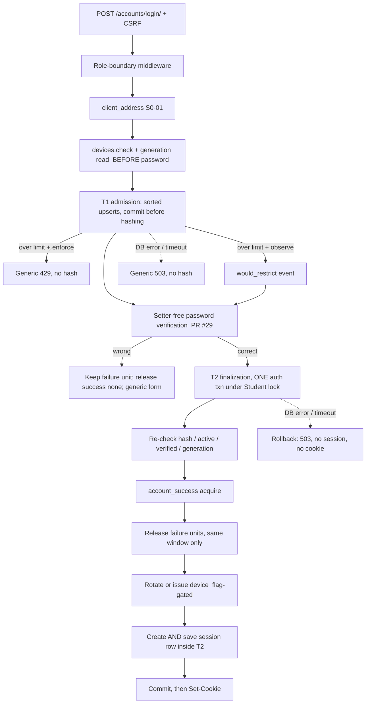

# Stage B: S0-02B/C authentication security implementation plan

**Status: planning only. Revision 3:** B1 is corrected after Codex's independent review (verdict REQUEST CHANGES on revision 2, `7f438b1`; `docs/security/B1_INDEPENDENT_DESIGN_REVIEW.md`, merged in PR #37). See the correction matrix in §6.0. Nothing in this document is implemented or authorized.

| Item | Value |
| --- | --- |
| Prepared | 12 November 2026 (Africa/Lagos) |
| Baseline | `master` `c19c1a3` (includes PR #30 and PR #37: the independent B1 review and probe appendix) |
| Analysed tree | A local, never-pushed scratch merge of `master` + PR #29 (`42910ed`) + PR #26 (`44c515f`). Both merged with no conflicts (`docs/AUTHENTICATION.md` auto-merged). That is static evidence only; no tests were run on it. |
| PR #26 and PR #29 | Read, not modified |
| Owner decisions so far | B1 accepted as the first candidate, subject to this refinement; timeout values remain **configurable candidates**, not production limits |

Companion documents:

* `docs/security/S1_PROPOSALS.md` sections A.19–A.21 (accepted design baseline). **These sections exist only on the unmerged PR #26 branch** (`security/s0-02a-trusted-device-foundation`, `44c515f`); on `master` the file predates them.
* `docs/security/S0_02_RECONCILIATION.md` §§4–5 (quota taxonomy and commit order). **This file exists only on the PR #26 branch**; it arrives on `master` when PR #26 merges.
* Codex PR #35 (Stage A readiness, Stage C local staging)
* Codex PRs #32 and #33 (independent approvals)

This plan does not repeat that design. It turns it into small, reviewable PRs against the code as it will exist after Stage A.

---

## 1. Authentication architecture review

### 1.1 Implemented and verified (on `master`, or in an approved unmerged PR)

| Control | Where | Evidence |
| --- | --- | --- |
| Separate restricted `auth` and academic `runtime` LOGIN roles; the migrator never serves requests; fail-closed role middleware | `accounts/middleware.py`, `accounts/boundary.py`, `academics/ownership.py` | Historical suites, PG17 CI |
| Forced RLS plus a signed transaction/backend-bound owner context | `academics/ownership.py`, migration `academics.0004` | 46 security tests |
| Live-session principal, password-hash-bound capability, session invalidation on password change | `accounts/principals.py` | Auth suite |
| Per-IP throttle (`REMOTE_ADDR`, IPv6 /64, opt-in trusted proxies), atomic upsert | `accounts/throttling.py` (S0-01, PR #24) | `test_client_address.py` |
| Generic login, registration and recovery responses; dummy hashing for unknown users | `accounts/backends.py`, `accounts/tokens.py` | Auth suite |
| One-use, expiring, digest-only email tokens with a credential stamp; Student-then-token locking | `accounts/tokens.py` | Auth suite |
| **F04b:** setter-free verification, compare-and-swap hash upgrade, locked re-validation before `auth_login` | PR #29 (`42910ed`), **unmerged** | 9 tests plus 9 Codex probes; PG17 CI |
| **S0-02A** dormant device primitives: UUID binding, generation barrier, rotation with grace, exact role allowlist including PG17 MAINTAIN | PR #26 (`44c515f`), **unmerged** | 64 tests plus 8 Codex probes; PG17 CI |

### 1.2 Confirmed gaps (code-level)

| ID | Gap | Location | Severity before activation |
| --- | --- | --- | --- |
| G1 | No `lock_timeout`, `statement_timeout` or `idle_in_transaction_session_timeout` on application aliases. A held Student lock stalls login, reset and change without limit. | `config/settings/base.py:36-37` | High (availability) |
| G2 | Database errors raised **after** the middleware's role checks become a generic **500** in account views. Session-save database errors become **400** via `SessionInterrupted` (Codex B1-01). The shared error template is unavailable in auth profiles (B1-05), and Django error logs carry token paths and exception text (B1-07). | `accounts/middleware.py`; `config/web_urls.py`; Django session middleware | Medium |
| G3 | The authenticated session payload is persisted by `SessionMiddleware` **after** the login transaction commits (Codex PR #32, Low). It is safe today, but device issuance cannot be made atomic with the session. | `accounts/views.py` login; Django `SessionMiddleware` | Blocks atomic device finalization |
| G4 | No account-aware failure tracking. Distributed guessing is limited only per source. | `accounts/views.py` login | High (S0-02, P2) |
| G5 | The IP login bucket counts **successes**, so many students behind one NAT block each other. | `accounts/throttling.py`, `AUTH_RATE_LIMITS['login']` | Medium (availability) |
| G6 | No security-event logging, no pseudonymous references, no deduplication. | n/a | Medium (S0-12) |
| G7 | `reset_confirm` and `verify` apply the per-IP limit **before** token validation, so shared-IP saturation also blocks recovery. | `accounts/views.py:110-113, 95-98` | High for any future enforcement (F07) |
| G8 | A new reset or verify request **revokes** earlier live links, so an unauthenticated requester can invalidate a victim's working link. | `accounts/tokens.py:29` | High for enforcement (F07) |
| G9 | Email is sent synchronously after commit through the console backend. There is no queue, retry or outage contract, and timing can reveal account existence. | `accounts/tokens.py:41`, `auth_common.py:46` | High for enforcement (S0-05) |
| G10 | The single `ip_ceiling` kind can't express the split trusted and unfamiliar ceilings in A.19 B. | `accounts/models.py` (PR #26) | Needs a migration in B6 |
| G11 | Device generation monotonicity is enforced by application code, not SQL (Codex PR #33, Low). | PR #26 | Low; documentation and test naming |

### 1.3 Outstanding risks carried forward

* Credential stuffing below per-account thresholds (R-06), which needs MFA or breached-password checks: owner decisions.
* An old `accounts.0003` already applied anywhere persistent needs a forward migration plan.
* `sslmode=prefer` (S0-08) is owned by Stage C (`verify-full` in the local staging profile).

---

## 2. Stage B implementation blueprint

### 2.1 Login data flow (end state; every enforcement switch default off)



### 2.2 Components

| Component | New or changed | Responsibility | Security boundary |
| --- | --- | --- | --- |
| `accounts/dbsafety.py`, `failure_response.py`, `logging.py` (new) | B1 | Application-alias timers plus `connect_timeout`. A cause/context chain-walking classifier. **Three** catch points: `process_exception`, `handler500`, and `handler400` for the session-save `SessionInterrupted` path. A template-free renderer and Django error-log redaction. | No retry; database-origin failures get 503, a genuine concurrent logout stays 400, defects stay 500. **No claim** that 5xx rolls back writes or revokes pre-existing sessions (§6.2). |
| `accounts/login_flow.py` (new) | B2, then extended | `finalize_login(request, verified, raw_password)`: one auth transaction holding the Student lock, re-validation, `auth_login`, explicit session save | Replaces only the body of PR #29's finalizer; same lock order |
| `accounts/security_events.py` (new) | B3 | Allowlisted event names and fields, an independent pseudonym key, dedup by bucket window | No usernames, IPs, tokens, cookies or paths |
| `accounts/admission.py` (new) | B4 | T1 reservation; T2 settlement helpers over `AuthThrottle` and `LoginLimit` | Auth connection only; sorted lock order; observe/enforce mode |
| Device wiring in `login_flow` and `views` | B5 | Classify before the password; rotate or issue in T2; `revoke_all` in reset, change and forget-all | `UCC_TRUSTED_DEVICES=off` by default |
| `accounts/recovery.py` (new) + outbox model | B7/B8 | Coalesced non-invalidating issuance; outbox delivery; independent redemption lane | No enforcement dependency; console or locmem until Stage D |

### 2.3 Invariants (each PR must keep all of these)

* **I1:** No session, and no Set-Cookie for a session or device, unless T2 committed.
* **I2:** No password hash is evaluated without a committed admission (once B4 lands).
* **I3:** A wrong password never consumes `account_success`. A success never consumes failure units. Releases never touch a newer window.
* **I4:** Device trust can only lower friction for the **exact** account that owns the device: the stored username before authentication, the UUID after.
* **I5:** Generation is read before password verification and re-checked in T2. A forget-all, reset or change serialized before T2 refuses issuance.
* **I6:** No request path uses the migrator. Runtime and auth privileges are unchanged unless a migration plus allowlist update is reviewed. RLS is never weakened.
* **I7:** Every enforcement switch defaults to off or observe. Hard account restriction requires all of A.21.
* **I8:** Lock order: Student → TrustedDevice → AccountToken → AuthThrottle/LoginLimit (sorted). `rotate()` takes only its own device row.
* **I9:** Responses for unknown and known accounts and for every limit kind are byte-identical. Timing is tested as distributions, not as an equality claim.

---

## 3. PR-by-PR roadmap

Each PR is separately reviewed, gets its own PG17 CI, and is independently verified by Codex. None activates a hard restriction.

| PR | Scope | Depends on | Migration | Live behaviour change | Owner decision |
| --- | --- | --- | --- | --- | --- |
| **B0** | Stage A: merge #29, then #26 (Codex sequence) | Owner | `accounts.0003` | **Yes:** #29 changes live login finalization (F04b fix: setter-free verification, CAS upgrade, locked revalidation). #26 is dormant. | Merge authorizations |
| **B1** (B1a–B1d, §6.11) | **Bounded database waits + safe authentication failure handling** (§6, revision 3) | #29 merged | No | Database-origin failures on account routes and the session-save 400 path give a generic template-free 503; defects stay 500; existing handled contracts preserved; Django error-log redaction; uncertain-outcome wording | D-B1-1 to D-B1-5 (§6.13) |
| B2 | Transactional login finalization: explicit session save inside T2 (closes G3, Codex PR #32 Low) | B1 | No | None visible; session row created atomically | — |
| B3 | Security-event logging foundation (G6) | B1 | No | Log lines only | Logging key and retention; Stage D sink |
| B4 | Account-aware admission in **observe** mode: T1/T2 accounting, `account_fail`, `account_success` acquired in T2 | B2, B3, #26 | No (uses `LoginLimit`) | None; logs `would_restrict` only | Thresholds (initial 10/15 min) |
| B5 | Trusted-device wiring behind `UCC_TRUSTED_DEVICES=off`; `revoke_all` wired into reset, change and a new forget-all view | B4 | No | Forget-all button and revocation hooks; cookies only with the flag on | Forget-all UX; flag stays off |
| B6 | Split ceilings plus device IP bypass (flag-gated); failure-only IP counting | B5 | **`accounts.0004`** (`LoginLimit` kind CHECK) plus allowlist update | Failure-only IP counting changes when NAT users are limited | Failure-only switch; ceiling values from Stage E data |
| B7 | **02C-1:** recovery hardening: coalesced non-invalidating links, outbox and worker, recovery lane independent of login and IP saturation | B3 | **`accounts.0005`** (outbox, token columns) | Multiple live links (contract change; historical test conflict) | Link semantics; outbox vs Stage D transport |
| B8 | **02C-2:** verified-recovery trust and the "trust this browser" step-up link (flag-gated) | B5, B7 | Token purpose CHECK in 0005 | None until flagged | Step-up UX |
| B9 | Enforcement enablement (switch only) | All, plus A.21 evidence, plus independent review | No | Hard restriction | **Separate explicit approval** |

**Why this order:**

* B1 and B2 make every later database interaction fail safely and atomically. Without them, the B4 counters and B5 devices would inherit the 500 and post-commit-session gaps.
* Logging (B3) comes before observe-mode counters, so B4 produces evidence.
* Recovery hardening (B7) can run in parallel with B5 and B6 once B3 is done.

---

## 4. Security testing matrix

All tests use PostgreSQL 17 with real distinct migrator, runtime and auth LOGINs, synthetic data, and `TransactionTestCase` with barriers and bounded waits observed through `pg_locks` or `pg_blocking_pids`. They go in new test files; historical tests stay unchanged unless the owner approves a contract change.

| PR | Negative | Concurrency | Replay | Failure injection | PG17-specific |
| --- | --- | --- | --- | --- | --- |
| B1 | No B1 options on the migrator; duplicate or zero overrides rejected; a genuine concurrent logout stays 400; defects stay 500; existing handled contracts preserved | Real 55P03 on the Student and session rows; concurrent logins in the SA/DA cookie states | — | **Flow × phase × initial-cookie** matrix (§6.9), P0–P5 per write unit, real server abort versus commit-then-acknowledgement-loss, the session-save 400 path, log-redaction sentinels; allowed outcome sets, **no rollback assumed** | 55P03 / 57014 / 25P03 (`InternalError`); a deferred-trigger COMMIT exceeds `statement_timeout`; `connect_timeout` per attempt |
| B2 | No session row if T2 rolls back | Reset racing finalization in **both** orders (Codex probe 3 becomes a regression) | — | Fault after `auth_login`, at session save, at commit | Real row locks |
| B3 | Sentinel username, IP, token, cookie and password never appear in captured logs; reset paths never logged | Dedup under N threads | — | Logging failure never blocks auth | — |
| B4 | 20 failures across windows don't consume `account_success`; unknown and known accounts are identical | N+1 admissions, exactly N password checks (backend call counter); finalizations never exceed the success limit | — | T1 rollback consumes nothing; crash between T1 and T2 counts as a failure only | Campus simulation (11/61/601 students) **in observe mode** |
| B5 | Wrong-account and grace cookies get the unfamiliar lane; cookie flags per profile; flag off means no cookie | Forget-all or reset between verification and T2 refuses the device | Previous-cookie replay after grace revokes only the owner's device | Lost response or out-of-order responses; fault in T2 leaves the old identifier valid | MAINTAIN and allowlist regressions retained |
| B6 | Bypass only with a valid **current** device; ceilings never removed | Unfamiliar flood does not drain the trusted ceiling | Stolen-cookie guessing capped by `device_fail` and `account_trusted_fail` | — | Migration 0004 forward and reverse, grants re-provisioned |
| B7 | A recovery request never invalidates a live link; bombing limits; generic responses | Concurrent consumption of sibling tokens gives exactly one password change | Consumed or expired or wrong-purpose tokens rejected | Outbox send failure, retry, permanent failure; provider timeout | Redemption works while login and IP buckets are saturated |
| B8 | A request alone grants nothing; GET never consumes | Two-browser nonce mismatch | Step-up token single-use | Delivery outage | — |
| B9 | Enforcement refuses to start without the A.21 attestation | Full B4–B8 suite with enforce on | — | Email outage runbook rehearsal | Staging evidence (Stage C/F) |

---

## 5. Risk and dependency register

| ID | Risk or dependency | Severity | Mitigation | Owner |
| --- | --- | --- | --- | --- |
| RD-1 | PR #29 not merged, so stale-hash reset reversal persists on `master` | High | Stage A merges #29 first (B0) | Owner, then Codex |
| RD-2 | Unbounded lock waits (G1) | High (availability) | B1 | Claude |
| RD-3 | Post-commit session save (G3) | Medium | B2 | Claude |
| RD-4 | Recovery coupled to IP saturation and link invalidation (G7/G8) | High (blocks enforcement) | B7 | Claude; owner decides link semantics |
| RD-5 | No real email, outbox or outage behaviour (G9) | High (blocks enforcement) | B7 outbox; Stage D transport, sink and runbooks | Claude (code) / Codex (Stage D) |
| RD-6 | Campus ceiling sizing unknown | Medium | Observe-mode data (B4); Stage E simulations | Codex (Stage E) / owner |
| RD-7 | Credential stuffing below thresholds | High (general) | Out of Stage B: MFA or breached-password check decision | Owner |
| RD-8 | Settings collision with the Stage C `local_staging.py` profile | Low | B1 puts timeouts in a shared helper that every profile inherits; Stage C must not override them | Claude + Codex |
| RD-9 | Historical-test contract changes (B7 link semantics) | Medium (process) | Feature-flagged profile, or explicit owner approval to amend | Owner |
| RD-10 | `accounts.0003` history drift on persistent databases | Medium | Inventory before any persistent use; forward migrations only | Codex (Stage C/D) |
| RD-11 | Generation is not monotonic in SQL (G11) | Low | Document in B5; optional trigger only if the threat model requires it | Owner decision |
| RD-12 | Timeout values too tight cause false 503s under load | Medium | Configurable; Stage E measurement before staging | Codex (Stage E) / owner |

---

## 6. First implementation proposal: B1 (revision 3: corrected after the independent review)

**Status.** Specification only, **not implemented**.

Revision 3 replaces revision 2 (`7f438b1`), which Codex reviewed with the verdict **REQUEST CHANGES** (`docs/security/B1_INDEPENDENT_DESIGN_REVIEW.md` and `B1_INDEPENDENT_PROBE_APPENDIX.md`, merged in PR #37). Revision 2 made false framework and database guarantees. This revision withdraws them and narrows B1 to what the evidence supports.

**Evidence base for revision 3:**

* All 14 of Codex's probes, rerun **unmodified** against the approved PR #29 code (`42910ed`) with the repository `AuthenticationTestRunner` and real separate migrator, runtime and auth LOGINs: **14/14 reproduce Codex's observations**.
* Codex's native COMMIT experiment: **reproduces**.
* Three new probes of mine (§6.12, source in Appendix B1-R): **3/3** as stated.
* Environment: Django 5.2.19, psycopg 3.3.8. My runs used local **PostgreSQL 16.15**, because PostgreSQL 17 can't be installed in my environment. Codex's runs used **PostgreSQL 17.11**. Every behaviour cited below matched across both. The PostgreSQL 17 hosted run of the eventual B1 tests remains mandatory.

### 6.0 Finding-by-finding correction matrix

| Finding (severity) | Revision 2 error | Reproduced by me | Correction in revision 3 | Section | Status |
| --- | --- | --- | --- | --- | --- |
| **B1-01** (High): a database-origin session-save error becomes a 400 and bypasses handler500 | Claimed `handler500` covers response-phase session failures (§6.4 row 3) and used a single `__cause__` hop | Yes: the chain from `SessionInterrupted` down to `LockNotAvailable` 55P03 returns 400 with 0 handler500 calls; `handler400` receives that exception object (my probe R1); a genuine concurrent logout chain has **no driver error and no SQLSTATE** (R2) | **Three** classification points: view `process_exception`, `handler500` (`sys.exc_info()`), and **`handler400(request, exception)`**. A bounded, cycle-safe walk of cause then context. 400 is reclassified **only** when a driver error with a SQLSTATE, or a connection-loss class, is present. A true concurrent logout stays 400. | 6.3, 6.4 | **Corrected (design)**; needs implementation evidence |
| **B1-02** (High): 5xx does not guarantee no valid session, no prior access, or no expiry extension | Claimed universal A1–A3 and "cannot extend access" | Yes: a valid authenticated row behind a 500 for a new login; a known same-account session extended and still usable; the different-account case invalidates A, orphans B's key and leaves the browser on the dead A key (R3) | **Guarantees narrowed** to "no **new** authority delivered to a client that did not already hold it" when the failure precedes header emission. Orphaned rows and retention or extension of **pre-existing same-account** authority are documented as **existing behaviour that B1 preserves**. Any stronger contract is an **owner decision** (§6.13) and belongs in B2. | 6.2 | **Corrected (narrowed)**; residual risk RB-1/RB-2 |
| **B1-03** (High): `statement_timeout` does not bound COMMIT; the Stage C budget is unsupported | Claimed "per statement, including COMMIT" and proposed Gunicorn ≥30 s / Caddy +5 s | Yes: COMMIT took 352 ms under a 100 ms `statement_timeout`, with the row committed; the default psycopg connect budget is 130 s | Claims removed. Each timer is stated with what it does and does **not** bound. An explicit `connect_timeout` is added. Request duration is analysed as a formula, not a promise. **No** worker or proxy values are proposed; those are Stage C decisions with their own evidence. PostgreSQL 17 `transaction_timeout` is **not** adopted (it needs its own review). | 6.5 | **Corrected**; residual risk RB-3 |
| **B1-04** (Medium): a failed password change does not always flush or delete the cookie | Claimed the browser cookie is deleted "in both cases" | Yes: failure before flush or in the flush DELETE gives 500, no deletion cookie, and the old session stays valid | Split into pre-flush, in-flush, post-flush/pre-COMMIT and uncertain-COMMIT phases with explicit outcomes. B1 **preserves** prior access on failure. Explicit logout-on-failure is an owner decision. | 6.2 (F-CHG) | **Corrected (narrowed)**; decision D-B1-2 |
| **B1-05** (Medium): the shared error renderer is unavailable in auth profiles and depends on context | Proposed reusing `student_web.views.server_error` | Yes: `TemplateDoesNotExist` in `auth_test` | A new **template-free, database-independent** renderer in `accounts`, with a constant body, no context processors, no URL reversing, no session or user access, and a plain-text last resort | 6.6 | **Corrected (design)** |
| **B1-06** (Medium): universal A4/A5 and the fault matrix are invalid per flow | A4 "exactly one password" and A5 over all tokens; no verify matrix | Yes: a same-secret reset is legitimate; token issuance revokes older links | A **flow × phase × initial-cookie** matrix with allowed outcome sets. A4 only for distinct secrets. A5 is about the **nominated** token against a before snapshot. Email-hook assertions only at issuance. Checks run on a clean connection after waits. | 6.9 | **Corrected (design)** |
| **B1-07** (Medium): Django error logs carry the secret path and exception text | Assumed generic bodies plus custom events were enough | Yes: the `django.request` record contains the reset secret and the private exception detail | B1 adds a **minimal logging boundary**: a redaction filter on `django.request` and `django.server` for token-bearing routes and exception text, no `mail_admins`, and tests with sentinels. Proxy and WSGI access logs go to Stage C. Retention goes to Stage D. | 6.7 | **Corrected (scoped)**; residual risk RB-4 |
| **B1-08** (Medium): classification conflicts with existing handlers | "Defects stay 500 / no status below 500 on any path" | Code read: the role middleware catches all `DatabaseError` (503); registration handles `IntegrityError` (success page); academic wrappers return 503 | A precedence table by stage. Every existing contract is **preserved** and listed. B1 applies only to **unexpected, unhandled** exceptions on account routes and the session-middleware 400 path. Class 28 / 3D000 are misconfiguration. A bare `OperationalError` with no SQLSTATE is "ambiguous unavailable". | 6.3 | **Corrected (design)** |
| Roadmap B0 description | "No live behaviour change" | — | B0 (merging PR #29) **does** change live login finalization (the F04b fix) | §3 | **Corrected** |

### 6.1 Failure phases (per transaction or write, not per request)

The phases apply **to each write unit separately**. A request contains several of them: the autocommit throttle upsert, the compare-and-swap hash upgrade (PR #29), the finalization transaction, and the response-phase session UPDATE. An earlier unit can commit while a later one fails, so **B1 never claims that a failed request rolled anything back**.

| Phase | Meaning | Server-side outcome of **that** unit | Inspection rule |
| --- | --- | --- | --- |
| P0 | Before any write (role check, connect) | Nothing written | — |
| P1 | A wait or failure before the unit's first write (`lock_timeout`, connect failure) | Nothing written by this unit | — |
| P2 | Failure after writes, before COMMIT was sent | Rolled back **once the server processes the abort**. A network loss does not necessarily end the server transaction immediately; it may still be in flight. | Never read back through the broken connection |
| P3 | COMMIT sent, acknowledgement not received | **Unknown** | No speculative reads; no replay; outcome-uncertain wording |
| P4 | Unit committed, later failure (another unit, middleware, rendering) | Committed | The design must be safe with the commit |
| P5 | After response headers were handed to the WSGI server | Committed, **and Set-Cookie may already be delivered** | Outside Django's exception lifecycle; untestable by discarding a response object; documented residual risk (RB-2) |

### 6.2 Actual session and authentication-state guarantees

**What B1 guarantees (testable):**

* **SG1:** If a database failure in an authentication flow is converted by B1's boundaries into a ≥500 response **before headers are emitted**, that response carries **no** `Set-Cookie` for a session. Django skips `save()`/`set_cookie` for status ≥500, as verified in `contrib/sessions/middleware.py`. So **no new authenticated session key is delivered** to a client that did not already hold one.
* **SG2:** B1 never converts a database failure into a 2xx/3xx response, and never retries a security write.
* **SG3:** Outcome-uncertain flows (reset, verify, change) say the outcome is uncertain and do not claim success or rollback.
* **SG4:** B1 does not touch privileges, RLS, the signed context, sessions' storage engine or the authentication semantics of successful paths.

**What B1 does *not* guarantee (existing behaviour, preserved, documented):**

| Case (initial browser state) | Failure phase | Observed outcome | B1 position |
| --- | --- | --- | --- |
| No cookie, or an anonymous cookie, then login | P3/P4 on the response-phase session UPDATE | A **valid authenticated row may exist** whose new key was never delivered (Codex probe; my rerun) | Allowed **orphan**. Random 32-character key, expires under `SESSION_COOKIE_AGE`, removed by `clear_auth_artifacts`. Residual risk RB-1. |
| Anonymous cookie, rotated by `cycle_key` | P2–P4 | The old anonymous row is deleted or retained; the browser keeps its old anonymous key | No authority either way |
| Same-account authenticated cookie, then login again | P3/P4 | The **known key stays valid and its expiry may be extended** (Codex probe; my rerun) | **Pre-existing authority retained.** That is not new authority, but it is "renewal on failure". Owner decision D-B1-1: accept (recommended for B1), or move no-renewal/revocation into B2. |
| Different-account authenticated cookie (A), then login as B | P3/P4 | A's session **invalidated** (flush committed); B's valid row orphaned; the browser holds A's dead key, so it is anonymous (my probe R3) | No retained or new authority for the client |
| Any | **P5** (headers already handed to the server) | Set-Cookie **may** have reached the client before the write failed | **Not controllable by B1.** Residual risk RB-2; a Stage C proxy/WSGI topic |

**Per-flow write units and allowed outcomes** (the test oracle; "≡" means "committed together"):

* **F-LOGIN.** Units:
  1. The IP throttle upsert (autocommit).
  2. The CAS hash upgrade (PR #29, autocommit).
  3. The finalization transaction (≡ `cycle_key` create, old-row delete, `last_login`).
  4. The response-phase session UPDATE.

  Any of these may persist independently of a later failure. Allowed end states: per the case table above.
* **F-RESET** (redemption).
  * Unit: one transaction (≡ password write + **nominated** token consumption).
  * Allowed: {not committed: password and nominated token unchanged} or {committed: password = submitted secret, nominated token consumed}.
  * Other tokens are not part of this unit.
  * "Old password invalid" is asserted **only** when the submitted secret differs from the old one; a same-secret reset is legitimate (Codex probe).
* **F-VERIFY.**
  * Unit: one transaction (≡ `email_verified_at` + nominated token consumption).
  * Allowed: {unverified, token usable} or {verified, token consumed}.
  * No password involved.
* **F-CHG** (password change).
  * Phases:
    * **pre-flush** (Student lock or validation), where the old session stays valid and no deletion cookie is sent;
    * **in-flush DELETE failure**, where `clear()` ran but `_session_key` is still set, so `is_empty()` is false, there is no deletion cookie, the transaction rolls back and the old session stays valid;
    * **post-flush, pre-COMMIT**, where the transaction rolls back and the old session stays valid server-side. **Whether the browser cookie is deleted is not guaranteed** and depends on `is_empty()` at response time; asserted per test, not promised.
    * **P3**, where {committed: new password, session row deleted, other sessions invalid by hash} or {not committed}.
  * B1 position: **prior access may be preserved on failure.** Explicit logout-on-failure is D-B1-2.
* **F-ISSUE** (reset or verify email request).
  * Unit: one transaction (≡ revoke older same-purpose tokens + insert new).
  * The `on_commit` email runs only after `_commit()` returns successfully. On P3 with an acknowledgement fault, the token may be committed **without email** (Codex probe), and older links **are revoked**. That is an **availability** cost, not "harmless". It is carried to B7 (RB-5).
* **F-REGISTER.** The existing handled `IntegrityError` gives the generic success page, **preserved**.

### 6.3 Failure classification: precedence by stage

`classify_database_failure(exc)` is a pure function that walks the exception graph:

* Follow `__cause__` if set, otherwise `__context__`, while respecting `__suppress_context__`.
* Stop after **16 hops** or on revisiting an object (cycle-safe).
* At each node, prefer the driver's `sqlstate`, then the Django or psycopg class.

The **first decisive node** wins:

1. A **driver SQLSTATE** in:
   * the *recoverable* set: class `08`, `53`, `57P01`–`57P03`, `57014`, `55P03`, `40001`, `40P01`, `25P03`;
   * the *misconfigured* set: `42501`, class `28` (authentication failure), `3D000` (invalid database);
   * any other SQLSTATE: a *defect*.
2. A Django or psycopg `InterfaceError`, or an `OperationalError` whose own chain holds a psycopg connection-class error without a SQLSTATE (client-side loss): **ambiguous-unavailable**.
3. A bare Django `DatabaseError` with **no driver node** in the whole chain (for example Django's "Forced update did not affect any rows", which is how a genuine concurrent session deletion appears, per my probe R2): **not a database outage**. Leave the original handling unchanged.
4. Anything else: not database-related. Leave unchanged.

**Handling precedence by stage** (existing contracts are listed and preserved):

| Stage / site | Existing behaviour (kept) | B1 behaviour |
| --- | --- | --- |
| P0 `DatabaseRoleBoundaryMiddleware` (`accounts/middleware.py:13-25`) | Catches **all** `DatabaseError` and `ImproperlyConfigured`; returns 503 "not configured safely" | **Unchanged.** Programming errors at the role check stay 503 there. Documented as an intentional pre-existing exception to "defects are 500". |
| Registration `IntegrityError` (`accounts/tokens.py`) | Generic success | **Unchanged** |
| Academic wrappers (`student_web.views.protected`, `accounts.views.academic_errors`) | Turn `DatabaseError` into 503 (and 400/404/409 for service errors) | **Unchanged** |
| Unhandled exception in an **account view** | Django → `handler500` → 500 | `AuthFailureMiddleware.process_exception` (placed after `SessionMiddleware`) classifies it. Recoverable gives 503 with Retry-After; misconfigured gives 503 without Retry-After; ambiguous-unavailable gives 503 without Retry-After; a defect is not consumed, so Django's 500 path applies. |
| Unhandled exception in **middleware** (request or response phase, other than the session 400 path) | `handler500` | `handler500` wrapper: `sys.exc_info()` → classify. **No active exception** (manual invocation, `DEBUG`/`DEBUG_PROPAGATE_EXCEPTIONS`) → plain 500. Codex probe: the exception stays active on the tested sync path, and also through the async adapter. Only the **synchronous WSGI path is claimed**. |
| **Session-save database failure → `SessionInterrupted` → 400** | `handler400` (Django default 400 page) | `handler400(request, exception)`: classify `exception`. Recoverable, misconfigured or ambiguous gives 503; **otherwise the original 400** (true concurrent logout, or any non-database `BadRequest`). Never reclassify a 400 without a driver node. |
| `SuspiciousOperation`, CSRF 403, 404 | Existing handlers | **Unchanged** |

All 503 responses carry `Cache-Control: no-store`. Only *recoverable* responses carry `Retry-After` (a configurable candidate value).

### 6.4 Where each exception can surface, and the possible status codes (B1 end state)

| Origin | Catch point | Possible statuses |
| --- | --- | --- |
| Role check | Role middleware | 503 |
| Account view (throttle, CAS, finalizer, reset, verify, change, issue) | `process_exception` → else `handler500` | 503 (recoverable, misconfigured or ambiguous), 500 (defect) |
| Session load in a view (lazy) | Same as the view | 503 / 500 |
| Session save in `process_response` | `SessionInterrupted` → `handler400` | 503 (database-origin), 400 (genuine concurrent deletion) |
| Other middleware `process_response` | `handler500` | 503 / 500 |
| Error-renderer failure | Last-resort plain response inside the renderer | 503 or 500 with a fixed plain-text body |
| After the WSGI header handoff | **None** (server or transport) | Whatever the client already received (RB-2) |

### 6.5 Timeout and availability model (realistic, with limits)

| Mechanism | Proposed candidate (configurable, **not** final) | What it bounds | What it does **not** bound |
| --- | --- | --- | --- |
| `lock_timeout` | 3 s (auth, runtime) | Each **lock-acquisition wait** within a statement | Lock-free work; COMMIT-time work; the request total |
| `statement_timeout` | 5 s (auth), 10 s (runtime) | Each statement's **execution** (control: 57014 at about 100 ms in both experiments) | **COMMIT**: a deferred trigger ran 352 ms under 100 ms, and the row committed. Also commit-time waits, network transfer and client-side Python. |
| `idle_in_transaction_session_timeout` | 15 s | **Idle gaps** inside an open transaction; the server terminates the session (FATAL 25P03, which surfaces as Django `InternalError`) | Total transaction duration; active statements |
| **`connect_timeout`** (libpq, **new**) | 5 s | Each connection **attempt**. Verified in psycopg 3.3.8 `connection.py:98-110`: the timeout is applied inside the loop over `conninfo_attempts()`, one attempt per resolved host or address. Values below 2 s are raised to 2 s; 0 or less falls back to 130 s. A timeout raises `ConnectionTimeout` (`OperationalError`, no SQLSTATE), which is *ambiguous-unavailable* in §6.3. | The **number** of attempts (multiple DNS records multiply it); name resolution itself; waits on an established connection |
| PG17 `transaction_timeout` | **Not adopted** | — | Needs its own PostgreSQL 17 behaviour and privilege review (Codex B1-03) |
| Worker or proxy deadlines | **No values proposed** | — | Stage C decision with lab evidence |

**Request-duration analysis.** This is an upper-bound formula, not a guarantee. For the login POST:

```
T_req ≲ Σ_aliases(connect ≤ attempts × connect_timeout)
      + Σ_statements(min(lock_wait, lock_timeout) + exec ≤ statement_timeout)
      + T_commit(unbounded by statement_timeout)
      + 1–2 × PBKDF2 (≈ 0.3–1 s each, CPU-dependent)
      + response-phase session UPDATE (another statement) + transport
```

About 12–15 statements occur over two aliases on the login path: role checks, the throttle, session load, the user lookup, CAS, the lock, `cycle_key` (create and delete), `last_login`, COMMIT, and the session save. So any worker or proxy deadline that is too short to wait out PostgreSQL's own cancellation **can kill a worker mid-transaction, which is a P2/P3 event**. B1's uncertain-outcome rules must hold in that case too. B1 asserts **no** total request bound.

**Configuration rules:**

* Applied through `apply_db_safety()` to the **application aliases only** (`auth` plus `STUDENT_DB_ALIAS`), merged into `OPTIONS`. It preserves `sslmode`, `sslrootcert` and unrelated libpq options.
* Duplicate or conflicting `-c` settings for the same GUC in an existing `options` string are **rejected** (`ImproperlyConfigured`), not appended. This defeats a later zero override.
* Applying it twice is idempotent.
* Never applied to `auth_migration`, the test-provisioning `default`, or offline commands. B1 also **does not alter** an operator's existing offline-role timeouts.

**Verification:**

1. Settings-load validation: positive durations, and `lock < statement`; `idle` longer than the longest in-transaction Python work.
2. System check `accounts.E101`. **A registered check does not run under Gunicorn/WSGI**, so Stage C's startup preflight must run `manage.py check --deploy` explicitly (agreement needed).
3. `SHOW` on the actual auth and runtime connections. The migrator exclusion is asserted structurally ("no B1 option present"); `SHOW = 0` is only a fixture-level check.

**Pooling:** out of B1. Revision 2's "PgBouncer drops options" claim was overbroad and is withdrawn. Pooler behaviour depends on version and configuration, and a `connection_created` SET does not pin settings across transaction-pooled backends. Any pooler needs a separate design.

### 6.6 Error rendering: minimal and database-independent

* `accounts/failure_response.py` (new) builds responses **without the template engine**:
  * a constant UTF-8 HTML string per status (503-recoverable, 503-misconfigured, 503-uncertain-outcome variant by route name, 500, preserved 400);
  * no context processors, no `request.user`, no session or messages access, no `reverse()`;
  * a link to `/accounts/login/` as a **literal path**.
* Headers: `Cache-Control: no-store`; `Retry-After` only for recoverable; `Content-Type` with charset.
* **Last resort:** the whole builder is wrapped in `try/except BaseException`-safe logic that returns `HttpResponse('Service temporarily unavailable.', status=503 or 500, content_type='text/plain')`.
* Registered as `handler400`/`handler500` in **both** `config/auth_urls.py` and `config/web_urls.py`. For non-database 400/500 cases, the web profile delegates to the existing `student_web` handlers **only after classification decides "not a database failure"**, so their DB-touching layout cannot run during a classified outage.
* Tests run with `DEBUG=False` and `DEBUG_PROPAGATE_EXCEPTIONS=False`, in both the auth-only and web URL roots.

### 6.7 Logging boundary (minimal; the full taxonomy stays in B3)

* **Filter `accounts.logging.RedactSensitiveRequestFilter`**, attached to the `django.request` and `django.server` loggers through `LOGGING` in `auth_common`:
  * rewrites token-bearing paths (`/accounts/reset/<selector>/<secret>/`, `/accounts/verify/<selector>/<secret>/`) to `/accounts/reset/[redacted]/` in `msg`, `args` and `request`;
  * strips query strings;
  * replaces `exc_info` with a sanitized summary (exception class names along the chain, plus SQLSTATE) so the traceback text and exception messages (which can include SQL fragments) are not emitted;
  * never reads cookies, headers or the body.
* **`mail_admins`:** none. `ADMINS` is unset in every profile, and B1 adds a check that keeps it empty in authentication profiles unless separately approved.
* **Scope statement:** B1 covers **Django's own error and request records** for authentication routes. Gunicorn and Caddy access logs (which carry paths) are **Stage C** redaction requirements. Retention and sinks are **Stage D**. Until then, local console logs on a trusted host are the documented limit (RB-4).
* **Tests:** sentinel reset or verify secrets and a sentinel exception message through every failure route; assert no sentinel appears in any captured record's rendered message, args, `exc_text` or formatted traceback.

### 6.8 Exact files expected to change (B1 PRs, §6.11)

| File | Change |
| --- | --- |
| `server/accounts/dbsafety.py` (new) | `apply_db_safety()` (merge, reject duplicates, `connect_timeout`), validation, `classify_database_failure()` |
| `server/accounts/failure_response.py` (new) | Template-free renderer, last resort, `handler400`/`handler500` |
| `server/accounts/middleware.py` | Add `AuthFailureMiddleware` (`process_exception` only). The existing role middleware is unchanged. |
| `server/accounts/logging.py` (new) | Redaction filter |
| `server/accounts/checks.py` (new) + `apps.py` | `accounts.E101` (timeouts present), `accounts.E102` (`ADMINS` empty in auth profiles) |
| `server/config/settings/auth_common.py` | Call `apply_db_safety`; middleware order; `LOGGING`; candidate defaults |
| `server/config/auth_urls.py`, `server/config/web_urls.py` | Register `handler400`/`handler500` |
| `server/auth_tests/test_b1_*.py` (new) | §6.9 |
| `docs/AUTHENTICATION.md` | Contract, limits, Stage C preflight requirement |

**Not changed:** `base.py`, migrations, grants, provisioning, RLS, devices, throttle semantics, the session engine, successful-path authentication, academic code, CLI and Streamlit.

### 6.9 PostgreSQL 17 test and failure-injection matrix

All tests use real separate LOGINs, `TransactionTestCase`, and waits observed through `pg_blocking_pids` with bounded timeouts. Post-failure state is read **on a clean connection** after controlled transactions finish. Hosted CI uses PostgreSQL 17.

**Rows (flow × phase) × initial cookie state** (N = none, AN = anonymous, SA = same-account authenticated, DA = different-account authenticated). Each cell asserts the **allowed outcome set** from §6.2, the status, no-store and Retry-After policy, body constancy, and the log sentinels.

| Flow | Phases exercised | Cookie states | Key assertions |
| --- | --- | --- | --- |
| F-LOGIN | P0, P1 (real 55P03 on the Student lock), P2 (fault inside finalization), P3a (real server abort, **native connection terminated**, so commit raises), P3b (real commit then injected acknowledgement fault), P4 (session UPDATE real 55P03 → **400 path → 503**), P4 (session commit then acknowledgement loss → 500/503) | N, AN, SA, DA | SG1 (no new key delivered); SA known key: retained or extended per D-B1-1, asserted explicitly; DA: A invalidated, browser anonymous; orphan rows enumerated and expiring |
| F-RESET | P1, P2, P3a, P3b, P4 | N, SA | Nominated-token pair consistency against a before snapshot; distinct-secret old/new exclusivity; same-secret reset allowed; uncertain-outcome body |
| F-VERIFY | P1, P2 (`email_verified_at` UPDATE fault), P3a, P3b | N | Verified ⇔ nominated token consumed |
| F-CHG | Pre-flush (55P03 on the Student lock), in-flush DELETE fault, post-flush/pre-COMMIT fault, P3a, P3b | SA | Per-phase outcomes from §6.2; old session validity asserted, not assumed; cookie-deletion presence recorded per phase |
| F-ISSUE | P1, P3b | N | Token committed and email **not** sent on P3b; older-link revocation recorded |
| F-REGISTER | Handled `IntegrityError` | N | The generic success page is unchanged |

**Cross-cutting tests:**

| Test | Evidence |
| --- | --- |
| `test_session_interrupted_db_origin_becomes_503` | Real 55P03 on the session row; 503, Retry-After, not 400 |
| `test_genuine_concurrent_logout_stays_400` | Row deleted before save; chain has no driver node; 400 kept |
| `test_classifier_chain_walk` | Explicit cause beats context; `__suppress_context__`; cycles; depth cap; wrapper-only errors; SQLSTATE vs. class; no-SQLSTATE `InterfaceError`; class 28 / 3D000; unrelated nested exceptions not misread |
| `test_handler500_no_active_exception_fallback` | Manual call gives a plain 500 |
| `test_renderer_auth_only_and_web_roots`, `test_renderer_last_resort` | Template-free bodies; renderer failure forced; no DB queries issued (`CaptureQueriesContext` on all aliases is 0) |
| `test_existing_contracts_preserved` | Role middleware 503 for `ProgrammingError`; registration `IntegrityError`; academic wrappers |
| `test_logging_redaction_sentinels` | No secret path, query or exception text in `django.request` / `django.server` records; `ADMINS` empty |
| `test_options_merge_preserves_tls_and_rejects_duplicates` | `sslmode`/`sslrootcert` kept; a duplicate `-c statement_timeout=0` is rejected; idempotent |
| `test_show_values_on_application_aliases_only` | `SHOW` on auth and runtime; migrator has no B1 option |
| `test_connect_timeout_bounds_unreachable_host` | An unroutable or blackholed address is bounded by `connect_timeout × attempts` (a bounded local experiment) |
| `test_commit_not_bounded_by_statement_timeout` | Codex's deferred-trigger experiment kept as a **documentation regression**, proving that the plan's limit statement remains true |
| `test_idle_timeout_kills_and_classifies` | Real 25P03 → recoverable |
| `test_normal_paths_unchanged` | All historical suites pass unchanged |

**Mutation checks** against valid invariants only. Removing each of the following must make at least one test fail:

* `handler400` classification;
* the chain walk (reduced to one hop);
* the 25P03 mapping;
* duplicate-option rejection;
* the redaction filter;
* the renderer's last resort.

### 6.10 Stage C timeout and preflight agreements (for Codex, not values)

1. The Stage C startup preflight **runs `manage.py check --deploy`** under the exact web settings before starting workers (registered checks don't run under WSGI).
2. Worker, proxy and client deadlines are chosen from **lab measurement** of the §6.5 formula. **No 30/35-second values are proposed or confirmed here.** The lab must show what happens when a worker is killed mid-transaction (expected: a P2/P3 outcome, with the §6.2 rules holding).
3. Proxy and WSGI access logs must redact token paths and query strings (RB-4).
4. The C21 lab reruns the §6.9 matrix over TLS with `verify-full`.

### 6.11 Smallest independently reviewable implementation steps

| Step | Content | Depends on | Independent evidence |
| --- | --- | --- | --- |
| **B1a** | `apply_db_safety` (timeouts plus `connect_timeout`), validation, duplicate rejection, `E101`, docs | PR #29 merged | `SHOW`, merge and duplicate tests, connect-bound experiment, COMMIT documentation regression |
| **B1b** | `classify_database_failure`, `AuthFailureMiddleware`, template-free renderer, `handler400`/`handler500` in both URL roots | B1a | The 400-path 503, genuine-logout 400, chain-walk unit tests, renderer tests, existing-contract preservation |
| **B1c** | Logging redaction filter, `E102` | B1b | Sentinel tests across all failure routes |
| **B1d** | Uncertain-outcome wording per route, plus the full flow × phase × cookie matrix (§6.9) | B1b, B1c | Per-flow allowed-state oracle on PostgreSQL 17 |

Each step gets its own PR, PostgreSQL 17 CI and Codex review. None changes successful-path authentication.

### 6.12 Evidence from my revision probes (source: Appendix B1-R)

| ID | Probe | Observed (PG16.15, PR #29 `42910ed`) |
| --- | --- | --- |
| R1 | `handler400` during a real session-UPDATE `lock_timeout` | 400; `handler400` received the exception with the chain `SessionInterrupted → UpdateError → OperationalError → LockNotAvailable(55P03)`; `handler500` called 0 times |
| R2 | Genuine concurrent session deletion before save | 400; chain `SessionInterrupted → UpdateError → DatabaseError`; **no driver node and no SQLSTATE** |
| R3 | Login as B from a browser holding A's session; session commit then acknowledgement loss | 500; `response_sets_session_cookie=false`; A's session **invalid**; 1 valid authenticated row whose key is **not** the client's (`valid_row_key_is_client_key=false`); the browser still holds A's (now dead) key |
| Rerun | Codex's 14 probes, unmodified | 14/14 reproduce (same booleans and classes as the review) |
| Rerun | Codex's native COMMIT experiment | Control 57014 at about 100 ms; COMMIT succeeded at about 352 ms; row count 1 |
| — | psycopg `conninfo.timeout_from_conninfo({})` | 130 s |

### 6.13 Residual risks requiring owner acceptance

| ID | Risk | Severity | Why B1 cannot remove it | Where it can be addressed |
| --- | --- | --- | --- | --- |
| RB-1 | **Orphaned valid authenticated session rows** after a P3/P4 session-save failure (key never delivered) | Low (an attacker would need the random key) | Django persists the session after the view; the outcome is ambiguous | B2: create the authenticated session inside the finalization transaction, plus cleanup |
| RB-2 | **P5:** Set-Cookie may be delivered before a write or transport failure | Low–Medium | Outside Django's lifecycle | Stage C proxy and worker behaviour; accept |
| RB-3 | **No total request or COMMIT bound**; a worker kill mid-transaction gives an uncertain outcome | Medium (availability) | `statement_timeout` does not bound COMMIT; other waits add up | Stage C deadlines from measurement; possible PG17 `transaction_timeout` review |
| RB-4 | **Proxy and WSGI access logs** carry token paths until Stage C redaction | Medium (privacy) | Outside Django | Stage C configuration; Stage D retention |
| RB-5 | **An issued token without delivered email revokes older links** (F-ISSUE P3) | Medium (availability of recovery) | Existing revocation semantics | B7 (non-invalidating coalesced issuance) |
| RB-6 | **Same-account session renewal or retention on failure** (SA case) | Low–Medium | Existing Django behaviour | Decision D-B1-1 (B2 if changed) |
| RB-7 | Local verification on PostgreSQL 16 | Process | Environment | Hosted PostgreSQL 17 CI and the Stage C lab are mandatory |
| RB-8 | `handler500` relies on `sys.exc_info()`: not a documented Django API | Low | Framework design | Tested fallback; re-verify on Django upgrades |

**Decisions for the owner:**

* **D-B1-1:** Accept retention or extension of **pre-existing same-account** authority on failed logins (recommended for B1, documented), or require no-renewal/revocation (moves to B2 and changes login and session policy).
* **D-B1-2:** Accept that a **failed password change may leave the prior session valid** (recommended), or require explicit cookie expiry on failure. Note that this affects only the browser cookie, not server-side copies.
* **D-B1-3:** Approve the candidate timer values, now including `connect_timeout` 5 s, **with the stated limits** (no COMMIT or request bound).
* **D-B1-4:** Approve the minimal logging boundary inside B1 (§6.7), with the broader taxonomy left to B3.
* **D-B1-5:** Approve the B1a–B1d split.

---

## 7. Decisions requested from the owner

1. **Stage A:** authorize merging PR #29, then PR #26 (Codex sequence). This is a live behaviour change for #29. B1 depends on #29 being on `master`.
2. **B1 policy decisions D-B1-1 to D-B1-5** (§6.13): same-account session retention on failure; password-change failure behaviour; candidate timers with stated limits; the minimal logging boundary; the B1a–B1d split.
3. **Request another independent Codex review** of this revision 3 before any B1 implementation is authorized.
4. **Stage C coordination** (§6.10): a preflight that runs `check --deploy`; deadlines from lab measurement only; proxy and WSGI log redaction.
5. **Later, at B6:** whether the IP login bucket should count failures only.
6. **Later, at B7:** non-invalidating recovery links (also addresses RB-5). This is a historical-test contract change.
7. **Later, at B3:** the logging pseudonym key, retention and sink (with Codex Stage D).
8. **Out of Stage B:** MFA or breached-password checks for credential stuffing (RD-7). Adaptive mode and the daily cap remain deferred.

---

## Appendix B1-R: revision-3 observation probes (not application code)

Three probes supporting §6.12 R1–R3. Observation only: no B1 implementation and no fix. Synthetic identities and disposable PostgreSQL only. **Do not add them to application test discovery.** Run them like Codex's appendix, against the approved PR #29 code (`42910ed`), with the repository `AuthenticationTestRunner` and real separate LOGINs:

```sh
PYTHONDONTWRITEBYTECODE=1 PYTHONPATH=/private/probe/directory PGTESTDATABASE=test_b1_revision python server/manage.py test b1_revision_probes --settings=config.settings.auth_test -v 2
```

My runs used local PostgreSQL 16.15 (PostgreSQL 17 can't be installed in my environment). The behaviour relied on (Django session and exception routing, the psycopg error classes) does not depend on the server version, and the corresponding Codex observations were on 17.11. Evidence lines carry booleans, classes and SQLSTATEs only.

```python
"""Claude B1 revision probes (observation only; no B1 implementation). Synthetic data."""
import json, sys, types
from concurrent.futures import ThreadPoolExecutor
from unittest.mock import patch
from django.contrib.auth import SESSION_KEY
from django.contrib.sessions.backends.db import SessionStore
from django.contrib.sessions.models import Session
from django.db import connections, OperationalError, transaction
from django.http import HttpResponse
from django.test import Client, override_settings
from django.urls import include, path, reverse
from accounts.principals import session_student
from auth_tests.base import AuthenticationCase

seen = {'400': [], '500': []}
mod = types.ModuleType('b1_revision_urls')
mod.urlpatterns = [path('', include('config.auth_urls'))]
def h400(request, exception=None):
    seen['400'].append(exception); return HttpResponse('synthetic 400', status=400)
def h500(request):
    seen['500'].append(sys.exc_info()[1]); return HttpResponse('synthetic 500', status=500)
mod.handler400, mod.handler500 = h400, h500
sys.modules[mod.__name__] = mod

def chain(exc):
    out, ids = [], set()
    while exc is not None and id(exc) not in ids:
        ids.add(id(exc)); out.append((type(exc).__name__, getattr(exc, 'sqlstate', None)))
        exc = exc.__cause__ if exc.__cause__ is not None else exc.__context__
    return out

def emit(name, **v): print('B1R_EVIDENCE=' + json.dumps(dict(name=name, **v), sort_keys=True))

@override_settings(ROOT_URLCONF='b1_revision_urls')
class RevisionProbes(AuthenticationCase):
    def setUp(self):
        super().setUp(); seen['400'].clear(); seen['500'].clear()

    def test_handler400_receives_db_origin_session_interrupted(self):
        client = Client(raise_request_exception=False)
        self.assertEqual(self.login(client).status_code, 302)
        key = client.cookies['sessionid'].value
        def worker():
            try:
                with connections['auth'].cursor() as c: c.execute("SET lock_timeout='100ms'")
                return self.login(client).status_code
            finally: connections.close_all()
        with ThreadPoolExecutor(max_workers=1) as ex:
            with transaction.atomic(using='default'):
                Session.objects.using('default').select_for_update().get(session_key=key)
                status = ex.submit(worker).result(timeout=15)
        self.assertEqual(status, 400)
        self.assertEqual(len(seen['400']), 1)
        emit('handler400_db_origin', status=status, handler400_exception_chain=chain(seen['400'][0]), handler500_calls=len(seen['500']))

    def test_genuine_concurrent_logout_chain_has_no_driver_sqlstate(self):
        client = Client(raise_request_exception=False)
        self.login(client); key = client.cookies['sessionid'].value
        real = SessionStore.save
        def delete_then_save(store, must_create=False):
            if not must_create and store.get(SESSION_KEY):
                Session.objects.using('default').filter(session_key=store.session_key).delete()
            return real(store, must_create=must_create)
        with patch.object(SessionStore, 'save', delete_then_save):
            status = self.login(client).status_code
        self.assertEqual(status, 400)
        c = chain(seen['400'][0])
        self.assertFalse(any(sql for _, sql in c))
        emit('genuine_concurrent_logout', status=status, handler400_exception_chain=c)

    def test_different_account_browser_login_commit_then_ack_lost(self):
        client = Client(raise_request_exception=False)
        self.login(client); key_a = client.cookies['sessionid'].value
        real = SessionStore.save
        def committed_then_lost(store, must_create=False):
            real(store, must_create=must_create)
            if not must_create and store.get(SESSION_KEY):
                raise OperationalError('synthetic ack lost')
        with patch.object(SessionStore, 'save', committed_then_lost):
            response = self.login(client, 'bravo')
        valid = [s.session_key for s in Session.objects.using('auth').all()
                 if s.get_decoded().get(SESSION_KEY) and session_student(s.session_key)]
        emit('different_account_ack_lost', status=response.status_code,
             a_session_still_valid=session_student(key_a) is not None, valid_auth_rows=len(valid),
             response_sets_session_cookie='sessionid' in response.cookies,
             client_cookie_is_old_key=client.cookies['sessionid'].value == key_a,
             valid_row_key_is_client_key=key_a in valid)
```
