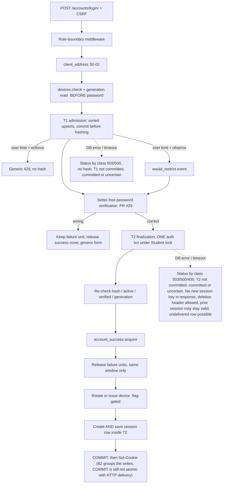

# Stage B: S0-02B/C authentication security implementation plan

**Status: planning only. Revision 5:** B1 is corrected after Codex's third independent review. That review gave the verdict REQUEST CHANGES on revision 4 (`e9178135`) and raised R4-01 to R4-06. It is on PR #40 (`e713a1e`, unmerged): `docs/security/B1_REVISION_4_INDEPENDENT_REVIEW.md` and `B1_REVISION_4_REVIEW_PROBES.md`. The earlier reviews (PR #37; PR #38 R3-01 to R3-06) remain addressed. See the correction matrices in §6.0. Nothing in this document is implemented or authorized. Documentation CI does not validate any B1 behaviour.

| Item | Value |
| --- | --- |
| Prepared | 12 November 2026 (Africa/Lagos) |
| Baseline | Branched from `master` `c19c1a3` (includes PR #30 and PR #37). Current `master` `0983f6f` adds only `docs/design/` files. The review documents are read from PR #38 `a908e12` and PR #40 `e713a1e`, both unmerged; this branch does not include them. |
| Analysed tree | A local, never-pushed scratch merge of `master` + PR #29 (`42910ed`) + PR #26 (`44c515f`). Both merged with no conflicts (`docs/AUTHENTICATION.md` auto-merged). That is static evidence only; no tests were run on it. |
| PR #26 and PR #29 | Read, not modified |
| Owner decisions so far | B1 accepted as the first candidate, subject to this refinement; timeout values remain **configurable candidates**, not production limits; D-B1-1 to D-B1-6 pending (§6.14) |

Companion documents:

* `docs/security/S1_PROPOSALS.md` sections A.19–A.21 (accepted design baseline). **These sections exist only on the unmerged PR #26 branch** (`security/s0-02a-trusted-device-foundation`, `44c515f`); on `master` the file predates them.
* `docs/security/S0_02_RECONCILIATION.md` §§4–5 (quota taxonomy and commit order). **This file exists only on the PR #26 branch**; it arrives on `master` when PR #26 merges.
* Codex PR #35 (Stage A readiness, Stage C local staging)
* Codex PRs #32 and #33 (independent approvals)

This plan does not repeat that design. It turns it into small, reviewable PRs against the code as it will exist after Stage A.

---

## 1. Authentication architecture review

### 1.1 Implemented and verified (on `master`, or in an approved unmerged PR)

| Control | Where | Evidence |
| --- | --- | --- |
| Separate restricted `auth` and academic `runtime` LOGIN roles; the migrator never serves requests; fail-closed role middleware | `accounts/middleware.py`, `accounts/boundary.py`, `academics/ownership.py` | Historical suites, PG17 CI |
| Forced RLS plus a signed transaction/backend-bound owner context | `academics/ownership.py`, migration `academics.0004` | 46 security tests |
| Live-session principal, password-hash-bound capability, session invalidation on password change | `accounts/principals.py` | Auth suite |
| Per-IP throttle (`REMOTE_ADDR`, IPv6 /64, opt-in trusted proxies), atomic upsert | `accounts/throttling.py` (S0-01, PR #24) | `test_client_address.py` |
| Generic login, registration and recovery responses; dummy hashing for unknown users | `accounts/backends.py`, `accounts/tokens.py` | Auth suite |
| One-use, expiring, digest-only email tokens with a credential stamp; Student-then-token locking | `accounts/tokens.py` | Auth suite |
| **F04b:** setter-free verification, compare-and-swap hash upgrade, locked re-validation before `auth_login` | PR #29 (`42910ed`), **unmerged** | 9 tests plus 9 Codex probes; PG17 CI |
| **S0-02A** dormant device primitives: UUID binding, generation barrier, rotation with grace, exact role allowlist including PG17 MAINTAIN | PR #26 (`44c515f`), **unmerged** | 64 tests plus 8 Codex probes; PG17 CI |

### 1.2 Confirmed gaps (code-level)

| ID | Gap | Location | Severity before activation |
| --- | --- | --- | --- |
| G1 | No `lock_timeout`, `statement_timeout` or `idle_in_transaction_session_timeout` on application aliases. A held Student lock stalls login, reset and change without limit. | `config/settings/base.py:36-37` | High (availability) |
| G2 | Database errors raised **after** the middleware's role checks become a generic **500** in account views. Session-save database errors become **400** via `SessionInterrupted` (Codex B1-01). The shared error template is unavailable in auth profiles (B1-05), and Django error logs carry token paths and exception text (B1-07). | `accounts/middleware.py`; `config/web_urls.py`; Django session middleware | Medium |
| G3 | The authenticated session payload is persisted by `SessionMiddleware` **after** the login transaction commits (Codex PR #32, Low). It is safe today, but device issuance cannot be made atomic with the session. | `accounts/views.py` login; Django `SessionMiddleware` | Blocks atomic device finalization |
| G4 | No account-aware failure tracking. Distributed guessing is limited only per source. | `accounts/views.py` login | High (S0-02, P2) |
| G5 | The IP login bucket counts **successes**, so many students behind one NAT block each other. | `accounts/throttling.py`, `AUTH_RATE_LIMITS['login']` | Medium (availability) |
| G6 | No security-event logging, no pseudonymous references, no deduplication. | n/a | Medium (S0-12) |
| G7 | `reset_confirm` and `verify` apply the per-IP limit **before** token validation, so shared-IP saturation also blocks recovery. | `accounts/views.py:110-113, 95-98` | High for any future enforcement (F07) |
| G8 | A new reset or verify request **revokes** earlier live links, so an unauthenticated requester can invalidate a victim's working link. | `accounts/tokens.py:29` | High for enforcement (F07) |
| G9 | Email is sent synchronously after commit through the console backend. There is no queue, retry or outage contract, and timing can reveal account existence. | `accounts/tokens.py:41`, `auth_common.py:46` | High for enforcement (S0-05) |
| G10 | The single `ip_ceiling` kind can't express the split trusted and unfamiliar ceilings in A.19 B. | `accounts/models.py` (PR #26) | Needs a migration in B6 |
| G11 | Device generation monotonicity is enforced by application code, not SQL (Codex PR #33, Low). | PR #26 | Low; documentation and test naming |

### 1.3 Outstanding risks carried forward

* Credential stuffing below per-account thresholds (R-06), which needs MFA or breached-password checks: owner decisions.
* An old `accounts.0003` already applied anywhere persistent needs a forward migration plan.
* `sslmode=prefer` (S0-08) is owned by Stage C (`verify-full` in the local staging profile).

---

## 2. Stage B implementation blueprint

### 2.1 Login data flow (end state; every enforcement switch default off)

Failure edges show **per-unit** outcomes (§6.1). Implicit autocommit statements (the throttle upsert and the CAS upgrade today) **persist once executed**, whatever happens later. A missing COMMIT proves rollback only for an explicit block. A failure response carries no new session key (§6.2 CK1). A deletion header is allowed, and a prior session may remain valid (§6.3). Statuses come from the classifier (§6.4): 503 for proven outage, connection or configuration states; 500 for defects; 400 kept for a genuine concurrent deletion. **No edge promises that a database failure rolled back, deleted sessions or produced a 503.**



### 2.2 Components

| Component | New or changed | Responsibility | Security boundary |
| --- | --- | --- | --- |
| `accounts/dbsafety.py`, `logging.py`, `failure_classification.py`, `failure_response.py` (new) | B1 (B1a–B1d) | Application-alias timers plus `connect_timeout`. Sink-level log sanitisation. A deterministic classifier over named wrapper classes. **Three** catch points: `process_exception`, `handler500`, and `handler400` for the session-save `SessionInterrupted` path. A template-free renderer. | No retry. Proven outage, connection or configuration states get 503. Driver defects and unproven database errors get 500, at `handler400` too. A genuine concurrent deletion stays 400. **No claim** that a failure rolled back writes, revoked prior sessions, or produced a 503 (§6.2–§6.5). |
| `accounts/login_flow.py` (new) | B2, then extended | `finalize_login(request, verified, raw_password)`: one auth transaction holding the Student lock, re-validation, `auth_login`, explicit session save | Replaces only the body of PR #29's finalizer; same lock order |
| `accounts/security_events.py` (new) | B3 | Allowlisted event names and fields, an independent pseudonym key, dedup by bucket window | No usernames, IPs, tokens, cookies or paths |
| `accounts/admission.py` (new) | B4 | T1 reservation; T2 settlement helpers over `AuthThrottle` and `LoginLimit` | Auth connection only; sorted lock order; observe/enforce mode |
| Device wiring in `login_flow` and `views` | B5 | Classify before the password; rotate or issue in T2; `revoke_all` in reset, change and forget-all | `UCC_TRUSTED_DEVICES=off` by default |
| `accounts/recovery.py` (new) + outbox model | B7/B8 | Coalesced non-invalidating issuance; outbox delivery; independent redemption lane | No enforcement dependency; console or locmem until Stage D |

### 2.3 Invariants (each PR must keep all of these)

* **I1:** A failure response produced before headers are emitted never *issues or renews* a session or device key (§6.2 CK1). Deletion or expiry headers are allowed. A committed T2 whose response is lost can leave an undelivered valid row (RB-1), and prior sessions may remain valid (RB-6). After the headers are handed off (P5), nothing is guaranteed (RB-2).
* **I2:** No password hash is evaluated without a committed admission (once B4 lands).
* **I3:** A wrong password never consumes `account_success`. A success never consumes failure units. Releases never touch a newer window.
* **I4:** Device trust can only lower friction for the **exact** account that owns the device: the stored username before authentication, the UUID after.
* **I5:** Generation is read before password verification and re-checked in T2. A forget-all, reset or change serialized before T2 refuses issuance.
* **I6:** No request path uses the migrator. Runtime and auth privileges are unchanged unless a migration plus allowlist update is reviewed. RLS is never weakened.
* **I7:** Every enforcement switch defaults to off or observe. Hard account restriction requires all of A.21.
* **I8:** Lock order: Student → TrustedDevice → AccountToken → AuthThrottle/LoginLimit (sorted). `rotate()` takes only its own device row.
* **I9:** Within each response variant (status, category family, route group), the body is byte-identical for unknown and known accounts and, where the plan says so, across limit kinds. Variants differ on purpose (status, `Retry-After`, uncertain-outcome wording). Constant bodies are **not** by themselves proof of enumeration resistance: status, timing and side effects are tested separately, and timing as distributions.

---

## 3. PR-by-PR roadmap

Each PR is separately reviewed, gets its own PG17 CI, and is independently verified by Codex. None activates a hard restriction.

| PR | Scope | Depends on | Migration | Live behaviour change | Owner decision |
| --- | --- | --- | --- | --- | --- |
| **B0** | Stage A: merge #29, then #26 (Codex sequence) | Owner | `accounts.0003` | **Yes:** #29 changes live login finalization (F04b fix: setter-free verification, CAS upgrade, locked revalidation). #26 is dormant. | Merge authorizations |
| **B1** (B1a–B1d, §6.11) | **Bounded database waits, log sanitisation and safe authentication failure handling** (§6, revision 5) | #29 merged | No | Proven outage, connection or configuration failures on account routes and the session-save path give a template-free 503. Driver defects and unproven database errors give a minimal 500. A genuine concurrent deletion stays 400. Existing handled contracts preserved. Sink-level sanitisation of Django and application logs in the protected web profiles; offline, migration and foundation profiles unchanged. Uncertain-outcome wording. Intermediates are trusted synthetic development only. | D-B1-1 to D-B1-6 (§6.14) |
| B2 | Transactional login finalization: explicit session save inside T2 (closes G3, Codex PR #32 Low) | B1 | No | None visible; session row created atomically | — |
| B3 | Security-event logging foundation (G6) | B1 | No | Log lines only | Logging key and retention; Stage D sink |
| B4 | Account-aware admission in **observe** mode: T1/T2 accounting, `account_fail`, `account_success` acquired in T2 | B2, B3, #26 | No (uses `LoginLimit`) | None; logs `would_restrict` only | Thresholds (initial 10/15 min) |
| B5 | Trusted-device wiring behind `UCC_TRUSTED_DEVICES=off`; `revoke_all` wired into reset, change and a new forget-all view | B4 | No | Forget-all button and revocation hooks; cookies only with the flag on | Forget-all UX; flag stays off |
| B6 | Split ceilings plus device IP bypass (flag-gated); failure-only IP counting | B5 | **`accounts.0004`** (`LoginLimit` kind CHECK) plus allowlist update | Failure-only IP counting changes when NAT users are limited | Failure-only switch; ceiling values from Stage E data |
| B7 | **02C-1:** recovery hardening: coalesced non-invalidating links, outbox and worker, recovery lane independent of login and IP saturation | B3 | **`accounts.0005`** (outbox, token columns) | Multiple live links (contract change; historical test conflict) | Link semantics; outbox vs Stage D transport |
| B8 | **02C-2:** verified-recovery trust and the "trust this browser" step-up link (flag-gated) | B5, B7 | Token purpose CHECK in 0005 | None until flagged | Step-up UX |
| B9 | Enforcement enablement (switch only) | All, plus A.21 evidence, plus independent review | No | Hard restriction | **Separate explicit approval** |

**Why this order:**

* B1 bounds lock and statement waits, classifies failures and sanitizes logs. B2 then groups the login writes into one transaction. Neither makes COMMIT atomic with HTTP delivery, so outcome-uncertain states remain (RB-1, RB-3). Without them, the B4 counters and B5 devices would inherit the unbounded-wait, 500 and post-commit-session gaps.
* Logging (B3) comes before observe-mode counters, so B4 produces evidence.
* Recovery hardening (B7) can run in parallel with B5 and B6 once B3 is done.

---

## 4. Security testing matrix

All tests use PostgreSQL 17 with real distinct migrator, runtime and auth LOGINs, synthetic data, and `TransactionTestCase` with barriers and bounded waits observed through `pg_locks` or `pg_blocking_pids`. They go in new test files; historical tests stay unchanged unless the owner approves a contract change.

| PR | Negative | Concurrency | Replay | Failure injection | PG17-specific |
| --- | --- | --- | --- | --- | --- |
| B1 | No B1 options on the migrator; duplicate or zero overrides rejected; a genuine concurrent deletion stays 400; driver defects give 500 at every catch point, including `handler400`; existing handled contracts preserved | Real 55P03 on the Student and session rows; logins in the N/AN/SA/DA states | — | **Flow × phase × initial-cookie** matrix (§6.10 A): O1–O4 recorded; CK1–CK4; DA A-valid on rollback; allowed deletion headers; no new key. Classification (B): 42703/42P01, 55P03, real and no-SQLSTATE connection loss, DA INSERT → `handler500`. Login lifecycle observation (A1: SA neither flushes nor cycles; DA has no row inside the finalizer). Implicit versus explicit units (H). Sink-level logging sentinels and label trust (D). Fresh-subprocess profile scope (G). | 55P03 / 57014 / 25P03 (`InternalError`); a deferred-trigger COMMIT exceeds `statement_timeout`; `connect_timeout` with a stalled handshake |
| B2 | No session row if T2 rolls back | Reset racing finalization in **both** orders (Codex probe 3 becomes a regression) | — | Fault after `auth_login`, at session save, at commit | Real row locks |
| B3 | Sentinel username, IP, token, cookie and password never appear in captured logs; reset paths never logged | Dedup under N threads | — | Logging failure never blocks auth | — |
| B4 | 20 failures across windows don't consume `account_success`; unknown and known accounts are identical | N+1 admissions, exactly N password checks (backend call counter); finalizations never exceed the success limit | — | T1 rollback consumes nothing; crash between T1 and T2 counts as a failure only | Campus simulation (11/61/601 students) **in observe mode** |
| B5 | Wrong-account and grace cookies get the unfamiliar lane; cookie flags per profile; flag off means no cookie | Forget-all or reset between verification and T2 refuses the device | Previous-cookie replay after grace revokes only the owner's device | Lost response or out-of-order responses; fault in T2 leaves the old identifier valid | MAINTAIN and allowlist regressions retained |
| B6 | Bypass only with a valid **current** device; ceilings never removed | Unfamiliar flood does not drain the trusted ceiling | Stolen-cookie guessing capped by `device_fail` and `account_trusted_fail` | — | Migration 0004 forward and reverse, grants re-provisioned |
| B7 | A recovery request never invalidates a live link; bombing limits; generic responses | Concurrent consumption of sibling tokens gives exactly one password change | Consumed or expired or wrong-purpose tokens rejected | Outbox send failure, retry, permanent failure; provider timeout | Redemption works while login and IP buckets are saturated |
| B8 | A request alone grants nothing; GET never consumes | Two-browser nonce mismatch | Step-up token single-use | Delivery outage | — |
| B9 | Enforcement refuses to start without the A.21 attestation | Full B4–B8 suite with enforce on | — | Email outage runbook rehearsal | Staging evidence (Stage C/F) |

---

## 5. Risk and dependency register

| ID | Risk or dependency | Severity | Mitigation | Owner |
| --- | --- | --- | --- | --- |
| RD-1 | PR #29 not merged, so stale-hash reset reversal persists on `master` | High | Stage A merges #29 first (B0) | Owner, then Codex |
| RD-2 | Unbounded lock waits (G1) | High (availability) | B1 | Claude |
| RD-3 | Post-commit session save (G3) | Medium | B2 | Claude |
| RD-4 | Recovery coupled to IP saturation and link invalidation (G7/G8) | High (blocks enforcement) | B7 | Claude; owner decides link semantics |
| RD-5 | No real email, outbox or outage behaviour (G9) | High (blocks enforcement) | B7 outbox; Stage D transport, sink and runbooks | Claude (code) / Codex (Stage D) |
| RD-6 | Campus ceiling sizing unknown | Medium | Observe-mode data (B4); Stage E simulations | Codex (Stage E) / owner |
| RD-7 | Credential stuffing below thresholds | High (general) | Out of Stage B: MFA or breached-password check decision | Owner |
| RD-8 | Settings collision with the Stage C `local_staging.py` profile | Low | B1 puts timeouts in a shared helper that every profile inherits; Stage C must not override them | Claude + Codex |
| RD-9 | Historical-test contract changes (B7 link semantics) | Medium (process) | Feature-flagged profile, or explicit owner approval to amend | Owner |
| RD-10 | `accounts.0003` history drift on persistent databases | Medium | Inventory before any persistent use; forward migrations only | Codex (Stage C/D) |
| RD-11 | Generation is not monotonic in SQL (G11) | Low | Document in B5; optional trigger only if the threat model requires it | Owner decision |
| RD-12 | Timeout values too tight cause false 503s under load | Medium | Configurable; Stage E measurement before staging | Codex (Stage E) / owner |

---

## 6. First implementation proposal: B1 (revision 5: corrected after the third independent review)

**Status.** Specification only, **not implemented**, not authorized.

**Review history:**

* **Revision 5** corrects revision 4 (`e9178135`). Codex's review of revision 4 gave **REQUEST CHANGES** (PR #40, commit `e713a1e`, **unmerged**). It is in `docs/security/B1_REVISION_4_INDEPENDENT_REVIEW.md` and `B1_REVISION_4_REVIEW_PROBES.md`, read at that exact commit. It raised:
  * three Medium findings: **R4-01** session lifecycle, **R4-02** offline profiles and the logging guard, **R4-03** implicit autocommit;
  * three Low findings: **R4-04** label trust, **R4-05** walker sequencing and category transport, **R4-06** the Stage C profile flag.
* **Revision 4** corrected revision 3 (`e308a9a`) after PR #38 (`a908e12`), findings R3-01 to R3-06.
* **Revision 3** corrected revision 2 after PR #37.

Revision 5 keeps every R3-01 to R3-06 design decision unless §6.0.0 says otherwise. The corrections are made throughout the document (§2, §3, §4, §6, §7), not only in the sections the review names.

**Documentation CI is not B1 evidence.** CI on this PR runs the **existing** code only. It does not show that any unimplemented B1 classifier, sanitizer, profile guard or test passes.

**Evidence labels.** Every claim below is labelled as one of:

* **Probe (PG17.11, Codex R4):** Codex's revision-4 observation tests: four login entry states, two response-save failures, implicit autocommit and offline logging. They ran on Django 5.2.19, psycopg 3.3.8 and PostgreSQL 17.11 against post-PR #29 code (`bec0a44`, identical to `42910ed` in `accounts`, `config` and `auth_tests`). I read the source in full. **I did not rerun them.**
* **Probe (PG17.11, Codex R3):** Codex's seven revision-3 probes (PR #38). Not rerun by me.
* **Probe (PG16.15, mine):** my R1–R3 probes and my reruns of Codex's earlier probes (§6.13).
* **Source:** a reading of Django 5.2.19, psycopg 3.3.8, CPython 3.12 or repository code, cited by file and line. **These still need the tests in §6.10 to prove them.**
* **Design:** a requirement for the future implementation, not an observation.

### 6.0 Correction matrices

#### 6.0.0 Revision-4 findings (Codex PR #40, `e713a1e`)

| Finding (severity) | Revision 4 error | Evidence | Correction in revision 5 | Sections | Test evidence required | Status |
| --- | --- | --- | --- | --- | --- | --- |
| **R4-01** (Medium): the session lifecycle and acceptance oracle were wrong | Said all four entry states run `cycle_key()`. Showed SA L4 as "K deleted, authenticated orphan". Showed DA L4 as "anonymous B row". Treated the response save as always an UPDATE through the `handler400` path. | Source: `contrib/auth/__init__.py:175-187`. A session holding a user takes the `flush()` branch only when the user or hash differs; otherwise **nothing** happens. `cycle_key()` runs only in the `else` branch (no user in the session). `db.py:114-138`: with the key set to None, `save()` calls `create()`. Probe (PG17.11, Codex R4): cycle calls are N 1, AN 1, **SA 0, DA 0**. Rows inside the finalizer: N 1, AN 1, SA 1 (existing), **DA 0** (key None). SA keeps the same key. A response save that is not applied gives SA 500 with the old key valid and 1 row; DA 500 with **0 rows**. | §6.3.1 rewritten from source. Four separate login lifecycles (N, AN, SA, DA), plus **SX** (same user, stale hash, which takes the flush branch). Response-save phases are split into **UPDATE** (N, AN, SA: `UpdateError` → `SessionInterrupted` → `handler400`) and **INSERT** (DA and SX: key generation `exists()` SELECT, then the INSERT; errors reach `handler500` directly; key collisions are Django's own `CreateError` retry). SA keeps its key and its renewal risk is on **this** path. The replacement row for an account switch is created **only** by the response-phase INSERT. RB-1 corrected (no SA orphan at L4). | 6.3.1–6.3.3, 6.5, 6.10 A, 6.11 (B1a), 6.13, 6.14 RB-1/RB-6, 2.1 | §6.10 A1 (lifecycle observation assertions in **B1a**): cycle counts, finalizer row counts, key retention for N, AN, SA, DA and SX. A2 for each response-save sub-phase. | **Corrected (design)**; evidence in B1a |
| **R4-02** (Medium): the startup logging guard had no profile boundary | `AccountsConfig.ready()` rejected every non-sanitizing handler. `accounts` is installed in `base`, so `auth_migration` (`LOGGING={}`; `StreamHandler` and `AdminEmailHandler` on `django`) would fail to start. | Probe (PG17.11 environment, Codex R4): a fresh `auth_migration` process has `accounts` installed, empty `LOGGING`, and `django` handlers `[StreamHandler, AdminEmailHandler]`. Source: `config/settings/*.py` import graph. | An explicit policy setting, **`UCC_LOG_PRIVACY = "enforce"`**, set **only** by `accounts.log_privacy.configure()`. That function is called from `auth_common.configure` (so it reaches the auth and web profiles) and must be called by Stage C's staging profile. Everything (`LOGGING`, `lastResort` replacement, `ready()` guard, E102 and E103) is active **only** when the setting is `"enforce"`. The default is absent, meaning off. Profile table in §6.8.1. Excluded profiles keep Django's default graph unchanged. | 6.8.1, 6.8.2, 6.9, 6.10 G, 6.11 (B1b) | §6.10 G: one **fresh subprocess per profile**. Protected profiles have exactly the sanitized graph; a raw handler stops startup. Excluded profiles have Django's default graph, and `check`, migration and provisioning commands start. Historical suites pass unchanged. | **Corrected (design)** |
| **R4-03** (Medium): implicit autocommit was omitted | P2 said "a transaction never commits without COMMIT" for every unit, including autocommit throttle and CAS writes | Probe (PG17.11, Codex R4): an INSERT on the auth alias in autocommit mode was visible to another connection with **0** `_commit()` calls. Source: `throttling.py:82-92` (raw cursor upsert, no atomic block); `backends.py:29` (`QuerySet.update`, no atomic block); session save uses `transaction.atomic` (`db.py:126`). | §6.1 separates **implicit statement units** (phases S0–S3: not dispatched; a statement-level error response; the driver returned success, so committed; dispatched with no result, so uncertain) from **explicit atomic units** (E0–E4). "No COMMIT sent" proves rollback **only** for an explicit block. A later finalizer rollback never implies a throttle or CAS rollback. No automatic retry of either kind. | 6.1, 6.3, 6.10 H, 6.11, 6.14 | §6.10 H: real autocommit persistence after a later failure (throttle and CAS); a real statement-level 55P03 on the throttle row gives no change; an **injected** post-execute lost acknowledgement is labelled as such; explicit-block known rollback versus an uncertain COMMIT. | **Corrected (design)** |
| R4-04 (Low): labels need a trust policy | Regex on logger names, exception qualnames and `levelname` | Probe (Codex R4): sentinel-bearing names pass the regex | Logger names map to **fixed labels from a code table**; unknown names become `other`. Levels use a numeric table. Exception labels come from an identity-keyed table of known classes; unknown classes become `OTHER`. A SQLSTATE is emitted only if `psycopg.errors.lookup()` knows it. Route labels come from a fixed tuple. The guard is a **startup snapshot**: runtime logging reconfiguration is prohibited by rule and by a source-scan test (RB-12). | 6.8.3, 6.10 D | Sentinel logger name, sentinel exception class, sentinel `levelname`, unknown SQLSTATE: none reach the sink | **Corrected (design)** |
| R4-05 (Low): walker sequencing and category transport | B1b used the §6.4 walker that B1c delivers; the output template had no category field | Review | The shared bounded walker is in `accounts/exception_chain.py`, **delivered and tested in B1b**; the B1c classifier imports it. A typed `FailureEvent` (enum category, validated SQLSTATE) is the **only** extra the sanitizer accepts. The output template gains `event` and `category` fields. | 6.4, 6.8.3, 6.9, 6.11 | Walker unit tests in B1b; the `accounts.failures` line shows the category at the sink (B1c) | **Corrected (design)** |
| R4-06 (Low): Stage C profile flag | E104 keyed on the `*_secure` filename | Review | Explicit **`UCC_SECURE_PROFILE = True`** in `auth_secure`, `web_secure`, and (by agreement) Stage C `local_staging`. E101–E104 are evaluated under that exact module in the Stage C preflight. | 6.7, 6.8.1, 6.12 | E104 fires on `DEBUG` or `DEBUG_PROPAGATE_EXCEPTIONS` when the flag is set, and is silent when it is unset | **Corrected (design)**; Stage C integration check |

#### 6.0.1 Revision-3 findings (Codex PR #38)

The statuses below are as revision 4 left them. Codex's PR #40 disposition: R3-01, R3-03 and R3-06 are **addressed at design level**. R3-02, R3-04 and R3-05 were **partly open** and are completed by R4-01 to R4-05 in §6.0.0. Their R3 design decisions (classification, cookie rules, renderer, increment order) are preserved unchanged.

| Finding (severity) | Revision 3 error | Evidence | Correction in revision 4 | Section | Status |
| --- | --- | --- | --- | --- | --- |
| **R3-01** (Medium): `handler400` sends database defects back as 400; the classification order was ambiguous | Any SQLSTATE outside the 503 sets fell through to the original 400 in `handler400`. "First decisive node" conflicted with whole-chain fallbacks. Bare `OperationalError` was handled three different ways. | Probe (PG17.11, Codex): `SessionInterrupted → UpdateError → ProgrammingError → UndefinedColumn(42703)` returns **400** at `handler400` | **One** deterministic algorithm, with three passes in a fixed order over a bounded walk through **named wrapper classes only**. It returns a category plus database-or-not origin. One status table covers all three catch points. **A driver defect gives 500 at every catch point, `handler400` included.** A genuine concurrent deletion, or a non-database `BadRequest`, keeps the original 400. Edge cases are listed explicitly: no-driver `InterfaceError`, a bare Django `OperationalError`, a truncated or cyclic chain, an unrelated non-database outer exception, and several driver nodes. | 6.4, 6.5 | **Corrected (design)**; tests in 6.10 |
| **R3-02** (Medium): a login as B from a browser holding A's session assumed the flush always committed | Showed A as invalidated for every P3/P4 failure, which generalised from one committed-case probe | Probe (PG17.11, Codex): a lock timeout before the flush leaves **A valid** (follow-up 200). A fault before COMMIT after the flush rolls back the DELETE, so **A stays valid and no B row survives**. Probe (PG16.15, mine), R3: after the session commit plus a lost acknowledgement, A is invalid and B is an orphan. | The account-switch outcome is now set **per login phase L0–L6** (§6.3.2). Before the flush, or with the flush rolled back, A **may remain valid**. A committed flush whose key is never delivered leaves A invalid and B possibly orphaned. An uncertain COMMIT allows either set. The universal oracle is **no B authority delivered** in every pre-header handled failure, not "A becomes anonymous". Keeping A's prior authority is an owner decision (D-B1-1, now explicitly covering account switch). It is **not** changed to make a test pass. | 6.3 | **Corrected (design)**; decision D-B1-1 |
| **R3-03** (Medium): SG1 forbade legitimate cookie-deletion headers | "No `Set-Cookie` for a session" on any ≥500 response | Probe (PG17.11, Codex): the password change completes its flush, then fails before COMMIT. The response is 500 with `sessionid=""; Max-Age=0`, and the old server session is valid again after the rollback. | Four separate observables: **O1** the cookie headers on the response, **O2** the browser cookie jar after receipt, **O3** committed valid session rows, **O4** keys the client already held. **CK1** forbids only *issuing or renewing* a non-empty session key on a pre-header failure response. **Deletion or expiry headers are allowed, and B1 must not strip them.** A client that receives no response gets no deletion header (CK5). | 6.2 | **Corrected (design)** |
| **R3-04** (Medium): the logging design missed real Django namespaces and the raw record metadata | Filters attached only to `django.request` and `django.server`. Records were rewritten in place. Assertions covered the message, args and traceback only. | Probe (PG17.11, Codex): a reset secret appears in **`django.security.csrf`**. `LogRecord.request` is the **live** request, with Cookie, Authorization, query and IP reachable. A logger filter **does not run** for records propagated from child loggers. Source: `logging.Handler.handleError` writes `record.msg` and `record.args` to stderr (CPython 3.12). | Logger filters are replaced by **sanitisation at the final sink**. A single `SanitizingHandler` is the only handler in the application process, attached at the root, so all propagation reaches it. Python's `lastResort` handler is replaced. A startup check fails closed if any raw handler is present in the covered logger tree. The handler builds a **fresh allowlisted record**: no message text, args, request reference, extras, `exc_text` or `stack_info` is copied, and it never mutates the request. `exc_info` is set to `None`, and a bounded summary of class names and SQLSTATEs goes in its own field. Its failure path is a constant line and `handleError` is overridden, so raw data is never a fallback. Tests check the bytes written to the sink. The Django namespaces are inventoried, including `django.security.*`. | 6.8 | **Corrected (design)**; RB-4 narrowed to non-Django sinks only |
| **R3-05** (Medium): the global blueprint and the correction matrix disagreed; increment gates were too loose | §2.1 promised "Rollback: 503, no session, no cookie". I1 and I9 were global. RB-1 implied B2 removes orphans. B1a–B1c had no full regression gates. | Review comparison of §2 against §6 | §2.1, §2.2, §2.3 (I1, I9), §3, §4 and §6.14 are rewritten to use per-unit known-rollback, committed or uncertain states. Statuses come from the classifier, and defects are 500. **B2 groups writes but cannot make COMMIT atomic with HTTP delivery.** Body-constancy claims are limited to their scope and are not presented as enumeration resistance. §6.11 gives **mandatory evidence gates per increment**. Privacy moves to **B1b, before** the new error handling (B1c). Every intermediate is **trusted synthetic development only**, never "B1 complete" or an accepted staging release. | 2.1–2.3, 3, 4, 6.11, 6.14 | **Corrected (design)** |
| **R3-06** (Low): wording around the renderer's fatal exceptions and DEBUG | "`try/except BaseException`-safe logic"; implied DEBUG causes a plain 500 through `handler500` | Source: `core/handlers/exception.py:96-107` and `173-186` | The renderer catches **`Exception` only**. `SystemExit`, `KeyboardInterrupt` and `GeneratorExit` propagate. There is no promise to survive `MemoryError` or resource exhaustion. DEBUG and `DEBUG_PROPAGATE_EXCEPTIONS` behaviour is documented exactly; neither calls `handler500`. A call with no active exception is a separate, tested case. | 6.7 | **Corrected (design)** |

#### 6.0.2 Original findings B1-01 to B1-08 after revision 4

| Finding | Codex disposition of revision 3 | Revision 4 change | Current status |
| --- | --- | --- | --- |
| B1-01 (High) session-save errors bypass `handler500` | Core routing corrected; partially addressed | R3-01: a defect at `handler400` gives 500; the chain rule is deterministic | Corrected (design); needs B1c evidence |
| B1-02 (High) 5xx does not revoke sessions or prevent valid rows | False guarantee withdrawn; partially addressed | R3-02 / R3-03 / R3-05: per-phase account-switch states, cookie observables, diagram and invariants | Corrected (design) with residual risks RB-1, RB-6 |
| B1-03 (High) COMMIT and request bound false | **Addressed** as a design correction | None (§6.6 unchanged in substance) | Accepted design; RB-3 |
| B1-04 (Medium) failed change need not flush | Substantively addressed | R3-03: the deletion header is allowed and asserted per phase | Corrected (design); D-B1-2 |
| B1-05 (Medium) unsafe renderer | Substantively addressed | R3-06 wording | Corrected (design) |
| B1-06 (Medium) universal invariants | Substantially corrected | R3-02 / R3-05: per-phase oracle and per-increment scope | Corrected (design) |
| B1-07 (Medium) framework logs leak | Partially addressed | R3-04: sink-level sanitisation, namespace inventory, safe records | Corrected (design); RB-4 limited to non-Django sinks |
| B1-08 (Medium) classification conflicts | Substantially addressed | R3-01 / R3-05: one precedence table, no global shorthand | Corrected (design) |

"Corrected (design)" means the specification is technically supportable. It does **not** mean implemented, tested in CI or authorized.

### 6.1 Write units and failure phases (per unit, not per request)

A request contains several write units. **Each unit has its own outcome.** A later failure never undoes an earlier unit that already committed, so **B1 never claims that a failed request rolled anything back**.

#### 6.1.1 Unit inventory (source: PR #29 `42910ed` plus Django 5.2.19)

| Unit | Kind | Where |
| --- | --- | --- |
| IP throttle upsert (`INSERT … ON CONFLICT … RETURNING`) | **Implicit** (autocommit single statement; no atomic block) | `accounts/throttling.py:82-92` |
| CAS hash upgrade (`QuerySet.update`) | **Implicit** (autocommit; `update()` opens no atomic block) | `accounts/backends.py:29` |
| Login finalization (Student lock, revalidation, `auth_login` session writes, `last_login`) | **Explicit** `transaction.atomic(using='auth')` | `accounts/views.py` login |
| Response-phase session save: UPDATE (N, AN, SA) or `create()` → INSERT (DA, SX) | **Explicit**: each `save()` runs in its own `transaction.atomic` | `sessions/backends/db.py:114-138` |
| Reset redemption, verify, issue, register, password change | **Explicit** atomic blocks | `accounts/views.py`, `accounts/tokens.py` |

#### 6.1.2 Phases for implicit statement units (autocommit)

PostgreSQL commits a successful standalone statement **implicitly**. No client COMMIT is sent (Probe, PG17.11, Codex R4: persisted with 0 `_commit()` calls).

| Phase | Meaning | Outcome of the unit | Known? |
| --- | --- | --- | --- |
| S0 | Not dispatched: the connection was unavailable before sending, or a client-side error occurred before execute | Not executed | Known (only when the test controls the point of failure) |
| S1 | The server returned a **statement-level ERROR** for this statement (for example 55P03, 57014, 23505). The connection stays usable. | The implicit transaction was aborted, so **not persisted** | Known |
| S2 | The driver **returned success** for the statement | **Persisted.** A later failure in the request (finalizer, middleware, rendering) does not undo it. | Known |
| S3 | Dispatched, then the connection failed before a result came back: no-SQLSTATE driver error, class `08`, a FATAL such as 57P01, or a worker kill | **Persisted or not** | **Uncertain** |

Consequences:

* The throttle and CAS units are **S2 in every login that reached the finalizer**, whatever happens afterwards.
* The plan never infers their rollback from a finalizer rollback or from the absence of a COMMIT.
* A connection-class or no-SQLSTATE error is treated as S3 unless the test proves S0.

#### 6.1.3 Phases for explicit atomic units

| Phase | Meaning | Outcome | Known? |
| --- | --- | --- | --- |
| E0 | Failure before the first statement of the block | Nothing written | Known |
| E1 | A statement-level ERROR, or a Python exception inside the block, before COMMIT is dispatched; Django's `Atomic.__exit__` rolls back | **Not committed.** An explicit transaction cannot commit without COMMIT. If the connection was lost, the server aborts it when it notices; locks may linger until then. | Known (not committed) |
| E2 | The connection failed inside the block before COMMIT was dispatched | Not committed (as E1) | Known |
| E3 | COMMIT dispatched, no confirmation (`_commit` raised a connection-class or no-SQLSTATE error, or the worker was killed) | Committed **or** not | **Uncertain** |
| E4 | COMMIT confirmed; a later failure happened elsewhere | Committed | Known |

"No COMMIT sent, therefore rolled back" applies **only** to E0–E2 of an explicit block.

The general labels P0–P5 used in earlier revisions map as follows: P0 and P1 → S0, S1 or E0; P2 → E1 or E2; P3 → S3 or E3; P4 → S2 or E4; P5 is after the header handoff (RB-2).

Post-failure state is always read on a **clean connection** after all controlled transactions end, never through the failed one.

**No automatic retries.** B1 never retries an implicit or explicit security write. Django's built-in `create()` loop, which retries a **session-key collision** (`CreateError`, an `IntegrityError` on the INSERT), is existing framework behaviour that inserts no duplicate authority. It is listed so that it is not mistaken for a B1 retry.

### 6.2 Cookie and session observables, and the invariants B1 guarantees

Each test records four observables separately:

| Observable | Definition | How it is read |
| --- | --- | --- |
| **O1 Response cookie** | Each `Set-Cookie` for `SESSION_COOKIE_NAME` on the response. Each is classified as **issue/renew** (non-empty value), **delete/expire** (empty value with `Max-Age=0` or a past `expires`), or none. | `response.cookies` |
| **O2 Browser jar** | The cookie the client holds **after** processing the response. If no response arrives, the jar is unchanged. | The test client's jar after the request |
| **O3 Committed sessions** | Every valid row: not expired, decodes, and `session_student(key)` is not None. Records the user and whether the row is authenticated. | Clean connection after all controlled transactions end |
| **O4 Prior keys** | The keys the client held before the request (`K_prev`), plus any key delivered in this test | Captured before the request |

**"Authority held by the client"** means a key in O2 that is valid in O3, and the user it maps to.

**Invariants for a B1-handled failure produced before headers are emitted** (any response produced inside Django's exception lifecycle, including B1's handlers):

* **CK1 (no new key issued).** O1 contains **no issue/renew** header for the session cookie. **Delete/expire headers are allowed. B1 must not remove them, and tests never require them to be absent.** Source: `contrib/sessions/middleware.py:36-42` (deletion when the session is empty, whatever the status) and `58-77` (save and set only below 500). A failed response-phase save raises **before** `set_cookie` (`contrib/sessions/middleware.py:58-77`: the save call precedes `set_cookie`). For N, AN and SA the error is an UPDATE → `handler400`; for DA and SX it is a `create()` error → `handler500` (§6.3.1). Either way the replacement response is built after the session middleware has raised, so it gets no issue header from the session middleware.
* **CK2 (no new authority).** After receipt, O2 holds no key outside `K_prev`. Any authority the client still has is **prior** authority: a `K_prev` key that is still valid.
* **CK3 (prior state asserted, not assumed).** Each `K_prev` key's validity is asserted against the per-flow phase tables (§6.3). Tests never assume a rollback invalidated it, and never assume it survived a committed flush.
* **CK4 (orphans recorded).** Valid rows whose key is in neither O2 nor `K_prev` are enumerated. They are permitted only in the phases the §6.3 tables list. They expire within `SESSION_COOKIE_AGE` (1800 s server side) and are removed by cleanup.
* **CK5 (no response, no promise).** If the client receives no response (transport loss, worker killed) or the failure is in P5, O1 is undefined. The client may get neither a deletion header nor, in P5, may already have an issue header. This is outside B1's guarantees (RB-2).
* **SG2.** B1 never converts a database failure into a 2xx or 3xx response, and never retries a security write.
* **SG3.** Flows with uncertain outcomes (reset, verify, change) say the outcome is uncertain. They do not claim success or rollback.
* **SG4.** B1 does not touch privileges, RLS, the signed context, the session engine, or the authentication semantics of successful paths.

### 6.3 Flow-specific authentication, session and cookie invariants

#### 6.3.1 Login lifecycle (source: PR #29 `42910ed`, Django 5.2.19 `contrib/auth/__init__.py:153-196`, `sessions/backends/base.py`, `db.py`)

**Before the finalizer:**

1. Role check (read).
2. Throttle upsert (**implicit**, §6.1.2).
3. Form authentication (reads), including the CAS upgrade when needed (**implicit**).

**Finalizer** (explicit `transaction.atomic(using='auth')`): lock the Student row and revalidate, then `auth_login(request, user)`, which branches **exactly once**:

| Entry state | Branch in `auth_login` | Session writes **inside the finalizer** | In-memory session after `auth_login` |
| --- | --- | --- | --- |
| **N** (no cookie) | `SESSION_KEY` absent → `cycle_key()` → `create()`: `exists()` SELECT, then INSERT of the current (empty) data | 1 INSERT (anonymous row, new key K′) | Key K′, authentication data **in memory only** |
| **AN** (known anonymous key K) | `SESSION_KEY` absent → `cycle_key()`: INSERT of K's anonymous data under K′, then DELETE of K | INSERT K′, DELETE K | Key K′, authentication data in memory |
| **SA** (key K holding the same user with a matching hash) | `SESSION_KEY` present, same user, hash equal → **neither flush nor cycle** | **None.** K is kept (same key). | Key K, authentication keys rewritten in memory (same values) |
| **SX** (key K holding the same user with a **stale** hash, for example after a password change elsewhere) | Hash differs → `flush()` | DELETE K; key set to **None** | Key None, authentication data in memory |
| **DA** (key K holding a different user A) | Different user → `flush()`: clear, DELETE K, key None. **No `cycle_key()`** (that call is in the `else` branch). | DELETE K only. **No replacement row exists inside the finalizer** (Probe, PG17.11, Codex R4: 0 rows). | Key None, B's authentication data in memory |

After the branch, every state continues the same way inside the finalizer:

* `rotate_token`;
* `user_logged_in` updates `last_login`;
* `request.session.set_expiry(0)` (in memory).

**COMMIT** closes the finalizer. The view then returns a 302 redirect.

**Response phase:** `SessionMiddleware.process_response`. For any status below 500 with a modified, non-empty session, it calls `save()`:

| Entry state | Response save | Error path if the save fails |
| --- | --- | --- |
| N, AN | **UPDATE** of K′ with the authentication data and new expiry (explicit atomic) | `DatabaseError` → `UpdateError` → `SessionInterrupted` → **`handler400`** |
| SA | **UPDATE of the existing K** (authentication data, new `expire_date` = now + `SESSION_COOKIE_AGE`): this **renews K** | Same `handler400` path |
| DA, SX | Key is None, so `save()` → **`create()`**: the `exists()` SELECT for a new key, then **INSERT** of the authenticated data under the new key K_B (explicit atomic per attempt). **This is the only point at which the replacement session for B is created.** | `exists()` error → the raw `DatabaseError` propagates. INSERT `IntegrityError` → `CreateError`, which Django retries with a new key. Any other INSERT `DatabaseError` is re-raised (`must_create` skips `UpdateError`). All reach **`handler500`**, not `handler400`. |

Then `Set-Cookie` carries the session key.

Login phases used below:

| Label | Unit | Meaning |
| --- | --- | --- |
| L0 | Implicit units | Failure before the finalizer. Throttle and CAS are S1, S2 or S3 independently. |
| L1 | Finalizer E0/E1 | Before any session write: Student lock wait, revalidation |
| L2 | Finalizer E1/E2 | After the session writes in the table above (and/or `last_login`), before COMMIT: **known not committed** |
| L3 | Finalizer E3 | COMMIT uncertain |
| L4u | Response UPDATE E0–E2 | UPDATE known not applied (N, AN, SA) |
| L4i | Response INSERT E0–E2 | `exists()` or INSERT known not applied (DA, SX) |
| L5u / L5i | Response UPDATE or INSERT E3 | Commit uncertain (including commit followed by a lost acknowledgement) |
| L6 | — | After the header handoff (P5) |

The finalizer commit is E4 in L4u–L5i.

#### 6.3.2 Account switch: browser authenticated as A logs in as B

| Phase | A's row K (O3) | B rows (O3) | O1 | O2 after | Authority after | Evidence |
| --- | --- | --- | --- | --- | --- | --- |
| L0, L1 | **Valid**, unchanged | None | None | K | **Prior A retained** | Probe (PG17.11, Codex R3): Student 55P03, 500 today, A valid, follow-up 200 |
| L2 | **Valid** (the DELETE rolled back) | **None** (none was ever inserted in the finalizer) | None. The in-memory session holds B's authentication data, so it is non-empty and no deletion header is sent (source); a deletion header would still be allowed by CK1. | K | **Prior A retained** | Probe (PG17.11, Codex R3): `_commit` fault, A valid, 1 row, follow-up 200 |
| L3 | L2 state **or** invalid | None | None | K | Prior A retained, or anonymous | Allowed union |
| L4i | **Invalid** (DELETE committed) | **None.** The `exists()` or INSERT failed and was not applied. | None | K (dead) | Anonymous | Probe (PG17.11, Codex R4): injected before save, 500, **0 rows**, no cookie |
| L5i | Invalid | **0 or 1** valid authenticated B row (K_B), key never delivered (**orphan** if committed) | None | K (dead) | Anonymous; orphan possible | Probe (PG16.15, mine) R3 (the real INSERT ran, then the error was injected): 500, 1 valid row not equal to the client's key |
| L6 | Invalid | B valid | Issue header **may** have been delivered | **May** be K_B | Equivalent to a successful login | Outside B1 (RB-2) |

**Universal oracle for every pre-header row:**

* **no B key in O2** (CK2);
* A's validity is asserted per row;
* a B row exists **only** in L5i (committed side) or L6;
* the DA response-save error reaches **`handler500`** (§6.5).

**A status conversion cannot change these states.**

#### 6.3.3 Other initial states for login

| Initial state | L0–L2 (finalizer known not committed) | L3 | L4u / L4i (response save known not applied) | L5u / L5i (response save uncertain) |
| --- | --- | --- | --- | --- |
| **N** | No session row persisted by the finalizer | Either | L4u: anonymous K′ committed in the finalizer, never delivered; no authority | L5u: K′ authenticated if the UPDATE committed (**orphan**); otherwise anonymous |
| **AN** (K) | K valid (anonymous) | Either | L4u: K deleted; K′ anonymous; the jar holds dead K; no authority | L5u: K′ authenticated orphan or anonymous; the jar holds dead K |
| **SA** (K) | **K valid**, expiry unchanged | Either (the finalizer wrote no session row for SA, so K is unaffected by either outcome) | L4u: **K valid, expiry unchanged**, 1 row, **no orphan**, no cookie (Probe, PG17.11, Codex R4) | L5u: **K valid; expiry renewed if the UPDATE committed** (prior authority **renewed**, RB-6; Probe PR #37 `test_session_update_ack_lost_can_extend_known_existing_session`). No orphan, because the key is the client's own. |
| **SX** (K, stale hash) | K row restored by the rollback, but already **invalid** (stale hash), so no authority | Either | L4i: K deleted; no new row; anonymous | L5i: 0 or 1 authenticated orphan; the jar holds dead K |

**Successful-path note (existing behaviour, unchanged by B1):** a successful SA login **keeps** the same session key K. The other entry states end with a new key.

No pre-header row delivers a key outside `K_prev` (CK1, CK2).

#### 6.3.4 Password change (F-CHG; initial state SA)

| Phase | Server session K | Other sessions of A | O1 | O2 after | Evidence |
| --- | --- | --- | --- | --- | --- |
| C0 before flush (Student lock, validation) | Valid | Valid (hash unchanged) | None | K | Probe (PG16.15 and PG17, PR #37) |
| C1 flush DELETE fails | Valid (rolled back) | Valid | None (`_session_key` still set, so not empty) | K | Probe (PR #37) |
| C2 after flush, before COMMIT | **Valid again** (rolled back) | Valid | **Deletion header present** (session empty) | **None** | Probe (PG17.11, Codex): 500, `sessionid=""; Max-Age=0`, K valid |
| C3 COMMIT uncertain | {committed: K deleted, new hash, others invalid by hash} or the C2 state | Either | As C2 | None | Allowed set |
| C4 committed, later failure | Deleted | Invalid by hash | Deletion header | None | Source; test required |

The **C2** row shows the R3-03 distinction. The browser copy is deleted, but **the server-side session K stays valid**, and so does any other copy of K. That is a prior-authority residual (RB-6, D-B1-2), not new authority.

#### 6.3.5 Reset, verify, issue and register

* **F-RESET (redemption; initial states N or SA).**
  * Unit: one transaction, writing the password and consuming the **nominated** token together.
  * Allowed outcomes: {not committed: password and nominated token unchanged} or {committed: password = submitted secret, nominated token consumed}.
  * Other tokens are not part of this unit.
  * "Old password invalid" is asserted **only** when the submitted secret differs from the old one.
  * Session observables: no issue header (CK1). For SA, a prior key's validity follows the hash rule (an unchanged hash keeps it valid; a committed change invalidates it).
* **F-VERIFY.** Unit: `email_verified_at` written together with consumption of the nominated token. Allowed outcomes: {unverified, token usable} or {verified, token consumed}. CK1 applies.
* **F-ISSUE.** Unit: older same-purpose tokens are revoked and a new one inserted, together. On E3 (COMMIT sent, acknowledgement lost), the token may be committed **without email**, and the older links are still revoked (RB-5).
* **F-REGISTER.** The existing handled `IntegrityError` gives the generic success page; **preserved**.

### 6.4 Failure classification: one deterministic algorithm

`classify_database_failure(exc) -> Classification(category, origin, sqlstate, truncated)` is a pure function. It performs no I/O, reads no request data, and never calls `str()` on any exception.

**Transparent wrapper allowlist** (exact classes and their subclasses). The walk passes **only** through these:

* `django.contrib.sessions.exceptions.SessionInterrupted`;
* `django.contrib.sessions.backends.base.UpdateError` and `CreateError`;
* `django.db.utils.Error` and its subclasses (`InterfaceError`, `DatabaseError`, `OperationalError`, `ProgrammingError`, `IntegrityError`, `DataError`, `InternalError`, `NotSupportedError`; `TransactionManagementError` is a `ProgrammingError`);
* `psycopg.Error` and its subclasses (the **driver nodes**).

**Bounded walk:**

* Start at `exc`.
* At each node, the next node is `__cause__` if set. Otherwise it is `__context__`, unless `__suppress_context__` is true, in which case the walk stops.
* The walk also stops at a node **outside the allowlist**: that node is not examined further.
* It stops at **16 nodes** or on a revisited object, with `truncated=True`.
* Result: the ordered list of allowlisted nodes.

**Decision, in strict pass order.** The first pass that matches wins.

0. **Outer gate.** If `exc` itself is not on the allowlist, the result is `NOT_DATABASE`. This covers an unrelated outer exception raised while handling a database error, such as a template error with a database `__context__`: it is **not** read as an outage. It also covers a non-database `BadRequest`.
1. **SQLSTATE pass.** The first driver node in walk order with a well-formed `sqlstate` (five characters `[0-9A-Z]`) decides:
   * **`OUTAGE`**: class `08`, class `53`, `57P01`, `57P02`, `57P03`, `57014`, `55P03`, `40001`, `40P01`, `25P03`;
   * **`CONFIGURATION`**: `42501`, class `28`, `3D000`, `57P04`;
   * **`DEFECT`**: any other SQLSTATE (for example `42703`, `42P01`, `22xxx`, `23xxx` that was not handled).
2. **No-SQLSTATE driver pass.** Only if pass 1 found nothing. The first driver node decides:
   * `psycopg.OperationalError` or `psycopg.InterfaceError` (including `ConnectionTimeout`, a closed connection or lost input) is **`CONNECTION_UNAVAILABLE`**;
   * any other `psycopg.Error` is **`DEFECT`**.
3. **Django-only pass.** No driver node was reached: a bare Django `DatabaseError` family member with no driver cause, a chain truncated before a driver node, or a chain that ended at a non-allowlisted node. The result is **`DATABASE_UNPROVEN`**. This covers a no-driver Django `InterfaceError`, a bare Django `OperationalError`, Django's "Forced update did not affect any rows" (the genuine concurrent deletion; probe R2), and `TransactionManagementError`.

`origin` is `database` for every category except `NOT_DATABASE`. Passes 1 and 2 are taken in that order across the **whole** bounded walk. So a SQLSTATE deeper in the chain beats an outer node with no SQLSTATE. With several driver nodes, the outermost one with a SQLSTATE decides. The result is the same for any given chain.

**Status by category and catch point** (B1 end state; "minimal" means the template-free renderer, §6.7):

| Category | View `process_exception` (`AuthFailureMiddleware`) | `handler500` (`sys.exc_info()`) | `handler400(request, exception)` |
| --- | --- | --- | --- |
| `OUTAGE` | 503 minimal + `Retry-After` | 503 minimal + `Retry-After` | 503 minimal + `Retry-After` |
| `CONNECTION_UNAVAILABLE` | 503 minimal, no `Retry-After` | Same | Same |
| `CONFIGURATION` | 503 minimal ("not configured safely"), no `Retry-After` | Same | Same |
| `DEFECT` | Not consumed; Django's 500 path runs and `handler500` renders it | **500 minimal** | **500 minimal** |
| `DATABASE_UNPROVEN` | Not consumed, so `handler500` handles it | **500 minimal** (database origin, so never the database-dependent web renderer) | **Original 400** (genuine concurrent deletion, or another Django-only session failure) |
| `NOT_DATABASE` | Not consumed | Existing handler (web profile: `student_web` 500; auth profile: Django default) | Existing 400 handling |

**Precedence over existing handled contracts.** These are unchanged and run **before** B1 sees anything:

| Site | Existing behaviour (kept) |
| --- | --- |
| P0 `DatabaseRoleBoundaryMiddleware` (`accounts/middleware.py:13-25`) | Catches **all** `DatabaseError` and `ImproperlyConfigured`, returning 503 "not configured safely". Programming errors at the role check stay 503. This is the documented exception to "defects are 500". |
| Registration `IntegrityError` (`accounts/tokens.py`) | Generic success page |
| Academic wrappers (`student_web.views.protected`, `accounts.views.academic_errors`) | `DatabaseError` → 503; service errors → 400/404/409 |
| `SuspiciousOperation`, CSRF 403, 404 | Existing Django handling (logging covered by §6.8) |

**Logging of consumed exceptions.** When `process_exception` returns a response, Django does **not** call `log_response` for the exception (`core/handlers/base.py:356-366`). B1c therefore emits one event on logger `accounts.failures`, carrying a typed `FailureEvent` (enum event and category, validated SQLSTATE; §6.8.3). The sink prints its fixed fields with the route label.

**Shared walker.** The bounded walk below is implemented **once**, in `accounts/exception_chain.py`, delivered and tested in B1b (where the log sanitizer uses it). The B1c classifier imports it; there is no second traversal.

**Retry-After and caching.** Every B1 response carries `Cache-Control: no-store`. Only `OUTAGE` carries `Retry-After` (a configurable candidate value).

**Synthetic chain cases (unit tests; the expected result is part of the test):**

| Chain (outer → inner) | Expected |
| --- | --- |
| `SessionInterrupted → UpdateError → OperationalError → LockNotAvailable(55P03)` | `OUTAGE` / 55P03 |
| `SessionInterrupted → UpdateError → ProgrammingError → UndefinedColumn(42703)` | `DEFECT` / 42703 |
| `SessionInterrupted → UpdateError → DatabaseError` (no driver) | `DATABASE_UNPROVEN`, so 400 at `handler400` |
| `OperationalError → psycopg.OperationalError` (no SQLSTATE) | `CONNECTION_UNAVAILABLE` |
| Django `InterfaceError` with no cause or context | `DATABASE_UNPROVEN`, so 500 minimal |
| Django `OperationalError` with no driver | `DATABASE_UNPROVEN`, so 500 minimal |
| `OperationalError → psycopg.OperationalError` (no SQLSTATE) whose context is `AdminShutdown(57P01)` | `OUTAGE` / 57P01 (pass 1 beats pass 2) |
| `TemplateDoesNotExist` with context `OperationalError(55P03)` | `NOT_DATABASE` (outer gate) |
| `UpdateError` whose context is a `KeyError` | `DATABASE_UNPROVEN` (walk stops at a non-allowlisted node) |
| Cyclic `__context__` between two Django errors, no driver | `DATABASE_UNPROVEN`, `truncated=True` |
| 17 nested Django wrappers, driver node at depth 17 | `DATABASE_UNPROVEN`, `truncated=True` |
| `raise X from None` (`__suppress_context__`) hiding a driver context | Walk stops; the result is decided by the nodes before it |
| Explicit `__cause__` set alongside a different `__context__` | Cause followed, context ignored |
| `psycopg.errors.InsufficientPrivilege(42501)` | `CONFIGURATION` |
| `psycopg.errors.InvalidAuthorizationSpecification(28000)` / `InvalidCatalogName(3D000)` | `CONFIGURATION` |
| `IdleInTransactionSessionTimeout(25P03)` wrapped as Django `InternalError` | `OUTAGE` |
| Malformed `sqlstate` (wrong length or characters) on a driver node | Treated as no SQLSTATE (pass 2) |

### 6.5 Where each exception can surface, and the possible statuses

| Origin | Catch point | Possible statuses |
| --- | --- | --- |
| Role check | Role middleware (existing) | 503 |
| Account view (throttle, CAS, finalizer, reset, verify, change, issue) | `process_exception`, otherwise `handler500` | 503 (`OUTAGE`, `CONNECTION_UNAVAILABLE`, `CONFIGURATION`); 500 minimal (`DEFECT`, `DATABASE_UNPROVEN`); 500 existing (`NOT_DATABASE`) |
| Lazy session load in a view | Same as the view | Same |
| Session save UPDATE in `SessionMiddleware.process_response` (N, AN, SA; §6.3.1) | `UpdateError` → `SessionInterrupted` → `handler400` | 503 (driver outage, connection or configuration); **500 minimal (driver defect)**; 400 (`DATABASE_UNPROVEN` or `NOT_DATABASE`) |
| Session save `create()` in `process_response` (DA, SX): the `exists()` SELECT or the INSERT | Raw `DatabaseError` → **`handler500`** (not `handler400`; `must_create` skips `UpdateError`) | 503 / 500 minimal by category; `DATABASE_UNPROVEN` → 500 minimal |
| Other middleware `process_response` | `handler500` | 503 / 500 |
| Error-renderer failure (`Exception`) | Last resort inside the renderer | A fixed plain-text response with the status already chosen |
| `handler400` raises | Django `get_exception_response` → `handle_uncaught_exception` → `handler500` (`exception.py:162-170`) | As `handler500` |
| After the WSGI header handoff | **None** | Whatever the client already received (RB-2) |

### 6.6 Timeout and availability model (substance unchanged from revision 3; Codex: addressed)

| Mechanism | Candidate (configurable, **not** final) | What it bounds | What it does **not** bound |
| --- | --- | --- | --- |
| `lock_timeout` | 3 s (auth, runtime) | Each **lock-acquisition wait** within a statement | Lock-free work; COMMIT-time work; the request total |
| `statement_timeout` | 5 s (auth), 10 s (runtime) | Each statement's **execution** | **COMMIT** (a deferred trigger ran 352 ms under 100 ms and committed); commit-time waits; network; client-side Python |
| `idle_in_transaction_session_timeout` | 15 s | **Idle gaps** inside an open transaction (FATAL 25P03 → `OUTAGE`) | Total transaction duration; active statements |
| `connect_timeout` (libpq) | 5 s | Each connection **attempt** (psycopg 3.3.8 `connection.py:98-110`). Values below 2 s become 2 s; 0 or less means 130 s. `ConnectionTimeout` → `CONNECTION_UNAVAILABLE`. | The number of attempts (multiple addresses); name resolution; waits on an established connection |
| PG17 `transaction_timeout` | **Not adopted** | — | Needs its own review |
| Worker and proxy deadlines | **No values proposed** | — | Stage C, from lab evidence |

**Request duration** has an upper-bound formula, not a guarantee:

```
T_req ≲ Σ_aliases(attempts × connect_timeout)
      + Σ_statements(min(lock_wait, lock_timeout) + exec ≤ statement_timeout)
      + T_commit (unbounded by statement_timeout)
      + 1–2 × PBKDF2 + response-phase session UPDATE + transport
```

B1 asserts **no** total request or COMMIT bound.

**Configuration rules:**

* Applied by `apply_db_safety()` to the **application aliases only**, merged into `OPTIONS`. `sslmode`, `sslrootcert` and unrelated libpq options are preserved.
* Duplicate or conflicting `-c` settings for the same GUC are **rejected**. An identical re-application is idempotent.
* Never applied to `auth_migration`, the test-provisioning `default`, or offline commands. An operator's existing offline-role timeouts are left alone.

**Verification:**

* Settings-load validation.
* System check `accounts.E101`. It runs in Stage C's preflight through `manage.py check --deploy`, because registered checks do not run under WSGI.
* `SHOW` on the real auth and runtime connections.

Pooling is out of scope for B1.

### 6.7 Error rendering: minimal, database-independent, process-safe (R3-06)

* **What it is.** `accounts/failure_response.py` builds responses **without the template engine**: a constant UTF-8 body per variant. It uses:
  * no context processors and no `reverse()`;
  * no `request.user`, session or messages access;
  * no database or request headers.

  The login link is a **literal path**.
* **Variants.** Each (status, category family, route group) pair has its own constant body:
  * 503 outage;
  * 503 connection unavailable;
  * 503 configuration;
  * 503 uncertain outcome, for reset, verify and change;
  * 500 minimal;
  * preserved 400.

  Bodies are identical **within a variant**. They differ across variants on purpose, and that alone **is not** a claim of account-enumeration resistance (§2.3 I9).
* **Headers.** `Cache-Control: no-store`; `Retry-After` only for `OUTAGE`; `Content-Type` with a charset.
* **Failure handling.**
  * The builder catches **`Exception` only**. On a caught exception it returns a fixed plain-text `HttpResponse` built from a module-level constant, with the already-chosen status.
  * `BaseException` subclasses that are not `Exception` (`SystemExit`, `KeyboardInterrupt`, `GeneratorExit`) **propagate unchanged**, so worker shutdown and interruption keep working.
  * **No guarantee** is given under `MemoryError`, `RecursionError` or resource exhaustion; the fallback may itself fail. If the fallback raises, Django's own path applies: `get_exception_response` catches it and calls `handler500` (`exception.py:162-170`). An exception escaping `handler500` goes to the WSGI server (RB-4 covers its logs).
* **DEBUG behaviour** (source: `core/handlers/exception.py`):

  | Setting | `BadRequest` / `SessionInterrupted` | `SuspiciousOperation` | Uncaught exception | `process_exception` |
  | --- | --- | --- | --- | --- |
  | `DEBUG=True` | `technical_500_response(status_code=400)`; **`handler400` is not called** (lines 96-101) | Technical page with status 400 (119-122) | `technical_500_response`; **`handler500` is not called** (181-182) | **Still runs** (middleware), so view-level 503s still apply |
  | `DEBUG_PROPAGATE_EXCEPTIONS=True` (with `DEBUG=False`) | `handler400` **is** called (only the uncaught path checks this flag) | `handler400` is called | **Re-raised** to the WSGI server; **`handler500` is not called** (178-179) | Still runs |

  Neither flag makes `handler500` run without an active exception. **Calling `handler500` with no active exception** (a manual call, or a future framework change) is a **separate supported case**: it returns a minimal plain 500, tested by a direct call. B1 tests run with both flags False. A system check (`accounts.E104`) requires both flags to be False whenever the explicit flag `UCC_SECURE_PROFILE` is True (`auth_secure`, `web_secure`, and Stage C `local_staging` by agreement; §6.8.1). It does not depend on the filename. Development profiles keep Django's technical pages; they are local only (RB-11).
* **Registration.** Registered as `handler400` and `handler500` in **both** `config/auth_urls.py` and `config/web_urls.py`. The web profile delegates to the existing `student_web` handlers **only for `NOT_DATABASE`**.

### 6.8 Logging privacy: sink-level sanitisation in protected profiles (R3-04, R4-02, R4-04, R4-05)

**Proposed B1b amendment (B1B-1–B1B-7):** [B1B_LOGGING_DESIGN_AMENDMENT.md](B1B_LOGGING_DESIGN_AMENDMENT.md) governs the updated early lastResort, exception-hook, secure-email E105, walker, emission and event-type details below. D-B1-4(a–f) are all **PENDING**; this is design only, not B1b implementation authorization. B1a is merged at master `3a4fff14421d8f79422df901027213da75a7cecc`; its CI evidence is recorded in the amendment. Other historical Revision 5 evidence retains its original scope.

**Inventory.** These are the Django 5.2.19 namespaces that emit records in the application process (source: every `getLogger` call in the package):

| Namespace | What it can carry |
| --- | --- |
| `django.request` (`core/handlers/base.py`, `exception.py`, `utils/log.py`, `views/generic/base.py`) | `log_response` records: the path in the args, the live request in `record.request`, `exc_info` |
| `django.security.<ExceptionClass>` (`exception.py:113-137`) | Every `SuspiciousOperation` subclass: the message, the live request |
| `django.security.csrf` (`middleware/csrf.py:209-219`) | "Forbidden (reason): path", including token-bearing reset and verify paths (Probe, PG17.11, Codex R3) |
| `django.security.SuspiciousSession` (`sessions/backends/base.py`, `db.py`) | Session decode failures |
| `django.server` (`core/servers/basehttp.py`) | runserver request lines (development only) |
| `django.db.backends` (`db/backends/utils.py`) | SQL **with parameters** at DEBUG level when the debug cursor is on |
| `django.db.backends.schema`, `django.db.backends.base`, `django.db.models`, `django.template`, `django.dispatch`, `django.contrib.auth`, `django.contrib.sessions`, `django.utils.autoreload` | Messages and exceptions |
| `psycopg`, `py.warnings`, `accounts.*`, `academics.*`, `student_web.*`, the root logger | Driver notices, warnings, application records |

**Current state on master** (source):

* `LOGGING` is unset, so Django applies `DEFAULT_LOGGING` (`utils/log.py:18-64`, `67-76`).
* With `DEBUG=True`, `django.*` records reach the console.
* With `DEBUG=False`:
  * the console handler is filtered out;
  * `AdminEmailHandler` returns early when `ADMINS` is empty (`utils/log.py:95-101`);
  * `django.server` has its own handler.
* Any handler an operator or test adds receives the raw `LogRecord`, including its live request.

#### 6.8.1 Profile scope: which processes enforce the policy (R4-02, R4-06)

The policy is controlled by **one explicit setting**, `UCC_LOG_PRIVACY`:

* It is set to `"enforce"` **only** by `accounts.log_privacy.configure(namespace)`. That function also installs `LOGGING`.
* `auth_common.configure` calls it. So does any future web-serving profile, such as Stage C `local_staging`, which must call it explicitly.
* The setting is absent from `base`. Absent means **off**.

**Everything** below is conditional on `settings.UCC_LOG_PRIVACY == "enforce"`:

* the `LOGGING` graph;
* the `lastResort` replacement;
* the fail-closed `ready()` guard;
* the registration of checks E102 and E103.

The setting is never inferred from a filename, from `DEBUG`, or from the installed apps.

A second explicit flag, **`UCC_SECURE_PROFILE = True`**, marks profiles meant for non-developer serving. It is set in `auth_secure` and `web_secure`, and must be set in Stage C `local_staging`. E104 (`DEBUG` and `DEBUG_PROPAGATE_EXCEPTIONS` both False) is evaluated only when it is True, replacing revision 4's `*_secure` filename rule.

| Profile (`config/settings/…`) | Imports | Serves | `UCC_LOG_PRIVACY` | `UCC_SECURE_PROFILE` | Why |
| --- | --- | --- | --- | --- | --- |
| `auth_development` | `runtime` + `auth_common` | Auth URL root (local) | **enforce** | — | Serves token-bearing auth routes |
| `auth_secure` | `runtime` + `auth_common` | Auth URL root | **enforce** | **True** | Same, for non-developer serving |
| `auth_test` | `security_test` + `auth_common` | Test client (auth root) | **enforce** | — | Historical `auth_tests` and B1 tests run under the real policy |
| `web_development` | `auth_development` + `web_common` | Website root (local) | **enforce** (inherited) | — | Serves auth and website routes |
| `web_secure` | `auth_secure` + `web_common` | Website root | **enforce** (inherited) | **True** (inherited) | Same |
| `web_test` | `auth_test` + `web_common` | Test client (website root) | **enforce** (inherited) | — | Historical `web_tests` |
| Stage C `local_staging` (future) | Per PR #35 | Staging | **enforce** (must call `log_privacy.configure`) | **True** (must set) | Integration gate (§6.12) |
| `base` | — | `config.urls` (`urlpatterns = []`) | off | — | Serves no endpoint |
| `development` | `base` | `config.urls` (empty); default for `manage.py` and `wsgi.py` | off | — | Foundation and offline tooling |
| `production` | Raises `ImproperlyConfigured` on import (deliberately disabled) | Nothing | off (never loads) | — | Unchanged |
| `runtime` | `base` | `config.urls` (empty) | off | — | Milestone 2B runtime base; no auth routes |
| `test` | `base` | Test client (empty URLs) | off | — | Historical `accounts`/`academics` suites |
| `security_test` | `test` | Test client (empty URLs) | off | — | Historical restricted-role suite |
| `auth_migration` | `base` | None (offline migrations and provisioning) | **off** | — | Must keep `LOGGING={}` and Django's default graph (Probe, Codex R4) |

**Excluded profiles are unchanged:**

* no `LOGGING`;
* no `lastResort` change;
* no guard and no E102/E103.

They serve no authentication route, because their `ROOT_URLCONF` has an empty `urlpatterns`. Their privacy limit is recorded as RB-13.

**No runtime credentials or runtime policy are added to `auth_migration`**, and no migration or DBA credentials are added to protected profiles. The role separation is unchanged.

#### 6.8.2 Enforcement mechanics (protected profiles only)

1. **One handler class.** `accounts.logging.SanitizingHandler(logging.Handler)` writes to a stream (stderr by default). `log_privacy.configure()` installs this `LOGGING`:
   * `disable_existing_loggers: False`;
   * `SanitizingHandler` **only on the root logger**;
   * `django` and `django.server` set to `handlers: []`, `propagate: True`. `dictConfig` removes their existing handlers, including `mail_admins`.
   * **No filters or formatters.**

   Every propagating record reaches the root handler, so the policy covers child loggers. Logger-level filters do not (Probe, Codex R3).
2. **No raw fallback sinks, startup snapshot.**
   * `AccountsConfig.ready()` returns immediately unless the policy is `"enforce"`.
   * In enforce mode `log_privacy.configure()` replaces `logging.lastResort` during protected settings configuration, **before** `AccountsConfig.ready()`. Proposed sanitized `sys.excepthook` and `threading.excepthook` are installed at that phase too. Ready validates identities and the final graph. Pre-settings/bootstrap, command/fatal output and existing pre-configuration raw handlers remain explicit boundaries (amendment B1B-2/B1B-3).
   * It then raises `ImproperlyConfigured` if:
     * any handler on the root logger, or on any existing logger named `django*`, `psycopg*`, `py.warnings`, `accounts*`, `academics*` or `student_web*`, is not a `SanitizingHandler` (`NullHandler` is allowed);
     * any of those loggers or handlers has a filter.
   * The same predicate is check `accounts.E103`, registered only in enforce mode.
   * `gunicorn.*` loggers are outside the named tree (RB-4).
   * **This guard is a snapshot taken at startup.** Code that adds a raw handler to a child logger later would emit before the record reaches the root sink. Runtime logging reconfiguration (`addHandler`, `dictConfig`, `fileConfig`, `basicConfig`, `captureWarnings` toggling) is **prohibited** in application packages. A source-scan test (§6.10 D) enforces that outside `accounts/logging.py` and `accounts/log_privacy.py`. Trusted reconfiguration after startup is unsupported (RB-12).

#### 6.8.3 The safe record and label trust policy (R4-04, R4-05)

`emit(record)` builds a **new** `LogRecord`. Every emitted label comes from a **fixed table in code**, never from the input string:

| Output field | Source | Rule |
| --- | --- | --- |
| `logger` | `record.name` | Mapped to a fixed label by an exact or prefix table, for example `django.request`→`django.request`, `django.security.csrf`→`django.security.csrf`, `django.security.<known SuspiciousOperation subclass>`→that constant, other `django.security.*`→`django.security`, `django.db.backends*`→`django.db`, other `django.*`→`django`, `psycopg*`→`psycopg`, `py.warnings`→`py.warnings`, `accounts.failures`→`accounts.failures`, other `accounts.*`→`accounts`, `academics.*`→`academics`, `student_web.*`→`student_web`. **Anything else → `other`.** |
| `level` | `record.levelno` | `{10:DEBUG, 20:INFO, 30:WARNING, 40:ERROR, 50:CRITICAL}`, otherwise `OTHER`. `record.levelname` is **never** read. |
| `status` | `record.__dict__.get('status_code')` | Only if `type(x) is int` and 100 ≤ x ≤ 599, otherwise `-` |
| `method` | `request.method` (only if `record.__dict__.get('request')` is an `HttpRequest`) | Membership in a fixed method tuple, emitting the tuple's constant; otherwise `OTHER` |
| `route` | `request.resolver_match.view_name` | Membership in a **fixed tuple of the project's view names** (accounts and student_web URLconfs, maintained with them and checked by a test against both URL roots), emitting the constant; otherwise `other`. Paths, URL arguments, queries, headers, cookies, `META`, `user`, `session` and the body are **never** read. |
| `exc` | `record.exc_info`, only if it is a valid three-tuple whose second item is a `BaseException` | The shared walker (`accounts/exception_chain.py`, §6.4; delivered in **B1b**). Each node maps to a label from an identity-keyed table of known classes (Django session and DB error classes, psycopg base classes). A psycopg.errors subclass is emitted as `psycopg.errors[<SQLSTATE>]`. Unknown classes → `OTHER`. A SQLSTATE is emitted only if `psycopg.errors.lookup(code)` succeeds; otherwise `XXXXX`. Always label the outermost exception (unknown → `OTHER`); traverse only allowlisted nodes, stopping at opaque wrappers, suppression, repeated identity or 16 examined nodes including the outer node. Exception groups are opaque and never flattened. See amendment B1B-4. `str()` and `repr()` are never called on exception instances. |
| `event`, `category`, `sqlstate` | `record.__dict__.get('ucc_event')` | Only if `type(x) is FailureEvent`: a frozen dataclass with exact plain **Enum** field types (no IntEnum/StrEnum, strings or duck types), validated again at emission, and `sqlstate` validated as above. B1b initially provides EventKind.FAILURE and FailureCategory.UNCLASSIFIED only; extensions/classification/live emission belong to B1c (amendment B1B-6). The emitted values are the enum constants. This is the **only** extra the sanitizer accepts. B1c's consumed-exception emission uses it (`logger.error('b1.failure', extra={'ucc_event': FailureEvent(...)})`). |

**Never copied:**

* `msg` and `args`;
* `request`;
* any other extras;
* `pathname`, `funcName`, `stack_info`, `exc_text` (so a cached traceback text from an earlier formatter is never copied);
* `levelname` and `name` text.

The new record has `msg` set to a fixed template, `args=None`, `exc_info=None`, `exc_text=None` and `stack_info=None`. **Neither the original record nor the request is ever written to.**

**Output**, one line per record, formatted by the handler's own code:

```
ucc-log logger=<label> level=<label> status=<int|-> method=<label> route=<label> event=<enum|-> category=<enum|-> sqlstate=<code|-> exc=<labels>
```

**Failure handling, inside `emit` (amendment B1B-5):**

* Build one bounded safe line including newline, then one stream write per line. A per-thread re-entry guard shared by handler/lastResort/hooks drops nested emission and clears in finally.
* An ordinary preparation/serialization error attempts only the constant line `ucc-log record suppressed (sanitizer error)\n`. A failed or short stream write causes no further output or retry.
* Never call `getMessage()`, `Handler.format()`, an arbitrary formatter or default `handleError`. No raw stderr fallback or recursive logging.
* `SystemExit`, `KeyboardInterrupt` and `GeneratorExit` raised inside emission machinery propagate. Uncaught-hook behavior preserves interpreter/thread semantics as specified in amendment B1B-2.

**`ADMINS`.** E102 (enforce mode only) keeps it empty. Removing `mail_admins` from the graph is the actual control. **Proposed E105** rejects console/file email backends (including subclasses) in secure profiles only. Development stays compatible. Secure preflight fails until an approved real backend is configured; passing E105 alone does not approve a backend or prove delivery. This independent raw-email channel and the new exception hooks require D-B1-4(f) approval.

**Scope statement.**

* **Covered:** in protected profiles, every record that passes through Python `logging` after `configure_logging`, for the named logger tree, under both URL roots.
* **Not covered:**
  * Gunicorn's `gunicorn.error` and `gunicorn.access`. Gunicorn may share the OS process and the Python logging system with Django; the exclusion is a **named-logger and configuration boundary**, not a separate-process guarantee.
  * Caddy and proxy logs.
  * Raw stdout/stderr outside the proposed sanitized hooks, console/file email output, pre-settings/bootstrap, management `CommandError`/`--traceback`, unraisable/native/fatal output and non-integer SystemExit messages. `manage.py test --debug-sql` is disposable-synthetic-only (amendment B1B-7).
  * Retention and export.

  These are RB-4. Handlers added after startup are RB-12. Excluded profiles are RB-13.
* **Trade-offs (D-B1-4):**
  * free text is dropped;
  * new sanitized stderr lines appear in `DEBUG=False` protected profiles;
  * runserver request lines are lost in `auth_development` and `web_development`.

### 6.9 Exact files expected to change (B1 PRs, §6.11)

| File | Change | Increment |
| --- | --- | --- |
| `server/accounts/dbsafety.py` (new) | `apply_db_safety()` (merge, reject duplicates, `connect_timeout`), validation | B1a |
| `server/config/settings/auth_common.py` | Call `apply_db_safety` (B1a); call `log_privacy.configure` (B1b); middleware order (B1c) | B1a–B1c |
| `server/config/settings/auth_secure.py` | `UCC_SECURE_PROFILE = True` (`web_secure` inherits it) | B1b |
| `server/accounts/checks.py` (new), `apps.py` | E101 (timers, always registered for profiles calling `apply_db_safety`); E102 and E103 (registered only when `UCC_LOG_PRIVACY == "enforce"`); E104 and proposed E105 (evaluated only when `UCC_SECURE_PROFILE`). Protected settings configuration installs lastResort/hooks early; `ready()` validates the guard and identities **only in enforce mode**. | B1a (E101); B1b (E102–E105, amendment) |
| `server/accounts/exception_chain.py` (new) | Shared bounded cause/context walker and wrapper allowlist (§6.4), used by the sanitizer (B1b) and the classifier (B1c) | **B1b** |
| `server/accounts/log_privacy.py` (new) | `configure(namespace)`: sets `UCC_LOG_PRIVACY="enforce"` and `LOGGING`; installs early safe lastResort and proposed exception hooks (amendment) | B1b |
| `server/accounts/logging.py` (new) | `SanitizingHandler`, label tables, exact plain-Enum `FailureEvent`, one-write/re-entry guards and safe hook emission; never default `handleError` (amendment) | B1b (`FailureEvent` enum values extended in B1c) |
| `server/accounts/failure_classification.py` (new) | `classify_database_failure()` built on `exception_chain`; the `Classification` dataclass | B1c |
| `server/accounts/failure_response.py` (new) | Template-free renderer, last resort, `handler400` and `handler500` | B1c |
| `server/accounts/middleware.py` | Add `AuthFailureMiddleware` (`process_exception` only). Role middleware unchanged. | B1c |
| `server/config/auth_urls.py`, `server/config/web_urls.py` | Register `handler400` and `handler500` | B1c |
| `server/accounts/views.py`, account templates | Uncertain-outcome wording for reset, verify and change; **no** change to successful-path logic | B1d |
| `server/auth_tests/test_b1_*.py` (new), plus test-only settings modules under `server/auth_tests/` for the subprocess profile tests | §6.10 | B1a–B1d |
| `docs/AUTHENTICATION.md` | Contract, limits, profile scope, Stage C preflight requirement | Each increment updates its own part |

**Not changed:**

* `base.py`, `auth_migration.py`, `test.py`, `security_test.py`, `runtime.py`, `development.py`, `production.py`;
* migrations, grants, roles, provisioning, RLS, devices, throttle semantics;
* the session engine and successful-path authentication;
* academic code, CLI and Streamlit.

### 6.10 Revised PostgreSQL 17 regression matrix

**Common rules:**

* Real separate migrator, runtime and auth LOGINs, with forced RLS present.
* `TransactionTestCase`, with waits observed through `pg_blocking_pids` and bounded timeouts.
* Post-failure state read on a **clean connection** after all controlled transactions end.
* `DEBUG=False` and `DEBUG_PROPAGATE_EXCEPTIONS=False` unless the test is about those flags.
* **Both** URL roots.
* Hosted CI on PostgreSQL 17.
* Fault-injection kinds are labelled:
  * **real**: an actual PostgreSQL lock, timeout or termination;
  * **injected-driver**: a psycopg error raised inside an `execute_wrapper`, wrapped exactly as Django's `DatabaseErrorWrapper` does;
  * **injected-commit**: a patched `_commit` (an explicit unit);
  * **injected-post-execute**: the real statement runs, then an error is raised before the result is returned (an implicit unit, or an explicit unit's statement).

**Documentation CI is not B1 evidence.** These tests do not exist until their increment is implemented.

**A. Login, password change and other flows × phase × initial state.** Every cell records O1–O4 and asserts CK1–CK4 against §6.3 (an allowed set, never a single assumed outcome), plus the status, `no-store` and `Retry-After` policy (B1c and later), the body variant, and the §6.8 sink sentinels (B1b and later).

| ID | Flow | Phases (injection kind) | Initial states | Key assertions |
| --- | --- | --- | --- | --- |
| **A1** | Login lifecycle observation (**B1a**, successful paths) | None; spies that delegate to the real `cycle_key` and `auth_login` (Codex R4 shape) | N, AN, SA, SX, DA | `cycle_key` calls: N 1, AN 1, **SA 0, SX 0, DA 0**. Rows inside the finalizer: N 1, AN 1 (K deleted), SA 1 (K), **SX 0, DA 0** (key None). SA keeps the same key; the others get a new key. Response save is an UPDATE for N, AN and SA and an INSERT for SX and DA. |
| **A2** | F-LOGIN failures | L0: throttle 55P03 (real, statement-level S1) and post-execute lost acknowledgement (injected-post-execute, S3). L1: Student 55P03 (real). L2: `last_login` UPDATE (injected-driver) and `_commit` before COMMIT (injected-commit, E1/E2). L3: real backend termination as COMMIT is issued, and injected-commit after a real COMMIT (E3). **L4u:** session-row 55P03 (real) and 42703 (injected-driver). **L4i:** `exists()` SELECT failure (injected-driver) and INSERT failure before commit (injected-driver). **L5u / L5i:** real save, then lost acknowledgement (injected-post-execute). | N, AN, SA, SX, DA | §6.3.2 and §6.3.3 per row. **SA L4u: K valid, expiry unchanged, 1 row, no orphan.** **SA L5u: K valid, expiry snapshot compared (renewal allowed and recorded).** **DA L1–L2: A valid, 0 B rows.** **DA L4i: A invalid, 0 rows.** DA L5i: 0 or 1 B orphan. DA and SX save errors reach `handler500`; N, AN and SA save errors reach `handler400`. **No new non-empty key in O1 or O2 anywhere.** Throttle and CAS units asserted **persisted** in every A2 row after L0 (§6.1.2). A deletion header is allowed and recorded, never required absent. |
| A3 | F-RESET | S1/E1 (real 55P03), E1 (injected-driver), E3 (real and injected-commit), E4 | N, SA | Nominated-token pair consistency against a before snapshot. Distinct-secret exclusivity; a same-plaintext reset is legitimate and tested separately. SA prior-key validity follows the hash rule (a committed change invalidates it). Deletion header allowed. Uncertain-outcome body (B1d). |
| A4 | F-VERIFY | E1, E1 (`email_verified_at`, injected-driver), E3 | N | Verified ⇔ nominated token consumed |
| A5 | F-CHG | C0 (real 55P03), C1 (injected-driver on the flush DELETE), C2 (injected-commit), C3 (real and injected-commit), C4 | SA | §6.3.4. **C2 asserts that the deletion header is present AND K is valid server-side.** |
| A6 | F-ISSUE | E1, E3 (injected-commit after a real COMMIT) | N | Token committed and email **not** sent on E3; older-link revocation recorded |
| A7 | F-REGISTER | Handled `IntegrityError` | N | Generic success page unchanged |

**B. Classification and routing (B1c).**

| Test | Evidence required |
| --- | --- |
| `test_session_update_undefined_column_is_500` | Injected-driver `UndefinedColumn(42703)` on the SA/N **UPDATE** → `handler400` → **500 minimal**; no issue header |
| `test_session_update_undefined_table_is_500` | Same with `UndefinedTable(42P01)` |
| `test_session_insert_failure_routes_handler500` | DA **INSERT** or `exists()` failure (injected-driver 55P03, 42703, and no-SQLSTATE) → `handler500` → 503 or 500 by category; 0 B rows |
| `test_real_undefined_column_in_view_is_500` | **Real** 42703: the migrator renames a `django_session` column in setup; the session load in the view fails; 500 minimal through `handler500`; column restored in teardown |
| `test_session_update_lock_timeout_is_503` | **Real** 55P03 on the SA session row → 503 with `Retry-After` |
| `test_connection_loss_real_termination_is_503` | **Real** `pg_terminate_backend` of the auth backend before the session UPDATE. Category is in {`OUTAGE` 57P01, `CONNECTION_UNAVAILABLE`}; 503. The exact driver exception class is recorded. |
| `test_connection_loss_without_sqlstate_is_503` | A local TCP relay closes the socket mid-request → no SQLSTATE → `CONNECTION_UNAVAILABLE` → 503 without `Retry-After` |
| `test_genuine_concurrent_session_deletion_stays_400` | Row deleted before the SA save (R2 shape) → `DATABASE_UNPROVEN` → **original 400** |
| `test_non_database_bad_request_stays_400` | A synthetic `BadRequest` → `NOT_DATABASE` → 400 |
| `test_configuration_class_is_503_without_retry_after` | Injected-driver 42501 and 28000 → 503, no `Retry-After` |
| `test_classifier_synthetic_chains` | Every row of the §6.4 chain table, plus opaque wrappers, suppression, cause versus context, mixed driver nodes, malformed states, truncation and cycles. Constructed instances prove the traversal only. |
| `test_view_versus_middleware_routing` | View exception → `process_exception`; middleware or response exception → `handler500`; session UPDATE → `handler400` |
| `test_existing_contracts_preserved` | Role middleware 503 for `ProgrammingError`; registration `IntegrityError`; academic wrappers |
| `test_consumed_exception_emits_typed_event` | `process_exception` 503 → exactly one `accounts.failures` sink line with `event`, `category` and `sqlstate` |

**C. Rendering (B1c).**

| Test | Evidence required |
| --- | --- |
| `test_renderer_both_roots_no_db_no_templates` | `CaptureQueriesContext` on all aliases is 0; template loader not called; no `reverse`, user or session access |
| `test_renderer_last_resort_and_recursive_failure` | Builder raises `RuntimeError` → fixed plain body. The fallback also raises → Django's `handler500` path. |
| `test_renderer_propagates_process_control` | `KeyboardInterrupt`, `SystemExit` and `GeneratorExit` propagate |
| `test_handler500_without_active_exception` | Direct call → minimal plain 500 |
| `test_debug_flags_documented_behaviour` | With `DEBUG=True`, `handler400` and `handler500` are not called and `process_exception` 503 still applies. With `DEBUG_PROPAGATE_EXCEPTIONS=True`, an uncaught exception is re-raised. E104 fires on either flag when `UCC_SECURE_PROFILE` is set, and is silent when it is unset. |
| `test_body_variants_constant_and_enumeration_comparison` | Identical bytes within a variant across known and unknown accounts. Status and timing distributions are compared separately; no claim that constant bodies alone prove enumeration resistance. |

**D. Logging (B1b; extended in B1c). Assertions are at the sink.** The amendment adds the B1B-1–B1B-7 test matrix: email E105, early lastResort, uncaught hooks/exit semantics, groups/opaque first nodes, single-write/re-entry/failure guards, exact enums and production mutation evidence. Evidence comes from the bytes written to the `SanitizingHandler` stream, **not** from `assertLogs`.

| Test | Evidence required |
| --- | --- |
| `test_sink_no_sentinels_all_failure_routes` | Sentinels carried by the request: reset and verify secret; percent-encoded secret; malformed token path; query string; `HTTP_COOKIE`; `HTTP_AUTHORIZATION`; `REMOTE_ADDR` 192.0.2.x; User-Agent; an exception message; a SQL fragment. Routes: 500, 400 genuine, CSRF 403 to a reset URL, 404 to a malformed token URL, `SuspiciousSession`, the B1a timeout paths; from B1c also 503, minimal 500 and `accounts.failures`. No sentinel reaches the sink. |
| `test_sink_label_trust` | Logger named `accounts.SENTINEL`, an allowlisted-base exception subclass named `SENTINEL`, a custom `levelname='SENTINEL'`, an unknown SQLSTATE, and an unknown `view_name`. The sink shows `other`, `OTHER` or `XXXXX`; no sentinel. |
| `test_sink_drops_extras_cached_exc_text_and_stack_info` | `extra={'ucc_probe': S}`, `stack_info=True`, `exc_text` pre-set to S, and a `ucc_event` that is **not** a `FailureEvent` → no S, no event fields |
| `test_request_and_record_not_mutated` | Request `path`, `META` and `COOKIES` unchanged; `record.request is request`; `msg` and `args` unchanged |
| `test_child_logger_propagation_sanitized` | `django.b1probe.child` (no handlers) → sanitized line |
| `test_last_resort_replaced` | A logger with `propagate=False` and no handlers → sanitized line; no raw text on stderr |
| `test_sanitizer_and_stream_failures_never_leak` | Sanitizer raises `RuntimeError` → constant line; label computation raises → `other`; stream `write` raises → overridden `handleError`, captured stderr holds no sentinel; the caller sees no exception |
| `test_sanitizer_process_control_propagates` | `KeyboardInterrupt` propagates |
| `test_no_runtime_logging_reconfiguration_in_app_code` | Source scan of `accounts`, `academics`, `student_web` and `config`: no `addHandler`, `dictConfig`, `fileConfig`, `basicConfig` or `captureWarnings` outside `accounts/logging.py` and `accounts/log_privacy.py` |
| `test_admins_empty_and_no_admin_email_handler` | E102; no `AdminEmailHandler` in the tree (enforce mode) |
| `test_walker_shared_and_bounded` (B1b) | `exception_chain` unit tests: cause before context, suppression, the 16-node cap, cycles, an opaque stop |

**E. Settings and timers (B1a).**

| Test | Evidence required |
| --- | --- |
| `test_options_merge_preserves_tls_and_rejects_duplicates` | `sslmode` and `sslrootcert` kept; duplicate or conflicting `-c` rejected; identical re-application idempotent |
| `test_show_values_on_application_aliases_only` | `SHOW` on `auth` and the `STUDENT_DB_ALIAS` alias, for fresh and reused connections. The test-provisioning `default` (migrator) in `auth_test` carries no B1 option. |
| `test_offline_profiles_have_no_b1_options` | Fresh subprocess per excluded profile (`auth_migration`, `test`, `security_test`, `development`, `runtime`): `DATABASES` options carry no B1 timers. `manage.py check` starts. |
| `test_e101_via_check_command` | `manage.py check --deploy` under `web_secure` (synthetic environment) reports E101 when the timers are removed |
| `test_connect_timeout_with_stalled_handshake` | A local listener that accepts TCP and never answers. Failure after ≈ `connect_timeout` × the known number of attempts (one address). No DNS, multi-host, request or COMMIT bound is claimed. |
| `test_commit_not_bounded_by_statement_timeout` | Deferred-trigger documentation regression |
| `test_idle_timeout_kills_and_reconnects` | Real 25P03; the next request reconnects. Existing 500 status in B1a; `OUTAGE` in B1c. |
| `test_statement_timeout_with_restricted_roles` | `pg_sleep` beyond `statement_timeout` as the auth and runtime roles → 57014 |

**F. Historical suites.** These pass **unchanged** on PostgreSQL 17 for every increment:

* legacy;
* `accounts`/`academics` under `test`;
* `security_tests` under `security_test`;
* `auth_tests` under `auth_test` (enforce mode from B1b);
* `web_tests` under `web_test` (enforce mode from B1b).

The historical `assertLogs('accounts.tokens')` test (`auth_tests/test_accounts.py:284`) attaches its own handler after startup and must keep passing. **If any historical test fails under enforce mode, B1b stops. Historical tests are never edited to make it pass.**

**G. Profile scope (B1b; each case in a fresh subprocess, because the global logging state cannot be reset in-process).**

| Test | Evidence required |
| --- | --- |
| `test_protected_profiles_have_sanitized_graph` | For `auth_development`, `auth_secure`, `auth_test`, `web_development`, `web_secure` and `web_test`, with a synthetic environment: `UCC_LOG_PRIVACY == "enforce"`; the root handlers are exactly `[SanitizingHandler]`; `django` and `django.server` have no handlers; `lastResort` is a `SanitizingHandler`; E102 and E103 pass. |
| `test_protected_profile_with_raw_handler_fails_startup` | **R5-T2:** add the unsafe child handler/filter in the test-only LOGGING dictionary, or inject after configure_logging and before ready. Prove its identity exists at the guard boundary; setup fails. Disabling the production guard must make the assertion fail. An earlier object erased by dictConfig does not count |
| `test_excluded_profiles_keep_default_graph` | For `auth_migration`, `development`, `runtime`, `test` and `security_test`: the policy setting is absent; the `django` handlers are Django's defaults (`StreamHandler`, `AdminEmailHandler`); `lastResort` is unchanged; E102 and E103 are not registered |
| `test_excluded_profiles_commands_start` | `manage.py check` under each excluded profile. `manage.py migrate --plan` under `auth_migration` against the disposable test database. The provisioning commands (`accounts` `configure_auth_role` and `academics` `configure_runtime`) run under `auth_migration` against the disposable database, as in the existing test runners. |
| `test_secure_flag_scope` | `UCC_SECURE_PROFILE` is True only in `auth_secure` and `web_secure`. E104 is evaluated there and not in the development or test profiles. |

**H. Implicit versus explicit units (B1a).**

| Test | Evidence required |
| --- | --- |
| `test_autocommit_statement_persists_without_commit` | Real throttle upsert and real CAS upgrade on the auth alias: a clean connection sees both persisted; `_commit` spy count is 0 (Codex R4 shape) |
| `test_implicit_units_survive_finalizer_failure` | Login with an old-hasher password; the finalizer fails at the Student lock (real 55P03). The throttle attempt and the **CAS-upgraded hash are persisted**. |
| `test_statement_error_means_not_persisted` | Hold the throttle row lock from another connection; real 55P03 on the upsert (S1); attempts unchanged on a clean connection |
| `test_post_execute_lost_ack_is_uncertain_label` | **Injected-post-execute** on the throttle upsert: the real statement runs, then the error is raised. The row is persisted. The test documents S3 as "persisted or not" and asserts the code does not retry. |
| `test_explicit_block_known_rollback_vs_uncertain_commit` | Finalizer `_commit` replaced before dispatch (E1/E2) → not committed. A real COMMIT followed by an injected error (E3) → committed. Both are allowed states of an uncertain unit; neither is inferred from the status. |
| `test_no_security_write_retry` | Spies on the throttle, CAS, finalizer and session save count exactly one dispatch per request under each injected fault. The only multiple INSERT attempts allowed are Django's `CreateError` key-collision loop, exercised by a forced collision. |

**Mutation checks.** Removing or weakening each of these must make at least one test fail:

* the `handler400` defect → 500 rule;
* the outer gate;
* pass 1 running before pass 2;
* the wrapper allowlist;
* the 16-node bound;
* the 25P03 mapping;
* duplicate-option rejection;
* the root `SanitizingHandler`;
* the `lastResort` replacement;
* the `handleError` override;
* copying extras, `exc_text`, `levelname` or the raw logger name;
* the enforce-mode condition (an unconditional guard must fail G `test_excluded_profiles_commands_start`; a missing guard must fail G `test_protected_profile_with_raw_handler_fails_startup`);
* the renderer's last resort;
* catching `BaseException` in the renderer;
* stripping a deletion header (must fail A5 C2);
* asserting an SA key change, or a DA row inside the finalizer (must fail A1);
* treating throttle or CAS writes as rolled back (must fail H).

### 6.11 Increments and their minimum evidence gates (boundaries unchanged: B1a → B1b → B1c → B1d)

| Increment | Content | Minimum regression evidence **before its own acceptance** (real PostgreSQL 17, restricted roles, forced RLS) | Must not claim or include |
| --- | --- | --- | --- |
| **B1a** settings and timers | `apply_db_safety` (auth and `STUDENT_DB_ALIAS` aliases only; applied through `auth_common.configure`, so it reaches the auth and web profiles); validation; E101; docs | **E** in full, including the offline-profile exclusions. **H** in full. **A1** (lifecycle observation). **A2 rows L0, L1, L4u (55P03), L4i, L5u and L5i** against **existing** behaviour: today's 500 and 400 statuses; CK1 and CK2; SA K valid with expiry snapshots; DA A valid at L1; DA 0 rows at L4i. **A5 C0.** **F.** | No status, cookie or session lifecycle change; no classifier; no privacy claim; no "B1 complete" |
| **B1b** logging privacy | `exception_chain` (shared walker), `log_privacy.configure`, `SanitizingHandler`, label tables, `FailureEvent` type, early `lastResort`, sanitized uncaught hooks, E102–E104 plus proposed E105, `UCC_SECURE_PROFILE` (amendment; D-B1-4(a–f) pending) | **D** in full over the existing failure routes and the B1a timeout paths. **G** in full (fresh-subprocess profile tests). **F** with enforce mode on in `auth_test` and `web_test`. | Coverage of B1c event lines until B1c adds them to D |
| **B1c** classification and rendering | Classifier on `exception_chain`, `AuthFailureMiddleware`, renderer, `handler400` and `handler500` in both roots, `accounts.failures` emission | **B** and **C** in full. **A2 and A5** rows that change status (L1, L2, L3, L4u for 55P03 and 42703, L4i, L5u, L5i; C0–C3), with CK1–CK4, allowed-deletion and no-new-key assertions. **A3 and A4** S1/E1 to E3. **D** extended to the new routes and to typed `FailureEvent` lines. **F.** | Uncertain-outcome wording; "B1 complete" |
| **B1d** wording and full matrix | Uncertain-outcome wording; every remaining A cell | **A** complete (all flows × phases × initial states, N, AN, SA, SX and DA); the full mutation list; **F**; independent implementation review | Production readiness (Stages C, D and E remain) |

**Release rule:**

* No intermediate branch or build (B1a, B1b or B1c) is labelled "B1 complete", merged as a staging release, or used to build an accepted Stage C environment.
* Until B1d passes independent review, B1 builds run **only in trusted synthetic development**.
* Each increment needs separate owner authorization and its own Codex review.
* None changes successful-path authentication or the session lifecycle.

### 6.12 Stage C agreements (for Codex; no values proposed)

1. The Stage C startup preflight **runs `manage.py check --deploy`** under the exact `local_staging` module (E101–E105, including the proposed secure-email gate). This future integration remains unimplemented.
2. `local_staging` must call `accounts.log_privacy.configure` (so `UCC_LOG_PRIVACY == "enforce"`) and set `UCC_SECURE_PROFILE = True`. The integration check verifies both, and that a raw handler stops startup (§6.10 G run against that module).
3. Worker, proxy and client deadlines come from **lab measurement** of the §6.6 formula. The lab shows that a worker killed mid-transaction gives an S3 or E3 outcome, with the §6.1 and §6.3 rules holding.
4. Gunicorn error and access logs and Caddy logs must redact paths and query strings, and must not log request bodies (RB-4). Gunicorn's "Error handling request <path>" line is included. Gunicorn's loggers are excluded from the B1 named tree **by configuration**, not because of process separation.
5. The C21 lab reruns §6.10 over TLS with `verify-full`.
6. No Stage C environment is built from an intermediate B1 increment (§6.11).

### 6.13 Evidence register

| ID | Probe | Observed | Source |
| --- | --- | --- | --- |
| R1 | `handler400` during a real **SA** session-UPDATE `lock_timeout` | 400; chain `SessionInterrupted → UpdateError → OperationalError → LockNotAvailable(55P03)`; `handler500` called 0 times | Mine, PG16.15, Appendix B1-R |
| R2 | Genuine concurrent session deletion before the SA save | 400; chain `SessionInterrupted → UpdateError → DatabaseError`; no driver node | Mine, PG16.15 |
| R3 | DA login: the real response-phase **INSERT** ran (`create()`), then an error was injected | 500 (via `handler500`, because the injected error is not an `UpdateError`); no session cookie; A invalid; one valid row whose key is not the client's | Mine, PG16.15. **Reinterpreted in revision 5**: the probe's patched `save()` wrapped Django's real `create()` → INSERT. This is L5i, not an UPDATE. |
| CX-1 | DA login, Student lock 55P03 before flush | 500; **A valid**; follow-up 200; no session cookie | Codex R3, PG17.11, PR #38 |
| CX-2 | DA login, `_commit` fault after flush | 500; **A valid**; 1 row; follow-up 200 | Codex R3, PG17.11 |
| CX-3 | Password change, `_commit` fault after flush | 500; **deletion header** `Max-Age=0`; old session valid | Codex R3, PG17.11 |
| CX-4 | Session-UPDATE `UndefinedColumn` (injected-driver) | **400** at `handler400`; chain contains `('UndefinedColumn','42703')` | Codex R3, PG17.11 |
| CX-5 | `log_response` record | `record.request is request`; Cookie, Authorization, query and IP reachable | Codex R3, PG17.11 |
| CX-6 | Logger filter on a parent | Not applied to a propagated child record | Codex R3, PG17.11 |
| CX-7 | CSRF-rejected POST to a reset URL | 403; secret in a `django.security.csrf` message | Codex R3, PG17.11 |
| **CX-8** | Four successful login entry states (spies delegate to the real code) | `cycle_key` calls N 1, AN 1, **SA 0, DA 0**. Rows inside the finalizer N 1, AN 1, SA 1, **DA 0** (key None). SA keeps the same key. | Codex R4, PG17.11, PR #40 `e713a1e` |
| **CX-9** | Response save not applied (injected before save) | **SA:** 500, 1 row, old key valid, no cookie. **DA:** 500, **0 rows**, no cookie. | Codex R4, PG17.11 |
| **CX-10** | INSERT on the auth alias in autocommit | Persisted, visible from another connection; `_commit` calls 0 | Codex R4, PG17.11 |
| **CX-11** | Fresh `auth_migration` process | `accounts` installed; `LOGGING` empty; `django` handlers `[StreamHandler, AdminEmailHandler]` | Codex R4 (stdlib/Django observation) |
| **CX-12** | Sentinel logger name and exception qualname | Both pass revision 4's regex | Codex R4 |
| Earlier | Codex's 14 PR #37 probes; native COMMIT experiment | 14/14 reproduce; COMMIT 352 ms under a 100 ms `statement_timeout` | Mine (rerun, PG16.15) and Codex (PG17.11) |

**Source confirmation for revision 5 (mine, Django 5.2.19):**

* `contrib/auth/__init__.py:175-187`: `flush()` only inside the `SESSION_KEY in session` branch, when the user or hash differs; `cycle_key()` only in the `else` branch.
* `sessions/backends/db.py:68-78` and `114-138`: `save()` with a None key calls `create()` (an `exists()` loop, then an INSERT with `must_create`). A non-integrity `DatabaseError` on that INSERT is re-raised, not turned into `UpdateError`.
* `accounts/throttling.py:82-92` and `accounts/backends.py:29` (PR #29): neither opens an atomic block.

**I have not rerun CX-1 to CX-12.** B1 implementation CI on PostgreSQL 17 remains mandatory for each increment.

### 6.14 Residual risks requiring owner acceptance

| ID | Risk | Severity | Why B1 cannot remove it | Where it can be addressed |
| --- | --- | --- | --- | --- |
| RB-1 | **Undelivered valid authenticated session rows** (orphans). They can arise only where a response-phase save **committed** but the key was not delivered: **N and AN L5u** (the UPDATE made K′ authenticated), **DA and SX L5i** (the INSERT created K_B), or a lost response after a successful save. **SA has no orphan** at L4u or L5u, because the key is the client's own (it is a renewal; see RB-6). | Low (an attacker would need the random 32-character key) | Response-phase saves and HTTP delivery are separate. **B2 can move the session row into the finalization unit, but cannot make COMMIT atomic with HTTP delivery**, so orphans remain possible after a lost acknowledgement or response. | B2 reduces the number of units; expiry (1800 s) and cleanup bound the lifetime; accept |
| RB-2 | **P5:** Set-Cookie may be delivered before a write or transport failure | Low–Medium | Outside Django's lifecycle | Stage C; accept |
| RB-3 | **No total request or COMMIT bound.** S3 and E3 outcomes are uncertain, for example after a worker kill. | Medium (availability) | `statement_timeout` does not bound COMMIT; implicit statements can persist before the client sees the result | Stage C deadlines from measurement; possible PG17 `transaction_timeout` review |
| RB-4 | **Logs outside B1's named logger tree:** Gunicorn error and access logs (including "Error handling request <path>"), Caddy logs, raw stderr writes | Medium (privacy) | A configuration boundary (Gunicorn may share the process and the Python logging system). **Django's `django.security.*` loggers are covered by §6.8.** | Stage C configuration; Stage D retention |
| RB-5 | **An issued token without delivered email revokes older links** (F-ISSUE E3) | Medium (recovery availability) | Existing revocation semantics | B7 |
| RB-6 | **Prior legitimate authority survives a failure:** SA K kept with its expiry unchanged (L4u) or **renewed** (L5u, when the UPDATE commits and the acknowledgement is lost); DA A valid after a rolled-back switch (L0–L2); F-CHG C0–C2 server-side session valid even when the browser cookie was deleted (C2) | Low–Medium | Existing Django and login behaviour (SA neither flushes nor cycles). Status conversion cannot change it. | D-B1-1 and D-B1-2; B2 if the owner requires revocation or no-renewal |
| RB-7 | My local runs were PostgreSQL 16; the CX probes (PostgreSQL 17.11) were not rerun by me; documentation CI does not exercise B1 | Process | Environment | Each increment's hosted PostgreSQL 17 CI with restricted roles; the Stage C lab |
| RB-8 | `handler500` relies on `sys.exc_info()` | Low | Framework design | Middleware, view and response integration tests; no-active-exception fallback; re-verify on upgrades |
| RB-9 | **Reduced diagnosability:** only fixed labels, status, route, typed event and category, SQLSTATE and exception-class labels | Low (operations) | The privacy-first allowlist | B3 structured events; D-B1-4 |
| RB-10 | **The classifier depends on Django and psycopg exception layouts** | Low | Framework internals | Unknown or opaque chains → `NOT_DATABASE` or `DATABASE_UNPROVEN` (500 or 400), **never a false 503**; pinned-version chain tests; upgrade review |
| RB-11 | **Development profiles with `DEBUG=True`** show technical pages | Low (local only) | Developer tooling | E104 under `UCC_SECURE_PROFILE`; development stays local and synthetic |
| **RB-12** | **The logging guard is a startup snapshot:** a raw handler added to a child logger after startup would emit before the root sink | Low (requires code change) | Python logging is mutable at runtime | Prohibition rule plus the source-scan test (§6.10 D); code review |
| **RB-13** | **Excluded profiles keep Django's default logging** (`auth_migration`, foundation and historical test profiles) | Low | They serve no authentication route (empty `config.urls`); offline tools must keep working | Operators run offline commands only with synthetic or locally controlled data; revisit if any excluded profile ever gains routes |

**Decisions for the owner** (Codex PR #40 recommendations noted):

* **D-B1-1 (prior authority on a failed login):** Accept that a failed login may leave **prior legitimate authority** valid, using the corrected oracle:
  * SA K kept, and possibly renewed (L5u);
  * DA A valid after a rolled-back switch.

  Recommended for B1. Requiring revocation or no-renewal is a separate B2 policy change.
* **D-B1-2 (failed password change):** Accept that a failed change may leave the **server-side** session valid while the browser cookie may be deleted (C2). Recommended. No compensating write or retry.
* **D-B1-3 (timers):** Approve the candidates for **synthetic testing and tuning only**: `connect_timeout` 5 s, `lock_timeout` 3 s, `statement_timeout` 5 s (auth) and 10 s (runtime), idle 15 s. None is a COMMIT or request bound. Final values come from Stage C measurement.
* **D-B1-4(a) — PENDING:** protected/excluded profile boundaries.
* **D-B1-4(b) — PENDING:** fixed-label logging despite diagnostic loss.
* **D-B1-4(c) — PENDING:** minimal plain-Enum, exact-type FailureEvent foundation; no B1c classification/emission.
* **D-B1-4(d) — PENDING:** startup enforcement and source audits, not guaranteed runtime immutability.
* **D-B1-4(e) — PENDING:** sanitized stderr/lastResort and loss of development request lines.
* **D-B1-4(f) — PENDING:** proposed secure-profile E105 and sanitized uncaught process/thread hooks, accepting the amendment's limits; external logging and retention deferred to operational readiness.
* **D-B1-5 (increments):** Approve B1a → B1b (privacy, including the shared walker) → B1c (classification and rendering) → B1d (wording and full matrix), with the §6.11 gates. Each PR is separately authorized and reviewed. No intermediate staging and no real data.
* **D-B1-6 (classification policy):** Approve the bounded SQLSTATE policy:
  * preserved handled contracts;
  * a reachable defect gives 500 at every boundary;
  * the documented Django-only `handler400` exception (genuine deletion stays 400);
  * the opaque-chain limits (RB-10).

Owner acceptance cannot excuse incorrect SQLSTATE routing, a false test oracle or an unsupported privacy claim. Stage A merge authorization and PR #29 integration remain external prerequisites.

---

## 7. Decisions requested from the owner

1. **Stage A:** authorize merging PR #29, then PR #26 (Codex sequence). This is a live behaviour change for #29. B1 depends on #29 being on `master`.
2. **B1 policy decisions D-B1-1 to D-B1-6** (§6.14, with the corrected session oracle):
   * prior authority on a failed login, including account switch;
   * password-change failure semantics;
   * timers with their stated limits;
   * logging scope;
   * the increment order and gates;
   * the classification policy.
3. **Request another independent Codex review** of this revision 5 before any B1 implementation is authorized.
4. **Stage C coordination** (§6.12):
   * a preflight that runs `check --deploy`;
   * deadlines from lab measurement only;
   * Gunicorn and proxy log redaction;
   * no staging from intermediate increments.
5. **Later, at B6:** whether the IP login bucket should count failures only.
6. **Later, at B7:** non-invalidating recovery links (also addresses RB-5). This is a historical-test contract change.
7. **Later, at B3:** the logging pseudonym key, retention and sink (with Codex Stage D).
8. **Out of Stage B:** MFA or breached-password checks for credential stuffing (RD-7). Adaptive mode and the daily cap remain deferred.

---

## Appendix B1-R: Claude observation probes R1–R3 (code unchanged since revision 3; R3 reinterpreted in revision 5, see §6.13; not application code)

Three probes supporting §6.13 R1–R3. Observation only: no B1 implementation and no fix. Synthetic identities and disposable PostgreSQL only. **Do not add them to application test discovery.** Run them like Codex's appendix, against the approved PR #29 code (`42910ed`), with the repository `AuthenticationTestRunner` and real separate LOGINs:

```sh
PYTHONDONTWRITEBYTECODE=1 PYTHONPATH=/private/probe/directory PGTESTDATABASE=test_b1_revision python server/manage.py test b1_revision_probes --settings=config.settings.auth_test -v 2
```

My runs used local PostgreSQL 16.15 (PostgreSQL 17 can't be installed in my environment). The behaviour relied on (Django session and exception routing, the psycopg error classes) does not depend on the server version, and the corresponding Codex observations were on 17.11. Evidence lines carry booleans, classes and SQLSTATEs only.

```python
"""Claude B1 revision probes (observation only; no B1 implementation). Synthetic data."""
import json, sys, types
from concurrent.futures import ThreadPoolExecutor
from unittest.mock import patch
from django.contrib.auth import SESSION_KEY
from django.contrib.sessions.backends.db import SessionStore
from django.contrib.sessions.models import Session
from django.db import connections, OperationalError, transaction
from django.http import HttpResponse
from django.test import Client, override_settings
from django.urls import include, path, reverse
from accounts.principals import session_student
from auth_tests.base import AuthenticationCase

seen = {'400': [], '500': []}
mod = types.ModuleType('b1_revision_urls')
mod.urlpatterns = [path('', include('config.auth_urls'))]
def h400(request, exception=None):
    seen['400'].append(exception); return HttpResponse('synthetic 400', status=400)
def h500(request):
    seen['500'].append(sys.exc_info()[1]); return HttpResponse('synthetic 500', status=500)
mod.handler400, mod.handler500 = h400, h500
sys.modules[mod.__name__] = mod

def chain(exc):
    out, ids = [], set()
    while exc is not None and id(exc) not in ids:
        ids.add(id(exc)); out.append((type(exc).__name__, getattr(exc, 'sqlstate', None)))
        exc = exc.__cause__ if exc.__cause__ is not None else exc.__context__
    return out

def emit(name, **v): print('B1R_EVIDENCE=' + json.dumps(dict(name=name, **v), sort_keys=True))

@override_settings(ROOT_URLCONF='b1_revision_urls')
class RevisionProbes(AuthenticationCase):
    def setUp(self):
        super().setUp(); seen['400'].clear(); seen['500'].clear()

    def test_handler400_receives_db_origin_session_interrupted(self):
        client = Client(raise_request_exception=False)
        self.assertEqual(self.login(client).status_code, 302)
        key = client.cookies['sessionid'].value
        def worker():
            try:
                with connections['auth'].cursor() as c: c.execute("SET lock_timeout='100ms'")
                return self.login(client).status_code
            finally: connections.close_all()
        with ThreadPoolExecutor(max_workers=1) as ex:
            with transaction.atomic(using='default'):
                Session.objects.using('default').select_for_update().get(session_key=key)
                status = ex.submit(worker).result(timeout=15)
        self.assertEqual(status, 400)
        self.assertEqual(len(seen['400']), 1)
        emit('handler400_db_origin', status=status, handler400_exception_chain=chain(seen['400'][0]), handler500_calls=len(seen['500']))

    def test_genuine_concurrent_logout_chain_has_no_driver_sqlstate(self):
        client = Client(raise_request_exception=False)
        self.login(client); key = client.cookies['sessionid'].value
        real = SessionStore.save
        def delete_then_save(store, must_create=False):
            if not must_create and store.get(SESSION_KEY):
                Session.objects.using('default').filter(session_key=store.session_key).delete()
            return real(store, must_create=must_create)
        with patch.object(SessionStore, 'save', delete_then_save):
            status = self.login(client).status_code
        self.assertEqual(status, 400)
        c = chain(seen['400'][0])
        self.assertFalse(any(sql for _, sql in c))
        emit('genuine_concurrent_logout', status=status, handler400_exception_chain=c)

    def test_different_account_browser_login_commit_then_ack_lost(self):
        client = Client(raise_request_exception=False)
        self.login(client); key_a = client.cookies['sessionid'].value
        real = SessionStore.save
        def committed_then_lost(store, must_create=False):
            real(store, must_create=must_create)
            if not must_create and store.get(SESSION_KEY):
                raise OperationalError('synthetic ack lost')
        with patch.object(SessionStore, 'save', committed_then_lost):
            response = self.login(client, 'bravo')
        valid = [s.session_key for s in Session.objects.using('auth').all()
                 if s.get_decoded().get(SESSION_KEY) and session_student(s.session_key)]
        emit('different_account_ack_lost', status=response.status_code,
             a_session_still_valid=session_student(key_a) is not None, valid_auth_rows=len(valid),
             response_sets_session_cookie='sessionid' in response.cookies,
             client_cookie_is_old_key=client.cookies['sessionid'].value == key_a,
             valid_row_key_is_client_key=key_a in valid)
```
