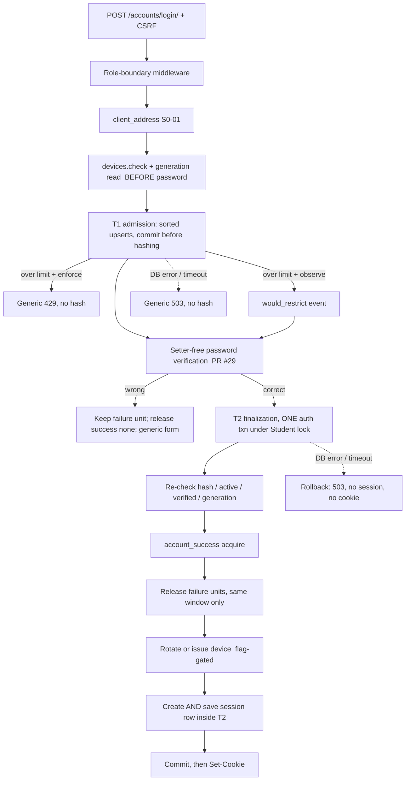

# Stage B: S0-02B/C authentication security implementation plan

**Status: planning only. Revision 2:** B1 is refined per the owner's seven review points (§6). Nothing in this document is implemented or authorized.

| Item | Value |
| --- | --- |
| Prepared | 12 November 2026 (Africa/Lagos) |
| Baseline | `master` `8295fbd` (includes PR #30) |
| Analysed tree | A local, never-pushed scratch merge of `master` + PR #29 (`42910ed`) + PR #26 (`44c515f`). Both merged with no conflicts (`docs/AUTHENTICATION.md` auto-merged). That is static evidence only; no tests were run on it. |
| PR #26 and PR #29 | Read, not modified |
| Owner decisions so far | B1 accepted as the first candidate, subject to this refinement; timeout values remain **configurable candidates**, not production limits |

Companion documents:

* `docs/security/S1_PROPOSALS.md` sections A.19–A.21 (accepted design baseline). **These sections exist only on the unmerged PR #26 branch** (`security/s0-02a-trusted-device-foundation`, `44c515f`); on `master` the file predates them.
* `docs/security/S0_02_RECONCILIATION.md` §§4–5 (quota taxonomy and commit order). **This file exists only on the PR #26 branch**; it arrives on `master` when PR #26 merges.
* Codex PR #35 (Stage A readiness, Stage C local staging)
* Codex PRs #32 and #33 (independent approvals)

This plan does not repeat that design. It turns it into small, reviewable PRs against the code as it will exist after Stage A.

---

## 1. Authentication architecture review

### 1.1 Implemented and verified (on `master`, or in an approved unmerged PR)

| Control | Where | Evidence |
| --- | --- | --- |
| Separate restricted `auth` and academic `runtime` LOGIN roles; the migrator never serves requests; fail-closed role middleware | `accounts/middleware.py`, `accounts/boundary.py`, `academics/ownership.py` | Historical suites, PG17 CI |
| Forced RLS plus a signed transaction/backend-bound owner context | `academics/ownership.py`, migration `academics.0004` | 46 security tests |
| Live-session principal, password-hash-bound capability, session invalidation on password change | `accounts/principals.py` | Auth suite |
| Per-IP throttle (`REMOTE_ADDR`, IPv6 /64, opt-in trusted proxies), atomic upsert | `accounts/throttling.py` (S0-01, PR #24) | `test_client_address.py` |
| Generic login, registration and recovery responses; dummy hashing for unknown users | `accounts/backends.py`, `accounts/tokens.py` | Auth suite |
| One-use, expiring, digest-only email tokens with a credential stamp; Student-then-token locking | `accounts/tokens.py` | Auth suite |
| **F04b:** setter-free verification, compare-and-swap hash upgrade, locked re-validation before `auth_login` | PR #29 (`42910ed`), **unmerged** | 9 tests plus 9 Codex probes; PG17 CI |
| **S0-02A** dormant device primitives: UUID binding, generation barrier, rotation with grace, exact role allowlist including PG17 MAINTAIN | PR #26 (`44c515f`), **unmerged** | 64 tests plus 8 Codex probes; PG17 CI |

### 1.2 Confirmed gaps (code-level)

| ID | Gap | Location | Severity before activation |
| --- | --- | --- | --- |
| G1 | No `lock_timeout`, `statement_timeout` or `idle_in_transaction_session_timeout` on application aliases. A held Student lock stalls login, reset and change without limit. | `config/settings/base.py:36-37` | High (availability) |
| G2 | Database errors raised **after** the middleware's role checks become a generic **500** in account views. No stage-specific contract. | `accounts/middleware.py`; `config/web_urls.py` handler500 | Medium |
| G3 | The authenticated session payload is persisted by `SessionMiddleware` **after** the login transaction commits (Codex PR #32, Low). It is safe today, but device issuance cannot be made atomic with the session. | `accounts/views.py` login; Django `SessionMiddleware` | Blocks atomic device finalization |
| G4 | No account-aware failure tracking. Distributed guessing is limited only per source. | `accounts/views.py` login | High (S0-02, P2) |
| G5 | The IP login bucket counts **successes**, so many students behind one NAT block each other. | `accounts/throttling.py`, `AUTH_RATE_LIMITS['login']` | Medium (availability) |
| G6 | No security-event logging, no pseudonymous references, no deduplication. | n/a | Medium (S0-12) |
| G7 | `reset_confirm` and `verify` apply the per-IP limit **before** token validation, so shared-IP saturation also blocks recovery. | `accounts/views.py:110-113, 95-98` | High for any future enforcement (F07) |
| G8 | A new reset or verify request **revokes** earlier live links, so an unauthenticated requester can invalidate a victim's working link. | `accounts/tokens.py:29` | High for enforcement (F07) |
| G9 | Email is sent synchronously after commit through the console backend. There is no queue, retry or outage contract, and timing can reveal account existence. | `accounts/tokens.py:41`, `auth_common.py:46` | High for enforcement (S0-05) |
| G10 | The single `ip_ceiling` kind can't express the split trusted and unfamiliar ceilings in A.19 B. | `accounts/models.py` (PR #26) | Needs a migration in B6 |
| G11 | Device generation monotonicity is enforced by application code, not SQL (Codex PR #33, Low). | PR #26 | Low; documentation and test naming |

### 1.3 Outstanding risks carried forward

* Credential stuffing below per-account thresholds (R-06), which needs MFA or breached-password checks: owner decisions.
* An old `accounts.0003` already applied anywhere persistent needs a forward migration plan.
* `sslmode=prefer` (S0-08) is owned by Stage C (`verify-full` in the local staging profile).

---

## 2. Stage B implementation blueprint

### 2.1 Login data flow (end state; every enforcement switch default off)



### 2.2 Components

| Component | New or changed | Responsibility | Security boundary |
| --- | --- | --- | --- |
| `accounts/dbsafety.py` (new) | B1 | Per-alias timeout options (merged, application aliases only). SQLSTATE-based `classify_database_failure`. `AuthFailureMiddleware.process_exception` plus a `handler500` classification for response-phase failures (§6.3). | Never retries security work; recoverable errors get 503, defects stay 500; Django's `SessionMiddleware` never saves a session or sets its cookie on 5xx (§6.4) |
| `accounts/login_flow.py` (new) | B2, then extended | `finalize_login(request, verified, raw_password)`: one auth transaction holding the Student lock, re-validation, `auth_login`, explicit session save | Replaces only the body of PR #29's finalizer; same lock order |
| `accounts/security_events.py` (new) | B3 | Allowlisted event names and fields, an independent pseudonym key, dedup by bucket window | No usernames, IPs, tokens, cookies or paths |
| `accounts/admission.py` (new) | B4 | T1 reservation; T2 settlement helpers over `AuthThrottle` and `LoginLimit` | Auth connection only; sorted lock order; observe/enforce mode |
| Device wiring in `login_flow` and `views` | B5 | Classify before the password; rotate or issue in T2; `revoke_all` in reset, change and forget-all | `UCC_TRUSTED_DEVICES=off` by default |
| `accounts/recovery.py` (new) + outbox model | B7/B8 | Coalesced non-invalidating issuance; outbox delivery; independent redemption lane | No enforcement dependency; console or locmem until Stage D |

### 2.3 Invariants (each PR must keep all of these)

* **I1:** No session, and no Set-Cookie for a session or device, unless T2 committed.
* **I2:** No password hash is evaluated without a committed admission (once B4 lands).
* **I3:** A wrong password never consumes `account_success`. A success never consumes failure units. Releases never touch a newer window.
* **I4:** Device trust can only lower friction for the **exact** account that owns the device: the stored username before authentication, the UUID after.
* **I5:** Generation is read before password verification and re-checked in T2. A forget-all, reset or change serialized before T2 refuses issuance.
* **I6:** No request path uses the migrator. Runtime and auth privileges are unchanged unless a migration plus allowlist update is reviewed. RLS is never weakened.
* **I7:** Every enforcement switch defaults to off or observe. Hard account restriction requires all of A.21.
* **I8:** Lock order: Student → TrustedDevice → AccountToken → AuthThrottle/LoginLimit (sorted). `rotate()` takes only its own device row.
* **I9:** Responses for unknown and known accounts and for every limit kind are byte-identical. Timing is tested as distributions, not as an equality claim.

---

## 3. PR-by-PR roadmap

Each PR is separately reviewed, gets its own PG17 CI, and is independently verified by Codex. None activates a hard restriction.

| PR | Scope | Depends on | Migration | Live behaviour change | Owner decision |
| --- | --- | --- | --- | --- | --- |
| **B0** | Stage A: merge #29, then #26 (Codex sequence) | Owner | `accounts.0003` | None (dormant) | Merge authorizations |
| **B1** | **Bounded database waits + safe authentication failures** (§6) | #29 merged | No | Recoverable DB failures give a generic 503; defects stay 500; outcome-uncertain wording on recovery and change pages | Timeout candidates; 503/500 classification |
| B2 | Transactional login finalization: explicit session save inside T2 (closes G3, Codex PR #32 Low) | B1 | No | None visible; session row created atomically | — |
| B3 | Security-event logging foundation (G6) | B1 | No | Log lines only | Logging key and retention; Stage D sink |
| B4 | Account-aware admission in **observe** mode: T1/T2 accounting, `account_fail`, `account_success` acquired in T2 | B2, B3, #26 | No (uses `LoginLimit`) | None; logs `would_restrict` only | Thresholds (initial 10/15 min) |
| B5 | Trusted-device wiring behind `UCC_TRUSTED_DEVICES=off`; `revoke_all` wired into reset, change and a new forget-all view | B4 | No | Forget-all button and revocation hooks; cookies only with the flag on | Forget-all UX; flag stays off |
| B6 | Split ceilings plus device IP bypass (flag-gated); failure-only IP counting | B5 | **`accounts.0004`** (`LoginLimit` kind CHECK) plus allowlist update | Failure-only IP counting changes when NAT users are limited | Failure-only switch; ceiling values from Stage E data |
| B7 | **02C-1:** recovery hardening: coalesced non-invalidating links, outbox and worker, recovery lane independent of login and IP saturation | B3 | **`accounts.0005`** (outbox, token columns) | Multiple live links (contract change; historical test conflict) | Link semantics; outbox vs Stage D transport |
| B8 | **02C-2:** verified-recovery trust and the "trust this browser" step-up link (flag-gated) | B5, B7 | Token purpose CHECK in 0005 | None until flagged | Step-up UX |
| B9 | Enforcement enablement (switch only) | All, plus A.21 evidence, plus independent review | No | Hard restriction | **Separate explicit approval** |

**Why this order:**

* B1 and B2 make every later database interaction fail safely and atomically. Without them, the B4 counters and B5 devices would inherit the 500 and post-commit-session gaps.
* Logging (B3) comes before observe-mode counters, so B4 produces evidence.
* Recovery hardening (B7) can run in parallel with B5 and B6 once B3 is done.

---

## 4. Security testing matrix

All tests use PostgreSQL 17 with real distinct migrator, runtime and auth LOGINs, synthetic data, and `TransactionTestCase` with barriers and bounded waits observed through `pg_locks` or `pg_blocking_pids`. They go in new test files; historical tests stay unchanged unless the owner approves a contract change.

| PR | Negative | Concurrency | Replay | Failure injection | PG17-specific |
| --- | --- | --- | --- | --- | --- |
| B1 | Timeouts absent on the migrator alias; values present on auth and runtime (`SHOW`); defects stay 500 | Login, reset and change waiting on a Student lock held by another connection, then 503 within the bound | — | P1–P4 phases (§6.1): before and after server commit, lost acknowledgement, session save in the response phase, client disconnect. Access invariants A1–A6 (§6.8) are asserted **without assuming rollback**. | `lock_timeout` raises 55P03, `statement_timeout` raises 57014, the idle timeout raises 25P03 (`InternalError`) |
| B2 | No session row if T2 rolls back | Reset racing finalization in **both** orders (Codex probe 3 becomes a regression) | — | Fault after `auth_login`, at session save, at commit | Real row locks |
| B3 | Sentinel username, IP, token, cookie and password never appear in captured logs; reset paths never logged | Dedup under N threads | — | Logging failure never blocks auth | — |
| B4 | 20 failures across windows don't consume `account_success`; unknown and known accounts are identical | N+1 admissions, exactly N password checks (backend call counter); finalizations never exceed the success limit | — | T1 rollback consumes nothing; crash between T1 and T2 counts as a failure only | Campus simulation (11/61/601 students) **in observe mode** |
| B5 | Wrong-account and grace cookies get the unfamiliar lane; cookie flags per profile; flag off means no cookie | Forget-all or reset between verification and T2 refuses the device | Previous-cookie replay after grace revokes only the owner's device | Lost response or out-of-order responses; fault in T2 leaves the old identifier valid | MAINTAIN and allowlist regressions retained |
| B6 | Bypass only with a valid **current** device; ceilings never removed | Unfamiliar flood does not drain the trusted ceiling | Stolen-cookie guessing capped by `device_fail` and `account_trusted_fail` | — | Migration 0004 forward and reverse, grants re-provisioned |
| B7 | A recovery request never invalidates a live link; bombing limits; generic responses | Concurrent consumption of sibling tokens gives exactly one password change | Consumed or expired or wrong-purpose tokens rejected | Outbox send failure, retry, permanent failure; provider timeout | Redemption works while login and IP buckets are saturated |
| B8 | A request alone grants nothing; GET never consumes | Two-browser nonce mismatch | Step-up token single-use | Delivery outage | — |
| B9 | Enforcement refuses to start without the A.21 attestation | Full B4–B8 suite with enforce on | — | Email outage runbook rehearsal | Staging evidence (Stage C/F) |

---

## 5. Risk and dependency register

| ID | Risk or dependency | Severity | Mitigation | Owner |
| --- | --- | --- | --- | --- |
| RD-1 | PR #29 not merged, so stale-hash reset reversal persists on `master` | High | Stage A merges #29 first (B0) | Owner, then Codex |
| RD-2 | Unbounded lock waits (G1) | High (availability) | B1 | Claude |
| RD-3 | Post-commit session save (G3) | Medium | B2 | Claude |
| RD-4 | Recovery coupled to IP saturation and link invalidation (G7/G8) | High (blocks enforcement) | B7 | Claude; owner decides link semantics |
| RD-5 | No real email, outbox or outage behaviour (G9) | High (blocks enforcement) | B7 outbox; Stage D transport, sink and runbooks | Claude (code) / Codex (Stage D) |
| RD-6 | Campus ceiling sizing unknown | Medium | Observe-mode data (B4); Stage E simulations | Codex (Stage E) / owner |
| RD-7 | Credential stuffing below thresholds | High (general) | Out of Stage B: MFA or breached-password check decision | Owner |
| RD-8 | Settings collision with the Stage C `local_staging.py` profile | Low | B1 puts timeouts in a shared helper that every profile inherits; Stage C must not override them | Claude + Codex |
| RD-9 | Historical-test contract changes (B7 link semantics) | Medium (process) | Feature-flagged profile, or explicit owner approval to amend | Owner |
| RD-10 | `accounts.0003` history drift on persistent databases | Medium | Inventory before any persistent use; forward migrations only | Codex (Stage C/D) |
| RD-11 | Generation is not monotonic in SQL (G11) | Low | Document in B5; optional trigger only if the threat model requires it | Owner decision |
| RD-12 | Timeout values too tight cause false 503s under load | Medium | Configurable; Stage E measurement before staging | Codex (Stage E) / owner |

---

## 6. First implementation proposal: B1 (bounded database waits and safe authentication failures)

**Status.** Owner-selected first candidate. This section is a **specification**: it is refined for review and **not implemented**. Every behavioural claim below that cites Django or psycopg was checked against the installed versions (Django 5.2.19, psycopg 3.3.8); file and line references are given.

**Objective.** Every authentication database interaction is **bounded in time** and, when it fails, **cannot grant or extend access**. The client gets a generic response that never claims more certainty than the system has. B1 does **not** promise that a failed HTTP response means nothing was written: §6.1–6.2 define exactly what may have been persisted.

### 6.1 Failure timing taxonomy: before, during and after commit

| Phase | Example failures | Database outcome | Access outcome | Response |
| --- | --- | --- | --- | --- |
| **P0** pre-request | Role-boundary check fails; no connection | Nothing written | None granted | Existing middleware 503 (unchanged) |
| **P1** before first write | `lock_timeout` waiting for the Student row; `statement_timeout`; connection refused | Nothing written in this transaction | None granted | 503 (recoverable, §6.3) |
| **P2** after writes, before `COMMIT` | Timeout or error on a later statement; `idle_in_transaction_session_timeout` kills the session; client-side connection loss | **Rolled back.** Django's `Atomic.__exit__` rolls back, and the server aborts any transaction whose connection ends without `COMMIT`. | None granted | 503 or 500 per §6.3 |
| **P3** during `COMMIT` | `COMMIT` raises (connection lost, server shutdown) | **Unknown: committed or rolled back.** Django attempts a rollback and re-raises (`django/db/transaction.py:263-271`). The server may have committed before the acknowledgement was lost. | Must be safe **in both cases** (§6.2) | 503 with **outcome-uncertain** wording on recovery and change pages |
| **P4** after commit, in the response path | `SessionMiddleware.process_response` save fails; another middleware raises; the WSGI write fails (client gone) | **Committed** | Must be safe with the commit (§6.2, §6.4) | 500 or 503 per §6.3; or no response delivered |

Rules:

* **Atomicity groups**, enforced by putting each group in **one** auth transaction (already true in the current code):
  * Reset: password change **and** token consumption.
  * Password change: password change **and** current-session deletion (`auth_logout` → `flush()` inside the same `atomic`).
  * Login: session-key cycling **and** `last_login`.

  A P3 outcome is therefore "whole group or nothing", never half.
* `on_commit` email delivery runs **only after a successful commit** (`run_commit_hooks_on_set_autocommit_on` is set only after `_commit()` returns, `django/db/backends/base/base.py:323-330`). A P3 failure never sends mail for an uncommitted token. A token committed under P3 without its email is harmless: the next request issues a fresh link.
* **No automatic retry** of any security step, in any phase. Retries are user-driven, and each user retry is safe against either P3 outcome (§6.2).

### 6.2 Consumed recovery tokens and password changes when the commit outcome is uncertain (P3/P4)

| Flow | If committed | If not committed | Required B1 behaviour |
| --- | --- | --- | --- |
| **Password reset confirm** | New password valid, old invalid, token consumed; existing sessions invalidated by the auth-hash change | Old password valid, token still usable | Group-atomic (already). The 503 page for this route says: *"We could not confirm whether your new password was saved. Try signing in with the new password. If that fails, open your reset link again or request a new one."* Re-opening a consumed link shows the existing generic invalid-link page. No state reveals more than the link holder already knows. |
| **Authenticated password change** | New password valid; all sessions invalid; this session row deleted | Old password valid; session row still exists server-side | The browser cookie is deleted **in both cases**: `flush()` empties the session, and Django's deletion branch runs even on 5xx (`django/contrib/sessions/middleware.py:35-43`). The 503 page says to sign in with whichever password works. A retry with the old password fails generically if the change committed; that is acceptable and documented. |
| **Login** | A session row exists, created by `cycle_key()` → `create()` (`contrib/sessions/backends/db.py:68-79`), holding only the **previous anonymous** data; `last_login` updated | Nothing | `auth_login` writes `SESSION_KEY` and `HASH_SESSION_KEY` **in memory after** `cycle_key()` (`contrib/auth/__init__.py:187-193`). They are persisted only by `SessionMiddleware` on a **non-5xx** response, which also sets the cookie (`middleware.py:57-60`). A committed row from a failed login therefore has no `_auth_user_id`, and its random key never reached the client. **No access.** An updated `last_login` is acceptable and is not treated as rollback evidence. |
| **Email request** (reset or verify) | New token stored; earlier same-purpose tokens revoked; no email sent (the hook is skipped) | Nothing | Unchanged generic response, so the student requests again. (Link-revocation semantics are B7's problem.) |
| **Email verify confirm** | Verified and token consumed | Unverified, token usable | Group-atomic; outcome-uncertain wording; a retry shows "invalid link" if it committed |

The B2 transactional finalization later strengthens login further: the authenticated payload is saved **inside** T2. B1 must not depend on B2.

### 6.3 Classifying recoverable database errors versus programming defects

Classification uses the **SQLSTATE** on the psycopg cause (`exc.__cause__.sqlstate`), not the Python class alone. Checked against psycopg 3.3.8: `idle_in_transaction_session_timeout` (25P03) is an **`InternalError`**, while `LockNotAvailable` (55P03) and `QueryCanceled` (57014) are **`OperationalError`**.

| Class | SQLSTATE / exception | Meaning | HTTP | Retry-After | Log category |
| --- | --- | --- | --- | --- | --- |
| **Recoverable, availability** | Class `08` (connection), `53` (insufficient resources, e.g. 53300 too many connections), `57P01`–`57P03` (shutdown / cannot connect now), `57014` (query cancelled or statement timeout), `55P03` (lock not available), `40001` and `40P01` (serialization failure, deadlock), `25P03` (idle-in-transaction timeout); Django `InterfaceError`; an `OperationalError` with **no** SQLSTATE (client-side connection loss) | Transient infrastructure condition | **503** | Yes (configurable, initially 5 s) | `db_unavailable` with the SQLSTATE class only |
| **Configuration or privilege drift** | `42501` (insufficient privilege); `ImproperlyConfigured` from the role guards | The deployment is unsafe | **503** with **no** Retry-After (existing role-boundary semantics) | No | `db_misconfigured` (alert) |
| **Programming defect** | Every other SQLSTATE, e.g. `42P01`/`42703` (undefined table or column), class `22` (`DataError`), class `23` (`IntegrityError`, unless a view handles it explicitly as today), `XX000`; non-DB exceptions | A bug, never masked as an outage | **500** (generic page; unchanged) | No | `defect` (alert) |

Every class **denies access**. None triggers a retry or fallback. Error bodies are the existing generic templates and contain no SQL, SQLSTATE, role or exception text.

**Where classification happens.** There are two points, because exceptions raised **inside middleware** (for example a session save in `process_response`) never reach a view's `process_exception`; Django converts them through `handler500`:

1. `AuthFailureMiddleware.process_exception`, for view exceptions.
2. A `server_error` wrapper that inspects `sys.exc_info()` inside the existing `handler500` (`config/web_urls.py`), and the same handler registered for `config/auth_urls.py` profiles, for middleware and response-phase exceptions.

Both call one pure function, `classify_database_failure(exc) -> 'recoverable' | 'misconfigured' | 'defect'`, which is unit-testable with synthetic exceptions.

### 6.4 Django session middleware behaviour for 500 and 503 (verified in the source)

| Situation | `SessionMiddleware.process_response` | Consequence |
| --- | --- | --- |
| Any status ≥ 500, session modified and not empty | **Skips `save()` and `Set-Cookie`** (`middleware.py:57-60`) | Authentication data set by `auth_login` is never persisted or sent. **Safe.** |
| Any status (including 5xx), request had a session cookie, session now empty (after `flush()`/`auth_logout`) | **Deletes the cookie** (`middleware.py:35-43`) | A failed password change still logs the browser out. **Safe** (it only removes access). |
| `process_response` itself raises (session save DB error on a 2xx/3xx) | The exception propagates and Django converts it via `handler500` | Covered by classification point 2. The cookie is not set because `set_cookie` follows `save()`. **Safe.** |
| `UpdateError` (concurrent logout) | `SessionInterrupted`, i.e. 400 | Existing behaviour, unchanged |

B1 therefore keeps the 5xx status for every failure. It never converts a database failure into a 2xx/3xx page, which would let `SessionMiddleware` persist a half-built session.

### 6.5 PostgreSQL timeout configuration and verification

**Mechanism.** libpq startup `options` on the application aliases only:

```
-c lock_timeout=<L> -c statement_timeout=<S> -c idle_in_transaction_session_timeout=<I>
```

These are applied through a helper that **merges** into each alias's existing `OPTIONS` and appends to any existing `options` string. It never replaces `sslmode`, `sslrootcert` or other keys. That costs no extra round trip. With `CONN_MAX_AGE=0`, every request's connections receive the values.

**Scope.**

* The `auth` alias, plus the academic alias named by `STUDENT_DB_ALIAS`: `default` in the runtime and web profiles, `runtime` in the test profiles.
* **Not** the migrator, the test-provisioning `default` alias in test profiles, or the offline `auth_migration` profile, so migrations and provisioning are never killed.

**Candidate values** (configurable starting points, **not** production limits; Stage E measurement decides):

| Setting | Auth | Runtime | Constraint |
| --- | --- | --- | --- |
| `lock_timeout` | 3 s | 3 s | Must be < `statement_timeout`, so lock waits report 55P03 rather than 57014 |
| `statement_timeout` | 5 s | 10 s | Applies per statement, **including `COMMIT`** |
| `idle_in_transaction_session_timeout` | 15 s | 15 s | Must exceed the longest Python work done **inside** an open transaction. The PR #29 finalizer may run one PBKDF2 check while holding the Student lock, and the reset and change views hash new passwords inside their transactions. A breach **terminates the session** (FATAL 25P03), and the next statement fails as P2. |

**Validation at settings load (fail closed).** Values must be positive durations, and `lock < statement < idle`. An invalid value raises `ImproperlyConfigured`.

**Runtime verification.**

1. A Django system check (`accounts.E101`) in authentication and web profiles fails if either application alias lacks the three options. That catches a later profile, including the Stage C one, that replaces `OPTIONS` wholesale.
2. Tests read `SHOW lock_timeout` / `SHOW statement_timeout` / `SHOW idle_in_transaction_session_timeout` on the **actual** auth and runtime LOGIN connections, and assert `0` on the migrator connection.
3. The Stage C lab repeats the `SHOW` checks against the real local server.

**Known limitation.** Any role can `SET` these GUCs on its own session, so this is an availability control, not a security boundary. A transaction-pooling proxy (PgBouncer) would drop startup `options`. If a pooler is ever approved, switch to a `connection_created` `SET` or role-level `ALTER ROLE … SET`, which is a provisioning change needing review. Optional defence in depth (role-level defaults set by `configure_runtime` / `configure_auth_role`) is **deferred**, because those commands are touched by unmerged PR #26.

### 6.6 Compatibility with Codex's Stage C database configuration (PR #35)

| Stage C element | B1 interaction | Agreement needed |
| --- | --- | --- |
| `server/config/settings/local_staging.py` with `sslmode=verify-full` and a lab CA root on **both** aliases | The B1 helper merges and preserves TLS keys. Stage C must build on `auth_common.configure` (directly or via `web_secure`), or call the same helper. System check `accounts.E101` fails if timeouts are lost. | One composition point: `accounts.dbsafety.apply_db_safety(DATABASES, aliases, timeouts)` is called by `auth_common.configure`. Stage C adds keys **before** or **after** it, but never assigns a fresh `OPTIONS` dict after it without re-calling it. |
| Direct PostgreSQL connections, `CONN_MAX_AGE=0`, no pooler | Startup `options` work as specified | Any future pooler triggers the §6.5 switch |
| Gunicorn worker timeout and Caddy upstream timeouts | Must exceed the application's worst case, so PostgreSQL cancels and rolls back **before** the proxy returns a 504 or the worker is killed mid-transaction (a worker kill acts like P2/P3) | Proposal: Gunicorn timeout ≥ 30 s; Caddy upstream read timeout ≥ Gunicorn + 5 s. Both are values for Codex to confirm. |
| Separate offline migration process | B1 timeouts never reach it (scope rule above) | Codex verifies `SHOW lock_timeout = 0` in the migration job |
| C21 security-boundary tests and the C22 interrupted-release rehearsal | Rerun the B1 PG17 tests in the lab, including `SHOW` checks over TLS | Added to the Stage C acceptance list |

### 6.7 Exact files expected to change

| File | Change |
| --- | --- |
| `server/accounts/dbsafety.py` (new) | `apply_db_safety()`, timeout validation, `classify_database_failure()`, `AuthFailureMiddleware` (`process_exception` only), generic 503 response builder (existing template, `never_cache`, `Retry-After` per §6.3) |
| `server/accounts/checks.py` (new) + `accounts/apps.py` registration | System check `accounts.E101` |
| `server/config/settings/auth_common.py` | Call `apply_db_safety`; insert `AuthFailureMiddleware` **after** `SessionMiddleware` (so its `process_exception` runs before the response phase); `AUTH_DB_TIMEOUTS` defaults |
| `server/student_web/views.py` | `server_error` consults `classify_database_failure(sys.exc_info()[1])` and returns 503 for recoverable or misconfigured errors, 500 otherwise. Same templates. |
| `server/config/auth_urls.py` | Register the same `handler500` for the historical auth profile |
| `server/accounts/templates/…` | Outcome-uncertain wording on the 503 page for reset-confirm, verify-confirm and password-change (route-name based) |
| `server/auth_tests/test_db_failure_handling.py` (new) | §6.8 |
| `docs/AUTHENTICATION.md` | Failure contract, timeout tuning, pooler caveat |

**Not changed:** `config/settings/base.py`, migrations, grants or provisioning commands, RLS, `accounts/devices.py`, the throttle semantics, academic services and calculations, CLI and Streamlit, and the PR #26 and #29 code paths beyond what merging #29 brings in.

**Dependencies:** PR #29 merged (B0), since B1 bounds its Student-lock wait. Independent of PR #26.

### 6.8 Tests: failed authentication cannot grant access, without assuming rollback

Every failure test asserts **access invariants and allowed database states**, never "the request failed, so nothing was written". All use PostgreSQL 17, actual separate migrator, runtime and auth LOGINs, `TransactionTestCase`, and waits observed through `pg_blocking_pids` with bounded timeouts.

**Access invariants checked after every injected failure:**

* **A1:** The response sets no session cookie carrying authentication. The client's cookie jar either holds no session key, or holds one for which `session_student(key)` is `None`.
* **A2:** A follow-up protected request with whatever cookies the client holds redirects to login and cannot read academic data.
* **A3:** For every `django_session` row created during the test: either it has no `_auth_user_id`, or its stored hash fails the live auth-hash comparison.
* **A4:** Exactly one of {old password, new password} is valid. Never both, never neither.
* **A5:** Token consumed ⇔ password changed (or ⇔ verified, for verify).
* **A6:** Other students' sessions and data are unaffected (no RLS or role change).

**Fault injection points** (each runs with A1–A6):

| Test | Phase | Injection |
| --- | --- | --- |
| `test_login_lock_timeout_returns_503_without_access` | P1 | The migrator holds `SELECT … FOR UPDATE` on the Student row; the login finalizer waits and gets 55P03 within `lock_timeout` plus a margin |
| `test_reset_lock_timeout_leaves_token_and_password_consistent` | P1 | Same, on reset-confirm |
| `test_password_change_lock_timeout_logs_out_without_change_or_with_complete_change` | P1 | Same, on password change; also asserts the cookie was deleted |
| `test_statement_timeout_classified_recoverable` | P1/P2 | A short `statement_timeout` override **below** `lock_timeout` plus a held lock gives 57014 → 503 |
| `test_idle_in_transaction_timeout_kills_session_and_denies_access` | P2 | A short `idle_in_transaction_session_timeout` override; patch the in-transaction password check to sleep past it. The server terminates the session (25P03), giving 503 or 500 per the classification test, with A1–A5. |
| `test_commit_failure_before_server_commit` | P3a | Patch `DatabaseWrapper._commit` to close the connection **before** the real commit, so the server aborts. Assert A1–A5 and that the state equals "not committed". |
| `test_commit_acknowledgement_lost_after_server_commit` | P3b | Patch `_commit` to call the real commit **then** raise `OperationalError`. Assert A1–A5, that the state equals "committed" (password changed, token consumed, login row without auth data), that **no email hook ran**, and that the outcome-uncertain wording is shown. |
| `test_session_save_failure_in_response_phase` | P4 | Fault on the auth connection's `django_session` UPDATE during `process_response` after a successful login. `handler500` classification applies; no cookie; A1–A3 hold even though the login transaction committed. |
| `test_response_write_failure_after_commit` | P4 | Simulate the client disconnecting after the view commits: drop the response. The session row exists without delivered cookies; A2/A3 hold for every client. |
| `test_classification_table` | unit | Synthetic psycopg errors for every SQLSTATE in §6.3, plus `InterfaceError`, a bare `OperationalError`, `IntegrityError`, `ProgrammingError(42P01)`, `InsufficientPrivilege` and a non-DB exception, each mapped to the expected class, status and `Retry-After` |
| `test_programming_defect_is_500_not_503` | defect | An `UndefinedColumn` injected at the login finalizer gives 500 with no access, and no Retry-After |
| `test_timeouts_apply_only_to_application_aliases` | config | `SHOW` values on auth and runtime equal the configuration; the migrator shows `0`; the system check fails when `OPTIONS` is replaced |
| `test_invalid_timeout_configuration_fails_closed` | config | Negative values, missing units, or `lock ≥ statement` raise `ImproperlyConfigured` |
| `test_generic_bodies_reveal_nothing` | all | No SQL, SQLSTATE, role, exception or timing text in any 503 or 500 body |
| `test_normal_paths_unchanged` | regression | Successful and wrong-password login, reset, change and verify behave exactly as before; the historical suites run unchanged |

**Mutation checks required in the B1 PR:**

* Remove `AuthFailureMiddleware`.
* Remove the `handler500` classification.
* Drop the options merge.
* Swap the `25P03` classification.
* Remove the system check.

Each must make at least one test fail.

### 6.9 Security acceptance criteria for B1

1. Invariants A1–A6 hold for every injection in §6.8, on hosted PostgreSQL 17 CI and in the Stage C lab.
2. No automatic retry, no permissive fallback, and no status code below 500 on any database failure path.
3. Recoverable, misconfigured and defect failures are distinguishable in the HTTP status and Retry-After header, and in sanitized logs (the SQLSTATE class only), but never in the response body.
4. The migrator, test-provisioning and offline profiles have no B1 timeouts. Every application alias does, verified by `SHOW`.
5. Historical tests are unchanged and passing. No migration, grant, RLS or device change.
6. Codex independent review, plus a rerun of the PR #32 lock-timeout and post-login-failure probes as regressions.

---

## 7. Decisions requested from the owner

1. **Stage A:** authorize merging PR #29, then PR #26 (Codex sequence). B1 depends on #29 being on `master`.
2. **Approve B1 implementation** exactly as specified in §6 (still not started).
3. **Timeout candidates:** 3 s / 5–10 s / 15 s as configurable starting points, final values from Stage E measurement.
4. **HTTP contract:**
   * Recoverable database failures get 503 with Retry-After.
   * Configuration and privilege drift gets 503 without Retry-After.
   * Programming defects stay 500.
   * Recovery and change pages say the outcome is uncertain.
5. **Stage C coordination:** one composition point (`apply_db_safety`) and proxy and worker timeouts longer than the application worst case (§6.6). Values to be agreed with Codex.
6. **Later, at B6:** whether the IP login bucket should count failures only.
7. **Later, at B7:** whether multiple live recovery links may coexist. This changes a historical test's contract, so it needs explicit approval or a feature-flagged profile.
8. **Later, at B3:** the logging pseudonym key, retention and sink (with Codex Stage D).
9. **Out of Stage B:** MFA or breached-password checks for credential stuffing (RD-7). Adaptive mode and the daily cap remain deferred.
