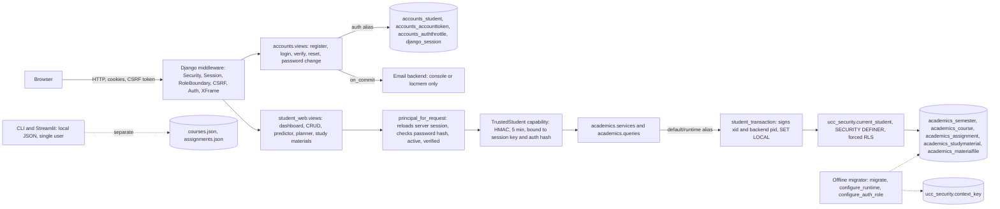

# Threat model — Stage S0 baseline

| Item | Value |
| --- | --- |
| Audited commit | `fefd3cae4efeac5539bc3f02e9ffdc53bfb88766` (master, merge of PR #23, Milestone 4A) |
| Audit date | 2026-11-11 |
| Stage | S0: read-only baseline assessment. No application code was changed. |
| Active feature work | None found. No open Milestone 4B branch or PR. Only open PRs are Dependabot #18 and #19 (GitHub Actions bumps). |
| Method | STRIDE per trust boundary, built from the source code and verified where possible with synthetic probes on a disposable PostgreSQL cluster. |

This is a model of the system as it is built. It is not a certification. Where
this document says a control "holds", it means the control was tested (see
`SECURITY_TEST_MATRIX.md`) or read directly in code. Each claim is labelled.

## 1. System summary

The CLI and Streamlit apps are local, single-user programs that read and write
JSON files. They share no code path with the Django database and do not
receive multi-user isolation. They are in scope only for local file safety.

## 2. Assets

| Asset | Where it lives | Classification | Main threat |
| --- | --- | --- | --- |
| Student identities (UUID, username) | `accounts_student` | Personal, internal | Enumeration, impersonation |
| Student email addresses | `accounts_student.email`, `accounts_accounttoken.email_at_issue` | Personal | Enumeration, disclosure |
| Password hashes (PBKDF2) | `accounts_student.password` | Secret | Offline cracking after auth-role or DB compromise |
| Sessions | `django_session` (signed, not encrypted) and `sessionid` cookie | Bearer secret | Hijack, fixation, replay |
| Verification and reset tokens | Emailed URL secret; DB stores only SHA-256 digest | Bearer secret, short-lived | Interception through logs/history, replay |
| Course records, grades, assignments | Three academic tables, RLS-protected | Personal academic records | Cross-student read/write (IDOR), integrity loss |
| `DJANGO_SECRET_KEY` | Process environment | Secret | Session/CSRF/throttle-bucket forgery |
| `UCC_CONTEXT_SIGNING_KEY` | Process environment AND `ucc_security.context_key` table | Secret | Forging owner context and capabilities |
| PostgreSQL credentials (runtime, auth, migrator) | Process environments, kept separate | Secret | Privilege escalation |
| Database backups | Not implemented | Would contain all of the above, including the context key | Bulk disclosure |
| Legacy JSON files and history | Local disk; historical commits `fe511c9`..`d51ed5f` | Possibly personal (provenance unknown) | Disclosure through repository history |

## 3. Attackers

| Attacker | Capability assumed | In scope for S0 |
| --- | --- | --- |
| Unauthenticated visitor | Any HTTP request to the site | Yes |
| Registered, verified student | Valid own session; can craft any form field, UUID or version | Yes, highest priority |
| Student targeting another student | Knows or guesses another student's UUIDs | Yes |
| Holder of a stolen session cookie or email link | Bearer credential | Yes (impact analysis) |
| Automated bots, credential stuffing | Many requests, possibly many IP addresses | Yes (bounded simulation) |
| Request manipulator | Arbitrary methods, headers, Host, Origin, body size | Yes |
| Network attacker between app and database | Can intercept unless TLS is enforced | Configuration review only |
| Compromised dependency | Code execution inside the Django process | Review of locks and audit only |
| Compromised runtime or auth DB role | Arbitrary SQL with that login | Yes, direct SQL probes |
| Migrator/DBA, or arbitrary Python in the web process | Full control | Out of the defended boundary (documented by the project) |

## 4. Trust boundaries and STRIDE analysis

Status labels: **Verified** (tested in S0 or in an existing test that was run),
**Code-reviewed** (read, not executed), **Gap** (finding raised), **Future**
(not implemented, needed before deployment).

### TB1 — Browser to Django

| STRIDE | Threat | Control | Status |
| --- | --- | --- | --- |
| S | Cross-site request forgery | Django CSRF middleware on every POST; SameSite=Lax cookies | Verified (existing `test_post_csrf_protection_covers_crud_status_and_planning`) |
| S | Host-header poisoning of email links | Fixed `ALLOWED_HOSTS`; links built from `AUTH_LINK_ORIGIN` | Verified (P08: foreign Host returns 400) |
| T | Oversized or many-field requests | `DATA_UPLOAD_MAX_MEMORY_SIZE=65536`, `DATA_UPLOAD_MAX_NUMBER_FIELDS=600` | Verified (C03: both return 400) |
| T | Stored or reflected XSS | Django autoescaping; no `|safe`, no inline script or style | Verified (P07) |
| I | Clickjacking, MIME sniffing, referrer leaks, caching | `X-Frame-Options: DENY`, `nosniff`, `Referrer-Policy: same-origin`, `Cache-Control: no-store` | Verified (P06) |
| I | No Content-Security-Policy, no HSTS | None | Gap: S0-07 |
| D | Floods of anonymous requests | Each request runs 2 role-check catalog queries | Gap: S0-11 |

### TB2 — Django session to verified principal

| STRIDE | Threat | Control | Status |
| --- | --- | --- | --- |
| S | Online password guessing from one IP | 10 logins per 15 min per `REMOTE_ADDR` | Verified (existing auth tests) |
| S | Guessing one account from many IPs | None per account | Gap: S0-02 (P03) |
| D | Everyone behind one proxy or NAT locked out | Throttle keys only on `REMOTE_ADDR` | Gap: S0-01 (P02) |
| S | Session fixation | `auth_login` rotates the session key | Code-reviewed, plus existing tests |
| S | Old session used after password change or reset | Session auth hash compared on every capability use | Verified (existing auth tests) |
| I | Username enumeration | Registration emails only when the username is free | Gap: S0-04 (P01) |
| I | Email enumeration by timing | Email sent synchronously on the account-exists path | Likely: S0-05 (not measured) |
| R | No security event logging | No `LOGGING` configured | Gap: S0-12 |

### TB3 — Verified principal to academic capability

| STRIDE | Threat | Control | Status |
| --- | --- | --- | --- |
| S | Minting a capability from a Student object or client UUID | `ALLOW_INTERNAL_TEST_PRINCIPALS` is false in web profiles; middleware returns 503 if it is true | Verified (existing tests) |
| T | Tampering with a capability | HMAC over UUID, expiry, session key and auth hash; re-checked against the live session on every call | Code-reviewed, plus existing tests |
| E | Capability survives logout, deactivation or password change | Re-validated against `django_session` and the password hash | Verified (existing auth tests) |

### TB4 — Academic services to PostgreSQL, and runtime role to RLS

| STRIDE | Threat | Control | Status |
| --- | --- | --- | --- |
| S | Setting `ucc.student_id` directly | Verifier needs an HMAC bound to the transaction ID and backend PID | Verified (P09: forged GUC sees 0 rows; existing replay tests) |
| E | Runtime reads accounts, sessions or key | No grants | Verified (P09) |
| T | Reassigning `owner_id` | Column-limited UPDATE grant plus `WITH CHECK` plus composite foreign keys | Verified (P09, existing tests) |
| E | Privileged connection used for web requests | `require_runtime_role` and `require_auth_role` fail closed | Verified (existing tests) |
| I | Identity leaks across pooled connections | `SET LOCAL` and ContextVar reset; signature bound to xid and PID | Verified (existing tests; no external pooler tested) |
| E | Default PUBLIC privileges at cluster level (other DBs, large objects) | Not covered by the provisioning commands | Gap: S0-10 |
| I | Plaintext DB transport if the DB is remote | `sslmode=prefer` | Gap: S0-08 |

### TB5 — Authentication role to account and session tables

| STRIDE | Threat | Control | Status |
| --- | --- | --- | --- |
| E | Auth role reads academic records | No grants | Verified (P09) |
| T | Auth role changes `is_active` or `email` | Column-limited UPDATE | Verified (P09) |
| T | Auth role inserts a pre-verified account | INSERT is table-wide | Gap: S0-09 |

### TB6 — Migrator to privileged operations

Migrator credentials are not in any web settings profile (code-reviewed:
`config/settings/web_*.py`, `auth_*.py`). The existing test suite checks that web
requests send zero queries over the migration connection. Verified (C01/C02
measured 0 queries on `default`; existing tests). The migrator can read the
context key and alter policies. That is by design and outside the defended boundary.

### TB7 — Application to email provider

Only the console and locmem backends are configured. Links carry the token
secret in the URL path (S0-13). Real SMTP, SPF, DKIM, DMARC and queueing are
Future items.

### TB8 — CI to source and dependencies

Hashed lock files, `pip-audit --strict` on both locks, actions pinned to commit
SHAs, `permissions: contents: read`, `persist-credentials: false`, and ephemeral
masked secrets. Verified (code-reviewed and pip-audit re-run). Branch protection
on `master` is not enabled (S0-15).

### TB9 — Hosting platform to application and database

Not implemented. `config/settings/production.py` raises `ImproperlyConfigured`.
Every hosting control is Future.

## 5. Assumptions. If any of these fails, the risk changes.

1. The web process environment holds only runtime and auth credentials, never migrator or DBA credentials. If this fails, all RLS guarantees are void.
2. `UCC_CONTEXT_SIGNING_KEY` is secret and different from `DJANGO_SECRET_KEY`. If this fails, an attacker with runtime SQL access can forge any owner.
3. The application is only reachable on 127.0.0.1. If it is exposed behind a proxy, S0-01 becomes an easy denial of service for all users.
4. No external connection pooler runs in statement mode. If one does, the transaction-scoped context does not hold.
5. Database backups are not taken, or are encrypted. If plaintext backups exist, the context key, password hashes and sessions are exposed together.
6. Dependencies are trusted at their locked hashes. A malicious release inside a pinned hash is out of scope; a new advisory is caught by the weekly scheduled CI audit.

## 6. Out of scope for S0

Public infrastructure, real email, real student data, load or DoS testing
beyond small bounded probes, a full manual browser test, and auditing of
historical JSON data contents (paths only were checked, per AGENTS.md).
